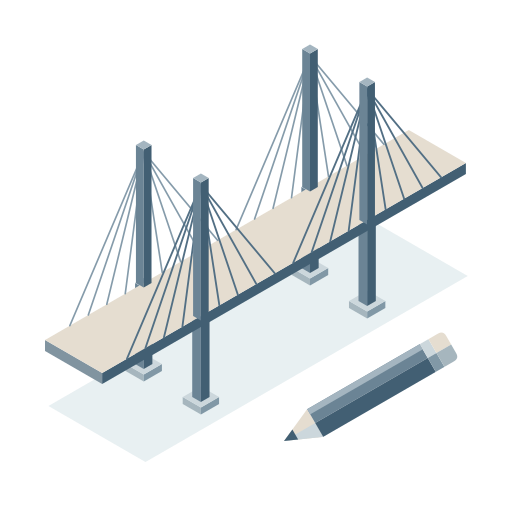
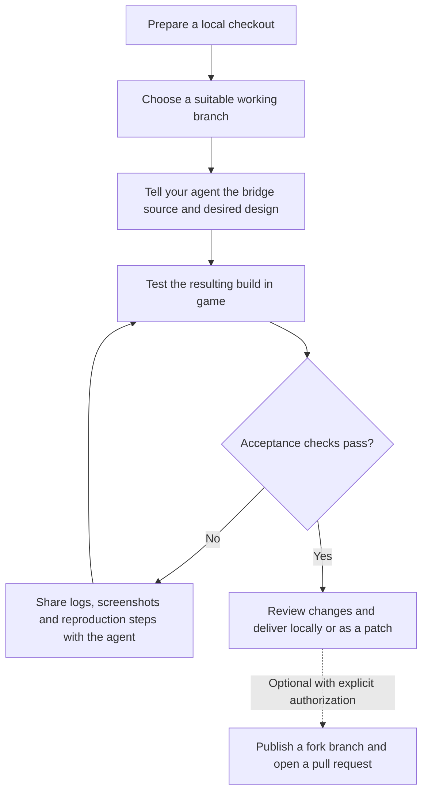

# Bridge Builder



A Cities: Skylines II mod that builds a **bridge prefab** from parts you choose: a road for the upper
deck, a bridge style to wear, and optionally something hung underneath.

The rules generation is held to are in [AGENTS.md](AGENTS.md).
Use the [documentation index](docs/README.md) to distinguish current contracts, native research
and recorded implementation evidence.

Contributors can follow [Adding a bridge style with a coding agent](#adding-a-bridge-style-with-a-coding-agent)
for the evidence, implementation and acceptance workflow.

## License

This project's original code is available under the [MIT License](LICENSE).
Game assets and third-party dependencies retain their respective licenses.

## Geometry calculation

Bridge geometry uses measured affine coefficients for X, Y and Z, stored in DLL-embedded
typed arrays and compact part recipes. Independent numerical batches and movable LOD plans
run on the CPU through `AffineGeometry`; native mesh access, materials and asset persistence
remain on the main thread. Small batches execute serially to avoid scheduling overhead.
This changes generation-time computation, not the runtime requirements of saved bridges.
See the [affine execution contract](docs/agent-contract/BRIDGE_GENERATION_CONTRACT.md#cpu-affine-geometry-execution)
and [contributor workflow](docs/Adding-Bridge-Styles-With-Coding-Agents.md#affine-matrix-generation-step).
End-to-end speed improvements require in-game measurements.

## In-game builder and identity

The floating BridgeBuilder button opens the runtime builder in a loaded game. Roads are shown as
icon-and-name cards (three per row); double-deck mode provides independent upper and lower network
lists. Bridge styles are likewise selected from prototype cards, and unavailable styles are omitted
when their providing DLC or mod is not installed. Creating a bridge publishes it into the running
prefab world. Create-and-build also activates the ordinary network construction tool; neither action
places a bridge automatically.

Every bridge created there has two deliberately separate names:

- `PrefabName`: immutable `b<UUID>` identity, for example
  `b6f9619ff-8b86-d011-b42d-00c04fc964ff`. Saved references, activation and deletion use only this key.
- registration name: the editable name shown in game. It can be duplicated or renamed without
  changing the prefab identity or reconstructing the bridge.

The management tab lists these bridges and supports activation, display-name changes and deletion.
Construction inputs are read-only after creation; changing them means creating another UUID-backed
bridge. Deleting a bridge asks for confirmation and removes its placed instances before removing its
asset record.

It is the parallel of [Road Prefab Exporter](../CS2RoadPrefabExporter) and shares its code — see
[Layout](#layout).

## One bridge at a time

There is no batch mode, and that is not a simplification of one. A bridge is a **pairing** — this
deck on top, that one underneath, in this style — and a pairing does not distribute over a list of
roads. So the page asks for the two decks explicitly and builds exactly one bridge. The road exporter
next door remains the batch tool.

## What you can pick

Each bridge style binds to a single content source for both display and generation. Base-game
variants take precedence over DLC variants, then mod variants; ties use stable source identifiers,
not translated labels. A selected unavailable prerequisite does not trigger a fallback to another
owner. The V-pylon double-deck cable-stayed bridge (`Extradosed01`) accepts base-game variants only,
never the duplicate Bridge Expansion Pack version. Existing bridge assets are unchanged.

The DLC landmark `GoldenGate` supports **single-deck generation only**. The separate Bridge Expansion
Pack style `GoldenGateDouble` uses its own double-deck archetype. Preview/export/create requests must
respect each style's supported arrangement. Existing saved bridges are not reconstructed by this rule.

Road Builder is **optional compatibility, not a required dependency**. Without it installed and
successfully loaded in the current playset, its roads are omitted from both deck selectors. Base-game
roads, pedestrian paths and tracks remain available. Cached Road Builder prefabs do not enable the
integration; standalone plain-road exports remain ordinary roads. The mod does not load or ship
RoadBuilder.dll, and Road Builder must not be declared a mandatory dependency when publishing it.

The upper and lower deck are chosen from everything registered in the loaded world:

| Kind | What it covers |
|---|---|
| Road Builder | roads generated by Road Builder, with their configuration still attached |
| Road | every other road — the game's own, a pack's, or one exported earlier by either mod |
| Train / Subway / Tram | the rail, subway and tram tracks |

Each entry is labelled with its kind, its in-game name and its measured width, because the width is
what decides which variant of the chosen style will fit.

Both deck selectors accept the supported network kinds above. Generation still requires a matching
bridge archetype and valid network data. Leaving the lower deck empty selects a single-deck bridge;
choosing the same road for both creates two independent deck networks.

**Bridges are never offered as decks.** A bridge already carries its own span behaviour, towers and
pillars; draping a second bridge over that gives two structures fighting for the same space. It also
keeps a generated bridge out of the list it came from, which would otherwise let one run's output
become the next run's input and compound the error each time. For the same reason a generated bridge
is not offered as a *style* donor either.

## Bridge styles

Styles use stable IDs and localized labels. Discovery binds installed prototype variants, while
explicit generator admission determines which styles and deck arrangements can be created.
The runtime catalogue omits unavailable styles; discovering a prototype does not add support for it.

The router includes all ten Bridges & Ports movable styles: Draw01–Draw03, Lift01–Lift05
and PedestrianDraw01/02. Registered styles use the same catalogue and operation behavior;
missing native prerequisites still prevent generation. Routing and compilation do not establish
human acceptance of every selected road, motion cycle, LOD or independent cold load.
See the [implementation record](docs/Movable-Bridges-Implementation.md) for per-style evidence
and [prepared materials](docs/Prepared-Materials.md) for unfinished material migration.

Generated towers, cables and LODs are private derived assets owned by the bridge. Required native
game/DLC resources remain prerequisites; external non-built-in dependencies are persisted as
byte-identical copies with original CIDs under the bridge's UUID directory.

### Width

Generation selects a compatible prototype variant and uses its measured geometry data. Authored
parts reaching or crossing the centre line stretch against their own span; side parts translate
rigidly. The same classification applies to every LOD. Unsupported or missing metadata causes an
explicit failure rather than an arbitrary width clamp or a fallback to another bridge design.

The [material contract](docs/agent-contract/MATERIAL_GENERATION_CONTRACT.md#2-preserve-source-resolution-and-pattern-scale)
allows verified non-tiling prototype UV mappings to stretch with that geometry while retaining
authored UVs, original textures, resolution, channels, mips and compatible material identity.
Tiling mappings retain original physical density. Evidence must identify the source, part, LOD
and affected axes; a failed mapping or missing repeat evidence does not qualify. Selected-road
appearance and marking layout retain their existing rules. This permission is not an implementation
or visual-acceptance claim.

## Double decks

Double decks use the matching archetype's `AuxiliaryNets` arrangement. The main network may be the
upper or lower deck; ownership does not determine its physical height. Deck separation and placement
come from the archetype and are not adjustable. The lower-deck direction toggle changes the selected
network's direction while preserving that arrangement. A style without a matching double-deck
archetype is refused.

Each generated deck has its own bridge-owned network copy. The auxiliary is placed with its carrier;
its independent editing and connections remain subject to the game's auxiliary-network behavior.

## Naming and repeated creation

The runtime builder and legacy options page use the same creation path. Each creation allocates a
new immutable `b<UUID>` identity, including when the selected roads and style match an existing
bridge. A suggested display name describes the pairing; it is not an overwrite key. Renaming or
switching language does not change asset identity or saved references.

## Building

```powershell
tools\Build.ps1
```

```powershell
tools\Install.ps1
```

`Build.ps1` compiles the checked-in source snapshot at `vendor/CS2ModShared/src` and verifies its
SHA-256 manifest with `tools/CheckSharedSources.ps1`. A sibling repository is not needed. The script
resolves the installed game assemblies; pass `-GameDir` to override. Game assemblies and the .NET SDK
are still external build prerequisites; the shared snapshot alone does not pin those versions.

## Layout

```
CS2ModShared/               shared - discovery, cloning, asset IO, speed-limit correction, status model
CS2RoadPrefabExporter/      exports Road Builder roads as plain roads, in batches
CS2BridgeBuilder/            this repository
```

The shared code is **compiled into** each mod rather than referenced as an assembly: its types are
`internal`, and a CS2 mod ships as a single DLL. The one thing it needs from its host — an id, a log,
a page-rebuild callback and the export naming policy — comes through `ModHost`.

The sibling projects describe the source family. This checkout builds from its own reviewed snapshot; see `vendor/CS2ModShared/README.md` for update instructions.

## Reports

Every run writes `ModsData\BridgeBuilder\last-export-report.txt`, including the structural
counts that separate "the deck came out wrong" from "the style did not attach": sections, overhead
sections, sub-objects and auxiliary nets. Generation and preview failures are recorded with their underlying diagnostics and shown
through localized operation-failure dialogs. The preview frame remains text-free; deletion
failures retain their operation diagnostics.

The log line `Bridge styles: N of M available, from D donor prefab(s) out of K bridge-capable
prefab(s)`, followed by one line per style, is the authoritative record of what discovery bound.

## What the composer does not touch

Preserve the selected road's lane layout, upgrade alternatives and native semantics. Fixed
bridge composition retains unchanged section references; movable generation derives the
necessary section conditions and visible object geometry under the movable contract.

An earlier version also appended the donor's elevated-only sections, to pick up the deck edges. That
is the one operation that changes how the net tiles across its own width — the composition system
lays sections side by side and computes their offsets, so sections authored for a different net at a
different width are not decoration but a second, conflicting layout. Everything the composer still
copies is additive: drawn above the deck, or anchored alongside it.

Fixed spans are copied only when the deck has sections that respond to the states they set. A fixed
segment declares "this span is N metres and sets state X"; the sections that answer X stay with the
donor, so copying the declaration alone lays the structure out around a main span that is never
built - which is what "placed, but the parts did not join up" looks like. Deck props anchored to a
fixed span go with them: `m_FixedIndex` is read by a compiled job with no bounds check, so an index
past the end of the array is not an exception but a hard crash.

Donor selection ranks by kind before width: a road deck prefers a road donor over a track one, and a
single-deck bridge prefers a single-deck donor. Width alone once picked a double-deck *train* bridge
to drape over a road, because it happened to be the closest match in metres.

### Geometry fitting

Every style routes to its own generator. Towers, cable pieces and LODs are private derived assets
owned by the generated bridge. The selected road supplies its network structure; bridge behavior,
components, materials and placement follow the matching archetype.

Recorded authored parts that reach the centre line stretch across their own span. Side parts move
rigidly by half the width change. Full-detail geometry and every LOD use the same part classification.
Missing supported metadata is a generation failure, not permission to guess a different bridge.
Game assets and derived content remain subject to their original licenses.

### Creation durability and recovery

Creation reserves a UUID in memory and stores incomplete-creation metadata on the bridge root asset.
The catalogue commits the bridge after native publication succeeds. Bridge metadata is asset-local;
there is no separate bridge registry file or registration guard rejecting native loads.

Startup self-check waits for native loading, mod initialization and PDX asset batches. It attempts
migration first, preserving UUID/CID and valid data. Failed or impossible migration enters UUID-scoped
backup/removal; backup failure falls back to deleting the remaining selected source files. Actual
removal failures are reported. Persistent changes require restart; self-check does not unregister
live prefabs. See contract sections 17–19 for persistence, ownership and migration requirements.

### Source layout and checks

`BridgeGenerationSystem` is split into lifecycle/catalogue, composition, preview, management
and removal partial files. Source-policy checks read all these files together.

Non-visual checks include `tools/AssetMetadataCheck`, `tools/DependencyCopyCheck`,
`tools/DependencySourceCheck`, `tools/SelfCheckLifecycleCheck`, `tools/DiskAuditCheck`,
`tools/PublicationCheck`, and `tools/Check*.mjs` (UI,
localization and source policy). Preview/generation failures use localized failure dialogs
and ERROR diagnostics; the preview itself has no inline error footer. Deletion failures
retain their operation diagnostics.

These checks and a successful build do not establish in-game visual correctness or save compatibility.

<!-- BEGIN BRIDGE STYLE CONTRIBUTOR GUIDE -->
## Adding a bridge style with a coding agent

This guide helps contributors extend Bridge Builder with a measured bridge archetype. A new style
requires a working generator, compatible persisted assets and human in-game acceptance; adding a
catalogue entry alone is not sufficient. You provide the design and test it in game; your coding
agent handles implementation and reads the repository instructions. Local delivery is sufficient;
GitHub publication is optional and does not require upstream write access when using a fork.

### Contribution workflow



### 1. Prepare the repository and evidence

Use a local checkout with the game and its required DLC or source asset installed, a working .NET
build environment, and a disposable test city. Back up saves and existing bridge assets.
You do not need to read AGENTS.md or the internal contracts; ask your coding agent to read and follow them.
The workflow requires game shutdown before replacing loaded binaries during deployment;
save your work before that step. Intermediate source edits do not require shutdown. Computer-use automation and agent-driven bridge placement are prohibited in this project.

Give the agent these inputs:

- A stable English style ID and the intended single-deck or double-deck capability.
- Exact prototype Prefab names and their source: base game, named DLC, or mod ID, with the
  corresponding game/mod version and any available CID evidence.
- Prefab anatomy, mesh and LOD data, plus screenshots of the prototype at near and far distances.
- Measured road and structure boundaries, tower placement, cables, railings, lights, materials,
  unlock conditions and native cost components.
- For double-deck styles, the real prototype's `AuxiliaryNets` arrangement and deck separation.

Do not ask the agent to infer dimensions from a screenshot or borrow another family's constants.
When evidence is missing, it should identify the missing data and complete independent work first.

Use a local copy of [CS2BridgeBuilder](https://github.com/Chengxuan-He/CS2BridgeBuilder).
A GitHub account or fork is not required; create a fork only if you choose to contribute through GitHub.
Use a suitable working branch. A per-style `bridge/<bridge-name>` branch, such as
`bridge/stone-arch`, is optional. Shared multi-style work may use one branch while keeping
style data distinct. Preserve unrelated local changes. Optional branch creation:

```powershell
git switch -c bridge/stone-arch
```

### 2. Start with a concrete prompt

Replace the angle-bracket placeholders before giving this prompt to your coding agent:

For `<source and version>`, explicitly identify where the prototype comes from. Use one of these
formats; do not provide only the bridge's display name:

| Prototype source | What to enter |
| --- | --- |
| Base game | `Base game; Cities: Skylines II version <game version>` |
| DLC | `DLC: <exact DLC name>; Cities: Skylines II version <game version>` |
| Mod | `Paradox Mods ID: <numeric mod ID>; mod name: <name>; mod version: <version>; game version: <game version>` |

For mod-provided prototypes, include the mod page link when available. If a version is unknown,
say so rather than guessing. Include any additional required DLC or mods separately.

```text
Add support for <style ID> using <exact prototype Prefab> from <source and version>.
Support <single deck / double deck>; use a suitable working branch (a style branch is optional).
Evidence is available at <paths to anatomy, mesh/LOD exports and screenshots>.

Read AGENTS.md, the complete project contract and applicable nested instructions.
Inspect the existing generation, preview, localization, persistence and migration paths.
Use the simplest existing extension points. Record measured parameters for this archetype;
do not copy another style's constants or infer part identity in runtime code.
Keep generated bridges independent of Bridge Builder and preserve native pricing/unlocks.
Do not use other bridges' ImportedData Prefabs as creation or copy sources.

Follow contract section 12's optional branch policy and keep the style ID stable.
Implement the style, build and install it locally according to the repository workflow,
and report exact changes, evidence, checks and outstanding manual acceptance steps.
Deliver the changes locally with a review summary. Do not push to GitHub, publish to Paradox Mods
or modify existing bridge identities. I will create the test bridges
and provide near/far screenshots and cold-start results for visual acceptance.
```

### 3. Trace the existing extension points

The following paths describe the current implementation, not a requirement to edit every file.
Ask your agent to trace callers and consumers before choosing the smallest change. Use this table
to understand its proposal and review the resulting changes.

| Responsibility | Entry point |
| --- | --- |
| Stable IDs, patterns, supported deck modes and explicit generator admission | [BridgeStyleDefinitions.cs](src/BridgeBuilder/Bridges/BridgeStyleDefinitions.cs) |
| Discovery and binding installed prototype variants | [BridgeStyleCatalog.cs](src/BridgeBuilder/Bridges/BridgeStyleCatalog.cs) |
| Prototype availability and provenance | [BridgePrototypeSource.cs](src/BridgeBuilder/Bridges/BridgePrototypeSource.cs) |
| Route a selected style to its generator | [BridgeGeneratorRouter.cs](src/BridgeBuilder/Bridges/BridgeGeneratorRouter.cs) |
| Per-style implementations and immutable geometry data | [Types directory](src/BridgeBuilder/Bridges/Types) |
| Shared generation and double-deck composition | [Common directory](src/BridgeBuilder/Bridges/Common) |
| Recorded dimensions and tower/cable behavior | [BridgeMeasurements.cs](src/BridgeBuilder/Bridges/BridgeMeasurements.cs), [BridgeTowers.cs](src/BridgeBuilder/Bridges/BridgeTowers.cs), [BridgeCables.cs](src/BridgeBuilder/Bridges/BridgeCables.cs) |
| Offline part identification and generated geometry tables | [GeometryMetaprogram](tools/GeometryMetaprogram) |
| Localized style labels | [UiStringTables.Styles.cs](src/BridgeBuilder/Settings/UiStringTables.Styles.cs) |
| Creation integration | [BridgeGenerationSystem.Composition.cs](src/BridgeBuilder/Systems/BridgeGenerationSystem.Composition.cs) |
| Dependency persistence and native presentation | [BridgeDependencyPersistence.cs](src/BridgeBuilder/Runtime/BridgeDependencyPersistence.cs), [BridgeNativePresentation.cs](src/BridgeBuilder/Runtime/BridgeNativePresentation.cs) |

A small style generator can reuse `BridgeGeneratorBase`, as existing wrappers do, only when its
archetype behavior is already supported and measured. A matching name or successful discovery does
not establish that. Register the route and supported deck modes consistently; unsupported designs
must fail explicitly rather than silently generating a different family.

Provide labels in every supported UI language. The current admission rule also checks for a Chinese
display name independently of the active locale. Keep style IDs unlocalized and the mod metadata
title exactly `Bridge Builder`. Check catalogue cards, preview selection and actual creation together.

Bridge generation contract section 22 requires immediate UI synchronization and connection of each new bridge
style to the generator router, with multilingual style names in the same implementation increment.
Include the creation-list entry, search/filter behavior,
preview, both creation actions and management labels. Verify all supported locales and live language
changes; the existing Chinese-name admission check alone does not establish translation coverage.
A working generator without its working UI entry is not a completed contribution.

#### Affine matrix generation step

Use the [CPU affine execution contract](docs/agent-contract/BRIDGE_GENERATION_CONTRACT.md#cpu-affine-geometry-execution)
for every style's coordinate stage:

1. Extract measured origins, coefficient rows, parameter domains and part membership offline.
   Each of X, Y and Z may depend on width; a constant axis has zero coefficients.
2. Store numerical values in the existing DLL-embedded typed arrays. Sparse vertex weights and
   part ranges are valid matrix representations; the BBN1 format need not change or expand to
   dense matrices. Preserve float bits, anchors and evaluation order.
3. Snapshot native mesh inputs on the main thread. Evaluate independent coordinate ranges with
   `AffineGeometry.For`, source-only sparse assignments with `Scatter`, and repeated additive
   index recipes with `Indices`. Use `Row`/`Matrix` for general XYZ parameter mappings and the
   specialized scalar kernels where appropriate. Retain dependent stage ordering.
4. Shared movable assembly schedules independent LOD plans with `Groups`, waits for completion,
   then creates native render assets on the main thread. Do not put Mesh, Prefab, material or
   persistence API calls into numerical workers. Small batches and nested work stay serial.
5. After regenerating recipes, review the [offline lowering pass](tools/AffineGeometryMigration/README.md)
   and preserve manual coefficient caches and snapshot boundaries. Run `AffineGeometryCheck`,
   resource integrity checks, affected geometry/LOD regressions and localization checks.
   Compare actual cold/warm preview and creation timings before claiming an acceleration.

The implementation entry points are [AffineGeometry.cs](src/BridgeBuilder/Bridges/AffineGeometry.cs),
[HardcodedNumbers.cs](src/BridgeBuilder/Bridges/HardcodedNumbers.cs) and
[MovableRenderAssembly.cs](src/BridgeBuilder/Bridges/Common/Movable/MovableRenderAssembly.cs).
This stage changes computation only: preserve topology, native bone ownership, material/UV
semantics and independent asset persistence.

### 4. Measure geometry before implementing transforms

Identify authored parts offline using the highest-detail prototype. Record exact mesh/LOD identity
and part membership as immutable data; runtime code consumes this data without rediscovering parts
from bounds, topology, thresholds or name resemblance.

- Apply contract section 8's explicit base, centred-post and Draw03 truss rules and section 5's
  measured Golden mappings; otherwise a part
  reaching or crossing `x = 0` stretches against its own span and a side part translates rigidly.
- Preserve tower height/depth outside the measured Golden ornament exception, side-part thickness
  and native behavior. Apply only the contracts' scoped topology, native representation and
  UV/material rules, including the verified prototype non-tiling exception.
- Carry the highest-detail classification to all LODs. Repoint derived LOD references to derived meshes.
- Preserve prototype placement, stacking, tiling, lights and their parent relationships.
- Apply the contract's separate base and pier rules using structural evidence, not names.
- Derive a double-deck style from a real double-deck prototype; retain its separation and orientation.

Consult existing metaprogram modes in `tools/GeometryMetaprogram/Program.cs`; there is no universal
command that measures and implements an arbitrary style automatically. Do not change a generated
table without retaining the source evidence and documenting how to reproduce it.

For the width audit, compare a real prototype with a real newly generated bridge. Measure complete
left-to-right spans (`maxX - minX`) on the same basis. Ask your agent to perform and document the
required width calculation using the project's binary32 rules.
The human creates the sample. A missing sample means the audit is incomplete, and a discrepancy
outside the contract's allowed range needs investigation rather than a guessed correction.

### 5. Keep persistence compatible

Use the existing naming, layout and native persistence helpers. Bridge asset ownership is determined
by `b{uuid}` in the path, not metadata. Generated components must carry their bridge UUID. Do not
truncate it or invent a separate registration store.

External dependency snapshots retain original bytes and CIDs, deduplicated within one bridge and
stored separately for different bridges. Stop traversal at built-in resources. Never select another
Bridge Builder bridge's Prefab from `ImportedData`, even if its CID matches and its file is readable.
Use original or otherwise permitted sources and fail explicitly if none is available.

Persist native unlock conditions, prices, names, descriptions and icons. Do not save Bridge Builder
component types, custom UI-host requirements or third-party editor-only components as runtime
requirements. Preserve native pricing rather than introducing price-only copies or runtime overrides.
The known double-deck rail-seam compatibility limitation still requires explicit testing and disclosure.

If a style change affects existing assets, trace self-check migration as well. Complete missing fields
individually, preserve bridge/deck UUID and CID, and use the same layout as new generation. Successful
migration must be idempotent. Failed migration follows the contract's backup/move and deletion fallback;
do not use self-check to unregister live Prefabs. Persistent migration requires a restart.

### 6. Build, deploy and verify

From the repository root, the build entry point is:

```powershell
.\tools\Build.ps1 -Configuration Release
```

Use `-GameDir` if automatic game discovery does not find the installation. Follow contract section 13
for shutdown, backup, recovery and installation. Preserve healthy bridges when generation code
changes. Only a demonstrated incompatibility permits recovery of the affected style/UUID-owned
assets; preserve unrelated bridges and dependencies. Trace shared-code impacts before recovery.

If bridge-generation code did not change, remove no existing bridges. Documentation-only edits
require no shutdown, cleanup, build or deployment. Preserve diagnostic evidence before scoped cleanup
and verify both removal of selected assets and retention of unaffected assets. Verify installed files
against the build output. Deployment does not authorize publishing to GitHub or Paradox Mods.

Run relevant existing nonvisual checks for naming, source selection, persistence, localization,
unlocking and native pricing when those paths change. Unit tests do not validate visual geometry and
must not replace the contract's human near/far inspection. Do not add tests that merely duplicate the
implementation or claim a build proves appearance.

Test the following in your local game and give the results to your agent:

1. The intended style is discoverable with required native content and packaged resources available.
   Players need not own identical original prototype files; missing required resources fail explicitly.
2. Creation and placement work at prototype and wider widths, including supported asymmetric
   roads and both deck directions. Movable bridges have no special narrow-road adaptation gate.
3. Towers, deck, cables, railings, lights and materials remain correct up close and through LOD changes.
4. Native unlock conditions, construction cost, labels, descriptions and icons are correct.
5. Saving, exiting and cold-start loading preserve geometry and references; healthy self-check is inert.
6. With Bridge Builder disabled, persisted bridges remain available and usable; retain required native
   game/DLC resources. Separately test any known rail-seam limitation.
7. When applicable, legacy migration preserves identity and a second check makes no further changes.

### 7. When the generated bridge does not match your expectations

Tell your agent what you expected, what actually happened and how to reproduce it. Identify the
affected part rather than saying only "the bridge looks wrong." For example: "The right tower leg
becomes thicker on a wider road; it should move outward without changing thickness." Describe the
observation without assuming its cause.

Attach a screenshot of the prototype and a comparable screenshot of the generated bridge. For an
LOD issue, include both near and far views. Provide the selected road or track, deck mode, width,
elevation, bridge UUID if known, and whether the problem occurs immediately or only after reloading.
Include the relevant log and export report if available; a visual defect can occur without a logged
error. Save your city before requesting another code change, because deployment stops the game before replacing loaded binaries.

Use this follow-up prompt:

```text
The generated <style ID> bridge does not match the expected result.
Prototype: <exact Prefab name>.
Source and version: <base game + game version / DLC name + game version /
Paradox Mods ID + mod name + mod version + game version>.
Contribution branch: bridge/<bridge-name>.

Expected: <describe the correct appearance or behavior of the affected part>.
Actual: <describe the difference, including which side, part or viewing distance is affected>.
Steps to reproduce: <selected road/track, deck mode, width, elevation and placement steps>.
Timing: <immediately after creation / after save and reload / after a cold start>.
Evidence: <prototype and generated screenshots, logs, export report and bridge UUID if available>.
Last working result, if known: <build/commit and what changed since then>.

Compare the generated bridge with this exact prototype and identify the cause from evidence.
Check the affected components, references, materials and all LODs; do not guess a geometric
correction or borrow another style's measurements. Preserve unrelated working behavior and
existing bridge identities. Implement the smallest justified fix, check affected callers,
build and install it locally, and explain what I should retest in game.
If evidence is missing, tell me exactly which screenshot, log or measurement you need.
Do not publish a release or push to GitHub. I will verify the local result.
```

After testing the next build, report whether the same reproduction steps now pass and attach new
screenshots. If the defect persists, explicitly say it is the same issue and retain the previous
evidence so your agent can compare attempts instead of repeating an unsupported explanation.

### 8. Deliver locally; optionally submit a GitHub pull request

Deliver a reviewed local working tree or patch with the evidence and verification summary below.
No GitHub account, upload or pull request is required to complete development.

If you explicitly choose GitHub contribution and have permission to publish to your fork, you may
upload the contribution branch and open a pull request. The following commands are optional, not
automatic agent actions; stage only files belonging to the contribution:

```powershell
git commit -m "Add stone arch bridge style"
git push -u origin bridge/stone-arch
```

In GitHub, select your fork's `bridge/stone-arch` as the compare branch. Select the upstream target
branch requested by the maintainers; if none has been specified, use the repository's default branch.
Do not push changes to every upstream branch or upload a release to Paradox Mods. Maintainers review,
merge and publish accepted contributions.

Include the following in the local handoff or optional pull request:

- The bridge style and supported deck modes, with required DLC or source assets.
- A short explanation of the implementation and any shared code it changes.
- Prototype measurements and reproducible evidence, without redistributing assets you lack permission to share.
- Near/far screenshots and results for creation, save/load and cold-start testing.
- Build and nonvisual checks actually completed, plus known limitations and unfinished checks.
- Any effect on existing bridges and how migration preserves their identity.

Have your agent help summarize the changes, but review the code and verify its claims before
delivery. A successful build is not evidence that a bridge looks correct or survives a restart.
Address review feedback locally; update a remote pull request only if that optional workflow was chosen.
<!-- END BRIDGE STYLE CONTRIBUTOR GUIDE -->
