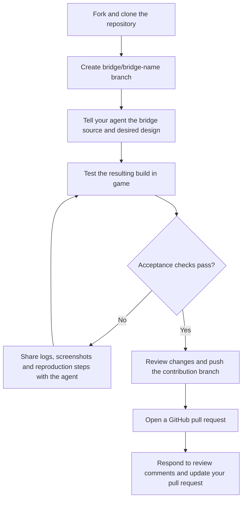

# Adding a bridge style with a coding agent

This guide helps contributors extend Bridge Builder with a measured bridge archetype. A new style
requires a working generator, compatible persisted assets and human in-game acceptance; adding a
catalogue entry alone is not sufficient. You provide the design, test it in game and submit a GitHub
pull request; your coding agent handles the implementation and reads the repository instructions.

## Contribution workflow



## 1. Prepare the repository and evidence

Use a local checkout with the game and its required DLC or source asset installed, a working .NET
build environment, and a disposable test city. Back up saves and existing bridge assets.
You do not need to read AGENTS.md or the internal contracts; ask your coding agent to read and follow them.
The workflow requires forced game shutdown before code edits and before deployment, so save your
work first. Computer-use automation and agent-driven bridge placement are prohibited in this project.

Give the agent these inputs:

- A stable English style ID and the intended single-deck or double-deck capability.
- Exact prototype Prefab names and their source: base game, named DLC, or mod ID, with the
  corresponding game/mod version and any available CID evidence.
- Prefab anatomy, mesh and LOD data, plus screenshots of the prototype at near and far distances.
- Measured road and structure boundaries, tower placement, cables, railings, lights, materials,
  unlock conditions and native cost components.
- For double-deck styles, the real prototype's `AuxiliaryNets` arrangement and deck separation.

Do not ask the agent to infer dimensions from a screenshot or borrow another family's constants.
When evidence is missing, it should identify the missing data and complete independent work first.

Fork [CS2BridgeBuilder](https://github.com/Chengxuan-He/CS2BridgeBuilder) on GitHub and clone your fork.
Create a contribution branch named `bridge/<bridge-name>`, for example `bridge/stone-arch`.
Replace `<bridge-name>` with the name of the bridge you are adding. Keep the change focused on that
bridge and leave unrelated local changes out of the contribution.

```powershell
git switch -c bridge/stone-arch
```

## 2. Start with a concrete prompt

Replace the angle-bracket placeholders before giving this prompt to your coding agent:

For `<source and version>`, explicitly identify where the prototype comes from. Use one of these
formats; do not provide only the bridge's display name:

| Prototype source | What to enter |
| --- | --- |
| Base game | `Base game; Cities: Skylines II version <game version>` |
| DLC | `DLC: <exact DLC name>; Cities: Skylines II version <game version>` |
| Mod | `Paradox Mods ID: <numeric mod ID>; mod name: <name>; mod version: <version>; game version: <game version>` |

For mod-provided prototypes, include the mod page link when available. If a version is unknown,
say so rather than guessing. Include any additional required DLC or mods separately.

```text
Add support for <style ID> using <exact prototype Prefab> from <source and version>.
Support <single deck / double deck>; use contribution branch bridge/<bridge-name>.
Evidence is available at <paths to anatomy, mesh/LOD exports and screenshots>.

Read AGENTS.md, the complete project contract and applicable nested instructions.
Inspect the existing generation, preview, localization, persistence and migration paths.
Use the simplest existing extension points. Record measured parameters for this archetype;
do not copy another style's constants or infer part identity in runtime code.
Keep generated bridges independent of Bridge Builder and preserve native pricing/unlocks.
Do not use other bridges' ImportedData Prefabs as creation or copy sources.

Use the bridge/<style-slug> branch required by contract section 12; keep the style ID stable.
Implement the style, build and install it locally according to the repository workflow,
and report exact changes, evidence, checks and outstanding manual acceptance steps.
Prepare the changes for a GitHub pull request. Do not publish to Paradox Mods or modify existing
bridge identities. I will create the test bridges
and provide near/far screenshots and cold-start results for visual acceptance.
```

## 3. Trace the existing extension points

The following paths describe the current implementation, not a requirement to edit every file.
Ask your agent to trace callers and consumers before choosing the smallest change. Use this table
to understand its proposal and review the resulting changes.

| Responsibility | Entry point |
| --- | --- |
| Stable IDs, patterns, supported deck modes and explicit generator admission | [BridgeStyleDefinitions.cs](../src/BridgeBuilder/Bridges/BridgeStyleDefinitions.cs) |
| Discovery and binding installed prototype variants | [BridgeStyleCatalog.cs](../src/BridgeBuilder/Bridges/BridgeStyleCatalog.cs) |
| Prototype availability and provenance | [BridgePrototypeSource.cs](../src/BridgeBuilder/Bridges/BridgePrototypeSource.cs) |
| Route a selected style to its generator | [BridgeGeneratorRouter.cs](../src/BridgeBuilder/Bridges/BridgeGeneratorRouter.cs) |
| Per-style implementations and immutable geometry data | [Types directory](../src/BridgeBuilder/Bridges/Types) |
| Shared generation and double-deck composition | [Common directory](../src/BridgeBuilder/Bridges/Common) |
| Recorded dimensions and tower/cable behavior | [BridgeMeasurements.cs](../src/BridgeBuilder/Bridges/BridgeMeasurements.cs), [BridgeTowers.cs](../src/BridgeBuilder/Bridges/BridgeTowers.cs), [BridgeCables.cs](../src/BridgeBuilder/Bridges/BridgeCables.cs) |
| Offline part identification and generated geometry tables | [GeometryMetaprogram](../tools/GeometryMetaprogram) |
| Localized style labels | [UiStringTables.Styles.cs](../src/BridgeBuilder/Settings/UiStringTables.Styles.cs) |
| Creation integration | [BridgeGenerationSystem.Composition.cs](../src/BridgeBuilder/Systems/BridgeGenerationSystem.Composition.cs) |
| Dependency persistence and native presentation | [BridgeDependencyPersistence.cs](../src/BridgeBuilder/Runtime/BridgeDependencyPersistence.cs), [BridgeNativePresentation.cs](../src/BridgeBuilder/Runtime/BridgeNativePresentation.cs) |

A small style generator can reuse `BridgeGeneratorBase`, as existing wrappers do, only when its
archetype behavior is already supported and measured. A matching name or successful discovery does
not establish that. Register the route and supported deck modes consistently; unsupported designs
must fail explicitly rather than silently generating a different family.

Provide labels in every supported UI language. The current admission rule also checks for a Chinese
display name independently of the active locale. Keep style IDs unlocalized and the mod metadata
title exactly `Bridge Builder`. Check catalogue cards, preview selection and actual creation together.

Bridge generation contract section 22 requires immediate UI synchronization and connection of each new bridge
style to the generator router, with multilingual style names in the same implementation increment.
Include the creation-list entry, search/filter behavior,
preview, both creation actions and management labels. Verify all supported locales and live language
changes; the existing Chinese-name admission check alone does not establish translation coverage.
A working generator without its working UI entry is not a completed contribution.

## 4. Measure geometry before implementing transforms

Identify authored parts offline using the highest-detail prototype. Record exact mesh/LOD identity
and part membership as immutable data; runtime code consumes this data without rediscovering parts
from bounds, topology, thresholds or name resemblance.

- A part reaching or crossing `x = 0` stretches against its own span. A side part translates rigidly.
- Preserve tower height and depth, side-part thickness, vertex formats, indices, materials and behavior.
- Carry the highest-detail classification to all LODs. Repoint derived LOD references to derived meshes.
- Preserve prototype placement, stacking, tiling, lights and their parent relationships.
- Apply the contract's separate base and pier rules using structural evidence, not names.
- Derive a double-deck style from a real double-deck prototype; retain its separation and orientation.

Consult existing metaprogram modes in `tools/GeometryMetaprogram/Program.cs`; there is no universal
command that measures and implements an arbitrary style automatically. Do not change a generated
table without retaining the source evidence and documenting how to reproduce it.

For the width audit, compare a real prototype with a real newly generated bridge. Measure complete
left-to-right spans (`maxX - minX`) on the same basis. Ask your agent to perform and document the
required width calculation using the project's binary32 rules.
The human creates the sample. A missing sample means the audit is incomplete, and a discrepancy
outside the contract's allowed range needs investigation rather than a guessed correction.

## 5. Keep persistence compatible

Use the existing naming, layout and native persistence helpers. Bridge asset ownership is determined
by `b{uuid}` in the path, not metadata. Generated components must carry their bridge UUID. Do not
truncate it or invent a separate registration store.

External dependency snapshots retain original bytes and CIDs, deduplicated within one bridge and
stored separately for different bridges. Stop traversal at built-in resources. Never select another
Bridge Builder bridge's Prefab from `ImportedData`, even if its CID matches and its file is readable.
Use original or otherwise permitted sources and fail explicitly if none is available.

Persist native unlock conditions, prices, names, descriptions and icons. Do not save Bridge Builder
component types, custom UI-host requirements or third-party editor-only components as runtime
requirements. Preserve native pricing rather than introducing price-only copies or runtime overrides.
The known double-deck rail-seam compatibility limitation still requires explicit testing and disclosure.

If a style change affects existing assets, trace self-check migration as well. Complete missing fields
individually, preserve bridge/deck UUID and CID, and use the same layout as new generation. Successful
migration must be idempotent. Failed migration follows the contract's backup/move and deletion fallback;
do not use self-check to unregister live Prefabs. Persistent migration requires a restart.

## 6. Build, deploy and verify

From the repository root, the build entry point is:

```powershell
.\tools\Build.ps1 -Configuration Release
```

Use `-GameDir` if automatic game discovery does not find the installation. Follow contract section 13
for shutdown, backup, cleanup and installation. A bridge-generation change removes all mod-created
bridges only for its affected style IDs, including their UUID-owned dependencies. Preserve all other
styles. For example, a `GoldenGate`-only change removes `GoldenGate` bridges, not `GoldenGateDouble`
or other suspension bridges. Trace the affected styles when shared generation code changes.

If bridge-generation code did not change, remove no existing bridges. Documentation-only edits
require no shutdown, cleanup, build or deployment. Preserve diagnostic evidence before scoped cleanup
and verify both removal of selected assets and retention of unaffected assets. Verify installed files
against the build output. Deployment does not authorize publishing to GitHub or Paradox Mods.

Run relevant existing nonvisual checks for naming, source selection, persistence, localization,
unlocking and native pricing when those paths change. Unit tests do not validate visual geometry and
must not replace the contract's human near/far inspection. Do not add tests that merely duplicate the
implementation or claim a build proves appearance.

Test the following in your local game and give the results to your agent:

1. The intended style is discoverable only with its required prototype available; unsupported modes
   and unavailable sources report clear errors.
2. Creation and placement work at prototype, wider and narrower road widths, including supported
   asymmetric roads and both deck directions where relevant.
3. Towers, deck, cables, railings, lights and materials remain correct up close and through LOD changes.
4. Native unlock conditions, construction cost, labels, descriptions and icons are correct.
5. Saving, exiting and cold-start loading preserve geometry and references; healthy self-check is inert.
6. With Bridge Builder disabled, persisted bridges remain available and usable; retain required native
   game/DLC resources. Separately test any known rail-seam limitation.
7. When applicable, legacy migration preserves identity and a second check makes no further changes.

## 7. When the generated bridge does not match your expectations

Tell your agent what you expected, what actually happened and how to reproduce it. Identify the
affected part rather than saying only "the bridge looks wrong." For example: "The right tower leg
becomes thicker on a wider road; it should move outward without changing thickness." Describe the
observation without assuming its cause.

Attach a screenshot of the prototype and a comparable screenshot of the generated bridge. For an
LOD issue, include both near and far views. Provide the selected road or track, deck mode, width,
elevation, bridge UUID if known, and whether the problem occurs immediately or only after reloading.
Include the relevant log and export report if available; a visual defect can occur without a logged
error. Save your city before requesting another code change, because the agent's workflow stops the game.

Use this follow-up prompt:

```text
The generated <style ID> bridge does not match the expected result.
Prototype: <exact Prefab name>.
Source and version: <base game + game version / DLC name + game version /
Paradox Mods ID + mod name + mod version + game version>.
Contribution branch: bridge/<bridge-name>.

Expected: <describe the correct appearance or behavior of the affected part>.
Actual: <describe the difference, including which side, part or viewing distance is affected>.
Steps to reproduce: <selected road/track, deck mode, width, elevation and placement steps>.
Timing: <immediately after creation / after save and reload / after a cold start>.
Evidence: <prototype and generated screenshots, logs, export report and bridge UUID if available>.
Last working result, if known: <build/commit and what changed since then>.

Compare the generated bridge with this exact prototype and identify the cause from evidence.
Check the affected components, references, materials and all LODs; do not guess a geometric
correction or borrow another style's measurements. Preserve unrelated working behavior and
existing bridge identities. Implement the smallest justified fix, check affected callers,
build and install it locally, and explain what I should retest in game.
If evidence is missing, tell me exactly which screenshot, log or measurement you need.
Do not publish a release. I will verify the result before updating the pull request.
```

After testing the next build, report whether the same reproduction steps now pass and attach new
screenshots. If the defect persists, explicitly say it is the same issue and retain the previous
evidence so your agent can compare attempts instead of repeating an unsupported explanation.

## 8. Submit a GitHub pull request

Contributors do not need mod publishing permissions. Upload your code to the
`bridge/<bridge-name>` branch in your fork, then open a pull request against the upstream repository.
For example, after reviewing the changes and staging only files belonging to your contribution:

```powershell
git commit -m "Add stone arch bridge style"
git push -u origin bridge/stone-arch
```

In GitHub, select your fork's `bridge/stone-arch` as the compare branch. Select the upstream target
branch requested by the maintainers; if none has been specified, use the repository's default branch.
Do not push changes to every upstream branch or upload a release to Paradox Mods. Maintainers review,
merge and publish accepted contributions.

Include the following in your pull request:

- The bridge style and supported deck modes, with required DLC or source assets.
- A short explanation of the implementation and any shared code it changes.
- Prototype measurements and reproducible evidence, without redistributing assets you lack permission to share.
- Near/far screenshots and results for creation, save/load and cold-start testing.
- Build and nonvisual checks actually completed, plus known limitations and unfinished checks.
- Any effect on existing bridges and how migration preserves their identity.

Have your agent help summarize the changes, but review the code and verify its claims before
submitting. A successful build is not evidence that a bridge looks correct or survives a restart.
Respond to review feedback with further commits on the same `bridge/<bridge-name>` branch.
