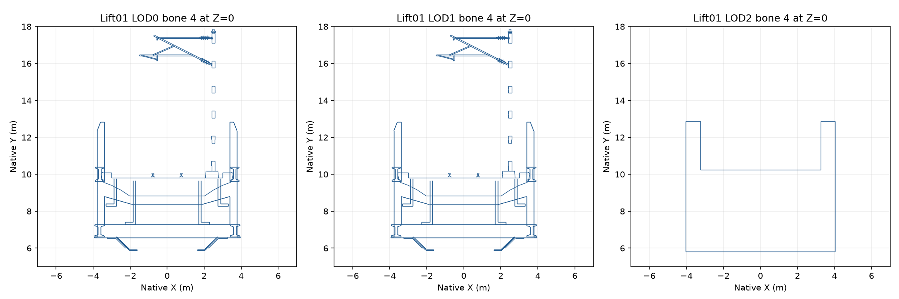

# Lift01 native deck cross-section review

## Actual geometry inspected

The image intersects bone-4 triangles of mesh 0 at Z=0 for all three native LODs.
Positions and indices come from compressed Geometry files through the native decoder;
bone membership comes from the topology-matched native OBJ export. This is an archetype
inspection, not a generated bridge or synthetic test mesh. The plotted range concentrates
on the deck and does not classify the entire mechanism.

Near and middle LODs retain rails, lower structure, separate side profiles and overhead
equipment. The far mesh reduces these to a continuous coarse shell. Its visible inner top
is sloped longitudinally, explaining why the preceding exact-horizontal candidate scan
could not identify a large flat moving-road group at the near datum.

## Far inner-top evidence

Source: `LiftBridge01_LOD2 Mesh.Geometry`, mesh 0; SHA-256
`a634d30d56089487f0a4fbd1d6f7dfbe3644c99f5b447b4a6658e4db282fd925`.
The inner top comprises triangle ordinals 342, 343, 730 and 731, all assigned to bone 4.

| Station | X boundaries | Y | Z |
| --- | --- | --- | --- |
| Center | -3.245361328125, +3.245361328125 | 10.240234375 | 6.270347739298354e-16 |
| Positive end | -3.28533935546875, +3.28533935546875 | 10.2001953125 | 80.1796875 |
| Negative end | -3.28533935546875, +3.28533935546875 | 10.2001953125 | -80.1796875 |

Each inner-top triangle spans Y by exactly 0.0400390625 m in its stored vertex positions.
The tiny authored center Z is preserved in this evidence rather than rewritten to zero.
The inspection plane is Z=0; intersections, not an exact-zero vertex test, produce the
cross-section image.

## Replacement implication

The near road plane candidate is at Y=9.800048828125, while the far inner top is higher
and meets retained shell edges at its own elevations. A simple top-face deletion followed
by inserting near-height selected-road geometry does not establish a closed far shell.
The final plan needs explicit generated road-side closure or another measured road-owned
representation that preserves carried structural channels and topology. Moving the native
traffic lanes to the far proxy height is not a solution.

The four inner-top triangle identities are geometric evidence, not a complete replacement
mask: rail details, vertical transitions, end closures, other meshes and all near/middle
road-owned parts remain to be classified. This record does not authorize deleting their
neighbors or modifying carried structure. No runtime source, game assets or installed
payload changed; complete generator and human acceptance remain outstanding.

## Reproduction

Intermediate script: `work/bridge-research/lift01_cross_sections.py`.
Numeric cross-section evidence: `work/bridge-research/lift01-native-deck-cross-sections.json`.
The source geometry hashes and full mesh counts are in
[Lift native surface candidates](Lift-native-surface-candidates.md).

## Exact inner-top rim and retained neighbors

The four top triangles have six boundary edges after matching exact binary32 endpoint positions. Every boundary edge has exactly one retained neighboring triangle. Distinct vertex indices at a UV/normal seam are matched by their exact source positions in this offline measurement; no runtime welding or part inference is proposed.

| Top face | Top vertex indices | Retained face | Retained vertex indices | Endpoint positions |
| --- | --- | --- | --- | --- |
| 343 | [473, 471] | 334 | [458, 454] | [[-3.28533935546875, 10.2001953125, 80.1796875], [3.28533935546875, 10.2001953125, 80.1796875]] |
| 342 | [471, 472] | 341 | [466, 469] | [[3.245361328125, 10.240234375, 6.270347739298354e-16], [3.28533935546875, 10.2001953125, 80.1796875]] |
| 343 | [470, 473] | 344 | [476, 474] | [[-3.28533935546875, 10.2001953125, 80.1796875], [-3.245361328125, 10.240234375, 6.270347739298354e-16]] |
| 730 | [1027, 1028] | 722 | [1010, 1014] | [[-3.28533935546875, 10.2001953125, -80.1796875], [3.28533935546875, 10.2001953125, -80.1796875]] |
| 731 | [1029, 1027] | 728 | [1024, 1022] | [[3.245361328125, 10.240234375, 6.270347739298354e-16], [3.28533935546875, 10.2001953125, -80.1796875]] |
| 730 | [1028, 1026] | 732 | [1031, 1032] | [[-3.28533935546875, 10.2001953125, -80.1796875], [-3.245361328125, 10.240234375, 6.270347739298354e-16]] |

This identifies the structural endpoint of a possible generated road-owned closure strip. It does not identify the selected-road endpoint: that must come from the actual compiled road boundary, retaining its profile, material attributes and motion partition. Each strip must remain on its measured moving region; it must not weld the moving deck to a fixed approach across an expansion gap. The six measured edges provide no authority to move retained source vertices or reconstruct their channels.

The existing MovableStructureModel fragment path subdivides a recorded source triangle using measured barycentric coordinates. It cannot by itself create the missing off-plane connection to a newly generated road. Such closure belongs to generated road geometry, with all LODs addressed together, before final asset assembly. No closure is claimed implemented by this measurement.
