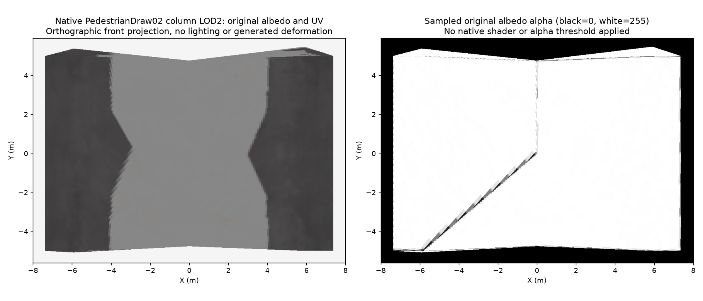

# PedestrianDraw02 column far material review

## Native sources

The near and LOD1 column renders use surface CID `5a4524b9e015bf4860c6e66e37e08bb7`. LOD2 uses a different surface, CID `4daae9cd460c780875604a3e3e127e16`, template hash 0. Its native surface SHA-256 is `09ddf3386feb9af0a2da8ee7ec0d75f9bd75ef0fc8a09783e6185eaa128b5a55`.

The far surface stores its pixels through VTSurface CID `2ef5ede53d04e07bd39508c629484d91`, not a separate preprocessed layer-0 VTTexture. Its per-layer preprocessed IDs are zero. The VTSurface payload was resolved from `Content/BridgesAndPorts/VT.cok`, entry `PedestrianDrawBridge02Pillar_LOD2_10888bf830fafb792fc53193cbae47aa.VTSurface`.

Payload SHA-256: `53a2da2e0c5eb9ccc053d22052726b644f8c5998bbf2f476486c52b9ab8c97bc`. The original 512-by-512 BC7 albedo tile was decompressed through the native plugin and decoded without texture recompression. Original mesh UV0 contains 121 Float16x2 coordinates, decoded directly from Geometry.

## UV projection

This is an orthographic mesh-0 front projection using original positions and UV coordinates. It shows original albedo RGB and alpha separately, without game lighting, native shader evaluation or an invented alpha threshold. The tile alpha ranges from 0 to 255; the central projected area is predominantly high alpha. Do not infer open framework from the bare triangulated shell, and do not infer full native transparency behavior from this diagnostic alone. It is not a generated bridge or visual acceptance.

## Mapping consequence and pending decision

LOD2 is a separately baked representation, not merely a reduced near mesh sharing the same material. Its broad triangles combine areas represented by different detailed parts. Moving only outer extrema cannot establish preservation of every visible column/brace width. Correspondence must account for the original surface/UV representation as well as the geometry.

A question is pending about allowing necessary triangle subdivision if exact per-face review proves that unchanged indices cannot preserve detailed side-part translation and centre-part stretching simultaneously. No permission has been assumed, no source vertices were moved and no proxy topology was changed. Bridge generation contract section 4 requires carried index preservation; section 8 requires the detailed part mapping at every LOD. The inspection must first establish where these requirements conflict before any exception is used.

The existing detailed column correspondence and footing implementation remain unchanged. No runtime code, installed payload or generated bridge assets changed. Final column mapping and all complete-generator acceptance remain outstanding.
