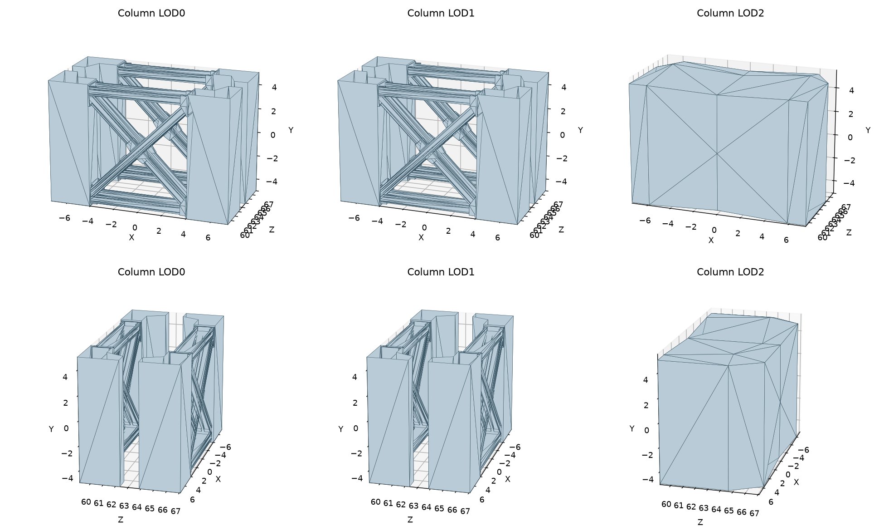

# PedestrianDraw02 column part correspondence

## Measured scope

The native column has three LODs. Detailed meshes show four piers per longitudinal support with horizontal beams, diagonal braces and separate joint/end plates. Mesh components were extracted offline by exact-position welding followed by triangle adjacency. This is a candidate-identification aid, not permission to classify arbitrary connected meshes as one authored part or to use topology at runtime.

Near and LOD1 each have 88 components with 88 unique, exactly matching XYZ extent records. Their matching extent records provide candidate correspondence, supported by the inspected shapes. Some LOD1 components have new vertex positions and cannot reuse the near vertex-ID table. LOD2 contains two merged proxies, one per longitudinal support; its topology cannot determine the near parts' stretch/translate behavior.

## Detailed-mesh roles

| Reviewed role | Near components | Reaches/crosses X=0 | Required operation |
| --- | --- | --- | --- |
| Diagonal brace | 16 | Yes | Stretch about centre using its own span |
| Horizontal beam | 8 | Yes | Stretch about centre using its own span |
| Centre joint plate | 8 | Yes | Stretch about centre using its own span |
| End plate | 16 | No | Rigid side translation |
| End gusset | 32 | No | Rigid side translation |
| Pier column | 8 | No | Rigid side translation |

The 32 centre-crossing pieces and 56 side pieces are separate mapping inputs. A small centre joint plate has its own span and cannot inherit the approximately four-metre half-span of a brace or beam. Pier columns and end plates/gussets must retain their widths. Full per-height span and attachment continuity still need resolution before emitting displacement data.

## Per-component correspondence

IDs below are local to this extraction, not native asset IDs. Native source triangle and vertex memberships remain in the intermediate record.

| Near component | LOD1 component | Role | Near triangles | LOD1 triangles | Minimum XYZ | Maximum XYZ |
| --- | --- | --- | --- | --- | --- | --- |
| 0 | 0 | Diagonal brace | 24 | 20 | [-4.0089111328125, -4.4820556640625, 65.4609375] | [4.0076904296875, 4.4810791015625, 66.076171875] |
| 1 | 1 | Diagonal brace | 24 | 21 | [-4.0089111328125, -4.4820556640625, 66.3203125] | [4.0076904296875, 4.4810791015625, 66.9375] |
| 2 | 2 | Diagonal brace | 24 | 22 | [-4.0078125, -4.4820556640625, 65.4609375] | [4.0089111328125, 4.4810791015625, 66.076171875] |
| 3 | 3 | Diagonal brace | 24 | 22 | [-4.0078125, -4.4820556640625, 66.3203125] | [4.0089111328125, 4.4810791015625, 66.9375] |
| 4 | 4 | Horizontal beam | 40 | 30 | [-4.0076904296875, 4.076904296875, 65.4609375] | [4.0076904296875, 4.75048828125, 66.9375] |
| 5 | 5 | Horizontal beam | 40 | 30 | [-4.0076904296875, -4.7513427734375, 65.4609375] | [4.0076904296875, -4.07763671875, 66.9375] |
| 6 | 6 | Centre joint plate | 28 | 28 | [-0.983001708984375, -0.975372314453125, 65.427734375] | [0.9742431640625, 0.98187255859375, 65.642578125] |
| 7 | 7 | Centre joint plate | 28 | 28 | [-0.983001708984375, -0.975372314453125, 66.755859375] | [0.9742431640625, 0.98187255859375, 66.96875] |
| 8 | 8 | End plate | 10 | 8 | [3.9364013671875, 3.2265625, 65.37109375] | [4.075927734375, 4.88427734375, 67.02734375] |
| 9 | 9 | End plate | 10 | 8 | [3.9364013671875, -4.8975830078125, 65.37109375] | [4.075927734375, -3.2398681640625, 67.02734375] |
| 10 | 10 | End plate | 10 | 8 | [-4.0760498046875, 3.2265625, 65.37109375] | [-3.93646240234375, 4.88427734375, 67.02734375] |
| 11 | 11 | End plate | 10 | 8 | [-4.0760498046875, -4.8975830078125, 65.37109375] | [-3.93646240234375, -3.2398681640625, 67.02734375] |
| 12 | 12 | End gusset | 16 | 16 | [3.45947265625, -4.8037109375, 65.412109375] | [4.0076904296875, -3.302001953125, 65.658203125] |
| 13 | 13 | End gusset | 16 | 16 | [3.45947265625, -4.8037109375, 66.73828125] | [4.0076904296875, -3.302001953125, 66.984375] |
| 14 | 14 | End gusset | 16 | 16 | [3.45947265625, 3.31439208984375, 65.412109375] | [4.0076904296875, 4.8160400390625, 65.658203125] |
| 15 | 15 | End gusset | 16 | 15 | [3.45947265625, 3.31439208984375, 66.73828125] | [4.0076904296875, 4.8160400390625, 66.984375] |
| 16 | 16 | End gusset | 16 | 16 | [-4.0076904296875, -4.8037109375, 65.412109375] | [-3.45953369140625, -3.302001953125, 65.658203125] |
| 17 | 17 | End gusset | 16 | 14 | [-4.0076904296875, -4.8037109375, 66.73828125] | [-3.45953369140625, -3.302001953125, 66.984375] |
| 18 | 18 | End gusset | 16 | 15 | [-4.0076904296875, 3.31439208984375, 65.412109375] | [-3.45953369140625, 4.8160400390625, 65.658203125] |
| 19 | 19 | End gusset | 16 | 16 | [-4.0076904296875, 3.31439208984375, 66.73828125] | [-3.45953369140625, 4.8160400390625, 66.984375] |
| 20 | 20 | Diagonal brace | 24 | 20 | [-4.0089111328125, -4.4820556640625, 59.28515625] | [4.0076904296875, 4.4810791015625, 59.9013671875] |
| 21 | 21 | Diagonal brace | 24 | 21 | [-4.0089111328125, -4.4820556640625, 60.1455078125] | [4.0076904296875, 4.4810791015625, 60.76171875] |
| 22 | 22 | Diagonal brace | 24 | 21 | [-4.0078125, -4.4820556640625, 59.28515625] | [4.0089111328125, 4.4810791015625, 59.9013671875] |
| 23 | 23 | Diagonal brace | 24 | 22 | [-4.0078125, -4.4820556640625, 60.1455078125] | [4.0089111328125, 4.4810791015625, 60.76171875] |
| 24 | 24 | Horizontal beam | 40 | 33 | [-4.0076904296875, 4.076904296875, 59.28515625] | [4.0076904296875, 4.75048828125, 60.76171875] |
| 25 | 25 | Horizontal beam | 40 | 29 | [-4.0076904296875, -4.7513427734375, 59.28515625] | [4.0076904296875, -4.07763671875, 60.76171875] |
| 26 | 26 | Centre joint plate | 28 | 28 | [-0.983001708984375, -0.975372314453125, 59.25390625] | [0.9742431640625, 0.98187255859375, 59.466796875] |
| 27 | 27 | Centre joint plate | 28 | 28 | [-0.983001708984375, -0.975372314453125, 60.580078125] | [0.9742431640625, 0.98187255859375, 60.7939453125] |
| 28 | 28 | End plate | 10 | 8 | [3.9364013671875, 3.2265625, 59.1953125] | [4.075927734375, 4.88427734375, 60.8515625] |
| 29 | 29 | End plate | 10 | 8 | [3.9364013671875, -4.8975830078125, 59.1953125] | [4.075927734375, -3.2398681640625, 60.8515625] |
| 30 | 30 | End plate | 10 | 8 | [-4.0760498046875, 3.2265625, 59.1953125] | [-3.93646240234375, 4.88427734375, 60.8515625] |
| 31 | 31 | End plate | 10 | 10 | [-4.0760498046875, -4.8975830078125, 59.1953125] | [-3.93646240234375, -3.2398681640625, 60.8515625] |
| 32 | 32 | End gusset | 16 | 16 | [3.45947265625, -4.8037109375, 59.236328125] | [4.0076904296875, -3.302001953125, 59.4833984375] |
| 33 | 33 | End gusset | 16 | 16 | [3.45947265625, -4.8037109375, 60.5634765625] | [4.0076904296875, -3.302001953125, 60.810546875] |
| 34 | 34 | End gusset | 16 | 16 | [3.45947265625, 3.31439208984375, 59.236328125] | [4.0076904296875, 4.8160400390625, 59.4833984375] |
| 35 | 35 | End gusset | 16 | 15 | [3.45947265625, 3.31439208984375, 60.5634765625] | [4.0076904296875, 4.8160400390625, 60.810546875] |
| 36 | 36 | End gusset | 16 | 16 | [-4.0076904296875, -4.8037109375, 59.236328125] | [-3.45953369140625, -3.302001953125, 59.4833984375] |
| 37 | 37 | End gusset | 16 | 15 | [-4.0076904296875, -4.8037109375, 60.5634765625] | [-3.45953369140625, -3.302001953125, 60.810546875] |
| 38 | 38 | End gusset | 16 | 15 | [-4.0076904296875, 3.31439208984375, 59.236328125] | [-3.45953369140625, 4.8160400390625, 59.4833984375] |
| 39 | 39 | End gusset | 16 | 16 | [-4.0076904296875, 3.31439208984375, 60.5634765625] | [-3.45953369140625, 4.8160400390625, 60.810546875] |
| 40 | 40 | Pier column | 12 | 12 | [-7.38427734375, -5.0, 63.8671875] | [-4.058837890625, 5.0, 67.076171875] |
| 41 | 41 | Pier column | 12 | 12 | [4.0587158203125, -5.0, 59.1474609375] | [7.38427734375, 5.0, 62.3564453125] |
| 42 | 42 | Pier column | 12 | 12 | [-7.38427734375, -5.0, 59.1474609375] | [-4.058837890625, 5.0, 62.3564453125] |
| 43 | 43 | Pier column | 12 | 12 | [4.0587158203125, -5.0, 63.8671875] | [7.38427734375, 5.0, 67.076171875] |
| 44 | 44 | Diagonal brace | 24 | 22 | [-4.0089111328125, -4.4820556640625, -66.076171875] | [4.0076904296875, 4.4810791015625, -65.4609375] |
| 45 | 45 | Diagonal brace | 24 | 21 | [-4.0089111328125, -4.4820556640625, -66.9375] | [4.0076904296875, 4.4810791015625, -66.3203125] |
| 46 | 46 | Diagonal brace | 24 | 21 | [-4.0078125, -4.4820556640625, -66.076171875] | [4.0089111328125, 4.4810791015625, -65.4609375] |
| 47 | 47 | Diagonal brace | 24 | 19 | [-4.0078125, -4.4820556640625, -66.9375] | [4.0089111328125, 4.4810791015625, -66.3203125] |
| 48 | 48 | Horizontal beam | 40 | 32 | [-4.0076904296875, 4.076904296875, -66.9375] | [4.0076904296875, 4.75048828125, -65.4609375] |
| 49 | 49 | Horizontal beam | 40 | 30 | [-4.0076904296875, -4.7513427734375, -66.9375] | [4.0076904296875, -4.07763671875, -65.4609375] |
| 50 | 50 | Centre joint plate | 28 | 28 | [-0.983001708984375, -0.975372314453125, -65.642578125] | [0.9742431640625, 0.98187255859375, -65.427734375] |
| 51 | 51 | Centre joint plate | 28 | 28 | [-0.983001708984375, -0.975372314453125, -66.96875] | [0.9742431640625, 0.98187255859375, -66.755859375] |
| 52 | 52 | End plate | 10 | 6 | [3.9364013671875, 3.2265625, -67.02734375] | [4.075927734375, 4.88427734375, -65.37109375] |
| 53 | 53 | End plate | 10 | 8 | [3.9364013671875, -4.8975830078125, -67.02734375] | [4.075927734375, -3.2398681640625, -65.37109375] |
| 54 | 54 | End plate | 10 | 8 | [-4.0760498046875, 3.2265625, -67.02734375] | [-3.93646240234375, 4.88427734375, -65.37109375] |
| 55 | 55 | End plate | 10 | 8 | [-4.0760498046875, -4.8975830078125, -67.02734375] | [-3.93646240234375, -3.2398681640625, -65.37109375] |
| 56 | 56 | End gusset | 16 | 15 | [3.45947265625, -4.8037109375, -65.658203125] | [4.0076904296875, -3.302001953125, -65.412109375] |
| 57 | 57 | End gusset | 16 | 16 | [3.45947265625, -4.8037109375, -66.984375] | [4.0076904296875, -3.302001953125, -66.73828125] |
| 58 | 58 | End gusset | 16 | 16 | [3.45947265625, 3.31439208984375, -65.658203125] | [4.0076904296875, 4.8160400390625, -65.412109375] |
| 59 | 59 | End gusset | 16 | 15 | [3.45947265625, 3.31439208984375, -66.984375] | [4.0076904296875, 4.8160400390625, -66.73828125] |
| 60 | 60 | End gusset | 16 | 15 | [-4.0076904296875, -4.8037109375, -65.658203125] | [-3.45953369140625, -3.302001953125, -65.412109375] |
| 61 | 61 | End gusset | 16 | 16 | [-4.0076904296875, -4.8037109375, -66.984375] | [-3.45953369140625, -3.302001953125, -66.73828125] |
| 62 | 62 | End gusset | 16 | 14 | [-4.0076904296875, 3.31439208984375, -65.658203125] | [-3.45953369140625, 4.8160400390625, -65.412109375] |
| 63 | 63 | End gusset | 16 | 15 | [-4.0076904296875, 3.31439208984375, -66.984375] | [-3.45953369140625, 4.8160400390625, -66.73828125] |
| 64 | 64 | Diagonal brace | 24 | 22 | [-4.0089111328125, -4.4820556640625, -59.9013671875] | [4.0076904296875, 4.4810791015625, -59.28515625] |
| 65 | 65 | Diagonal brace | 24 | 21 | [-4.0089111328125, -4.4820556640625, -60.76171875] | [4.0076904296875, 4.4810791015625, -60.1455078125] |
| 66 | 66 | Diagonal brace | 24 | 19 | [-4.0078125, -4.4820556640625, -59.9013671875] | [4.0089111328125, 4.4810791015625, -59.28515625] |
| 67 | 67 | Diagonal brace | 24 | 22 | [-4.0078125, -4.4820556640625, -60.76171875] | [4.0089111328125, 4.4810791015625, -60.1455078125] |
| 68 | 68 | Horizontal beam | 40 | 31 | [-4.0076904296875, 4.076904296875, -60.76171875] | [4.0076904296875, 4.75048828125, -59.28515625] |
| 69 | 69 | Horizontal beam | 40 | 32 | [-4.0076904296875, -4.7513427734375, -60.76171875] | [4.0076904296875, -4.07763671875, -59.28515625] |
| 70 | 70 | Centre joint plate | 28 | 28 | [-0.983001708984375, -0.975372314453125, -59.466796875] | [0.9742431640625, 0.98187255859375, -59.25390625] |
| 71 | 71 | Centre joint plate | 28 | 28 | [-0.983001708984375, -0.975372314453125, -60.7939453125] | [0.9742431640625, 0.98187255859375, -60.580078125] |
| 72 | 72 | End plate | 10 | 6 | [3.9364013671875, 3.2265625, -60.8515625] | [4.075927734375, 4.88427734375, -59.1953125] |
| 73 | 73 | End plate | 10 | 8 | [3.9364013671875, -4.8975830078125, -60.8515625] | [4.075927734375, -3.2398681640625, -59.1953125] |
| 74 | 74 | End plate | 10 | 8 | [-4.0760498046875, 3.2265625, -60.8515625] | [-3.93646240234375, 4.88427734375, -59.1953125] |
| 75 | 75 | End plate | 10 | 10 | [-4.0760498046875, -4.8975830078125, -60.8515625] | [-3.93646240234375, -3.2398681640625, -59.1953125] |
| 76 | 76 | End gusset | 16 | 13 | [3.45947265625, -4.8037109375, -59.4833984375] | [4.0076904296875, -3.302001953125, -59.236328125] |
| 77 | 77 | End gusset | 16 | 16 | [3.45947265625, -4.8037109375, -60.810546875] | [4.0076904296875, -3.302001953125, -60.5634765625] |
| 78 | 78 | End gusset | 16 | 15 | [3.45947265625, 3.31439208984375, -59.4833984375] | [4.0076904296875, 4.8160400390625, -59.236328125] |
| 79 | 79 | End gusset | 16 | 16 | [3.45947265625, 3.31439208984375, -60.810546875] | [4.0076904296875, 4.8160400390625, -60.5634765625] |
| 80 | 80 | End gusset | 16 | 16 | [-4.0076904296875, -4.8037109375, -59.4833984375] | [-3.45953369140625, -3.302001953125, -59.236328125] |
| 81 | 81 | End gusset | 16 | 16 | [-4.0076904296875, -4.8037109375, -60.810546875] | [-3.45953369140625, -3.302001953125, -60.5634765625] |
| 82 | 82 | End gusset | 16 | 16 | [-4.0076904296875, 3.31439208984375, -59.4833984375] | [-3.45953369140625, 4.8160400390625, -59.236328125] |
| 83 | 83 | End gusset | 16 | 16 | [-4.0076904296875, 3.31439208984375, -60.810546875] | [-3.45953369140625, 4.8160400390625, -60.5634765625] |
| 84 | 84 | Pier column | 12 | 12 | [-7.38427734375, -5.0, -67.076171875] | [-4.058837890625, 5.0, -63.8671875] |
| 85 | 85 | Pier column | 12 | 12 | [4.0587158203125, -5.0, -62.3564453125] | [7.38427734375, 5.0, -59.1474609375] |
| 86 | 86 | Pier column | 12 | 12 | [-7.38427734375, -5.0, -62.3564453125] | [-4.058837890625, 5.0, -59.1474609375] |
| 87 | 87 | Pier column | 12 | 12 | [4.0587158203125, -5.0, -67.076171875] | [7.38427734375, 5.0, -63.8671875] |

## Remaining implementation constraint

LOD2 merges the detailed parts into two 48/44-triangle shells and moves some central and lateral stations. It must inherit the detailed part mapping, not stretch an entire proxy because it spans the centre. No runtime column mapping was emitted in this pass. The separately implemented two-LOD footing graph is unaffected.

Source identities are retained in [support implementation](PedestrianDraw02-support-implementation.md). No runtime source, deployed payload or bridge assets changed. This is a native-geometry measurement; it does not establish generated geometry, motion, shipping or cold-load acceptance.
