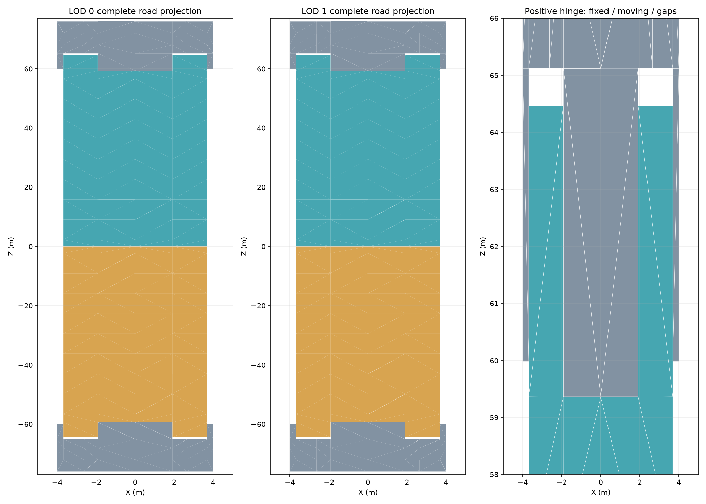

# PedestrianDraw02 complete road membership

## Native evidence

The two main LOD meshes contain 276 reviewed upward road-atlas triangles each. The exact projected XZ triangle sets are identical, with multiplicity one. A direct per-triangle correspondence is retained in the intermediate extraction. Original binary32 positions and index order are read from native Geometry; OBJ indices are checked exactly before its bone labels are used.

The atlas bounds were used for offline inspection only. Runtime must consume measured triangle membership and must not classify surfaces by UV, normal, bone or height. This membership covers the top road faces, not a complete structural replacement or width-deformation plan.

## Membership and boundary topology

| LOD | Bone | Triangles | Projected area (square metres) | Boundary edges | Closed loop edge counts |
| --- | --- | --- | --- | --- | --- |
| 0 | 0 | 108 | 224.50866270065308 | 52 | 26, 26 |
| 0 | 1 | 84 | 455.5097044734284 | 32 | 32 |
| 0 | 2 | 84 | 455.50972817174625 | 32 | 32 |
| 1 | 0 | 108 | 224.50866270065308 | 52 | 26, 26 |
| 1 | 1 | 84 | 455.5097044734284 | 32 | 32 |
| 1 | 2 | 84 | 455.50972817174625 | 32 | 32 |

Every projected boundary vertex has degree two; no selected projected edge has more than two adjacent triangles. The complete projected loops match exactly across LODs for each bone. Bone identity describes authored animation ownership here; it does not define width deformation.

## Correction to the horizontal-only inventory

LOD1 includes twelve road triangles with vertices at Y = 10.050048828125 m. A Y = 10 m horizontal-only filter omitted them and produced incomplete road outlines. The complete membership supersedes that filter for top-face coverage. The small height variation remains authored LOD geometry; identical XZ projection does not justify modifying its Y values.

The fixed road has 108 triangles, the positive moving leaf has 84, and the negative moving leaf has 84 at each LOD. Preserve the notched two-dimensional hinge boundary and its authored clearances. A single longitudinal split cannot reproduce this boundary. Vertical end faces share this atlas but are excluded from this top-face membership; their ownership and closure must be handled explicitly before removal.

## Source identities

- `PedestrianDrawBridge02 Mesh.Geometry`, mesh 0: 40168 vertices, 30064 triangles; SHA-256 `55b8fb530c4f5d80a211feecb2e82b6deb12cc8af5d76bdc3abef78b192494be`.
- `PedestrianDrawBridge02_LOD1 Mesh.Geometry`, mesh 0: 32137 vertices, 18025 triangles; SHA-256 `0dc1d41ae4acd634537b75699a226946ecb909c7c18780418a24584ca2519157`.

## Implementation boundary

This measurement does not complete the generator. Still required are authored part widening, selected-road clipping into the measured two-dimensional domains, road side and end closure, lane visuals and attachments, structural assembly, persistence and human in-game acceptance. No runtime source, deployed payload or existing bridge asset was changed by this extraction.
