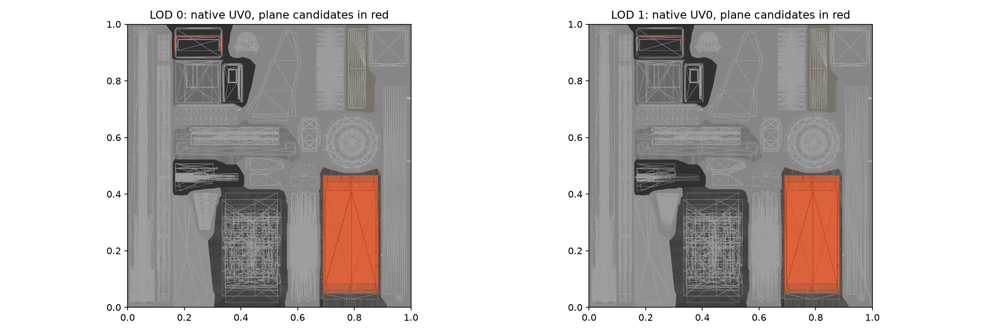

# PedestrianDraw02 native material and UV review

## Source resource identities

Both main LOD render prefabs reference the same two surfaces. The main surface is
`a1b3ca16b946cc34fc031e376ba03d71`, native template hash 0, VT-enabled. Its package entry
is `Content/BridgesAndPorts/Blob.cok` /
`PedestrianDrawBridge02_8dc9b27ea6d645d52e6ae1b387d9ae70.Surface`.
Recorded SHA-256: `5c3a1f839c0bca829fcb1fd4f923697f43b59cb464a494a2c64562d2f7b92219`.
The second surface is the window material, CID `3b81df0257792cb8f7641e88a51c2d1e`,
template hash 2; it must not be treated as road material.

The main albedo VT payload was resolved by its serialized layer reference
`42620b429f731b291c062f7c43f92d82` to
`PedestrianDrawBridge02_BaseColor_8260678d9b9176939c61f48b45e13e6f.VTTexture`
in the installed BridgesAndPorts VT.cok. The inspection image decodes its original BC7
tiles through the native decompressor; it does not modify or generate game textures.

## UV findings

The moving Y=10 candidates on both leaves use UV bounds:

- U: 0.69287109375 to 0.880859375.
- V: 0.061981201171875 to 0.442138671875.

Near moving candidates contain 84 faces per leaf. LOD1 contains 75 and 81 exact-horizontal
faces respectively. Fixed Y=10 candidates span additional atlas regions, including separate
small islands; their full candidate set is not exclusively the central walking surface.

A diagnostic selection of all faces fully contained in the moving candidate UV rectangle
returns 276 near faces and 264 LOD1 faces. Of these, 64 and 68 respectively are not horizontal.
Near nonhorizontal positions span Y=9.586181640625 to 10. LOD1 also reaches 10.050048828125.
For example, near faces 7437 and 7438 are vertical platform end faces at Z=76, connecting
Y=9.586181640625 to Y=10. Faces 7509–7512 form additional vertical end geometry at Z=65.125.
These faces share the rectangle used by horizontal road candidates.

Therefore neither material identity nor UV-rectangle containment is a complete removal
criterion. Retained end closures must be classified from native geometry and adjacent
parts, while sloped LOD road faces must not be omitted by an exact-horizontal test. The
main surface is opaque, so retaining old top geometry is not justified by an assumed
transparent road cutout.

## Scope and reproduction

- `work/bridge-research/pedestrian02_vt_albedo.py` decodes the resolved native albedo payload.
- `work/bridge-research/pedestrian02_native_uv.py` decodes original UV0 and produces the overlay.
- `pedestrian02-lod0-uv-evidence.npz` and `pedestrian02-lod1-uv-evidence.npz` retain UV arrays,
  topology and horizontal candidate membership in the research directory.

The UV rectangles above are offline inspection bounds, not runtime geometric classifiers.
No source structure channels, materials, game assets or installed payload were changed.
This review does not establish a complete removal mask, generated bridge or visual acceptance.
