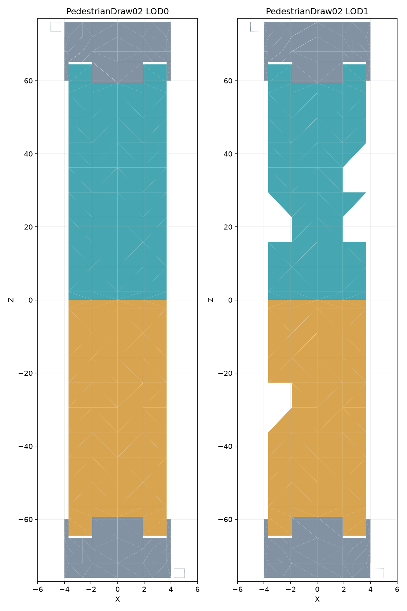

# PedestrianDraw02 native top-region review

Gray denotes bone 0, teal bone 1 and ochre bone 2. The plot includes exactly horizontal
upward faces at Y=10 from native mesh 0. It is an offline candidate inspection, not a
rendered generated bridge. Missing polygons in LOD1 may be nonhorizontal simplifications;
the plot is not evidence that the native model has holes.

## Measured longitudinal and transverse interfaces

Both main LODs have moving-region extrema:

| Region | Minimum X | Maximum X | Minimum Z | Maximum Z |
| --- | --- | --- | --- | --- |
| Positive leaf, bone 1 | -3.68646240234375 | 3.68646240234375 | 0.029992103576660156 | 64.470703125 |
| Negative leaf, bone 2 | -3.68646240234375 | 3.68646240234375 | -64.470703125 | -0.029988765716552734 |

These bounds do not describe rectangular leaves. In LOD0 the positive fixed platform
has a central tongue with X boundaries -1.9114990234375 and +1.9114990234375, beginning
at Z=59.3623046875. Moving side wings instead reach Z=64.470703125. The adjacent moving
inner boundaries are X=-1.9168701171875 and +1.9168701171875; their central end is at
Z=59.3564453125. Outer moving vertices at X=+-3.68646240234375 have a separate station
at Z=59.3623046875. Fixed outer strips extend from X=+-3.68646240234375 to +-4 and begin
at Z=59.984375. The fixed platform spans the whole top at Z=65.125 and beyond.

The central and lateral gaps therefore differ. Their exact planes and the small diagonal
transitions must be obtained from the actual triangle edges; a single seam at the largest
moving Z would incorrectly assign the central fixed tongue to a leaf. Conversely a seam
at the central tongue would truncate the moving side wings. The two central leaf endpoints
also have distinct stored float values and must not be forced to numerical symmetry.

## Runtime implications

Do not copy Draw01's carriageway/sidewalk longitudinal trees. This archetype needs a measured
transverse/longitudinal partition, including explicit gaps. Widening its recorded boundaries
must follow the same authored-part deformation as the structural replacement, not derive a
boundary from selected-road lane names. The full selected-road profile still needs to be
compiled and split in that measured construction frame.

No partition source code was emitted from extrema alone. Material/UV review, complete edge
identification, near/far semantic correspondence and structural widening remain required.
The closed-node sampler added earlier does not solve these geometry requirements.

## Reproduction and scope

- Script: `work/bridge-research/pedestrian02_top_regions.py`.
- Binary candidate membership: `work/bridge-research/pedestrian-native-road-plane-candidates.json`.
- Source geometry hashes and counts: [pedestrian surface candidates](Pedestrian-native-surface-candidates.md).

This inspection changed no runtime code, installed payload or existing bridge. Complete
PedestrianDraw02 generation and all ten styles' human acceptance remain unfinished.
