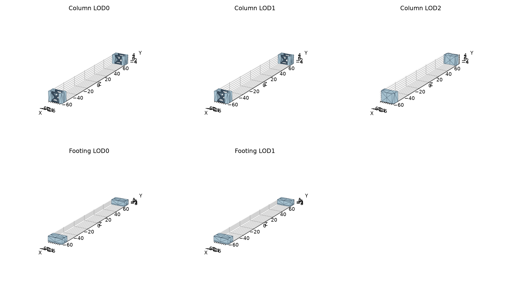
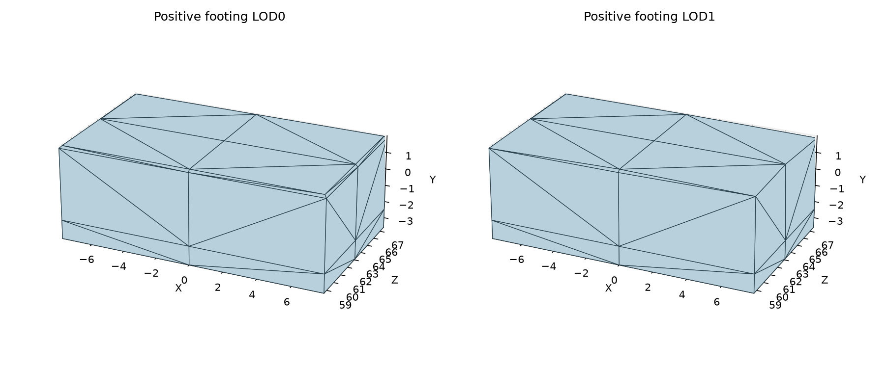

# PedestrianDraw02 support geometry and footing implementation

## Native inspection

All three column LODs and both footing LODs were read directly from their native Geometry payloads. The column contains open framing and braces in the detailed meshes and a simplified solid proxy at LOD2. A whole-column stretch is not justified by that proxy; its authored member mapping remains unfinished.

| Geometry | Vertices | Triangles | Minimum XYZ | Maximum XYZ |
| --- | --- | --- | --- | --- |
| PedestrianDrawBridge02Pillar Mesh.Geometry | 3332 | 1696 | [-7.38427734375, -5.0, -67.076171875] | [7.38427734375, 5.0, 67.076171875] |
| PedestrianDrawBridge02Pillar_LOD1 Mesh.Geometry | 3076 | 1526 | [-7.38427734375, -5.0, -67.076171875] | [7.38427734375, 5.0, 67.076171875] |
| PedestrianDrawBridge02Pillar_LOD2 Mesh.Geometry | 121 | 92 | [-7.38427734375, -5.1094970703125, -67.076171875] | [7.38427734375, 5.478515625, 67.08203125] |
| PedestrianDrawBridge02PillarBase Mesh.Geometry | 208 | 112 | [-7.8511962890625, -3.60003662109375, -67.580078125] | [7.8511962890625, 1.999969482421875, 67.580078125] |
| PedestrianDrawBridge02PillarBase_LOD1 Mesh.Geometry | 196 | 100 | [-7.8511962890625, -3.60003662109375, -67.580078125] | [7.8511962890625, 1.999969482421875, 67.580078125] |

## Footing mapping

Each footing is a continuous centre-crossing block. Native vertices lie on its centre line or lateral boundary. Below the top bevel the half-span is 7.8511962890625 m; at the top it is 7.7149658203125 m. The near geometry establishes the same centre-crossing block and lateral displacement at every level. Centre vertices stay at zero; each lateral boundary moves by the corresponding signed half-width change, stretching the intervening faces without opening a centre seam. This is the measured boundary result of stretching the spanning block, not a per-vertex classifier for arbitrary geometry.

LOD1 includes a bevel vertex at X=7.7830810546875, Y=1.93182373046875. It lies halfway along the near bevel between Y=1.863677978515625 and Y=1.999969482421875. It inherits the same lateral boundary displacement; the simplified mesh does not establish a different part or transform. Other original Y/Z coordinates, raw attributes, index buffers and surface references remain unchanged.

This footing is below the pier and is not the road-adjacent base defined by the project contract. The implementation does not apply the separate base rule merely because its native name contains `Base`.

## Implemented path

`PedestrianDraw02FootingWideningData.CreatePlan` consumes immutable measured vertex records for both LODs. It checks native positions and layout, applies recorded displacement weights, and creates the existing raw-channel-preserving structure plan without removing triangles.

`PedestrianDraw02RenderAssembly.CreateFooting` validates original-source ownership before reading geometry, prepares both LODs, preserves native Y/Z bounds and extends only the X bounds. It calls the existing movable render factory, which retains components and surfaces, remaps native LOD references and collects owned outputs for normal persistence. No additional material, texture, skeleton, controller or asset format was introduced.

## Source identities

- `PedestrianDrawBridge02Pillar Mesh.Geometry`: SHA-256 `98f138e40d8dd0ba1337a275e4f3cb087f033fc042108e140ee2ac591804d0d3`.
- `PedestrianDrawBridge02Pillar_LOD1 Mesh.Geometry`: SHA-256 `accc47b3bca78e3fa116614b38383f75bf77a4f725f548e53501d34115f4d117`.
- `PedestrianDrawBridge02Pillar_LOD2 Mesh.Geometry`: SHA-256 `e088f0cd862be023fd8a3831d453655ad2e5007bb53e259764d6f988c3791aa1`.
- `PedestrianDrawBridge02PillarBase Mesh.Geometry`: SHA-256 `b42466fc4e11fbcb679ffbbdb54a47138616eab8d4ef732b76711e0b59a4c652`.
- `PedestrianDrawBridge02PillarBase_LOD1 Mesh.Geometry`: SHA-256 `debb97074a80ef973707b0f058e9d191e0ddc82db886cc56979830234f8b6e6e`.

## Integration and verification

Style branch commit `2b2bcaa2f97273561620821b3ac490f47d889bf6`, integrated on `dev` as `195f50e`. Release build and immediate deployment passed; 18 original installed files were backed up and 12 installed payload files matched the build. Backup: `artifacts/backups/pedestrian02-footing-render-20261016-090411`.

The final generator does not yet call this render assembly. No existing bridges were removed. The column, main mechanism, road closure/partition/appearance and full generator integration remain unfinished. No visual-generation unit tests or game automation ran. Native execution, generated near/far geometry, motion, shipping and cold-load acceptance remain unverified.
