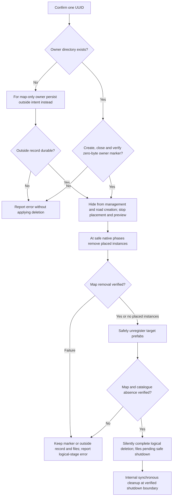
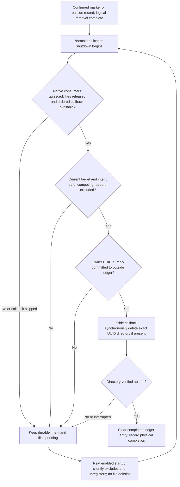
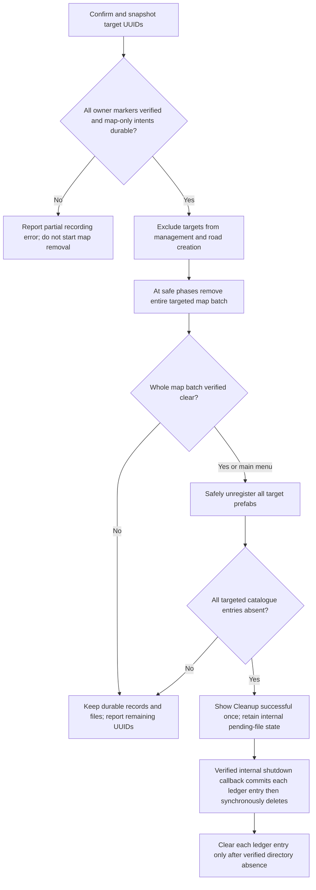

# Bridge deletion

**First rule: record deletion durably, make the bridge unavailable in the game, and clean its files synchronously inside a verified safe normal-shutdown callback.** Confirmed deletion has two distinct completion states: logical deletion and physical cleanup. Bridge asset files must not be deleted during normal gameplay, loading or startup self-check. The only permitted physical cleanup is during normal shutdown, after native consumers have demonstrably stopped and released file access, while the callback code can still execute. Completing logical deletion never means that files have already been removed.

This document governs confirmed single and bulk player deletion, tombstone handling at startup, and subsequent normal-shutdown cleanup. It is the authoritative deletion lifecycle design, not a claim that the current implementation already satisfies it. Migration and damaged-asset diagnosis retain their separate evidence and backup responsibilities; they cannot use recovery as a bypass for the restriction to the verified normal-shutdown cleanup boundary.

## Single bridge

### Confirmation and durable intent

Before confirmation, change neither the map, availability nor files. Confirmation identifies one bridge UUID. For an existing owner directory, create its zero-byte `.bridgebuilderdeleted` file, close the writer and verify that the marker exists as the expected zero-byte file **before** removing placed instances or unregistering the bridge. A normal owner has no marker. An existing valid marker makes a repeated request idempotent; do not truncate an unexpected file to manufacture a valid marker. If creation, durable completion, closing or verification fails, report an error and make no logical changes.

Two records have different roles: the per-owner marker records confirmed logical deletion, while an external cleanup ledger protects intent once recursive deletion could remove that marker. Keep the ledger outside **all** target owner directories. The implementation stores zero-byte per-owner records at `ModsData/BridgeBuilder/DeletionPending/b{uuid}.pending` under the game user-data root. Before starting recursive deletion for an owner, durably record its exact UUID in this ledger; if that write fails, abort physical deletion for that owner. Do not require normal, unmarked owners to have marker files or cleanup entries.

For a placed, map-only owner with no directory, persist its confirmed intent in the outside record before map removal or unregistration. Do not create a fake bridge directory just to hold a marker. Keep this entry until logical removal is complete and the normal-shutdown cleanup stage has verified directory absence; absence alone must not discard unfinished map-only work. Repeated requests remain idempotent. Neither record authorizes removing another owner, a source package or unrelated files.

Once recorded, the target must be unavailable in both the management list and road-creation/placement catalogues. Stop its active placement and preview. All discovery and catalogue rebuild paths must exclude an owner if its marker **or** outside ledger entry exists. Retained files must never make a logically deleted bridge selectable again. UUID allocation must continue to treat the retained directory, marker or pending outside record as occupied.

### Map removal and native unregistration

In a city or editor, remove the target's placed Bridge Builder instances before completing prefab unregistration. Collect real edges and nodes, including auxiliary decks, before modifying ECS buffers. Exclude previews, prefab entities and cached compositions from placed-instance selection. Preserve ordinary roads and shared junctions. In the main menu, there are no placed instances to remove in that world.

Accept durable intent while loading, saving or otherwise unable to modify the world safely. Execute the map and native-catalogue work at supported native phases, including when simulation speed is zero. Do not force completion across a save/load, world transition, native job or renderer lifetime boundary. Preserve the target identity across transitions and re-evaluate the current world rather than applying stale entity handles.

Native `WorldReady` and completed asset-file batches are not sufficient evidence of prefab initialization: the game enters that state before its first `PrefabUpdate` passes. Logical map mutation and unregistration must wait for an actual menu/city/editor context, completion of native prefab creation/update work, and no queued prefab replacement. Recheck this boundary for startup resumption, single deletion and the whole-batch map phase. Never call `RemovePrefab` on a still-created/updated prefab: it invalidates `PrefabData.m_Index` while native initialization queries can still consume that entity. Catalogue exclusion and durable confirmation remain available during this wait. Do not hide an initialization error or fix another mod's lookup by manufacturing missing entries.
Verify map removal before completing logical deletion. Native prefab systems must consume their removal notifications safely; unregister/hide the target from management and road creation without force-disposing live shared allocations. Independent files with identical CIDs may share runtime objects or read registrations. Keep their resources and physical read routes valid until native consumers have quiesced at the verified normal-shutdown boundary. Logical deletion does not require releasing every mesh, Surface, texture, VT allocation or native reader immediately. Do not use memory pressure, forced garbage collection or a timed delay as proof of safe release.

### Startup and interrupted operations

Startup self-check must silently recognize either a per-owner `.bridgebuilderdeleted` marker or an external cleanup-ledger entry before exposing bridge catalogues. A partially deleted directory remains excluded even if recursive deletion already removed its marker, because the outside entry survives. For a tombstoned bridge it performs only the logical exclusion/unregistration work; it does not migrate the bridge back into use or delete its asset files. ImportedData assets may already have been deserialized or initialized by native systems before the mod runs. Do not assume that startup is an unloaded or reader-free interval. Apply supported native lifecycle boundaries to any already-loaded target.

This startup handling produces no popup or restart request and contributes no owner counts
or entries to self-check results, progress or summary. It is silent logical exclusion and
unregistration, not a reported migration or removal result. Failures retain diagnostic logs
and pending state, without a popup or restart request; silence must not be recorded as success.
Keep the owner excluded from management and road creation while native unregistration remains
pending. These rules apply only to tombstone handling, not unrelated self-check repairs and
their existing reporting requirements.

A crash, forced termination or power loss may skip the shutdown callback or interrupt its
work. Durable intent must survive. On the next run with Bridge Builder enabled, silently
exclude remaining marked/ledger owners and resume necessary logical unregistration; do
not delete their files at startup. Retry physical cleanup at the next verified safe normal
shutdown. If the mod is disabled, unloaded before this boundary or uninstalled, cleanup is
not guaranteed. There is no external recovery process or automatic startup service.

### Normal-shutdown physical cleanup

**Single and bulk deletion use the same internal synchronous shutdown callback.** Its
input is confirmed, durably recorded work whose logical removal has completed. A single
request contributes one owner; a bulk request contributes its captured target set after
the whole-batch map-removal and catalogue barrier. Do not add unconfirmed owners or
owners created after the captured request.

The callback runs **before process termination**, after an evidenced native shutdown phase
has quiesced rendering, asset/VT streaming, serialization and other consumers of the target
files. An internal callback cannot execute after its own process has already exited.
`OnDispose`, `Application.quitting` and similarly named events are candidate observation
points only: their names do not prove that native readers, jobs, rendering or save operations
have completed. Mod disposal during a world transition or disabling a mod is not normal
application shutdown and must not trigger physical cleanup.

The implementation must establish and test the actual ordering before enabling deletion:

1. Normal application shutdown is committed; new generation, preview, placement, loading,
   registration and target-file reads can no longer start. Snapshot eligible durable work.
2. Placed-instance removal and logical exclusion/unregistration have already completed for
   those owners. Do not force unfinished map work through a shutdown or save boundary.
3. Native rendering, jobs, asset/VT streaming and serialization consumers have completed
   their supported shutdown/release steps, and target file access has been released. Keep
   shared allocations valid until their native consumers are quiescent; never forcibly
   dispose an in-use shared resource just to make deletion proceed.
4. A synchronous callback still has valid access to the filesystem, durable records and
   diagnostics and is ordered after those releases. Do not enqueue asynchronous deletion
   work that may outlive the callback or mod lifetime. Do not block waiting for shutdown
   work that can only advance after this same callback returns.
5. Serialize reentrant/concurrent deletion and record updates. Ensure another game instance
   cannot concurrently load the target directories during removal. A local mutex or absence
   of an observed process alone does not establish cross-instance reader exclusion. If
   the engine lifecycle cannot provide the required exclusion, leave cleanup pending.

The supported native teardown rejects the initial Unity quit request, commits
`Quitting`, disposes mods and worlds, drains tasks, disposes the global asset database,
and finally marks the captured game manager `Terminated` before allowing Unity to quit.
Use a direct `Application.quitting` event subscription, independent of Harmony patches.
Other mods may call ownerless `UnpatchAll` during disposal; a late Harmony postfix is
not a reliable cleanup executor or the sole source of lifecycle evidence.

The event name alone is not sufficient. Retain the original manager, database and task
manager references. Require committed normal shutdown, the captured manager's terminal
state, no global database instance, an empty disposed original database, no live ECS
worlds, a successfully completed native queue and no registered tasks. Tasks captured
at mod disposal must also have completed successfully. Do not invoke a second native
drain, recreate a disposed global database through its getter, or wait inside the event.
Enumerate `World.All` through its native typed enumerator; its no-allocation collection rejects `IEnumerable`/LINQ enumeration. Verify this against the actual engine assembly, not a list-shaped test double. A failed or incomplete teardown retains intent. Unloading the mod without application
shutdown unsubscribes the event and never performs file cleanup.

Colossal logging is released before this final event, so record late callback admission,
pending conditions and per-owner results directly in
`Logs/BridgeBuilder.Deletion.Shutdown.log` under the game user-data root. Diagnostic
failure must not escape the callback or clear intent. Normal UI/localization behavior
is unchanged; this is a technical shutdown log, not a replayed success popup.

The game's native single-instance startup restriction must remain enabled. The installed
Windows player enables `single-instance` in `boot.config`; Unity's native restriction
rejects another concurrent instance of the same player before its loading begins. An
internal callback finishes before this player terminates. Validate the supported
configuration at initialization and again at cleanup, and reject an already observable
competing instance as an additional safeguard. Process enumeration alone is not the
exclusion mechanism. Unsupported/changed settings leave cleanup pending. Test global
Harmony unpatching between mod disposal and Unity's final event explicitly. Native
code/configuration evidence and isolated tests do not replace human normal-exit,
immediate-restart and cold-load acceptance.
If no safe ordered callback is available, or any required lifecycle condition cannot be
proved, delete nothing: retain markers/ledger entries and record a diagnostic while logging
is available. Do not substitute a fixed delay, garbage collection, memory pressure, a
successful file-open probe or a guessed event ordering as proof of quiescence. A shutdown
callback being invoked is not proof of physical completion.

No external executable, PowerShell process, shell, service, scheduled task, launcher or
helper handshake participates in this design. No post-process-exit execution is promised.
Directory relocation, quarantine and atomic renaming are not substitutes for removal.

Before each recursive deletion, durably commit the owner UUID to the cleanup ledger outside
**all** target directories, even when its marker already records confirmed intent. Abort that
owner's removal if the commit fails. The ledger protects against partial deletion removing
the marker before other files. Marker and ledger reads must establish current confirmed
intent, not reinterpret an ordinary directory as a deletion request.

Validate UUID syntax, canonical direct-child target paths and the outside-ledger location
when accepting the confirmed request. At shutdown, still establish current path identity,
marker/ledger intent and no-reparse traversal; earlier validation does not prevent later
filesystem substitution. Match the exact immediate `ImportedData/b{UUID}` directory, where
the whole name is lowercase `b` followed by a hyphenated UUID, then recursively delete that
directory. Reject directory links and never follow links out of the owner directory. Do not
select targets through dependency graphs, compare duplicate CIDs, enumerate payloads for
per-file deletion, or delete flat historical files or nested UUID matches. Lifecycle and
path safety remain separate from this directory-removal primitive.

Keep the ledger entry on locked files, IO failure, interruption or inability to verify absence.
Clear it and record physical completion only after the exact directory is verified absent.
An already absent directory completes the physical step idempotently only when logical
completion is also established, including map-only records. Clear only the completed entry;
preserve all other owners' intent. Existing confirmed legacy records require explicit
compatibility handling under this same scope and shutdown-only rule.

Use explicit success/pending/failure results. Catch unexpected filesystem/native exceptions
at operation and callback boundaries without propagating them into game shutdown. Diagnostic
or cleanup failures must never manufacture success or clear intent. No implementation can
promise execution through process termination or power loss; durable records are the recovery
mechanism. Resource release and diagnostic teardown must themselves respect native ordering.

### Completion, errors and verification

Keep the user's **pre-deletion confirmation**. Successful single deletion and startup
resumption remain silent, including pending-normal-exit state. A confirmed **remove-all**
request displays exactly one localized success popup after the whole batch's map,
logical catalogue and management-list checks pass. Its body is only "Cleanup successful"
with the requested concise Simplified Chinese translation, no pending-exit explanation and no additional success
text. A confirmed empty target set also completes successfully. Cancellation produces no
success popup; failures must not take this route. Do not replay the popup after a later
UI/world transition. The confirmation retains the irreversible-deletion warning without
adding pending-exit text.

Refresh management and placement availability normally. Retain distinct internal
logical/physical completion states: this concise interactive acknowledgement does not
change the deferred physical cleanup boundary. Startup tombstone handling and eventual
physical cleanup add no success popup, self-check result, progress count or restart
request. Genuine failures retain the error behavior below; ordinary pending-exit state
is not an error.
On logical failure, keep durable intent and files, maintain catalogue exclusion, and log an ERROR with owner/batch identity, failed stage and remaining targets. Interactive requests may show their normal failure notice; startup tombstone handling retains pending state and diagnostic logs only, with no popup, restart request or self-check summary/progress contribution. A legitimate save/load pause is not failure, but work must not become an indefinitely silent retry: distinguish paused, pending and failed states and diagnose stalled logical work. Cleanup failure records the affected owner and error and remains pending; it must never be reported as successful file removal. No failure may resurrect a tombstoned bridge or destroy a surviving bridge's shared resources.

Implementation verification must cover cancellation, durable-write failure, active/paused city and editor contexts, main-menu deletion, transitions, shared junctions and native consumers, verified normal-shutdown ordering, renderer/VT/save-job release, callback reentrancy, mod unload and world-transition exclusion, crash/forced-termination/power-loss recovery, overlapping game instances, locked files, marker-write and ledger-write failures, partial cleanup after marker removal, already absent directories, map-only owners and legacy records. Verify both management and road-creation exclusion after catalogue rebuild and restart, and verify that startup tombstone handling emits no UI notice, restart request or self-check result/progress count on success or failure. Use isolated fixtures rather than deleting player bridges. Separate actual native tests from pending live-game acceptance. All user-visible status changes require complete translations in every supported language.

## All bridges

The settings action remains available during loading, inspection and saving. Coalesce repeated clicks into one confirmation. Cancellation has no effects. On confirmation, snapshot exact immediate `ImportedData/b{UUID}` directory names, including unplaced and unregistered owners; skip flat historical files and nested matches. In a city or editor, include the relevant placed Bridge Builder networks without a directory. Do not select filesystem targets from the current map or registry instead of the directory snapshot. Preserve owners created after confirmation.

Create, close and verify each confirmed directory owner's zero-byte marker, and persist outside intent for each map-only owner, before modifying any target's map or native catalogue state. If recording the batch fails partway, do not start map removal; retain and diagnose the already durable records without pretending the whole batch was accepted. Recovery must distinguish that partial state explicitly.

Apply the single-bridge rules to every recorded target, with a **whole-batch map-removal barrier**: all targeted placed instances must be removed and verified before completing the batch's prefab unregistration. Do not interleave one owner's completed retirement with unfinished map removal for other targets. Preserve ordinary roads and shared junctions. Before the verified normal-shutdown cleanup boundary, every target directory remains untouched by physical cleanup.

Verify completion against the captured batch rather than newly created bridges. A remaining target in the map, management list or road-creation catalogue prevents logical success and must produce a stage-specific ERROR with count and UUIDs at terminal failure. Canceled requests produce no success dialog. A confirmed empty batch uses the same concise success popup. Partial success must be distinguishable from full logical completion and from physical cleanup completion. Shutdown cleanup can complete owners independently; failed owners retain their records without undoing completed owners or touching unrelated directories.
