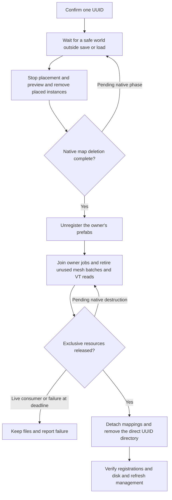
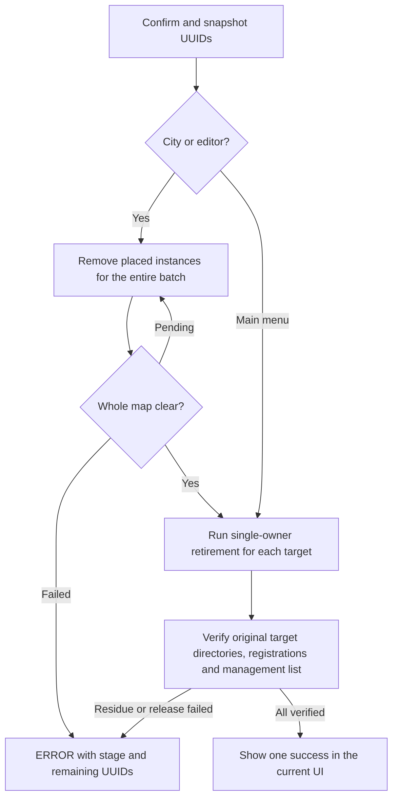

# Bridge deletion

This document governs confirmed player deletion in the management panel and settings. Startup migration and damaged-asset recovery follow [the generation contract](BRIDGE_GENERATION_CONTRACT.md#migration-failure-falls-back-to-removal).

## Single bridge

Confirm the selected UUID in the management panel. Stop placement and preview, update shared junctions, then remove the placed bridge instances. The native network and prefab systems must consume their deletion notifications before the renderer retires their resources. Run every ready step on the main thread at the first safe opportunity, including when simulation speed is zero.

Use the renderer's actual instance counts, groups, mesh consumers and work handles. Reset an eligible batch to its default bindings, release its resident geometry and update native bookkeeping independently of the game's available memory. Leave occupied groups, shared allocations and their bindings intact. Finish owned asynchronous reads through their native owners. Release loaded, exclusive owner assets and check their authoritative state. Unity objects queued for destruction require the engine's destruction boundary. Do not call global asset unloading, force garbage collection, wait for a timer as proof, or promise immediate return of memory to the OS. A real outstanding consumer keeps the operation pending or causes a retryable error.

### Shared map, memory and file lifecycle

Both actions use the same owner-retirement operation. The confirmation callback records consent. The main loop stops placement and preview and applies placed-network deletion tags before the native PrefabSystem, PostTool and modification consumers. Collect real edges and nodes, including auxiliary decks, before modifying ECS buffers. Exclude tool previews, prefab entities and cached compositions from placed-instance selection. Preserve connected ordinary roads and reassign shared junctions. Verify native removal of the placed entities and their references before retiring the backing prefabs.

Keep files readable while deregistering the target prefabs and joining native jobs. Preserve the global VT stacks, shader material, render target and shared atlas. Complete pending mesh and VT reads, disconnect the target's physical read routes and release only exclusive allocations. No later preview, generation, export, discovery or streaming work may reopen deleted files through a stale registration or pending reader. This invariant also applies after partial failure.

For file removal, match the exact immediate `ImportedData/b{UUID}` directory and invoke recursive deletion once. Single deletion locates the UUID directly. Reject directory links. Do not enumerate individual payloads, inspect sidecars or hashes, traverse dependencies, compare duplicate CIDs, transfer registrations, or move the directory elsewhere. Independent copies in other UUIDs and source packages retain their ownership. Detach only native registrations whose physical paths belong to the target. Verify the local index and disk separately. Keep unfinished targets available for retry.

New requests live in session memory. Compatibility handling consumes previously confirmed native95 tickets, including already detached directories. New requests never create tickets or start an exit-time worker. Startup recovery and style-scoped deployment maintenance have separate ownership and backup rules.

Verify create/delete/create, repeated requests, cancellation, active and paused worlds, shared junctions, native reads and object destruction, partial failure and retry. Record which boundaries ran with game assemblies and which still need a live-game check.

## All bridges

The settings action stays available during loading, inspection and saving. Coalesce repeated clicks into a single confirmation and a single pending operation. Cancellation changes neither the map nor the files. Keep confirmed intent across world changes. Capture the exact immediate `ImportedData/b{UUID}` directory names when the player confirms. Include unplaced and unregistered directories whose entire name is a lowercase `b` followed by a hyphenated UUID. Skip flat historical files and nested matches. In a city or editor include placed Bridge Builder networks without directories, and verify the **entire batch** of placed bridge instances has retired before deleting any owner's files. In the main menu proceed directly to owner retirement. Each UUID uses the same native release and directory primitive as single deletion. Preserve bridges created after confirmation, other roads, shared rendering infrastructure and unrelated files.

Saving, loading and world changes defer unsafe work; they do not restart the failure deadline. A ready owner can finish while another awaits an actual native phase. On terminal failure log an ERROR with batch, stage, remaining target count and UUIDs, and retain failed rows for retry. Send success once to the current native UI only when all captured targets have cleared the map, registrations, directories and bound management list. Empty, failed and canceled requests produce no success dialog. Never replay a completed notification in a later world or session.
