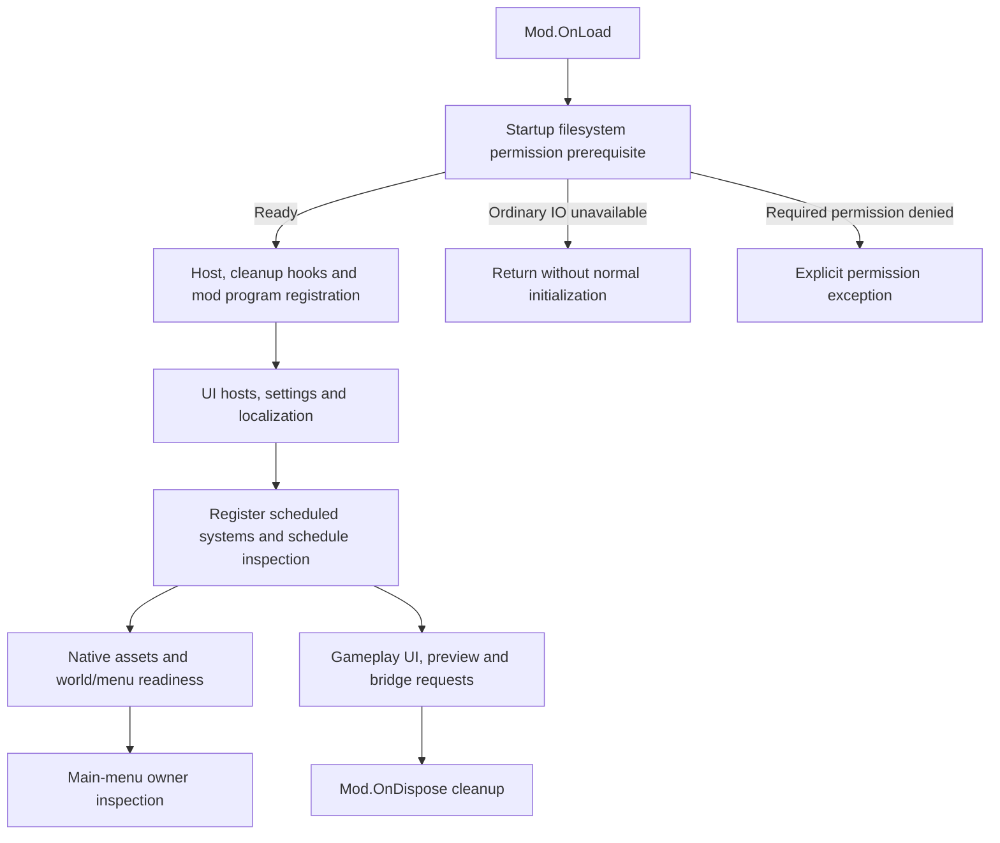
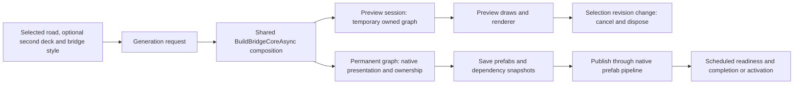

# Current implementation architecture

This is a descriptive guide to the current source tree, not an additional normative authority.
The [constitution](constitution.md), [contracts](contracts/README.md) and
[specifications](specs/README.md) define requirements. The routes below were checked against source;
this document does not certify a successful game run, visual result, cold load, GPU/driver combination
or cloud session. Historical evidence records describe only their inspected implementations.

## Modules and responsibilities

| Area | Current entry points | Responsibility |
| --- | --- | --- |
| Mod lifecycle | [Mod.cs](../src/BridgeBuilder/Mod.cs) | Startup permission prerequisite, host/settings/localization, mod program registration, scheduled systems, disposal and recovery presentation |
| UI and requests | [BridgeBuilderUISystem](../src/BridgeBuilder/UI/BridgeBuilderUISystem.cs), [BridgeRuntimeRequests](../src/BridgeBuilder/Runtime/BridgeRuntimeRequests.cs) | Selection and management bindings, request delivery and completion messages |
| Generation | [BridgeGenerationSystem](../src/BridgeBuilder/Systems/BridgeGenerationSystem.cs), [composition](../src/BridgeBuilder/Systems/BridgeGenerationSystem.Composition.cs), [router](../src/BridgeBuilder/Bridges/BridgeGeneratorRouter.cs) | Selected road/style composition, private owned graph, style-specific transformation |
| Preview | [preview orchestration](../src/BridgeBuilder/Systems/BridgeGenerationSystem.Preview.cs), [renderer](../src/BridgeBuilder/Runtime/BridgePreviewRenderer.cs) | Revision-bound generation work, temporary graph rendering and cleanup |
| Publication | [BridgePublicationSystem](../src/BridgeBuilder/Systems/BridgePublicationSystem.cs), [management](../src/BridgeBuilder/Systems/BridgeGenerationSystem.Management.cs) | Native registration and scheduled readiness before creation completion/activation; deletion orchestration |
| Persistence | [BridgePrefabPersistence](../src/BridgeBuilder/Runtime/BridgePrefabPersistence.cs), [BridgeDependencyPersistence](../src/BridgeBuilder/Runtime/BridgeDependencyPersistence.cs) | Owned native files and persisted external dependency copies with their identities |
| Inspection and recovery | [BridgeStartupAssetSystem](../src/BridgeBuilder/Systems/BridgeStartupAssetSystem.cs), [BridgeDiskAudit](../src/BridgeBuilder/Runtime/BridgeDiskAudit.cs) | Existing owner discovery, dependency repair, migration, disk audit and scoped recovery results |
| Material programs | [restoration](../src/BridgeBuilder/Runtime/BridgeCustomShaderRestoration.cs), [registry](../src/BridgeBuilder/Runtime/BridgeCustomShaderRegistry.cs) | Register embedded mod-owned native material graphs and queue variants |

The `Runtime` directory contains persistence, ownership, rendering and integration helpers as well as
runtime state; its name does not mean all its operations run on every frame. Tools under `tools` are
offline development/build utilities, not the player's startup pipeline.

## Startup and lifetime

[BridgeInspectionPermissions](../src/BridgeBuilder/Runtime/BridgeInspectionPermissions.cs) probes
isolated temporary files once per startup across the configured asset root and profile working
locations, including virtual-texture storage. It performs write/read/move/delete IO. A successful root
probe is not proof that every child file has the same ACL. `Ready == false` returns from `OnLoad`;
required permission denial throws the dedicated exception. Mod program registration failure is logged by
`OnLoad` and does not itself take that early-return path.

Generation is scheduled before `PrefabUpdate`; publication is scheduled after the native
`UnlockSystem` in `MainLoop`. UI and startup inspection run in UI update phases. Publication clears
its pending completion before invoking the callback, and does not recursively drive native systems.
Disposal removes hosts/settings and stops owned work/hooks. The shader registry intentionally retains
native registrations that meshes may still reference, rather than unloading them with the panel/mod
cleanup. These are source-level lifetime decisions, not a promise that every third-party API call
cannot fail.

## Preview and permanent creation

Preview and creation share composition, not asset identity or publication. A create request generates
a fresh graph; it does not promote the preview objects. Preview work uses selection revisions and
cancellation so obsolete continuations can release their temporary objects. Permanent creation saves
owned nodes and dependency snapshots before publication. The publication callback reports native
readiness before management completes the request. Failures are reported by the relevant stage;
a successful preview does not establish persistence or activation success.

See the [generation reading scope](contracts/reading-map.md#bridge-generation-contract),
[preview contract](contracts/preview-contract.md) and [preview specification](specs/preview-spec.md).

## Persistence, existing bridges and recovery

The generated graph has owner-scoped names/paths and native asset identities. The dependency saver
also copies needed external inputs with their original CIDs; a copied source dependency is distinct
from a newly generated owned identity. Persistence and native registration are separate steps.
[Deletion intents](../src/BridgeBuilder/Runtime/BridgeDeletionIntent.cs) support removal bookkeeping;
management and deferred removal coordinate native lifetime and file cleanup rather than treating a
folder deletion as the whole operation.

Startup inspection waits for asset loading and main-menu readiness. Its current code restores
programs, resumes pending player deletion, reads owner groups and their persisted dependency graphs,
then attempts dependency supplementation, portable migration, legacy-name/layout normalization and
disk audit. Availability of an optional source or registration of every non-network dependency is
not used as a blanket exemption from inspection. Recovered disk references are tracked separately
from stale live references to avoid serializing nulls back into repaired files. Shared program
restoration errors are logged and keep owner processing from deleting all bridges on that basis.

Owner repair failure enters the owner-scoped backup/removal path. Backup-directory permission denial
has its documented deletion fallback; required source/work-file permissions retain their explicit
exception policy. Ordinary exceptions are still caught and logged in source. Neither this overview
nor those catches establish an absolute absence of exceptions or certify all recovery cases.

Actual changed results are presented through `Mod.ShowRecoveryMessage`. It then calls
[BridgeGameRestart.Run](../src/BridgeBuilder/Runtime/BridgeGameRestart.cs) immediately, without waiting
for confirmation or closing the dialog. The existing implementation launches a hidden PowerShell
helper, requests native game quit, and has the helper wait for that process before relaunching the
recorded executable/arguments/working directory. A scheduling guard prevents duplicate successful
schedules. Helper launch/relaunch is an external process boundary and can fail; this is not a claim
that restart works in every cloud host or permission configuration. Agents must still not start or
close the player's game themselves.

The authoritative owner outcomes, permission exceptions and subsequent unchanged-run requirements
are in the [self-check contract](contracts/self-check-contract.md) and
[specification](specs/self-check-spec.md); persistence details are in the
[persistence contract](contracts/persistence-contract.md) and [specification](specs/persistence-spec.md).

## Version migration boundary

Self-check owns published Bridge Builder old-format migration into the current representation.
Ordinary runtime consumers must not interpret older Bridge Builder representations. Native
source formats and passive historical schema types needed for deserialization are separate:
the latter expose migration input without activating old runtime behavior. This is the required
responsibility boundary; source audits and cold migration tests establish its implementation.

## Material build and runtime boundary

[BuildNativeLayered.py](../tools/MaterialShaders/BuildNativeLayered.py) and
[BuildNativeDecal.py](../tools/MaterialShaders/BuildNativeDecal.py) compile the programs offline.
[BuildNativeMaterialGraph.py](../tools/MaterialShaders/BuildNativeMaterialGraph.py) produces the
native Shader/Material/AssetDatabaseResources graphs embedded in the mod. Runtime imports their
serialized material descriptions into the active MaterialLibrary; it does not rebuild a Material
from a separate recipe or compile HLSL.

[MovableCustomShaderAsset](../src/BridgeBuilder/Bridges/Common/Movable/MovableCustomShaderAsset.cs)
loads the embedded BoneDecal and WorldLayeredPbr graphs. The
[program identity helper](../src/BridgeBuilder/Runtime/BridgeNativeMaterialProgram.cs) hashes the
logical family and full signed-int render queue independently of bundle bytes. Queue identity is
also stored as the Surface integer property `BridgeBuilder_RenderQueue`. Runtime configuration
changes the recorded native identity/queue fields, not compiled shader bytecode.

[Startup registration](../src/BridgeBuilder/Runtime/BridgeCustomShaderRestoration.cs) registers the
default programs, reads owned current Surface headers, identifies their explicit queue/template
pairs and registers each referenced variant before native realization. The registry retains the
owning native bundles while published descriptions remain in use. New bridges and exports contain
Surface references but no owner-local program payload; Bridge Builder remains required.

Legacy custom-program evidence is classified only during self-check by
[BridgeLegacyShaderOwners](../src/BridgeBuilder/Runtime/BridgeLegacyShaderOwners.cs), using the existing
owner-scoped backup/removal and restart path. Ordinary generation, preview and UI do not delete
legacy owners. Unrelated missing-program or shader failures are not legacy-protocol evidence.
Historical prototype and integration results remain in the
[material graph evidence](archive/audits/native-material-graph-authoring-prototype.md) and
[production integration record](archive/audits/production-native-material-graph-integration.md);
they do not certify the current game, graphics driver or cold-load result.

See the [material contract](contracts/material-contract.md) and
[specification](specs/material-spec.md) for required ownership, binding and program compatibility.
Precompilation does not eliminate Unity/container compatibility or driver execution differences.

## External boundaries and evidence limits

Files and asset databases, Unity/native prefab and rendering APIs, UI bindings and the restart helper
are separate integration boundaries. Windows path mappings and filesystem permissions are relevant
to persistence/recovery; GPU/driver and Unity versions are relevant to native realization. Compiler
and architecture variation must not be inferred away from one successful local build. GeForce NOW
is a cloud-host scenario, not a local GPU test or a guarantee of mod availability.

The [compatibility principles](constitution.md#backward-and-cross-environment-compatibility) and
[development review](contracts/development-contract.md#project-compatibility-review) govern changes.
The [cross-environment contract](contracts/cross-environment-contract.md) and
[specification](specs/cross-environment-spec.md) define manual/pre-release evidence. This source review
performed no game launch, GPU/cloud execution, build, deployment or automatic-restart test.
