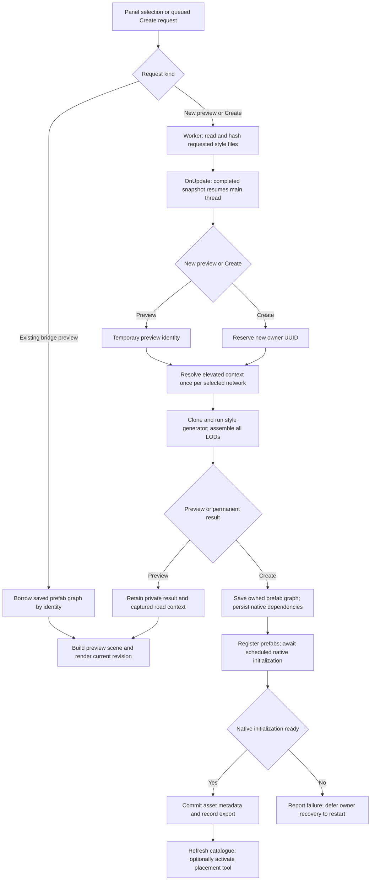

# Bridge generation contract

Required companion: [Generation Spec](../specs/generation-spec.md). Both documents are normative; read applicable requirements from both. See the [complete scope maps](reading-map.md) for additional relocated sections.

This document is normative within its stated scope. Responsibility-based placement does not
change requirement strength, existing specialist exceptions or explicit user authorizations.
Specifications are equally normative; this separation introduces no new precedence hierarchy.

Follow the [modular generation workflow](../specs/generation-spec.md#generation-workflow) for the normative sequence from request preparation through publication and cleanup.

## Prefab identity and display names

Road and bridge discovery, deduplication, exclusion, selection and saved-source lookup must use
actual prefab identifiers, never localized or user-editable display names. Road Builder roads
use their registered prefab identifier (`r{uuid}`), obtained from the actual prefab/configuration
identity; do not extract or guess a UUID from a display label. Preserve distinct identifiers with
identical labels, and deduplicate repeated discovery of the same identifier. Renaming a label
must not redirect a selection or change its source identity. Display-name text search and sorting
remain presentation behavior and do not determine identity or eligibility. Generated bridges retain
their independent owner UUIDs. Published historical identity migration belongs only to self-check.

All styles use the [common candidate and saved-asset naming rules](../specs/ui-spec.md#candidate-saved-asset-and-map-names); prototype proper names affect only native map labels and never override the submitted asset display name.

## Bridge implementation policy

For bridge work, the [current implementation policy](generation-contract.md#generation-current-implementation-policy)
requires hardcoded data from real prototypes and independence from the original prototype files.
Use optional style branches, coherent-increment deployment, measured CPU/GPU choices and
incremental integration.
Correct native behavior, resource ownership, persistence and localization requirements remain in force.

## Generation and execution

Follow [trusted internal execution](../constitution.md#repository-trusted-internal-execution): remove internal
memory/computation/GPU input and result validation, retaining actual file/network IO boundary validation and
operation failure handling. Offline assertions are development tools, not runtime invariants.
Business/native rules, cancellation and resource lifetimes remain unchanged.

Use measured hardcoded prototypes, memberships, numerical `.bin` resources and construction recipes, without runtime prototype rediscovery or dependence on original authoring files. Generation sections 2, 4, 5 and 8 govern exact numerical lifetime, prototype complexity, LOD exceptions and authored-part mapping. The root-visible pedestrian/Lift01/Lift02 truss and sidewalk invariants apply at every LOD. Preserve adjoining boundaries, bones, materials and native behavior; compilation alone is not completion.

[CPU affine execution](../specs/generation-spec.md#generation-cpu-affine-geometry-execution) requires shared packed XYZ processing with ordered rounding, immutable snapshots, joined workers and owned native output. Deferred preparation acquires the request parameter scope only when construction begins; callbacks own copied output data. No permanent numerical caches, forced GC or promised immediate RSS decrease. Independent requests cannot clear one another's resources.

[Continuous preview execution](preview-contract.md#preview-continuous-background-generation-and-asynchronous-native-dispatch) uses detached background computation and asynchronous native dispatch; no artificial frame slicing/6 ms budget. Preserve cancellation, native affinity, request-local reuse and measured viewport supersampling. Formal creation retains the same data semantics.

### Request lifecycle ownership

### End-to-end generation flow

The common request-to-result sequence applies to explicit generator routes. Prototype discovery entries and double-deck variants are not additional generator routes. The earlier route count is retained in the [workflow scope record](../archive/audits/generation-workflow-scope-record.md). The sequence describes execution boundaries, not a promise that
all work is asynchronous or that native initialization establishes visual correctness.

### Request scheduling and file preparation

The main-thread generation update waits for pending native publication or removal, releases
failed preview resources when safe, and services material preparation before starting another
request. Outside catalogue settling, queued operations take precedence over a new preview.
Changing the preview selection increments its revision; only the matching revision may publish
an image. Existing-bridge previews borrow the saved graph and bypass recipe generation and
style-file preparation.

For a new preview or Create, File preparation starts file reading and hashing for the
requested style on a worker. The worker receives paths, style identity and cancellation state,
not Unity objects or a live preview. The main-thread update polls completion across frames; it does not block
on an unfinished task. After completion it installs the request's file snapshot for the main-thread
continuation and releases it in guaranteed cleanup. Cancellation releases any completed snapshot through
worker-safe cleanup. Do not substitute a later unverified file read for the prepared input.

Prefab access, Unity/native asset operations, rendering and publication remain on the main thread.
Pure geometry calculations may use their existing worker jobs, but those jobs do not make the
whole generation call asynchronous. GPU material work and native upload are not moved to a file
worker. File preparation is not an offline material bake; generation consumes the source and
prepared material resources required by its route.

### One selected source context and style composition

Create reserves `ImportedData/b{uuid}` exclusively and registers pending metadata; a new preview
receives only a temporary identity. Both use the [single elevated context](../specs/generation-spec.md#generation-select-one-road-level-branch-before-generation)
and [generation algorithms](../specs/generation-spec.md#generation-workflow). Preview results retain
the captured contexts after generation scope exit. The explicit router owns dispatch and must not
replace the selected family; material matching and native lifetimes remain governed by their specialist contracts.

### Preview is not a pending permanent bridge

A new preview returns after retaining the generated result, before permanent asset-pack assignment,
prefab/dependency persistence and publication. It adopts private nodes even on a partial failure
so that they can be released. Rendering owns an isolated draw list and scene. Clear/dispose order
is renderer, draw list, then session/geometry; a borrowed saved graph is not destroyed.

Create always runs generation again under its new permanent identity. It does not rename, commit
or reuse the preview graph. A successful preview image proves neither independent persistence
nor native placement readiness, and is not evidence of correct in-game animation or appearance.
See the [preview specification](reading-map.md#bridge-preview-specification).

### Permanent save, native publication and completion

Permanent generation assembles the owner graph, assigns native presentation/asset-pack data,
and saves owned prefabs through the owned-prefab writer. It then calls
the dependency writer to persist the reachable native dependencies with their
required identities. Native resource contents must be initialized and successfully written and
closed before any subsequent read, unload/reload or dependency consumer relies on the file.
Missing files, failed writes and failed native operations are errors, not successful generation.

The generation owner must finish [current native unlock serialization](../specs/persistence-spec.md#native-unlocking-and-persistence)
for every newly owned network before its first permanent save. This includes non-Network source
styles: preserving the selected network's native gate does not defer its current-format conversion
to startup self-check. Keep historical migration and the existing self-check workflow separate.

This call's successful dependency persistence is the dependency guarantee for its newly saved
graph. Do not repeat the dependency-index traversal through a second dependency validation pass
before publication. This trust does not extend to arbitrary historical assets; loading, migration
and self-check retain their own checks under [sections 17](persistence-contract.md#generation-17-persist-external-dependencies-as-identical-cid-copies-owned-by-each-bridge)
and [19](persistence-contract.md#generation-19-independent-native-persistence-and-additive-legacy-conversion).

Native publication registers owned dependencies before the root and returns with
publication pending. The normally scheduled native prefab pipeline must initialize the graph;
do not recursively drive game systems to force readiness. Completion runs in the main loop after
the native `UnlockSystem` has propagated new dependency-group states, including while simulation
is paused. A tail-of-`PrefabUpdate` callback is too early for that propagation. The callback checks live native
entities, network archetypes/sections and menu registration. Only a ready result proceeds to
asset-metadata commit, export-state recording and request completion. Create-and-build
may then activate the native placement tool; it does not place a bridge automatically. Catalogue
and menu refresh follow completion. Post-commit UI refresh failure does not undo the saved bridge.

### Cancellation, failures and cleanup

A stale or cancelled preview cannot publish a result. Cancellation/disposal releases its private
resources and file leases without touching saved owners or shared source prefabs. Rendering
callback failures defer camera/resource release to a safe update rather than destroying a camera
inside its own callback. System stop/destruction cancels pending file preparation.

A failed permanent creation is not treated like disposable preview geometry. It ends the active
creation reservation, hides any incomplete live owned network and defers audited owner-file
backup/recovery to restart. It does not immediately delete live native indices or healthy owners.
Incomplete metadata and diagnostics must retain enough identity for the existing self-check
lifecycle. Successful generated assets remain independently loadable native assets.

Apply [player-controlled generation](#generation-player-controlled-generation-without-structural-rejection-gates); native readiness is operational, not visual acceptance.

### Offline inputs and runtime products

Offline extraction measures source geometry/UVs, classifies parts and produces typed BBN data.
Offline material tools prepare approved bounded repeats, remove embedded markings and write
complete channel/mip graphs. Those outputs are packaged inputs to runtime, not stages repeated
for every preview. Runtime still samples the user's actual selected native network and realizes
any permitted variable-input conversion. Preparation of files on a background thread is neither
of these offline authoring steps.

| Stage | Inputs | Output used by the next stage |
| --- | --- | --- |
| Offline geometry measurement | Real prototype meshes, attributes and native behavior | Immutable part memberships, typed measurements and transform recipes |
| Offline material preparation | Evidenced original PBR and sampling domains | Packaged native Surfaces, textures and complete mips with new identities where content changes |
| Runtime selected-road sampling | One elevated context per selected network, closed pose and actual lane/sidewalk layout | Evaluated road/lane geometry, source material identities and occurrence provenance |
| Runtime per-part adaptation | Measured recipes, target dimensions and source attributes | Per-LOD structural positions, face recipes, frames and physical/appearance assignments |
| Runtime material realization | Actual receiver classification, target part and prepared/source resources | Visible road triangles, UV/frame mapping and complete native material references |
| Runtime native assembly | Structural, road, lane and intended paint products | Owned mechanism/object/network graph with complete LOD groups |
| Permanent output only | Completed owned graph | Written prefabs and dependencies, followed by scheduled native initialization and commit |

Dashed failure edges summarize real operation-error exits; they are not geometry-quality tests.
The caller contains errors and selects the preview or permanent cleanup lifecycle described above.
No diagram success node substitutes for native loading, game rendering or animation evidence.

## Contents

- [Movable bridges: no special road-width adaptation](../specs/generation-spec.md#generation-movable-bridges-no-special-road-width-adaptation)
- [Contract routing](generation-contract.md#generation-contract-routing)
- [Select one road-level branch before generation](../specs/generation-spec.md#generation-select-one-road-level-branch-before-generation)
- [Preserve original UV projection and mapping mode](../specs/generation-spec.md#generation-preserve-original-uv-projection-and-mapping-mode)
- [Wheel-track placement follows actual selected lanes](../specs/generation-spec.md#generation-wheel-track-placement-follows-actual-selected-lanes)
- [Offline source-atlas repeat materials](../specs/generation-spec.md#generation-offline-source-atlas-repeat-materials)
- [Current implementation policy](generation-contract.md#generation-current-implementation-policy)
- [1. Every generated bridge follows its archetype](../specs/generation-spec.md#generation-1-every-generated-bridge-follows-its-archetype)
- [2. The archetype is hardcoded, never copied](../specs/generation-spec.md#generation-2-the-archetype-is-hardcoded-never-copied)
- [3. A generated bridge differs from its archetype in geometry and road structure alone](../specs/generation-spec.md#generation-3-a-generated-bridge-differs-from-its-archetype-in-geometry-and-road-structure-alone)
- [4. The tower and the cables are derived geometry, never referenced geometry](../specs/generation-spec.md#generation-4-the-tower-and-the-cables-are-derived-geometry-never-referenced-geometry)
- [5. A generated tower differs from its archetype in width alone](../specs/generation-spec.md#generation-5-a-generated-tower-differs-from-its-archetype-in-width-alone)
- [6. Nothing is claimed as fixed until it has been seen working](development-contract.md#generation-6-nothing-is-claimed-as-fixed-until-it-has-been-seen-working)
- [7. A fault is found by dumping both and diffing, not by reasoning about it](development-contract.md#generation-7-a-fault-is-found-by-dumping-both-and-diffing-not-by-reasoning-about-it)
- [8. Stretch or translate is decided by one thing: does the part cross the bridge's centre](../specs/generation-spec.md#generation-8-stretch-or-translate-is-decided-by-one-thing-does-the-part-cross-the-bridges-centre)
- [9. The suspension family is the reference; every other family is held to the same list](../specs/generation-spec.md#generation-9-the-suspension-family-is-the-reference-every-other-family-is-held-to-the-same-list)
- [10. Unsupported inputs are reported; movable families are in scope](generation-contract.md#generation-10-unsupported-inputs-are-reported-movable-families-are-in-scope)
- [11. A double deck bridge is built from a double deck archetype, or not at all](../specs/generation-spec.md#generation-11-a-double-deck-bridge-is-built-from-a-double-deck-archetype-or-not-at-all)
- [12. Branches organize work without blocking integration](development-contract.md#generation-12-branches-organize-work-without-blocking-integration)
- [13. Deploy coherent increments and preserve healthy assets](development-contract.md#generation-13-deploy-coherent-increments-and-preserve-healthy-assets)
- [14. Preserve each archetype's width allowance](../specs/generation-spec.md#generation-14-preserve-each-archetypes-width-allowance)
- [15. Bridge lighting is copied from the archetype as behavior](../specs/generation-spec.md#generation-15-bridge-lighting-is-copied-from-the-archetype-as-behavior)
- [16. Preserve native construction and upkeep pricing](../specs/generation-spec.md#generation-16-preserve-native-construction-and-upkeep-pricing)
- [17. Persist external dependencies as identical-CID copies owned by each bridge](persistence-contract.md#generation-17-persist-external-dependencies-as-identical-cid-copies-owned-by-each-bridge)
- [18. Bridge asset file ownership is determined only by b{uuid} text](persistence-contract.md#generation-18-bridge-asset-file-ownership-is-determined-only-by-buuid-text)
- [19. Independent native persistence and additive legacy conversion](persistence-contract.md#generation-19-independent-native-persistence-and-additive-legacy-conversion)
- [21. Movable bridges use generated selected-road surfaces and native mechanisms](generation-contract.md#generation-21-movable-bridges-use-generated-selected-road-surfaces-and-native-mechanisms)
- [22. New bridge styles require immediate UI synchronization, generator routing and multilingual names](../specs/generation-spec.md#generation-22-new-bridge-styles-require-immediate-ui-synchronization-generator-routing-and-multilingual-names)
- [23. Performance follows measured bottlenecks](../specs/generation-spec.md#generation-23-performance-follows-measured-bottlenecks)
- [24. Movable bridge asset size](../specs/generation-spec.md#generation-24-movable-bridge-asset-size)
- [25. Adapt sidewalk-dependent components to the actual elevated road](../specs/generation-spec.md#generation-25-adapt-sidewalk-dependent-components-to-the-actual-elevated-road)
- [Current repository checklist](development-contract.md#generation-current-repository-checklist)

This is the general normative contract for every bridge generator, fixed or movable. It is
separate from the [project contract](reading-map.md#project-contract), which governs project-wide workflow,
communication and documentation. Read both together with applicable AGENTS.md instructions.
Bridge geometry, native behavior, generation, preview acceptance, persistence and lifecycle rules
are owned here; they are not optional appendices of the movable-bridge contract.

## Contract routing

- All bridge work: this contract and the [project contract](reading-map.md#project-contract).
- Request, generation and publication lifecycle: [generation and execution](#generation-and-execution) defines scheduling, ownership, completion and failure obligations. Read it with the [generation specification](../specs/generation-spec.md).
- Generator implementation and refactoring: additionally [generator code organization](reading-map.md#generator-code-contract).
- Non-Network source bridges: additionally [virtual prototype preparation before Bridge Builder generation](reading-map.md#non-network-bridges-contract).
- Movable bridges: additionally [movable bridge generation](reading-map.md#movable-bridges-contract), incorporated by [section 21](generation-contract.md#generation-21-movable-bridges-use-generated-selected-road-surfaces-and-native-mechanisms).
- Persistence: additionally [asset persistence policy](reading-map.md#bridge-asset-persistence), incorporated by [section 17](persistence-contract.md#generation-17-persist-external-dependencies-as-identical-cid-copies-owned-by-each-bridge).
- Previews: additionally [preview specification](reading-map.md#bridge-preview-specification).
- Cross-environment verification and requested releases: additionally [manual and pre-release testing](reading-map.md#cross-environment-testing-contract).
- Materials: additionally [material generation](reading-map.md#material-generation-contract).
- Sidewalk-dependent components in every bridge: [section 25](../specs/generation-spec.md#generation-25-adapt-sidewalk-dependent-components-to-the-actual-elevated-road). Use each side's actual elevated-mode
  sidewalk presence, position and width, including absent and asymmetric sidewalks. Adapt inner
  railings and bridge-authored sidewalk parts accordingly; never impose the prototype's layout.

Existing section numbers are retained for audit continuity. Section 20 remains in the project
contract because it defines project metadata, not bridge generation. Unqualified numbered contract
references in bridge instructions refer here except section 20.

## Current implementation policy

Implement the remaining movable generators incrementally using hardcoded data from real
prototypes: other players may not possess the original prototype files. Preserve required
bridge behavior and distinguish executable stages from completed support.

## Hardcoding and source independence are retained

All prototype-specific parameters, component layouts, native motion/bind data, part membership,
construction coordinates and LOD rules must come from a real, identified prototype and be recorded
as immutable generation data. Prototype inspection and inference happen during development, not
on the player's machine. Do not invent missing values or require the player's original Prefab to
reconstruct these facts. Hardcoded profiles, ranges and construction recipes are valid; exhaustive
per-vertex literals are not mandatory when a compact measured representation yields the same result.

Separate original authoring files from the resources actually required to generate and load the
bridge. Record the necessary geometry/material inputs and their provenance. Make required non-built-in
resources available through permitted packaged data and the existing per-bridge dependency snapshots;
a developer-local path or the original prototype Prefab is not a distribution strategy. Do not assume
that hardcoded numeric parameters alone make absent geometry or textures available. Retain native
content prerequisites where applicable, output ownership isolation, resource identity and lawful resource use.
Verify the graph without access to the original prototype files; this is distinct from cold loading
with Bridge Builder enabled. Report source-file independence and mod-enabled cold-load evidence separately.

## Runtime contains no coordinate heuristics

Runtime authored-part identification must not use a fixed, non-zero coordinate. Applying an
explicitly recorded construction coordinate or transform is permitted. Comparisons of `x`, `y` or `z`
with zero are valid runtime spatial tests with any comparison operator (`<`, `<=`, `>`, `>=`, `==`
or `!=`); for the stretch-or-translate decision specifically, the `x = 0` axis remains the default
classification boundary outside the explicit exceptions above. A test such as “translate this part when `x > 10 m`”,
“this is a railing between `y = -0.5 m` and `y = 3 m`”, or the same test hidden behind a named constant,
ratio, road-width fraction, bounding-box extent or family-specific fallback is forbidden. A small
numeric tolerance may implement equality with an axis origin; it is not another boundary and may never
be used to create a non-zero selection band.

If identifying an authored part needs a non-zero coordinate, that identification belongs exclusively
to the **metaprogramming step**. The metaprogram may inspect the archetype mesh, walk topology, slice
height bands, compare bounds or use temporary non-zero thresholds. Its reviewed output is committed as
immutable source data: the exact archetype and mesh/LOD identity plus the exact component coordinates or
vertex membership which the runtime must transform. The threshold and the inference which produced the
data do not enter the game assembly's generation path.

Runtime code therefore hardcodes the metaprogram's result; it does not rediscover it. Runtime may look
up a recorded part by archetype and mesh identity and apply the recorded transform to its recorded
coordinates. It may not inspect bounds, nearest vertices, connected components, height bands, relative
span, aspect ratio, mesh size or naming resemblance to guess which part it has. Missing or mismatched
metadata is unsupported input to report, never permission to fall back to a geometric heuristic.

Metaprogramming records which logical authored parts touch or cross `x = 0` and the exact
membership of the explicit exceptions. It may not invent additional transform rules. Its purpose is to move
the expensive geometric identification out of the game runtime, not to introduce another criterion.

The highest-detail archetype mesh makes this decision once for itself and for every level of detail.
An LOD is a representation of those same authored parts, not another archetype and not another vote on
whether a part reaches `x = 0`. A coarse mesh may weld together parts which the full mesh keeps separate;
its reduced topology must never turn a translated side truss, arch or railing into stretched material.
Every LOD reuses the full-detail part profile. Diagnose inconsistent carried-range translation
in development tests; it is not a runtime structural rejection gate.

## Runtime error boundaries

Follow [trusted internal execution](../constitution.md#repository-trusted-internal-execution). Validate external
file/network data once at its IO boundary; trust subsequent owned data and in-memory computation.
Do not introduce or retain internal invariant assertions, numerical/structural result gates or
repeated input checks. Preserve actual operation failure propagation, native business rules,
cancellation and ownership cleanup. Offline tests may verify the construction; runtime must not
repeat their assertions. Structural or appearance quality cannot gate generation.

## Player-controlled generation without structural rejection gates

Every fixed and movable bridge must attempt the player's selected generation request without
an active structural or appearance acceptance gate. Width compatibility, negative scale,
collapsed or degenerate shapes, intersections, overlap, clearance, topology quality, visual
material fit and sampling-range quality must not reject preview, creation or publication.
The player decides whether the resulting structure is suitable. Keep useful measurements in
offline tests; do not run internal result validation in the runtime path.
This rule applies to every LOD, component, geometry/material stage and bridge family.

Continue applying the documented construction and material rules; removing a gate does not
authorize changing unrelated geometry, discarding parts or disguising a failed computation.
Preserve finite signed transforms, original attributes and native sampler behavior. A missing
material correspondence selects the original-source route. Never turn a failed operation into
fabricated successful output. The material pipeline contains native/external exceptions and
returns explicit failure results under its complete non-throwing contract.

Keep actual operational errors explicit: missing/corrupt required files, invalid serialized
indices or resource schemas, unavailable native APIs, failed writes and native registration failures. Such errors describe a failed
operation, not a judgement that the player's bridge shape or appearance is unacceptable.
Persistence must still write required resources before reading/publishing them and preserve
healthy owners. Historical asset self-check and missing dependency recovery remain separate.

## Unsupported inputs are reported; movable families are in scope

Draw, lift and pedestrian movable bridges are not deferred families. Implement their measured,
hardcoded construction rules and route executable generators through the existing UI and registry.
Report actual unsupported inputs, missing generation data and failed construction stages. Do not
substitute another bridge, publish incomplete output or treat a stub as support.

Preserve native content prerequisites and each style's source identity. The source used to produce
immutable data is selected during development; another player need not possess the identical
prototype authoring file. Required resource availability follows [section 2](../specs/generation-spec.md#generation-2-the-archetype-is-hardcoded-never-copied) and the current policy.
`Extradosed01` retains its base-game identity; native `GoldenGate` and pack-provided
`GoldenGateDouble` remain distinct archetypes.

## Movable bridges use generated selected-road surfaces and native mechanisms

[Movable bridge reading scope](reading-map.md#movable-bridges-contract) is the normative supplement for draw,
lift, pedestrian and subsequently admitted movable mechanisms. Read it before their development.
Its paired contract and specification define the general generation, rendering, graph and
persistence method; the [failure audit](../archive/bridge-evidence/generation-source-observations.md#movable-generation-failure-observations)
records encountered failures, while the specification retains mandatory prevention. The method derives from the implemented
pipeline; per-style dimensions and historical section tables are evidence, not universal rules.
[Selected-road conversion](../specs/movable-spec.md#movable-7-convert-the-closed-pose-road-into-persistent-object-geometry) requires source-faithful materials, measured UV projection and paint integrated into
mechanism geometry, with direct-skeleton decals under [marking layout](../specs/movable-spec.md#movable-18-marking-layout-mesh-and-native-material) and
[common motion](../specs/movable-spec.md#movable-19-common-motion-stacking-visibility-and-underside) rules.
Material preparation follows the material generation contract. [Movable persistence](persistence-contract.md#movable-11-persistence-failures-and-compatibility) requires
selective Section/Piece persistence, native unlock semantics and native-format reader compatibility.

Generate the visible moving road from the selected road's resolved closed-pose composition, convert
it into persistent object geometry, partition it and bind it to the measured native mechanism.
Preserve native traffic connectivity, crossing signals, watercraft clearance and native operation without a per-frame mod controller.
Bridge Builder remains enabled for startup material-program registration. Do not substitute the prototype road surface or a mod-owned animation/signal controller.
Network mapping is specific to the measured bridge archetype and selected road/state. The supplement's
Large Road to DrawBridge03 mapping is an example, not a universal section or node/edge template.

The user's selected-road conversion requires new road-surface topology, skinning and, where needed,
network-to-object attribute conversion. This is a scoped construction operation on the generated
road surface, not permission to re-encode carried archetype structure meshes under [section 4](../specs/generation-spec.md#generation-4-the-tower-and-the-cables-are-derived-geometry-never-referenced-geometry).
[Section 8](../specs/generation-spec.md#generation-8-stretch-or-translate-is-decided-by-one-thing-does-the-part-cross-the-bridges-centre)'s structural widening and offline part-identification rules remain unchanged. Use measured
partition data; do not infer authored hinges or part membership at runtime.

There is no deferred-family gate. Integrate executable variants using their own hardcoded generation
data, and report the supplement's verification evidence separately. Documentation and discovery are
not implementation; compilation and preview are not full acceptance. [General generation obligations](reading-map.md#bridge-generation-contract) govern workflow,
scoped recovery, width audits, native pricing, ownership, persistence and migration.

## Player-controlled structural and appearance results

Related requirements: [Material Spec](../specs/material-spec.md#repository-packaged-textures-belong-to-road-running-surfaces), [Constitution](../constitution.md#repository-packaged-textures-belong-to-road-running-surfaces-part-3).

Follow [player-controlled generation](generation-contract.md#generation-player-controlled-generation-without-structural-rejection-gates): do not reject a generation request
because of structural shape, width, signed scale, degeneracy, overlap, clearance or appearance
quality. Such checks belong to offline verification. Material
no-match selects Original. Preserve external file/schema/index validation at IO boundaries and
actual write/native API failures; trust internal arithmetic under the execution policy. This applies to all bridge
families and LODs without changing historical dependency recovery.

