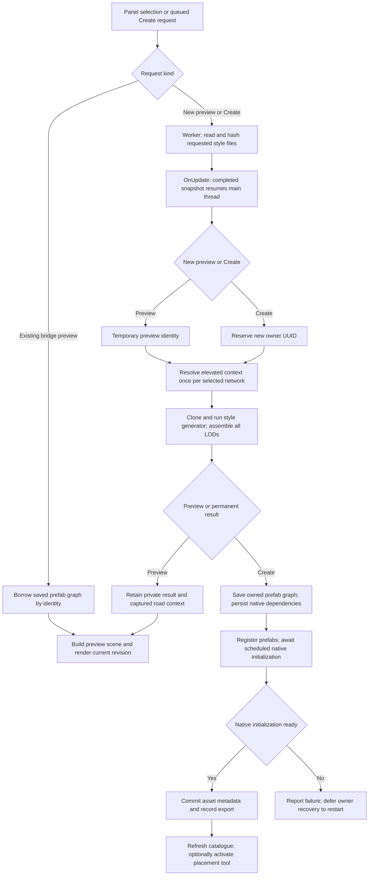
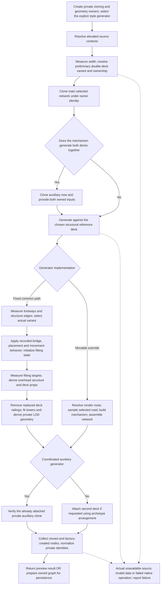

# Bridge generation workflow design

This document explains the implemented workflow, its decisions and intermediate products. It is
not a replacement for the [bridge generation contract](../../agent-contract/BRIDGE_GENERATION_CONTRACT.md),
[movable bridge contract](../../agent-contract/MOVABLE_BRIDGES_CONTRACT.md) or
[material contract](../../agent-contract/MATERIAL_GENERATION_CONTRACT.md). Those documents own the
requirements. Workflow diagrams do not establish in-game visual, animation or cold-load acceptance.

## Contents

- [End-to-end generation flow](#end-to-end-generation-flow)
  - [Request scheduling and file preparation](#request-scheduling-and-file-preparation)
  - [Selected source context and style composition](#one-selected-source-context-and-style-composition)
  - [Preview and permanent identity](#preview-is-not-a-pending-permanent-bridge)
  - [Save, publication and completion](#permanent-save-native-publication-and-completion)
  - [Cancellation, failures and cleanup](#cancellation-failures-and-cleanup)
  - [Generation core](#generation-core-actual-sequence-and-branches)
  - [Movable generation](#movable-generation-sampling-geometry-and-material-realization)
  - [Offline inputs and runtime products](#offline-inputs-and-runtime-products)

## End-to-end generation flow

This design describes the common request-to-result sequence for the 30 explicit generator routes: 20 fixed
styles and 10 movable styles. Prototype discovery entries and double-deck variants are not
additional generator routes. The sequence describes execution boundaries, not a promise that
all work is asynchronous or that native initialization establishes visual correctness.

### Request scheduling and file preparation

The main-thread generation update waits for pending native publication or removal, releases
failed preview resources when safe, and services material preparation before starting another
request. Outside catalogue settling, queued operations take precedence over a new preview.
Changing the preview selection increments its revision; only the matching revision may publish
an image. Existing-bridge previews borrow the saved graph and bypass recipe generation and
style-file preparation.

For a new preview or Create, File preparation starts file reading and hashing for the
requested style on a worker. The worker receives paths, style identity and cancellation state,
not Unity objects or a live preview. The main-thread update polls completion across frames; it does not block
on an unfinished task. After completion it installs the request's file snapshot for the main-thread
continuation and releases it in guaranteed cleanup. Cancellation releases any completed snapshot through
worker-safe cleanup. Do not substitute a later unverified file read for the prepared input.

Prefab access, Unity/native asset operations, rendering and publication remain on the main thread.
Pure geometry calculations may use their existing worker jobs, but those jobs do not make the
whole generation call asynchronous. GPU material work and native upload are not moved to a file
worker. File preparation is not an offline material bake; generation consumes the source and
prepared material resources required by its route.

### One selected source context and style composition

After request/source availability checks, a new preview receives a temporary identity; Create
claims a fresh `ImportedData/b{uuid}` directory exclusively, then registers pending creation metadata. Both enter the common generation workflow.
Before width-dependent variant selection, cloning or generator application, The shared road context
resolves the elevated context once for each distinct selected network. A double-deck request has
one context per independently selected source; it does not reselect at each section or LOD.
Width, extensions, sidewalks, sampling and clone consumers reuse these contexts. Local node,
edge, direction and motion conditions still describe complete physical contributions within that
selected level. Preview results retain the captured contexts after the generation scope ends.

The explicit style router creates the matching generator. The archetype's actual auxiliary-network
arrangement determines main/auxiliary ownership for double decks; main does not necessarily mean
upper or road. Cloning, measured structure adaptation, road composition, material realization and
all-LOD assembly occur through that generator's real calls, rather than as interchangeable global
passes. Fixed bridges retain the selected native road material path. Movable bridges additionally
use measured physical-part correspondence, selected-road sampling, native mechanisms and stable
cross-LOD appearance groups under the [movable contract](../../agent-contract/MOVABLE_BRIDGES_CONTRACT.md). Their
material routing follows the [material contract](../../agent-contract/MATERIAL_GENERATION_CONTRACT.md): a matching
receiver and target part use the corresponding material; no match retains Original through its
supported native representation. No-match classification itself must not throw.

Measured assembly transforms, frame/provenance handling and native material/VT lifecycles remain
part of the relevant generator and material contracts. This overview neither replaces them with a
single width formula nor permits dropping source attributes, layers or resource dependencies.

### Preview is not a pending permanent bridge

A new preview returns after retaining the generated result, before permanent asset-pack assignment,
prefab/dependency persistence and publication. It adopts private nodes even on a partial failure
so that they can be released. Rendering owns an isolated draw list and scene. Clear/dispose order
is renderer, draw list, then session/geometry; a borrowed saved graph is not destroyed.

Create always runs generation again under its new permanent identity. It does not rename, commit
or reuse the preview graph. A successful preview image proves neither independent persistence
nor native placement readiness, and is not evidence of correct in-game animation or appearance.
See the [preview specification](../../agent-contract/Bridge-Preview-Specification.md).

### Permanent save, native publication and completion

Permanent generation assembles the owner graph, assigns native presentation/asset-pack data,
and saves owned prefabs through the owned-prefab writer. It then calls
the dependency writer to persist the reachable native dependencies with their
required identities. Native resource contents must be initialized and successfully written and
closed before any subsequent read, unload/reload or dependency consumer relies on the file.
Missing files, failed writes and failed native operations are errors, not successful generation.

This call's successful dependency persistence is the dependency guarantee for its newly saved
graph. Do not repeat the dependency-index traversal through a second dependency validation pass
before publication. This trust does not extend to arbitrary historical assets; loading, migration
and self-check retain their own checks under [sections 17](../../agent-contract/BRIDGE_GENERATION_CONTRACT.md#17-persist-external-dependencies-as-identical-cid-copies-owned-by-each-bridge)
and [19](../../agent-contract/BRIDGE_GENERATION_CONTRACT.md#19-independent-native-persistence-and-additive-legacy-conversion).

Native publication registers owned dependencies before the root and returns with
publication pending. The normally scheduled native prefab pipeline must initialize the graph;
do not recursively drive game systems to force readiness. Its later callback checks live native
entities, network archetypes/sections and menu registration. Only a ready result proceeds to
asset-metadata commit, export-state recording and request completion. Create-and-build
may then activate the native placement tool; it does not place a bridge automatically. Catalogue
and menu refresh follow completion. Post-commit UI refresh failure does not undo the saved bridge.

### Cancellation, failures and cleanup

A stale or cancelled preview cannot publish a result. Cancellation/disposal releases its private
resources and file leases without touching saved owners or shared source prefabs. Rendering
callback failures defer camera/resource release to a safe update rather than destroying a camera
inside its own callback. System stop/destruction cancels pending file preparation.

A failed permanent creation is not treated like disposable preview geometry. It ends the active
creation reservation, hides any incomplete live owned network and defers audited owner-file
backup/recovery to restart. It does not immediately delete live native indices or healthy owners.
Incomplete metadata and diagnostics must retain enough identity for the existing self-check
lifecycle. Successful generated assets remain independently loadable native assets.

Do not insert structural or appearance rejection gates into this sequence. Finite zero/reversed
widths, intersecting geometry or a player's visually unsuitable result are not reasons to block
generation. Actual missing inputs, non-computable data, I/O failures or failed native operations
must still report their real error; do not fabricate success or swallow them. Native readiness is
an operational requirement, not a structural-quality or visual-acceptance test.

### Generation core: actual sequence and branches

The lifecycle graph's Compose node expands as follows. This is a workflow with conditional
sequences, not a requirement to run every operation for every style. In particular, fixed bridges
do not run movable road sampling or bake their selected-road materials.

The common generation entry makes a preliminary double-deck selection before cloning to determine which
selected network owns the bridge. The fixed generator subsequently measures and selects within
style generation; this is prototype selection using the same elevated source context, not a second
road-level selection. A coordinated generator receives both private clones before sampling.
Other generators attach the second deck after style generation. Single-deck requests skip auxiliary work.
Fixed icon application, ownership checks and permanent-only unlock preparation occur before the
owned-node result is handed to preview or persistence. Style overrides may specialize the fixed
operations; the router must not substitute another family.

Fixed structural derivation reads the corresponding source meshes for each LOD and applies the
recorded part memberships: ordinary central parts stretch over their measured span, side parts
translate, and explicit assembly exceptions keep their own measured transforms. Derived towers,
cables, props and railings are private geometry; their UV/material modes and required attributes
follow the source and transform rules. Overhead and sub-object references are remapped to those
owned products. This does not replace the fixed bridge's selected-road mesh, lane layout or paint.
Footway measurements determine sidewalk-dependent pieces independently on the two sides.

### Movable generation: sampling, geometry and material realization

Movable generation samples the selected road, builds the mechanism render graph, then assembles
the bridge network and objects. These stages are specialized by style. The shared preparation and
assembly path below includes Draw01; coordinated decks supply their own road frames and LOD inputs.
Do not interpret the diagram as a claim that every style has identical partitions or supports.

```mermaid
flowchart TD
    Roots["Resolve recorded source render graph and required content"] --> Sample["Sample native selected composition in the closed pose"]
    Sample --> Layout["Compile road occurrences, source Surfaces, lanes and object rules; retain native layout"]
    Layout --> Material["Initialize material owner; enumerate mechanism LOD render sources"]
    Material --> Prepare["Define style physical partitions and per-LOD appearance patches"]
    Prepare --> Compile["For each LOD: compile selected native road and lane geometry; establish road frame"]
    Compile --> Partition{"Combined physical and appearance partition enabled"}
    Partition -->|Yes| Joint["Combine and bind partitions once; retain motion flag and appearance domain"]
    Partition -->|No| Separate["Bind physical bones; prepare fixed receivers; bind fixed and moving appearance"]
    Joint --> Hook["Optional style reassignment of evidenced part domains only"]
    Separate --> Hook
    Hook --> Route["Process all LOD inputs: classify actual source and match target physical part"]
    Route --> Match{"Material route for this receiver"}
    Match -->|Prototype or corresponding| Project["Resolve measured patch or corresponding native object Surface and UV frame"]
    Match -->|Original| Original["Retain original or supported same-source native representation"]
    Project --> Content{"Material realization"}
    Content -->|Prepared repeat or unchanged source UV| Direct["Bind existing complete Surface graph; evaluate declared UV and tangent"]
    Content -->|Remaining permitted runtime chart| Bake["Chart analysis and packing; GPU channels, mips and native resource creation"]
    Original --> Visible["Output visible road triangles and per-LOD material slots"]
    Direct --> Visible
    Bake --> Visible
    Visible --> Plans["Read source meshes on main thread; detached arrays build measured structural Plans"]
    Plans --> Frames["Apply positions, face recipes, source copies and affine frames for each source LOD"]
    Frames --> Append["Build native structural models and material regions; append supplements, road and lanes"]
    Append --> Lane["Convert lane Surfaces and retain native virtual-texture resources"]
    Lane --> Groups["Assign complete LOD render groups with stable part ownership; create native render assets"]
    Groups --> Assemble["Assemble supports, skeleton, mechanism, pillars, fixed bases and network sections; attach intended paint through style path"]
    Assemble --> Finish["Set recorded aggregate and icon; retain material ownership; return variant"]
    Route -.-> Failure["Real resource, schema, arithmetic or native operation failure: unwind and report"]
    Append -.-> Failure
```

These nodes have specific meanings:

- Native sampling evaluates the selected elevated network, not a new heuristic reconstruction
  from paint. Native compilation evaluates road meshes and extracts lane visuals.
  The style's closed pose, occurrence provenance and actual lane/sidewalk layout determine its
  physical and appearance partitions. No generic step copies all prototype road faces over the input.
- Prototype part identification happens offline. Runtime reads immutable typed measurements and
  source geometry, then applies the style's recorded memberships and transforms. Structural Plans
  carry retained/removed faces, necessary fragments, UV domains, source copies and frame transforms;
  they do not discover member roles from a coarse height test during generation. Original bone,
  UV, color and packed-frame provenance is retained or explicitly transformed by the recipe.
- Road preparation finishes its per-LOD inputs before the shared material-processing stage.
  Road-material output therefore precedes the structural Plan assembly in this shared path.
  In the non-combined branch physical binding and appearance binding are distinct; the combined
  path labels both in one partition. The optional hook sits after binding and before source-aware
  routing, and does not change the geometry or motion assignment.
- Original and prepared material routes can finish without runtime atlas baking. The remaining
  chart path is conditional implementation, not permission to bake a whole span, discard layers,
  or turn a no-match into an error. Preserve source/part correspondence, complete PBR, original
  density, declared phase, filtering and native load lifetime under the material contract.
- Structural mesh access and native upload stay on the main thread. The parallel numerical stage
  computes independent Plan arrays from detached data, then native assembly resumes. Per LOD,
  native render assembly builds/retile-appends structural sources and supplements before
  road and lane batches. Material conversion and grouping follow these actual batches. Native
  render creation links the resulting LOD graph; group ownership must not create visibility gaps
  when independent renderers select different LODs.
- Paint is not a prototype texture-cleanup stage at runtime. The selected road's intended markings
  use the style's existing mechanism paint path (including its explicit moving-paint exceptions).
  Draw01 attaches paint through its object assembly; do not infer a universal paint call order
  inside road preparation. Fixed native approaches remain separate from moving receivers.
- Bridge object/network assembly installs the style's measured mechanism/object/network behavior, not only a
  render mesh. Draw01 creates column, footing, moving object, pillar, fixed base and network
  assembly in that order. Other styles' hooks can have different support or auxiliary ownership.

### Offline inputs and runtime products

Offline extraction measures source geometry/UVs, classifies parts and produces typed BBN data.
Offline material tools prepare approved bounded repeats, remove embedded markings and write
complete channel/mip graphs. Those outputs are packaged inputs to runtime, not stages repeated
for every preview. Runtime still samples the user's actual selected native network and realizes
any permitted variable-input conversion. Preparation of files on a background thread is neither
of these offline authoring steps.

| Stage | Inputs | Output used by the next stage |
| --- | --- | --- |
| Offline geometry measurement | Real prototype meshes, attributes and native behavior | Immutable part memberships, typed measurements and transform recipes |
| Offline material preparation | Evidenced original PBR and sampling domains | Packaged native Surfaces, textures and complete mips with new identities where content changes |
| Runtime selected-road sampling | One elevated context per selected network, closed pose and actual lane/sidewalk layout | Evaluated road/lane geometry, source material identities and occurrence provenance |
| Runtime per-part adaptation | Measured recipes, target dimensions and source attributes | Per-LOD structural positions, face recipes, frames and physical/appearance assignments |
| Runtime material realization | Actual receiver classification, target part and prepared/source resources | Visible road triangles, UV/frame mapping and complete native material references |
| Runtime native assembly | Structural, road, lane and intended paint products | Owned mechanism/object/network graph with complete LOD groups |
| Permanent output only | Completed owned graph | Written prefabs and dependencies, followed by scheduled native initialization and commit |

Dashed failure edges summarize real operation-error exits; they are not geometry-quality tests.
The caller contains errors and selects the preview or permanent cleanup lifecycle described above.
No diagram success node substitutes for native loading, game rendering or animation evidence.
