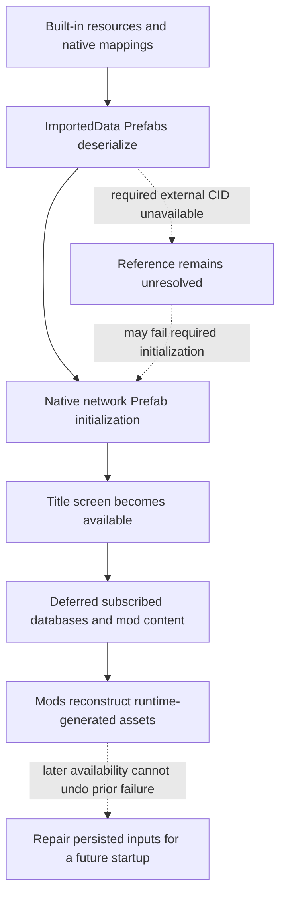
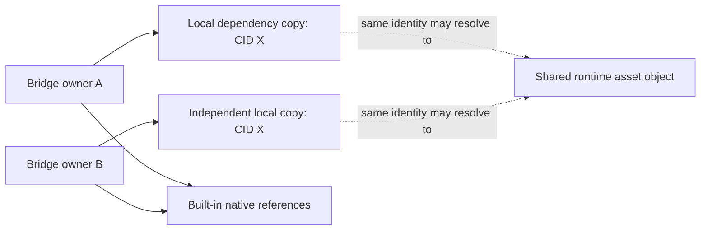

# Observed resource loading order

## Scope and evidence

This reference summarizes two historical diagnostic records: one showed network initialization failing before Bridge Builder loaded; another showed a local bridge being deserialized before its subscribed dependency became available. The records are distinct observations, not one combined session or a guaranteed engine-wide schedule. Personal identifiers, timestamps, save names, build identifiers and machine paths have been omitted.

This is an explanatory reference, not a project contract or a new recovery policy. Current requirements are defined by the bridge generation, asset persistence and deletion contracts. The historical removal behavior described below must not be treated as instructions for current self-check.

## Observed sequence

| Stage | Observed operation | Consequence for references |
| --- | --- | --- |
| Built-in resources | Game and installed-content resources and native Prefab mappings became available. | These resources could supply native references without owner-local copies. This does not prove that every resource was ready simultaneously. |
| Local asset deserialization | Bridge roots and derived Prefabs in `ImportedData` were read. | A serialized CID could exist in the file while the corresponding external asset was not yet registered. |
| Native Prefab initialization | The native Prefab update pipeline initialized network data. | An unresolved required section reference caused network initialization to fail. The failure occurred before the later save load in the first record. |
| Title screen | Startup proceeded to the title screen despite the earlier initialization error. | Reaching the title screen did not establish that all Prefabs had initialized successfully. A file check in the second record passed without proving runtime reference resolution. |
| Deferred subscribed content | Subscribed databases and deferred mod content were registered later. | Dependencies could become available only after their consumers had already failed initialization. |
| Runtime-generated assets | Mods reconstructed assets from their saved configurations. | Some required roads or sections did not exist as registered runtime assets until this additional work completed. |

The following diagram illustrates that observed order only. Mod initialization and database registration can interleave differently on another installation or launch; the diagram is not a universal ordering contract.

## Distinct failure mechanisms

**Initialization before protection.** In one record, a required network reference was unresolved when native initialization ran. Bridge Builder's loading protection was installed afterward. A guard installed after an operation cannot prevent an exception that has already occurred. A later save load can therefore encounter a network whose startup initialization was already incomplete.

**Late availability mistaken for damage.** The earlier recovery logic could interpret an unavailable dependency as permanent corruption and remove a bridge. Recreating the bridge did not remove its external dependency, so the same ordering problem could recur. This describes historical behavior, not an instruction to remove any asset that is currently unavailable.

**File validity mistaken for runtime readiness.** The separate test preserved the bridge files and passed its file check, yet native initialization had already failed on an unresolved reference. A serialized CID, an existing payload, a registered asset and an initialized native Prefab are different states. Evidence for one does not prove the others.

## Independent dependency snapshots

The persistence approach addresses the ordering risk by placing required external resources alongside each bridge before a later launch. Unchanged external dependencies retain their original CIDs and byte contents. Forward dependency traversal includes required transitive resources and native cache relations, stopping at built-in references. One owner keeps one copy of each required external CID; another owner keeps its own independent copy.

Independent files do not imply independent runtime objects. The native database can resolve identical CIDs through a single registered asset and loaded material. Its current read path may point at one owner's copy even while another bridge uses the same object. Conversely, two independent files with the same CID are not two generated bridge identities.

Independent on-disk copies can still resolve to shared runtime objects or registrations by CID. This observation distinguishes file ownership from runtime identity; deletion policy is defined only in [Bridge deletion](../../agent-contract/BRIDGE_DELETION.md).

## Self-check timing and limits

A post-load self-check can inspect persisted references and, when required sources are available, supplement missing independent copies while preserving the bridge's identity and geometry. It must distinguish actual damage from temporary or unverified resolution failures under the current recovery policy. The old report's simplified remove-unavailable rule is not carried forward here.

Self-check must account for loading and registration readiness rather than assuming that reaching the title screen is sufficient. Bridge Builder itself may load after the title screen. The observed deferred-load message does not explain why deferral occurred, and these records do not prove that every third-party producer exposes a reliable completion event.

A later self-check cannot retroactively reverse native initialization that has already failed. Persisted repairs become inputs to a subsequent full startup; returning to the title screen alone is not proof that those resources were deserialized and initialized again. A repair notification therefore does not certify recovery of the current session's native network state.

The existing loading mechanism does not establish that Bridge Builder can run before every `ImportedData` deserialization, or before every native initialization consumer. In particular, it provides no general guarantee that a mod can inspect or delete problematic local assets before the game reads them. This document grants no permission for preemptive deletion.

## What the evidence does not establish

- A universal order for every mod, content package, cache or operating environment.
- That all disappearing roads have the same cause, or that a startup exception identifies the exact visible outcome without further evidence.
- That later dependency registration automatically repairs an already initialized or failed Prefab.
- That a successful file check proves native readiness, independent cold loading, or correct in-game appearance.
- That existing local copies eliminate unrelated malformed data, serialization errors or native lifecycle defects.

Use resource identity, serialized references, registration state and initialization events as separate observations when diagnosing a new case. Preserve the distinction between historical evidence and current policy.
