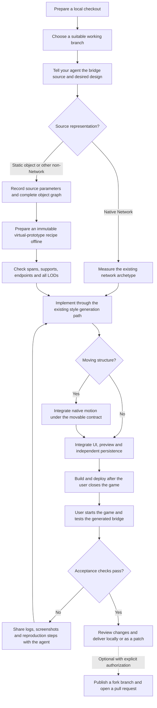

# Adding a bridge style with a coding agent

This guide helps contributors extend Bridge Builder with a measured bridge archetype. A new style
requires a working generator, compatible persisted assets and human in-game acceptance; adding a
catalogue entry alone is not sufficient. You provide the design and test it in game; your coding
agent handles implementation and reads the repository instructions. Local delivery is sufficient;
GitHub publication is optional and does not require upstream write access when using a fork.

This workflow does not automate arbitrary bridge import end to end. It requires bridge-specific
3D interpretation, measured rules and repeated visual checks; scripts and formulas do not replace
that work. Do not expect a coding agent, regardless of model capability, to produce a correct
arbitrary style in one attempt. Plan for investigation and correction rather than universal
third-party asset compatibility.

## Contribution workflow



The non-Network branch prepares construction data, not an intermediate playable network. Both
branches join the same generation path; the player selects the actual road, track or pedestrian
network there. Moving non-Network sources must also follow the movable branch. Use the
[non-Network contract](../contracts/non-network-contract.md) and
[paired specification](../specs/non-network-spec.md) for the governing scope.

## 1. Prepare the repository and evidence

Use a local checkout with the game and its required DLC or source asset installed, a working .NET
build environment, and a disposable test city. Back up saves and existing bridge assets.
You do not need to read AGENTS.md or the internal contracts; ask your coding agent to read and follow them.
The workflow requires game shutdown before replacing loaded binaries during deployment;
save your work before that step. Intermediate source edits do not require shutdown. Computer-use automation and agent-driven bridge placement are prohibited in this project.

Give the agent these inputs:

- A stable English style ID and the intended single-deck or double-deck capability.
- Exact prototype Prefab names and the ordered required-source array: direct source first, then
  each explicitly required DLC/mod; use an empty array for base-game styles. Include verified
  provider identities, corresponding game/mod versions and any available CID evidence.
- Prefab anatomy, mesh and LOD data, plus screenshots of the prototype at near and far distances.
- Measured road and structure boundaries, tower placement, cables, railings, lights, materials,
  unlock conditions and native cost components.
- For double-deck styles, the real prototype's `AuxiliaryNets` arrangement and deck separation.
- Identify whether the source is a native Network or a static object/other non-Network asset.
  For non-Network sources, include version-matched description evidence, retrieval date, package
  identities/hashes and documented units; distinguish total length, span and repeat length.

Do not ask the agent to infer dimensions from a screenshot or borrow another family's constants.
When evidence is missing, it should identify the missing data and complete independent work first.

Use a local copy of [CS2BridgeBuilder](https://github.com/Chengxuan-He/CS2BridgeBuilder).
A GitHub account or fork is not required; create a fork only if you choose to contribute through GitHub.
Use a suitable working branch. A per-style `bridge/<bridge-name>` branch, such as
`bridge/stone-arch`, is optional. Shared multi-style work may use one branch while keeping
style data distinct. Preserve unrelated local changes. Optional branch creation:

```powershell
git switch -c bridge/stone-arch
```

## 2. Start with a concrete prompt

Replace the angle-bracket placeholders before giving this prompt to your coding agent:

For `<source and version>`, explicitly identify where the prototype comes from. Use one of these
formats; do not provide only the bridge's display name:

| Prototype source | What to enter |
| --- | --- |
| Base game | `Base game; Cities: Skylines II version <game version>` |
| DLC | `DLC: <exact DLC name>; Cities: Skylines II version <game version>` |
| Mod | `Paradox Mods ID: <numeric mod ID>; mod name: <name>; mod version: <version>; game version: <game version>` |

For mod-provided prototypes, include the mod page link when available. If a version is unknown,
say so rather than guessing. Register additional required DLC or mods after the direct source in
the same ordered array. Follow the [source availability rules](../specs/cross-environment-spec.md#dlc-and-mod-compatibility);
Recursively trace the prototype's actual references offline, record provider/version and reference-path
evidence, and complete the registered array before implementation. Then verify each missing-entry
case separately. Hardcode the reviewed ordered declaration in code or a packaged data file.
Keep recursive tools, asset/provider indexes, reference graphs and closure evidence in development
records, outside the release package and runtime resources. Check the package file list and compiled
resources: runtime only checks each registered source's availability, never invokes the offline
scanner, traverses its indexes or dynamically calculates dependencies.

```text
Add support for <style ID> using <exact prototype Prefab> from <source and version>.
Support <single deck / double deck>; use a suitable working branch (a style branch is optional).
Source representation: <native Network / static object or other non-Network>.
Motion: <fixed / moving mechanism and available evidence>.
Evidence is available at <paths to anatomy, mesh/LOD exports and screenshots>.

Read AGENTS.md, the complete project contract and applicable nested instructions.
Read the complete generation contract, its paired specification and docs/specs/lod-spec.md. For a non-Network source,
also read docs/contracts/non-network-contract.md and docs/specs/non-network-spec.md.
Prepare only an existing-form immutable construction recipe; do not create or register an
intermediate network asset, introduce a virtual-prototype runtime layer, or bind it to a road kind.
For a moving source, also follow the movable contract and specification.
Inspect the existing generation, preview, localization, persistence and migration paths.
Use the simplest existing extension points. Record measured parameters for this archetype;
do not copy another style's constants or infer part identity in runtime code.
Keep each bridge’s persisted dependencies owner-local and preserve native pricing/unlocks; require Bridge Builder for mod-owned precompiled program registration; no shader program files are saved with a bridge.
Do not use other bridges' ImportedData Prefabs as creation or copy sources.

Follow contract section 12's optional branch policy and keep the style ID stable.
Implement the style, build and install it locally according to the repository workflow,
and report exact changes, evidence, checks and outstanding manual acceptance steps.
Deliver the changes locally with a review summary. Do not push to GitHub, publish to Paradox Mods
or modify existing bridge identities. I will create the test bridges
and provide near/far screenshots and cold-start results for visual acceptance.
```

## 3. Trace the existing extension points

The following paths describe the current implementation, not a requirement to edit every file.
Ask your agent to trace callers and consumers before choosing the smallest change. Use this table
to understand its proposal and review the resulting changes.

| Responsibility | Entry point |
| --- | --- |
| Stable IDs, patterns, supported deck modes and explicit generator admission | [BridgeStyleDefinitions.cs](../../src/BridgeBuilder/Bridges/BridgeStyleDefinitions.cs) |
| Discovery and binding installed prototype variants | [BridgeStyleCatalog.cs](../../src/BridgeBuilder/Bridges/BridgeStyleCatalog.cs) |
| Prototype availability and provenance | [BridgePrototypeSource.cs](../../src/BridgeBuilder/Bridges/BridgePrototypeSource.cs) |
| Route a selected style to its generator | [BridgeGeneratorRouter.cs](../../src/BridgeBuilder/Bridges/BridgeGeneratorRouter.cs) |
| Per-style implementations and immutable geometry data | [Types directory](../../src/BridgeBuilder/Bridges/Types) |
| Shared generation and double-deck composition | [Common directory](../../src/BridgeBuilder/Bridges/Common) |
| Recorded dimensions and tower/cable behavior | [BridgeMeasurements.cs](../../src/BridgeBuilder/Bridges/BridgeMeasurements.cs), [BridgeTowers.cs](../../src/BridgeBuilder/Bridges/BridgeTowers.cs), [BridgeCables.cs](../../src/BridgeBuilder/Bridges/BridgeCables.cs) |
| Offline part identification and generated geometry tables | [GeometryMetaprogram](../../tools/GeometryMetaprogram) |
| Localized style labels | [UiStringTables.Styles.cs](../../src/BridgeBuilder/Settings/UiStringTables.Styles.cs) |
| Creation integration | [BridgeGenerationSystem.Composition.cs](../../src/BridgeBuilder/Systems/BridgeGenerationSystem.Composition.cs) |
| Dependency persistence and native presentation | [BridgeDependencyPersistence.cs](../../src/BridgeBuilder/Runtime/BridgeDependencyPersistence.cs), [BridgeNativePresentation.cs](../../src/BridgeBuilder/Runtime/BridgeNativePresentation.cs) |

A small style generator can reuse `BridgeGeneratorBase`, as existing wrappers do, only when its
archetype behavior is already supported and measured. A matching name or successful discovery does
not establish that. Register the route and supported deck modes consistently; unsupported designs
must fail explicitly rather than silently generating a different family.

Use a concrete standard style ID under the [style registration rules](../specs/generation-spec.md#generation-22-new-bridge-styles-require-immediate-ui-synchronization-generator-routing-and-multilingual-names).
Do not register a bridge-family placeholder or turn it into an implicit alias. Preserve existing
standard IDs and healthy saved owners; historical migration requires published-record and
unambiguous prototype evidence at the existing self-check boundary.

Provide labels in every supported UI language. The current admission rule also checks for a Chinese
display name independently of the active locale. Keep style IDs unlocalized and the mod metadata
title exactly `Bridge Builder`. Check catalogue cards, preview selection and actual creation together.

Bridge generation contract section 22 requires immediate UI synchronization and connection of each new bridge
style to the generator router, with multilingual style names in the same implementation increment.
Include the creation-list entry, search/filter behavior,
preview, both creation actions and management labels. Verify all supported locales and live language
changes; the existing Chinese-name admission check alone does not establish translation coverage.
A working generator without its working UI entry is not a completed contribution.

### Affine matrix generation step

Use the [CPU affine execution contract](../specs/generation-spec.md#generation-cpu-affine-geometry-execution)
for every style's coordinate stage:

1. Extract measured origins, coefficient rows, parameter domains and part membership offline.
   Each of X, Y and Z may depend on width; a constant axis has zero coefficients.
2. Store numerical values in the existing DLL-embedded typed arrays. Sparse vertex weights and
   part ranges are valid matrix representations; the numerical `.bin` format need not change or expand to
   dense matrices. Preserve float bits, anchors and evaluation order.
3. Load only demanded binary resources into the current generation's parameter session. Reuse
   decoded arrays, membership records and SIMD programs within that request and its joined LOD
   workers. Release references on completion, failure or cancellation; no catalogue preload,
   permanent static parameter arrays or forced garbage collection.
4. Snapshot native inputs on the main thread. `AffineGeometry.Execute` consumes offline APF2
   stages with actual interleaved `x0,y0,z0,x1,...` storage. Load/bind operands, execute ordered
   SIMD operations, and store/scatter results with unchanged-axis masks and alias snapshots.
   Expression-recognition paths and per-axis register columns are prohibited. Scalar coefficient
   and frame programs remain distinct from vertex storage.
5. `Groups` joins independent LOD plans before main-thread native construction. Offline row-dependency
   proof permits bounded blocks; dependent stages keep their order. Native position bytes consume
   the completed owned array directly, without scalar XYZ repacking. Later preview/publication
   must not retain parameter sessions or borrowed parameter arrays.
6. Run the [offline lowering pass](../../tools/AffineGeometryMigration/README.md), resource/lifetime guards,
   numerical/LOD checks and localization checks after regeneration. Report initial checksum/decode
   separately from within-request cached execution. Measure preparation, operand loads, arithmetic,
   output stores and final byte copy separately before claiming an acceleration; arithmetic stages
   include memory traffic, not just pure ALU work.

The implementation entry points are [AffineGeometry.cs](../../src/BridgeBuilder/Bridges/AffineGeometry.cs),
[HardcodedNumbers.cs](../../src/BridgeBuilder/Bridges/HardcodedNumbers.cs) and
[MovableRenderAssembly.cs](../../src/BridgeBuilder/Bridges/Common/Movable/MovableRenderAssembly.cs).
This stage changes computation only: preserve topology, native bone ownership, material/UV
semantics and independent asset persistence.

## 4. Measure geometry before implementing transforms

### Prepare a non-Network source before generation

For a static-object or other non-Network source, complete this branch before implementing its
normal style generator. Follow the [required sequence](../contracts/non-network-contract.md#non-network-1-scope-and-required-sequence)
and record evidence in the appropriate bridge-style audit, rather than adding a separate design document.

1. Check for an existing native or supported equivalent before proposing a new style ID; width
   variants of the same design belong to one style. Record the exact installed source and compare
   its documented dimensions with measured geometry. Resolve discrepancies explicitly; a number
   in the asset name is not a measurement.
2. Inventory the complete object graph, nested render parts and every LOD. Disclose source and generated per-level triangle counts under the [LOD evidence rule](../specs/lod-spec.md#per-level-triangle-disclosure-and-reference-scope), with part/variant/instance scope explicit. Record coordinate
   frames, accumulated transforms, running-surface versus structural membership, material references,
   supports and endpoints using the [parameter meanings](../specs/non-network-spec.md#non-network-2-source-evidence-and-parameter-meanings).
   Before necessary native material conversion, trace actual shader variants, instance producers
   and palette/control inputs under [native consumer and palette preservation](../specs/material-spec.md#native-material-consumers-and-instance-palette-preservation). Record per-LOD/slot evidence, preserved channels, native cold reads,
   GPU/color-space checks, identity-bypass regression, filtering limits and resource costs; report
   actual game appearance separately from texel or serialization checks. Select a compatible native
   shader or an authorized mod-owned precompiled program from the [custom shader table](../specs/custom-shader-spec.md#custom-shader-table);
   retain necessary descriptor/VT conversion without runtime palette baking, pixel readback or
   appearance recompression. Verify this boundary in every non-Network caller.
3. Measure span-local, repeating, endpoint and shared-boundary support roles. Establish adjacent-span
   continuity and select the [native longitudinal behavior](../specs/non-network-spec.md#non-network-select-longitudinal-behavior-from-native-evidence)
   from actual native evidence. Keep transverse width mapping separate; do not stretch rigid supports
   or treat authored total length as an exact native course-length lock.
4. Encode those measurements in the existing immutable recipe and embedded numerical-resource
   form. The virtual prototype is only this construction data: emit no intermediate `.Prefab`,
   `.cok`, network entities or registration, and add no separate schema, factory, cache or runtime
   conversion pass. Do not choose a road/rail/pedestrian template for it or add a road-kind gate.
5. Feed the recipe directly into the existing generation path. The player's selected elevated
   network supplies composition, lanes and native network behavior. Map support roles into the final
   native graph, including applicable piece objects and node subobjects, and inspect preview traversal
   through nested objects and meshless carriers. Continue with the shared geometry, UI and persistence
   steps below; an unchanged static bridge placed over an unrelated road is not a generated bridge.
6. Record the [staged verification results](../specs/non-network-spec.md#non-network-5-staged-verification-and-acceptance)
   separately for source evidence, recipe, final generation, preview/persistence and human acceptance.
   Missing evidence remains explicit while independent work continues. Moving sources additionally
   require native mechanism/bone/state integration under the movable contract; this preparation does
   not implement motion or authorize a separate conversion UI.

### Apply the shared geometry workflow

Identify authored parts offline using the highest-detail prototype. Record exact mesh/LOD identity
and part membership as immutable data; runtime code consumes this data without rediscovering parts
from bounds, topology, thresholds or name resemblance.

- Apply contract section 8's explicit base, centred-post and Draw03 truss rules and section 5's
  measured Golden mappings; otherwise a part
  reaching or crossing `x = 0` stretches against its own span and a side part translates rigidly.
- Preserve tower height/depth outside the measured Golden ornament exception, side-part thickness
  and native behavior. Apply only the contracts' scoped topology, native representation and
  UV/material rules, including the verified prototype non-tiling exception.
- Carry the highest-detail classification to all LODs. Repoint derived LOD references to derived meshes.
- Preserve prototype placement, stacking, tiling, lights and their parent relationships.
- Apply the contract's separate base and pier rules using structural evidence, not names.
- Derive a double-deck style from a real double-deck prototype; retain its separation and orientation.

Consult existing metaprogram modes in `tools/GeometryMetaprogram/Program.cs`; there is no universal
command that measures and implements an arbitrary style automatically. Do not change a generated
table without retaining the source evidence and documenting how to reproduce it.

For the width audit, compare a real prototype with a real newly generated bridge. Measure complete
left-to-right spans (`maxX - minX`) on the same basis. Ask your agent to perform and document the
required width calculation using the project's binary32 rules.
The human creates the sample. A missing sample means the audit is incomplete, and a discrepancy
outside the contract's allowed range needs investigation rather than a guessed correction.

## 5. Keep persistence compatible

Use the existing naming, layout and native persistence helpers. Bridge asset ownership is determined
by `b{uuid}` in the path, not metadata. Generated components must carry their bridge UUID. Do not
truncate it or invent a separate registration store.

External dependency snapshots retain original bytes and CIDs, deduplicated within one bridge and
stored separately for different bridges. Stop traversal at built-in resources. Never select another
Bridge Builder bridge's Prefab from `ImportedData`, even if its CID matches and its file is readable.
Use original or otherwise permitted sources and fail explicitly if none is available.

Persist native unlock conditions, prices, names, descriptions and icons. Do not save Bridge Builder
component types, custom UI-host requirements or third-party editor-only components as runtime
requirements. Preserve native pricing rather than introducing price-only copies or runtime overrides.
The known double-deck rail-seam compatibility limitation still requires explicit testing and disclosure.

If a style change affects existing assets, trace self-check migration as well. Complete missing fields
individually, preserve bridge/deck UUID and CID, and use the same layout as new generation. Successful
migration must be idempotent. Failed migration follows the contract's backup/move and deletion fallback;
do not use self-check to unregister live Prefabs. Persistent migration requires a restart.

## 6. Build, deploy and verify

From the repository root, the build entry point is:

```powershell
.\tools\Build.ps1 -Configuration Release
```

Use `-GameDir` if automatic game discovery does not find the installation. Follow contract section 13
for shutdown, backup, recovery and installation. Preserve healthy bridges when generation code
changes. Only a demonstrated incompatibility permits recovery of the affected style/UUID-owned
assets; preserve unrelated bridges and dependencies. Trace shared-code impacts before recovery.

If bridge-generation code did not change, remove no existing bridges. Documentation-only edits
require no shutdown, cleanup, build or deployment. Preserve diagnostic evidence before scoped cleanup
and verify both removal of selected assets and retention of unaffected assets. Verify installed files
against the build output. Deployment does not authorize publishing to GitHub or Paradox Mods.

Run relevant existing nonvisual checks for naming, source selection, persistence, localization,
unlocking and native pricing when those paths change. Unit tests do not validate visual geometry and
must not replace the contract's human near/far inspection. Do not add tests that merely duplicate the
implementation or claim a build proves appearance.

Test the following in your local game and give the results to your agent:

1. The intended style is discoverable with required native content and packaged resources available.
   Players need not own identical original prototype files; missing required resources fail explicitly.
2. Creation and placement work at prototype and wider widths, including supported asymmetric
   roads and both deck directions. Movable bridges have no special narrow-road adaptation gate.
3. Towers, deck, cables, railings, lights and materials remain correct up close and through LOD changes.
4. Native unlock conditions, construction cost, labels, descriptions and icons are correct.
5. Saving, exiting and cold-start loading preserve geometry and references; healthy self-check is inert.
6. With Bridge Builder enabled, persisted bridges must cold-load and remain available and usable; retain required native
   game/DLC resources. Separately test any known rail-seam limitation.
7. When applicable, legacy migration preserves identity and a second check makes no further changes.
8. For non-Network sources, inspect reference, shorter and longer native courses, repeated spans,
   endpoints, slopes/intersections and sequence boundaries. Check rigid support dimensions, adjacent
   seams, duplicate/missing supports, zero/one/asymmetric sidewalks and usable lane connectivity.
   Compare authored dimensions with realized dimensions rather than assuming they remain identical.
   Verify preview coverage and cold loading of the final owned graph while source assets stay unchanged.
   Keep these evidence checks separate from player eligibility: do not add appearance/clearance/width
   rejection gates; genuine resource, native-operation and persistence failures remain explicit.

## 7. When the generated bridge does not match your expectations

Tell your agent what you expected, what actually happened and how to reproduce it. Identify the
affected part rather than saying only "the bridge looks wrong." For example: "The right tower leg
becomes thicker on a wider road; it should move outward without changing thickness." Describe the
observation without assuming its cause.

Attach a screenshot of the prototype and a comparable screenshot of the generated bridge. For an
LOD issue, include both near and far views. Provide the selected road or track, deck mode, width,
elevation, bridge UUID if known, and whether the problem occurs immediately or only after reloading.
Include the relevant log and export report if available; a visual defect can occur without a logged
error. Save your city before requesting another code change, because deployment stops the game before replacing loaded binaries.

Use this follow-up prompt:

```text
The generated <style ID> bridge does not match the expected result.
Prototype: <exact Prefab name>.
Source and version: <base game + game version / DLC name + game version /
Paradox Mods ID + mod name + mod version + game version>.
Contribution branch: <actual working branch>.
Source representation: <native Network / static object or other non-Network>.

Expected: <describe the correct appearance or behavior of the affected part>.
Actual: <describe the difference, including which side, part or viewing distance is affected>.
Steps to reproduce: <selected road/track, deck mode, width, elevation and placement steps>.
Timing: <immediately after creation / after save and reload / after a cold start>.
Evidence: <prototype and generated screenshots, logs, export report and bridge UUID if available>.
Last working result, if known: <build/commit and what changed since then>.

Compare the generated bridge with this exact prototype and identify the cause from evidence.
Check the affected components, references, materials and all LODs; do not guess a geometric
correction or borrow another style's measurements. Preserve unrelated working behavior and
existing bridge identities. Implement the smallest justified fix, check affected callers,
build and install it locally, and explain what I should retest in game.
If evidence is missing, tell me exactly which screenshot, log or measurement you need.
Do not publish a release or push to GitHub. I will verify the local result.
```

After testing the next build, report whether the same reproduction steps now pass and attach new
screenshots. If the defect persists, explicitly say it is the same issue and retain the previous
evidence so your agent can compare attempts instead of repeating an unsupported explanation.

## 8. Deliver locally; optionally submit a GitHub pull request

Deliver a reviewed local working tree or patch with the evidence and verification summary below.
No GitHub account, upload or pull request is required to complete development.

If you explicitly choose GitHub contribution and have permission to publish to your fork, you may
upload the contribution branch and open a pull request. The following commands are optional, not
automatic agent actions; stage only files belonging to the contribution:

```powershell
git commit -m "Add stone arch bridge style"
git push -u origin bridge/stone-arch
```

In GitHub, select your fork's `bridge/stone-arch` as the compare branch. Select the upstream target
branch requested by the maintainers; if none has been specified, use the repository's default branch.
Do not push changes to every upstream branch or upload a release to Paradox Mods. Maintainers review,
merge and publish accepted contributions.

Include the following in the local handoff or optional pull request:

- The bridge style and supported deck modes, with required DLC or source assets.
- For non-Network sources, the source-parameter record, reproducible recipe evidence, native
  longitudinal/support mapping and staged verification results, including outstanding manual checks.
- A short explanation of the implementation and any shared code it changes.
- Prototype measurements and reproducible evidence, without redistributing assets you lack permission to share.
- Near/far screenshots and results for creation, save/load and cold-start testing.
- Build and nonvisual checks actually completed, plus known limitations and unfinished checks.
- Any effect on existing bridges and how migration preserves their identity.

Have your agent help summarize the changes, but review the code and verify its claims before
delivery. A successful build is not evidence that a bridge looks correct or survives a restart.
Address review feedback locally; update a remote pull request only if that optional workflow was chosen.
