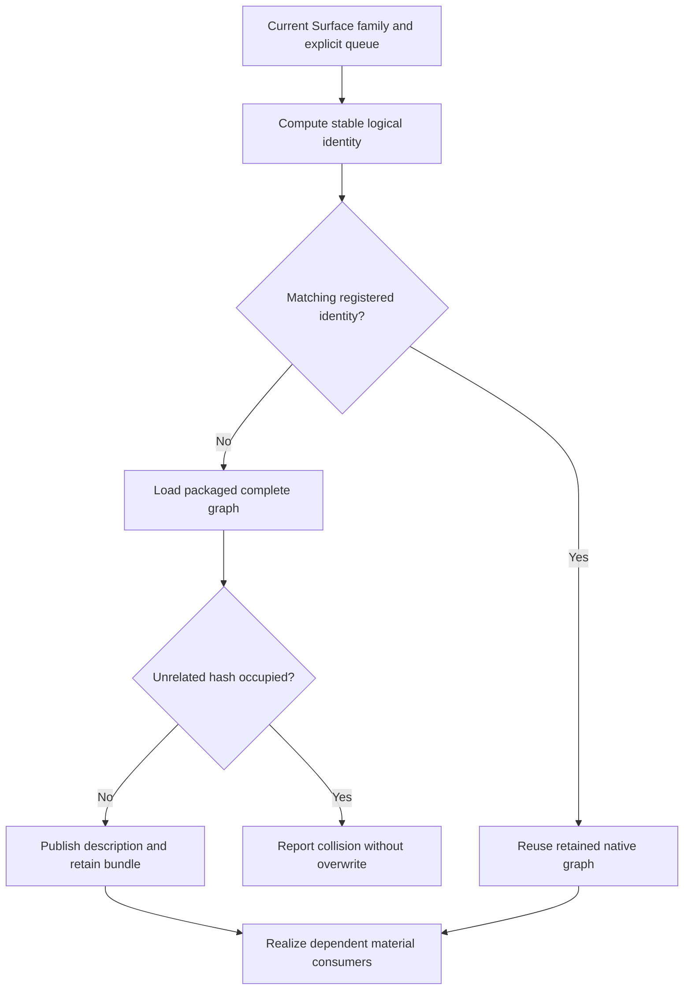
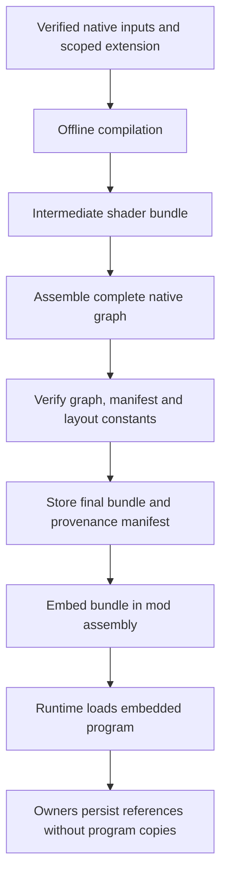
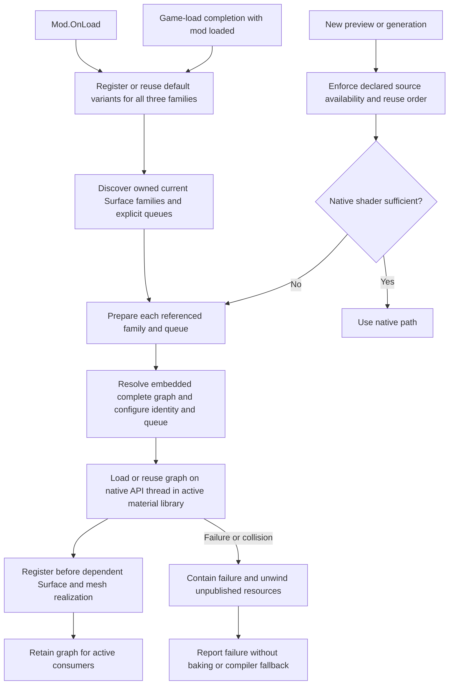

# Custom shader specification

Read this complete specification with the [material specification](material-spec.md) and
[material boundary contract](../contracts/material-contract.md). Material eligibility, native
conversion and the non-Network runtime-baking prohibition remain in the material specification.

## Two shader classes and reuse order

Custom shaders have exactly two broad classes:

- **Skeletal:** the native shader plus the required bone binding. Preserve native appearance,
  sampling, fragment behavior and passes; extend only the inputs needed for the mechanism's
  actual skeleton and motion sample.
- **Network:** the native shader plus required network properties. Preserve native geometry/rendering
  protocol and source appearance; expose only the properties needed to express those semantics
  on the generated network, including evidenced instance-palette inputs.

First use a compatible native shader. If native shaders cannot satisfy the measured requirements,
reuse a suitable existing custom shader. Add a new custom shader only when neither native shaders
nor existing custom shaders can satisfy them. Record the unmet semantics and evidence for both
decisions; a new bridge style, palette, owner UUID or material name is not a reason for a new program.
Do not force synthesis when a compatible prototype material already satisfies the requirements.

The classes describe the permitted extension, not new rendering families or permission to replace
source appearance. Precompile programs offline; retain source textures and all required mips.
Ordinary shader drawing is not texture baking. Preserve mod-owned registration and reference-only
owner persistence below; no runtime shader compiler, owner shader copy or baking fallback.

## Custom shader table

This is the canonical program inventory and selection boundary. Existing bundle presence does
not establish native visual acceptance. Implementation and offline verification are distinct from
publication and native game acceptance; retain those evidence limits for each entry.

| Class | Program and implementation status | Storage path | Purpose and when required | When unnecessary / native alternative |
| --- | --- | --- | --- | --- |
| Skeletal | `BoneDecal` — existing | `assets/MaterialPrograms/BoneDecal.bundle` | Movable running-surface decals requiring the mechanism's current skeleton sample, original alpha and PBR. | Native compatible fixed decals and the explicit native attachment exceptions retain their native path. |
| Skeletal | `WorldLayeredPbr` — existing | `assets/MaterialPrograms/WorldLayeredPbr.bundle` | Movable running surfaces requiring independent base/world-coordinate layers and native blends on the mechanism. | Compatible original native materials or a complete authorized native representation need no custom replacement. |
| Network | `NetworkPalette` — implemented; native game visual acceptance pending | `assets/MaterialPrograms/NetworkPalette.bundle` | Native network conversion whose source palette/ControlMask/PBR semantics are absent from the compatible target native shader. Preserve source fragment behavior with the actual network vertex/instance protocol. | Compatible native shaders and evidenced white/default-white identity inputs remain native; inspect every source instead of assigning this program to all non-Network bridges. |

Maintain this table when introducing or retiring a program. Record its source/target consumer
evidence, required passes/variants, native alternative and actual implementation status. It does
not authorize other custom shaders or change native attachment, source ownership or self-check
boundaries. Keep source palette and material properties per Surface rather than compiling a
program per bridge or per palette.

## Native program graphs, stable identity and registration

The mod ships complete precompiled native AssetDatabaseResources / MaterialLibrary / MaterialDescription / Material / Shader graphs in UnityFS bundles. Runtime loads those packaged programs; it never compiles HLSL, launches a compiler, reads an owner shader package or reconstructs a historical registration recipe. Native GPU-driver translation/cache activity is separate.

Surface template identities use a stable deterministic hash of the logical program family and the full native signed integer render queue. The queue is retained explicitly as an ordinary integer Surface property; the template hash is not a reversible encoding. Identity is independent of owner UUID, process order, source-template hash and compiled bundle bytes. BoneDecal preserves the native calculation queue = 2000 + rendererPriority. Do not invent a bounded priority/queue domain, bit-pack a truncated queue, clamp it or reject a native integer solely to fit the identity scheme. Startup recognizes a current template by recomputing the logical family/queue hash from the persisted queue property, then registers that variant from the mod bundle. Distinct queues retain their native material descriptions; unrelated hash collisions must never overwrite a registration. Preserve source PBR/alpha/VT inputs, defaults, overrides, enabled passes and lighting/instancing flags.

Runtime may specialize only the packaged graph's permitted native identity, queue and bundle identity fields in memory. Preserve compiled Shader bytes, object sizes, property sheets, references and all other fields. Do not append Materials to a bundle or reserve a fixed compiled-program slot. Registration is idempotent, collision-safe and retains graphs while native consumers use them. Source and built-in assets remain unchanged.

### Registration lifecycle

The [custom shader loading workflow](#custom-shader-loading-workflow) defines startup restoration and generation/preview ordering through the shared registry. No owner program file, CID sidecar, registration recipe, explicit program dependency root or program ZIP entry is written. Ordinary Surface, texture, VT and mip persistence remains unchanged. Bridge Builder is therefore a required installed and enabled runtime dependency. An already-cached shared fallback must not be modified in place; creation, startup order and native consumer realization require separate verification.

Legacy owner-persisted custom shader bridges are not migrated or restored. Only [self-check](../contracts/self-check-contract.md#self-check-obsolete-custom-program-retirement) classifies their concrete old protocol and retires their owned files through the established backup/removal/restart flow. Noncustom healthy bridges are preserved. Normal generation, preview, UI and export do not perform this compatibility deletion.

Offline compilation accepts complete variable-length outputs and rebuilds native program arrays, compressed segments, serialized lengths, offsets and alignment. Never truncate, disguise a length mismatch with padding or retain stale bytecode as fallback. Test shorter/longer outputs, multiple occurrences, queue variants, repeated registration and foreign identity collisions. Verify stable identities, exact native queue behavior, new-owner output without program files, mod-enabled fresh-process registration, ordinary preview and DOTS rendering. File parsing, property readback and isolated Editor tests do not establish native game rendering.

## Offline precompilation and storage

Programs are compiled offline with D3DCompile and assembled with UnityPy. The runtime
does not execute these Python producers. Keep extracted native inputs, generated HLSL/DXBC,
shader-only bundles and diagnostics in explicitly supplied authoring output directories outside
the release payload. Intermediate and final bundles share names but have different contents:
only the final complete native graph belongs at `assets/MaterialPrograms/<Program>.bundle`,
with its provenance manifest at `assets/MaterialPrograms/<Program>.manifest.json`.

Each shader producer takes `--output`; graph producers additionally take `--game-resources`
and their own `--output`, using `tools/MaterialShaders/NativeGraphSeed.bundle`. They combine
the compiled shader with the captured native MaterialDescription, Material and complete
AssetDatabaseResources/MaterialLibrary graph.
Choose separate intermediate/final output directories so a shader-only bundle cannot overwrite
the complete graph. Promote only verified final bundles and their matching manifests to the
shared repository paths above. Generated layout constants must match their complete graphs and
permit only the defined identity/queue specialization, never runtime shader reconstruction.

The final adjacent manifests record producer/source hashes, native input identities, container
format and complete output hash/size. `tools/MaterialShaders/VerifyPrograms.ps1` verifies these
inputs before compilation. The project `src/BridgeBuilder/BridgeBuilder.csproj` and
`tools/Build.ps1` both embed `assets/MaterialPrograms/*.bundle` as
`BridgeBuilder.MaterialProgram.<name>.bundle`. Manifests, intermediate bundles, extracted game
resources, HLSL/DXBC, reports and authoring tools are not runtime dependencies.

`MovableCustomShaderAsset` reads that exact assembly-resource name for each program,
and passes the configured graph to the common native program registry. The registry loads it with
`AssetBundle.LoadFromMemory`; it does not rebuild its Shader or Material. Generation, preview
and startup use the same family/queue identity and retain required native graph lifetimes.
Owners and exported bridge ZIPs contain only Surface references and ordinary appearance resources,
never program bundles, shader payloads or registration recipes. Verify package embedding and native
registration separately from source compilation, and retain the native visual/cold-load limits above.

## Custom shader loading workflow

Registration uses three stages. Both startup boundaries use the same restoration operation,
with the discovered Surface set available at that boundary:

- **Mod.OnLoad:** run restoration: register NetworkPalette queue 2225, WorldLayeredPbr queue
  2225 and BoneDecal queue 2000, then inspect currently discovered owned current Surface
  headers and prepare their referenced logical family and explicit integer queue variants.

- **Game-load completion:** when the mod is loaded, register the default queue variants of
  BoneDecal, WorldLayeredPbr and NetworkPalette, then inspect discovered owned current Surface
  headers and prepare every referenced logical family and explicit integer queue variant before
  WorldReady and mesh updates. Include Surfaces discovered during game loading.
- **Generation and preview:** prepare the exact required family/queue variant before creating
  or realizing its dependent Surface, material or mesh. Preserve this ordering after asynchronous
  preparation and use the same registry as startup.

Both restoration passes register defaults before discovered owner variants. Neither reads
owner program payloads or introduces a source-mod gate for healthy independent saved owners.
The following steps define the common loading operation and the new-generation source boundary.

1. Resolve the requested material against the shader reuse order. Compatible native shaders
   require no custom program. Before accessing source-dependent resources for new preview or
   creation, enforce the complete declared source array under the [source availability boundary](cross-environment-spec.md#dlc-and-mod-compatibility).
   Do not make unselected optional content a global prerequisite. Healthy independent saved
   owners retain their existing persistence/self-check policy rather than new source-mod gates.
2. Resolve the authorized logical program family and actual native queue. Look up only its
   packaged assembly resource, `BridgeBuilder.MaterialProgram.<Program>.bundle`, produced by
   the common embedding rules. Do not search owner folders for programs, download a replacement,
   compile at runtime or reconstruct a shader from a serialized recipe.
3. On the native API thread, load the complete packaged graph and register its stable family/queue
   description before any dependent Surface/material/mesh consumer realizes it. Startup must
   recognize current persisted template references and explicit queue properties and register
   those exact variants; default-queue registration alone is insufficient. New preview and creation
   use the same registry and ordering, including after asynchronous preparation.
4. Reuse an already registered matching identity in the active native material library idempotently. Reject an unrelated occupied hash
   without overwriting its description or mutating a shared fallback. Preserve serialized shader
   bytes, properties and pass state; specialize only the permitted identity and queue fields.
5. Retain the graph, bundle and native descriptions while consumers can reference them. Preview
   cleanup releases private drawing state, not shared registered programs or another owner's
   resources. Failed unpublished registration unwinds only its own partial publication/resources.
6. Contain native load/registration failures at the existing operation boundary and return the
   diagnosed failure to the caller. Do not publish false success, silently bind an incompatible
   native material, bake textures, compile a fallback or persist program files under an owner.
   This requires no unrelated generator API redesign or runtime internal-result validation.

Verify repeated registration, foreign hash collisions, missing packaged programs, actual native
failure cleanup, OnLoad registration including discovered owner Surface variants, the game-load
registration boundary, preview/create ordering and a fresh process
loading persisted nondefault queues. Include Surfaces discovered during game loading and repeated
restoration against the active material library.
Record native game appearance and saved-bridge cold loading separately from isolated tests.

Program-specific producer inputs, outputs and inspected loader behavior are retained in the
[authoring and loading audit](../archive/audits/custom-shader-authoring-and-loading.md).

## Decal and layered program behavior

Related requirements: [Material Contract](../contracts/material-contract.md#material-dynamically-generated-and-independently-persisted-material-shaders), [Material Spec](material-spec.md#material-dynamically-generated-and-independently-persisted-material-shaders-part-2), [Material Contract](../contracts/material-contract.md#material-dynamically-generated-and-independently-persisted-material-shaders-part-3).

The decal program consumes the same current procedural skeleton addressing as its mechanism. Preserve source alpha blending, PBR, priority, texture identities and evaluated UVs; no hard/hashed cutout substitution. The multilayer program samples base UV and world coordinates independently and blends corresponding PBR channels by the original mask. Use source defaults and overrides through semantic recipes, not name/CID exceptions. Persist Surface references to the mod-owned program/queue identities; do not save program files per owner.

Treat each skeletal-class program as its native source shader plus the necessary current-skeleton
binding. Preserve the native material computation, fragment programs, pass behavior and
vertex-channel decoding; change position, direction and projection inputs only as required
to bind the evaluated geometry to that skeleton. A keyword name alone does not establish
an alternative vertex layout. Verify the actual source variants and generated mesh format,
including packed normal and tangent channels. Test finite tangent frames and shaded output
at closed and opened poses through both native batching and the ordinary preview renderer.

Sources with different color or scalar overrides must not silently inherit a prepared cable's color. Compatible native object materials return directly without a prepared replacement.

Original Surface bytes and appearance properties remain unchanged. Private preview materials require actual draw-instance geometry modes, bone inputs, VT binding and offscreen depth state. Only a native lane or enabled CurveProperties tiling mode selects curve keywords; a plain object must not gain lane-default mode merely because it has bones. Procedural mode requires actual nonempty bone data. Preserve unrelated source appearance keywords. A footprint alone does not justify a substitute projected-color surface.

Simple static utility visuals can enter the mechanism's skinned model assembly
while a private native utility carrier retains functional placement. Do not empty
the object's mesh list: native object initialization derives its bounds from those
entries. A metadata-only render preserves each source bound, surface area, local
transform and relevant components, but has no geometry, material slots or indices.
It must not retain an LOD reference to visible source geometry. Sources with native
`BaseProperties` require their separately generated foundation visual to be handled
first; a zero-submesh render with that component would still generate a base batch.

Ordinary nested visuals require recursive native selection and accumulated local transforms,
with one shared plan for merged visuals and retained native branches. Conditional visibility,
actual independent animation, instance color and emissive attachments deliberately retain their
existing native attachment path under movable contract section 19. Derived utility-network
rendering still requires its functional native consumers. Native utility topology and native light
positioning are not replaced by a per-frame Bridge Builder synchronizer.
