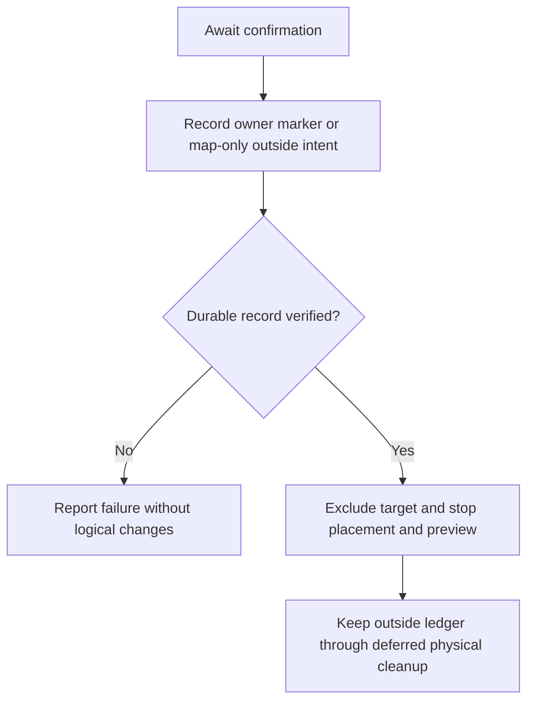
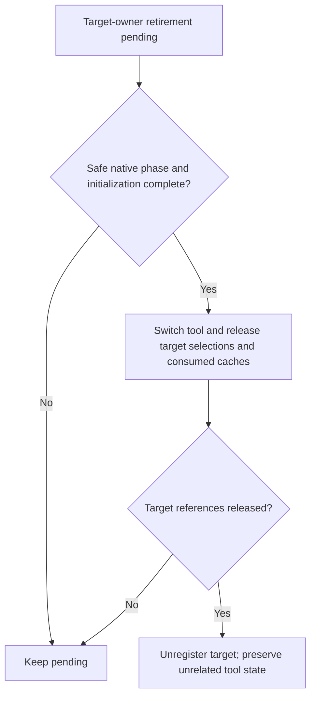
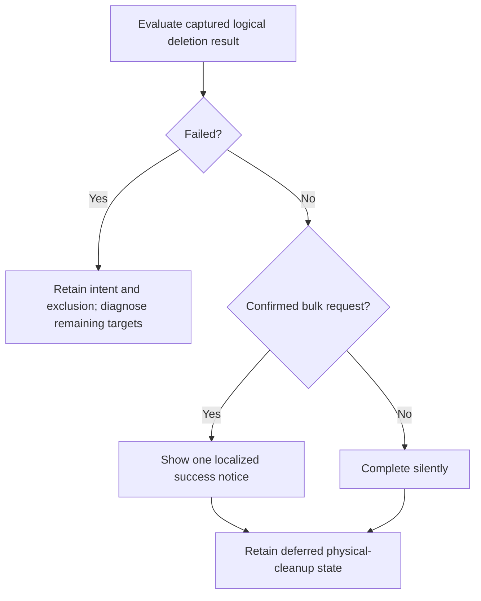
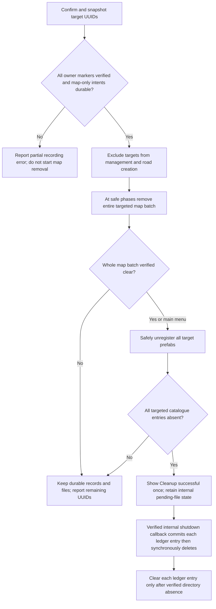

# Deletion Spec

Required companion: [Deletion Contract](../contracts/deletion-contract.md). Both documents are normative; read applicable requirements from both. See the [complete scope maps](../contracts/reading-map.md) for additional relocated sections.

This document is normative within its stated scope. Responsibility-based placement does not
change requirement strength, existing specialist exceptions or explicit user authorizations.
Specifications are equally normative; this separation introduces no new precedence hierarchy.

## Confirmation and durable intent

Before confirmation, change neither the map, availability nor files. Confirmation identifies one bridge UUID. For an existing owner directory, create its zero-byte `.bridgebuilderdeleted` file, close the writer and verify that the marker exists as the expected zero-byte file **before** removing placed instances or unregistering the bridge. A normal owner has no marker. An existing valid marker makes a repeated request idempotent; do not truncate an unexpected file to manufacture a valid marker. If creation, durable completion, closing or verification fails, report an error and make no logical changes.

Two records have different roles: the per-owner marker records confirmed logical deletion, while an external cleanup ledger protects intent once recursive deletion could remove that marker. Keep the ledger outside **all** target owner directories. The implementation stores zero-byte per-owner records at `ModsData/BridgeBuilder/DeletionPending/b{uuid}.pending` under the game user-data root. Before starting recursive deletion for an owner, durably record its exact UUID in this ledger; if that write fails, abort physical deletion for that owner. Do not require normal, unmarked owners to have marker files or cleanup entries.

For a placed, map-only owner with no directory, persist its confirmed intent in the outside record before map removal or unregistration. Do not create a fake bridge directory just to hold a marker. Keep this entry until logical removal is complete and the normal-shutdown cleanup stage has verified directory absence; absence alone must not discard unfinished map-only work. Repeated requests remain idempotent. Neither record authorizes removing another owner, a source package or unrelated files.

Once recorded, the target must be unavailable in both the management list and road-creation/placement catalogues. Stop its active placement and preview. All discovery and catalogue rebuild paths must exclude an owner if its marker **or** outside ledger entry exists. Retained files must never make a logically deleted bridge selectable again. UUID allocation must continue to treat the retained directory, marker or pending outside record as occupied.

## Tool-reference release before unregistration

Before any target prefab is unregistered, stop its active placement and release all target-owner references retained by native tools, including the actual cached prefab used by tool and Tool UI queries. Public selection and the internal consumed prefab may have different update lifetimes: changing the public selection, switching to another visible road or disabling the tool alone does not establish cache release. Establish the relevant native setters, update paths and consumers from implementation evidence; do not generalize one observed field layout to every tool. Complete the normal tool switch and any necessary target-scoped cache release before invalidating native prefab registration. Preserve unrelated selected roads, other owners, original sources and shared resources.

Apply the same guarantee to single deletion, the whole-batch unregistration phase and startup tombstone retirement, including a tool that is inactive but still retains the target. Honor pending prefab initialization/replacement and safe world-transition boundaries; do not force native update systems to advance merely to delete. Keep work pending through the existing lifecycle when its preconditions are not yet met. Do not add a per-frame scan, suppress lookup exceptions, disable Tool UI or fabricate registration entries to hide stale references. This rule does not authorize live unregistration during ordinary self-check migration or alter its existing recovery workflow.

Acceptance must exercise deletion while the target is selected, after switching to an unrelated road, and after deactivating a tool that retains target state. Cover single, bulk and startup-resumed unregistration, active/paused city and editor contexts, and pending registration/replacement. Continue native Tool UI snapping-mask and underground-mode queries across subsequent updates after deletion; no query may consume an unregistered target prefab, while unrelated tool use remains functional. A changed public selection or one successful delete callback is insufficient evidence. Keep isolated native/lifecycle tests distinct from human in-game acceptance.

## Completion, errors and verification

Keep the user's **pre-deletion confirmation**. Successful single deletion and startup
resumption remain silent, including pending-normal-exit state. A confirmed **remove-all**
request displays exactly one localized success popup after the whole batch's map,
logical catalogue and management-list checks pass. Its body is only "Cleanup successful"
with the requested concise Simplified Chinese translation, no pending-exit explanation and no additional success
text. A confirmed empty target set also completes successfully. Cancellation produces no
success popup; failures must not take this route. Do not replay the popup after a later
UI/world transition. The confirmation retains the irreversible-deletion warning without
adding pending-exit text.

Refresh management and placement availability normally. Retain distinct internal
logical/physical completion states: this concise interactive acknowledgement does not
change the deferred physical cleanup boundary. Startup tombstone handling and eventual
physical cleanup add no success popup, self-check result, progress count or restart
request. Genuine failures retain the error behavior below; ordinary pending-exit state
is not an error.
On logical failure, keep durable intent and files, maintain catalogue exclusion, and log an ERROR with owner/batch identity, failed stage and remaining targets. Interactive requests may show their normal failure notice; startup tombstone handling retains pending state and diagnostic logs only, with no popup, restart request or self-check summary/progress contribution. A legitimate save/load pause is not failure, but work must not become an indefinitely silent retry: distinguish paused, pending and failed states and diagnose stalled logical work. Cleanup failure records the affected owner and error and remains pending; it must never be reported as successful file removal. No failure may resurrect a tombstoned bridge or destroy a surviving bridge's shared resources.

Implementation verification must cover cancellation, durable-write failure, active/paused city and editor contexts, main-menu deletion, transitions, shared junctions and native consumers, verified normal-shutdown ordering, renderer/VT/save-job release, callback reentrancy, mod unload and world-transition exclusion, crash/forced-termination/power-loss recovery, overlapping game instances, locked files, marker-write and ledger-write failures, partial cleanup after marker removal, already absent directories, map-only owners and legacy records. Verify both management and road-creation exclusion after catalogue rebuild and restart, and verify that startup tombstone handling emits no UI notice, restart request or self-check result/progress count on success or failure. Use isolated fixtures rather than deleting player bridges. Separate actual native tests from pending live-game acceptance. All user-visible status changes require complete translations in every supported language.

## All bridges

The settings action remains available during loading, inspection and saving. Coalesce repeated clicks into one confirmation. Cancellation has no effects. On confirmation, snapshot exact immediate `ImportedData/b{UUID}` directory names, including unplaced and unregistered owners; skip flat historical files and nested matches. In a city or editor, include the relevant placed Bridge Builder networks without a directory. Do not select filesystem targets from the current map or registry instead of the directory snapshot. Preserve owners created after confirmation.

Create, close and verify each confirmed directory owner's zero-byte marker, and persist outside intent for each map-only owner, before modifying any target's map or native catalogue state. If recording the batch fails partway, do not start map removal; retain and diagnose the already durable records without pretending the whole batch was accepted. Recovery must distinguish that partial state explicitly.

Apply the single-bridge rules to every recorded target, with a **whole-batch map-removal barrier**: all targeted placed instances must be removed and verified before completing the batch's prefab unregistration. Do not interleave one owner's completed retirement with unfinished map removal for other targets. Preserve ordinary roads and shared junctions. Before the verified normal-shutdown cleanup boundary, every target directory remains untouched by physical cleanup.

Verify completion against the captured batch rather than newly created bridges. A remaining target in the map, management list or road-creation catalogue prevents logical success and must produce a stage-specific ERROR with count and UUIDs at terminal failure. Canceled requests produce no success dialog. A confirmed empty batch uses the same concise success popup. Partial success must be distinguishable from full logical completion and from physical cleanup completion. Shutdown cleanup can complete owners independently; failed owners retain their records without undoing completed owners or touching unrelated directories.

