# Bridge generation specification

Required companion: [Generation Contract](../contracts/generation-contract.md). Both documents are normative; read applicable requirements from both. See the [complete scope maps](../contracts/reading-map.md) for additional relocated sections.

This document is normative within its stated scope. Responsibility-based placement does not
change requirement strength, existing specialist exceptions or explicit user authorizations.
Specifications are equally normative; this separation introduces no new precedence hierarchy.

## Generation workflow

The [request lifecycle contract](../contracts/generation-contract.md#request-lifecycle-ownership)
owns scheduling, file preparation, temporary/permanent identity, publication and cleanup. The following
algorithms specialize shared composition without replacing the detailed geometry/material constraints.
A new bridge claims a fresh UUID directory with unlimited rerolls on genuine collisions; other IO
failures remain actual failures. Regeneration retains its owner's existing transaction rules.
Writer-side identity registration precedes serialization, separately from native ECS publication.

### Generation core: actual sequence and branches

The lifecycle graph's Compose node expands as follows. This is a workflow with conditional
sequences, not a requirement to run every operation for every style. In particular, fixed bridges
do not run movable road sampling or bake their selected-road materials.

Select the material branch before realization at every LOD, following the
[custom-material boundary](material-spec.md#custom-materials-are-limited-to-movable-bridge-roads):

- Movable-bridge road and rail running surface: use only the permitted running-surface processing/custom-material route; tracks are explicitly included.
- Every other component, including all static bridge structure: retain the original prototype
  Surface, shader/template and texture bindings; selected native roads retain their own materials.
  For a non-Network source requiring native network rendering, apply only the necessary
  [native-template conversion exception](material-spec.md#non-network-native-material-template-conversion), preserving source appearance and dependencies; select native or scoped precompiled custom programs through the [custom shader table](custom-shader-spec.md#custom-shader-table).
  Follow [native consumer and instance-palette acceptance](material-spec.md#native-material-consumers-and-instance-palette-preservation) for that conversion; property persistence alone cannot prove appearance support.
  Geometry/deformation/instance adaptation alone grants no additional replacement permission.

Before permanent publication, persist the actual native dependency closure through independent
owner snapshots, preserving VT headers/cache relationships and built-in references. Do not copy
shaders or program bundles into the owner. Check these postconditions offline for both branches;
they do not add a runtime validation pass.

**Input preparation; hands the owned reference deck to style generation.**

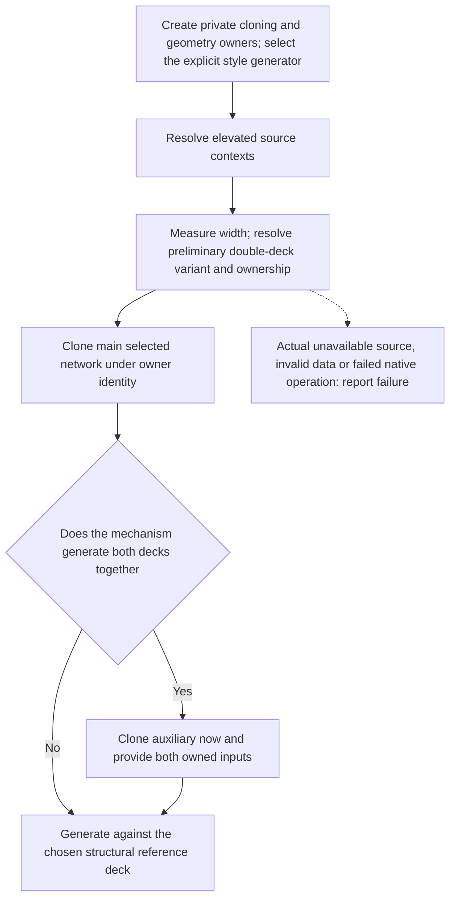

**Style generation; hands fixed or movable products to graph assembly.**

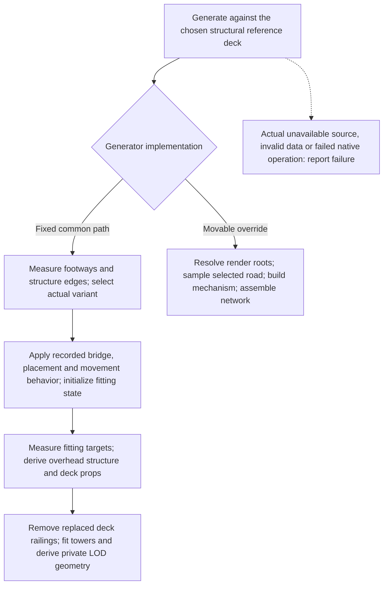

**Graph assembly; hands private output to preview or persistence.**

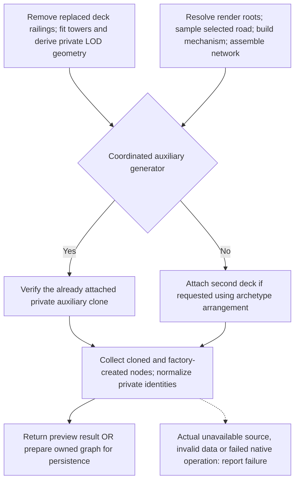

The common generation entry makes a preliminary double-deck selection before cloning to determine which
selected network owns the bridge. The fixed generator subsequently measures and selects within
style generation; this is prototype selection using the same elevated source context, not a second
road-level selection. A coordinated generator receives both private clones before sampling.
Other generators attach the second deck after style generation. Single-deck requests skip auxiliary work.
Fixed icon application, ownership checks and permanent-only unlock preparation occur before the
owned-node result is handed to preview or persistence. Style overrides may specialize the fixed
operations; the router must not substitute another family.

Fixed structural derivation reads the corresponding source meshes for each LOD and applies the
recorded part memberships: ordinary central parts stretch over their measured span, side parts
translate, and explicit assembly exceptions keep their own measured transforms. Derived towers,
cables, props and railings are private geometry; their UV/material modes and required attributes
follow the source and transform rules. Overhead and sub-object references are remapped to those
owned products. This does not replace the fixed bridge's selected-road mesh, lane layout or paint.
Footway measurements determine sidewalk-dependent pieces independently on the two sides.

### Movable lifecycle and native motion

This overview connects movable construction to its consumers. The next diagram expands sampling
and material realization. Native simulation consumes the generated graph; it is not a per-frame
Bridge Builder regeneration loop. Each style supplies measured skeleton, part and motion data.

**Construction; hands the assembled native mechanism to its consumer.**

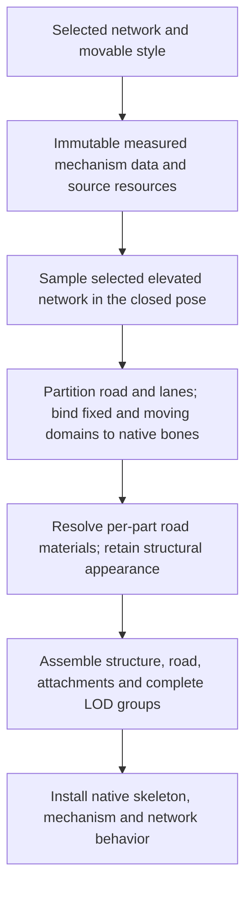

**Consumers; preview disposal, permanent publication and native motion.**

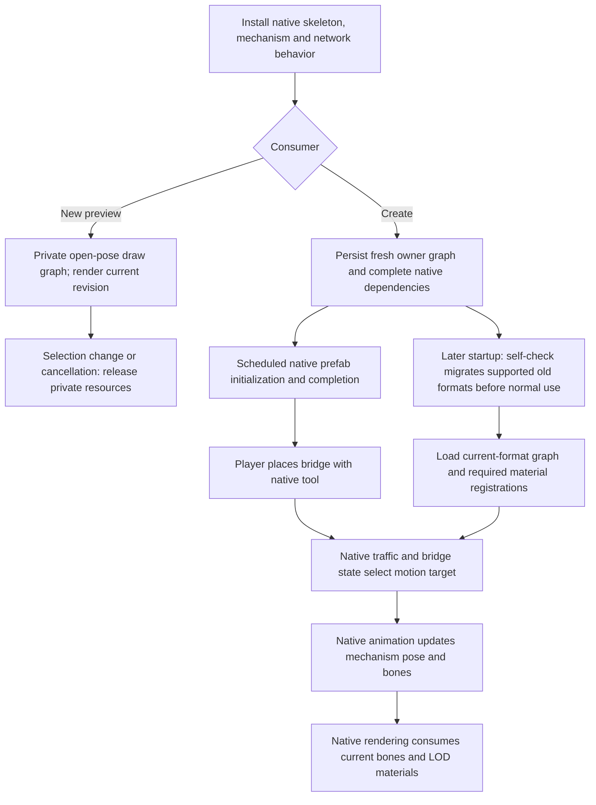

Create runs generation again; it does not promote preview resources. An existing saved-bridge
preview borrows its current-format graph through the common lifecycle above. The simulation branch
represents placement or save restoration; loading an asset alone does not place it. Relevant
material registration is a separate prerequisite. See the
[generated material design](material-spec.md) for its implementation
status; this workflow does not certify pending shader work or every movable style.

Verify closed, opening, open and closing states, traffic/shipping behavior, near/far LODs and
save/restart separately under the [movable acceptance criteria](../contracts/movable-contract.md#movable-23-acceptance-and-contributor-checklist).
These are development acceptance activities, not runtime geometry or GPU-result validation gates.
Actual failures and cancellation follow the common cleanup lifecycle. Source assets and healthy
saved owners are not preview-owned resources.

### Movable generation: sampling, geometry and material realization

Movable generation samples the selected road, builds the mechanism render graph, then assembles
the bridge network and objects. These stages are specialized by style. The shared preparation and
assembly path below includes Draw01; coordinated decks supply their own road frames and LOD inputs.
Do not interpret the diagram as a claim that every style has identical partitions or supports.

**Sampling and partition binding; hands classified LOD receivers to material realization.**

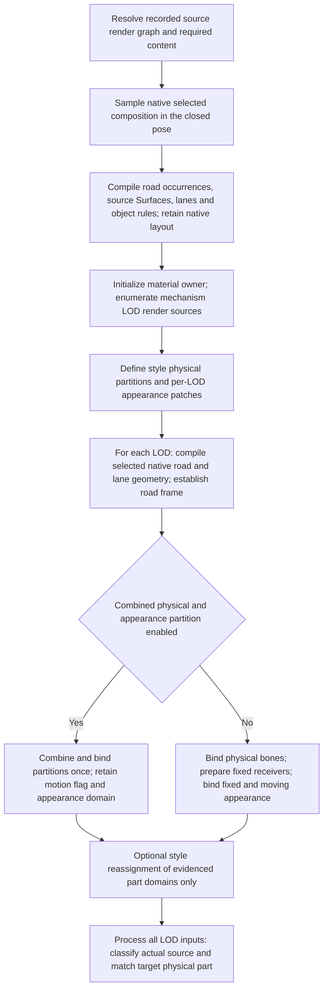

**Material realization; hands visible road triangles and slots to assembly.**

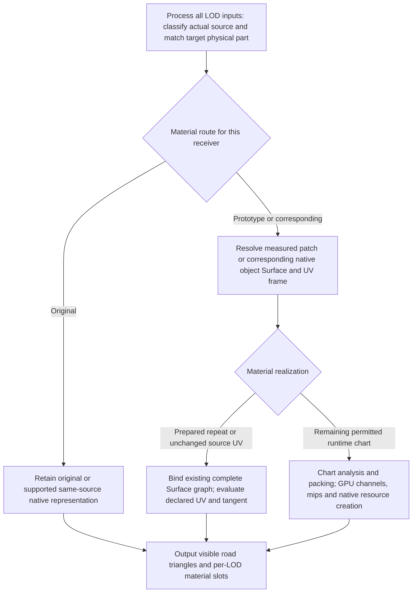

**Structural and native assembly; returns the owned variant.**

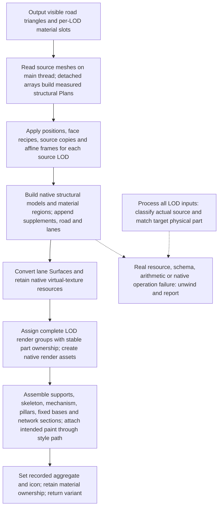

These nodes have specific meanings:

- Native sampling evaluates the selected elevated network, not a new heuristic reconstruction
  from paint. Native compilation evaluates road meshes and extracts lane visuals.
  The style's closed pose, occurrence provenance and actual lane/sidewalk layout determine its
  physical and appearance partitions. No generic step copies all prototype road faces over the input.
- Prototype part identification happens offline. Runtime reads immutable typed measurements and
  source geometry, then applies the style's recorded memberships and transforms. Structural Plans
  carry retained/removed faces, necessary fragments, UV domains, source copies and frame transforms;
  they do not discover member roles from a coarse height test during generation. Original bone,
  UV, color and packed-frame provenance is retained or explicitly transformed by the recipe.
- Road preparation finishes its per-LOD inputs before the shared material-processing stage.
  Road-material output therefore precedes the structural Plan assembly in this shared path.
  In the non-combined branch physical binding and appearance binding are distinct; the combined
  path labels both in one partition. The optional hook sits after binding and before source-aware
  routing, and does not change the geometry or motion assignment.
- Original and prepared material routes can finish without runtime atlas baking. The remaining
  chart path is conditional implementation, not permission to bake a whole span, discard layers,
  or turn a no-match into an error. Preserve source/part correspondence, complete PBR, original
  density, declared phase, filtering and native load lifetime under the material contract.
- Structural mesh access and native upload stay on the main thread. The parallel numerical stage
  computes independent Plan arrays from detached data, then native assembly resumes. Per LOD,
  native render assembly builds/retile-appends structural sources and supplements before
  road and lane batches. Material conversion and grouping follow these actual batches. Native
  render creation links the resulting LOD graph; group ownership must not create visibility gaps
  when independent renderers select different LODs.
- Selected-road decals retain each original source's texture channels, alpha and evaluated
  texture-area UVs. Clip each occurrence to existing receivers and bind their bones;
  keep separate overlapping sources and deduplicate only one occurrence's segments.
  A derived native hashed-alpha object Surface represents coverage, with explicit
  differences from DBuffer channel blending. There is no name filter, unknown-source
  white ribbon or constant white/yellow Paint replacement.
  Draw01 attaches paint through its object assembly; do not infer a universal paint call order
  inside road preparation. Fixed native approaches remain separate from moving receivers.
- Bridge object/network assembly installs the style's measured mechanism/object/network behavior, not only a
  render mesh. Draw01 creates column, footing, moving object, pillar, fixed base and network
  assembly in that order. Other styles' hooks can have different support or auxiliary ownership.

## Affine geometry execution

Fixed and movable bridge work follows the authoritative
[CPU affine geometry execution rules](generation-spec.md#generation-cpu-affine-geometry-execution).
The measured XYZ parameter matrices, embedded sparse arrays, bounded CPU scheduling,
main-thread native API boundary and numerical verification requirements apply to new
styles and regenerated recipes as well as existing implementations. This generation-time
change does not add a mod dependency to independently persisted bridges or require GPU
geometry execution. Use its interleaved XYZ storage and direct target-buffer requirements;
runtime expression recognition and per-axis register-column execution are prohibited.
Its parameter lifetime is on demand per generation; release decoded and derived arrays after
completion/failure/cancellation. No permanent static numerical cache or unused-style preload.
Keep runtime and metaprogram instructions synchronized with that section.

## Current implementation policy

Follow the [current implementation policy](../contracts/generation-contract.md#generation-current-implementation-policy). Prototype data must still be extracted from real sources and
hardcoded: other players may not have the same prototype files. Offline identification remains
required, but compact measured profiles/recipes may replace exhaustive per-vertex literals.
Do not depend on the original prototype Prefab at generation time. Preserve the required resource
graph through permitted packaged data and per-bridge dependency snapshots.

Style branches are optional. Implement movable families incrementally, deploy coherent buildable
increments, and choose CPU/GPU execution from measured needs. Continue unblocked coding while
human visual acceptance is pending. Preserve correct native behavior, all-LOD geometry, original
road bones, independent persistence and multilingual adaptation.

## Elevated-road sidewalks: all bridge generators

Follow [bridge generation contract section 25](generation-spec.md#generation-25-adapt-sidewalk-dependent-components-to-the-actual-elevated-road) for every fixed or movable bridge. A road may have no sidewalks,
a sidewalk on only one side, or unequal sidewalk widths. Resolve the actual elevated-mode road
composition and selected upgrades independently on each side. Adapt sidewalk-dependent components,
including inner bridge railings and bridge-authored sidewalk portions, to that side's actual
sidewalk presence, position and width. Do not generate them on a side without a sidewalk, mirror
one side, or impose the prototype's sidewalk width. Keep unrelated structural and outer safety
railings distinct. Apply the same layout to previews, saved bridges and every LOD.
Sidewalk portions embedded in fixed bases, end platforms or other composite components are also
subject to section 25. Only `Sidewalk` sections count as sidewalks; curbs do not. Adapt each side
independently without removing unrelated structural parts.

## Geometry invariants that must remain visible at repository scope

Read generation contract sections 2, 4, 5 and [8](generation-spec.md#generation-8-stretch-or-translate-is-decided-by-one-thing-does-the-part-cross-the-bridges-centre), plus [movable contract sections 7](movable-spec.md#movable-7-convert-the-closed-pose-road-into-persistent-object-geometry), 11, 15 and 19.

- PedestrianDraw02's central truss scales as a complete X assembly. Both pedestrian movable styles distribute underside longitudinal trusses evenly across X, retaining rigid member sections and the unchanged central truss. Lift01/Lift02 measured central trusses use complete-assembly scaling; outermost edge trusses retain their recorded mapping. Preserve measured memberships and all LODs.
- Apply [source-face coverage](movable-spec.md#movable-source-face-coverage-and-prevention-of-missing-structure): retain non-road faces, remove superseded fragments, verify final indices/attributes and independent renderer LOD ownership in offline acceptance. No coarse height/bounds removal or capacity fallbacks that hide parts.
- Use on-demand DLL-embedded, uncompressed numerical `.bin` arrays and request-local parameter caches. Verify exact numeric bits/order in offline tests; release on success/failure/cancellation. No unused-style preload, permanent numerical holders or runtime Boolean operations with prototype geometry. Development decompression uses temporary files removed on success/failure.
- Prototype meshes govern shape and complexity at every LOD. No excessive subdivision, including road conversion. Section 5 permits necessary subdivision of merged structural faces to express separate authored transforms, and measured high-detail-derived/supplemented LODs; preserve original attributes/materials and mapping rules. Golden ornament/support exceptions remain scoped there.
- Preserve authored widths, contact boundaries, closure faces, deck-adjacent bases, centred posts and Draw03 trusses. Pier columns translate, never stretch. No runtime membership inference or silent internal-error fallback.
- Moving paint, poles, lamps, cables and ordinary nested meshes use the mechanism's native motion sample. A parent connection ID is insufficient. Only the explicit native attachment exceptions retain historical behavior. No transform-tracking controller. Keep source decal artwork; accepted curve-segmentation/endpoint-fade differences remain scoped by the material/movable contracts.
- Section 17 requires byte-identical external dependency snapshots with original CIDs under each owner UUID, deduplicated only within that owner and stopping at built-ins. Preserve source files/references. Intentional copied-CID duplicates are not generated-identity collisions; do not restore in-memory integrity checks or quarantine.

## Movable bridge size

Follow [bridge generation contract section 24](generation-spec.md#generation-24-movable-bridge-asset-size): a generated movable bridge's total Prefab size, including
its dependencies, must be comparable to its original counterpart. Measure the complete graph,
not only its root or textures; preserve required content and report unresolved measurements.

## Movable generation requirements

Read [complete movable material and persistence scope](../contracts/reading-map.md#movable-sections-16-24) before implementing or modifying movable bridges.
Read the [movable runtime invariants](../contracts/reading-map.md#movable-runtime-invariants) and material
contract together: preserve original road bones, native material semantics and independent
persistence. Retained selected-road decals must use the authorized direct-skeleton shader route with
source decal appearance; the historical relative-child route is not the target motion implementation. Preserve source alpha
blending, artwork and evaluated UV density; partition footprints by actual motion/support domains.
This user-authorized route supersedes the former child-projector prohibition. No receiver cuts,
receiver-only structural material copies or runtime synchronization dependency. Acceptance remains
specific to the tested style, input and build. Material conversion follows section 4's bounded rules.

Follow bridge-asset-persistence.md sections 6–7 for owner-local short filenames, VT/mid-mip
placement and backed-up file-only migration. Legacy sibling dependency directories remain valid
migration inputs. Layout conflicts preserve healthy bridges and report incomplete migration;
they do not authorize damaged-asset retirement. Native cold-load acceptance remains separate.

## Packaged textures belong to road running surfaces

See [Packaged textures belong to road running surfaces](material-spec.md#material-packaged-textures-belong-to-road-running-surfaces).

## Movable bridges: no special road-width adaptation

Do not apply special adaptation based on road width to movable bridges. Retain the
ordinary measured target-minus-prototype width mapping; do not add narrow-road
compensation, clamps, replacement geometry, special bone precedence or dedicated
width thresholds. Remove narrow-road-specific generation branches and diagnostics.
Narrow-road compatibility is no longer a completion gate for the movable batch.
Trust internal numerical and geometry/skeleton data under the repository execution policy;
retain actual external IO boundary validation and native operation failure handling.
This is not a claim that every arbitrarily narrow input produces a valid bridge.

This rule applies only to movable bridges. Do not change non-movable bridge
selection, geometry, validation or persistence. Narrow-road adaptation is outside the movable
generation and acceptance scope.
Existing saved assets are not rewritten merely because generation code changes.

## Select one road-level branch before generation

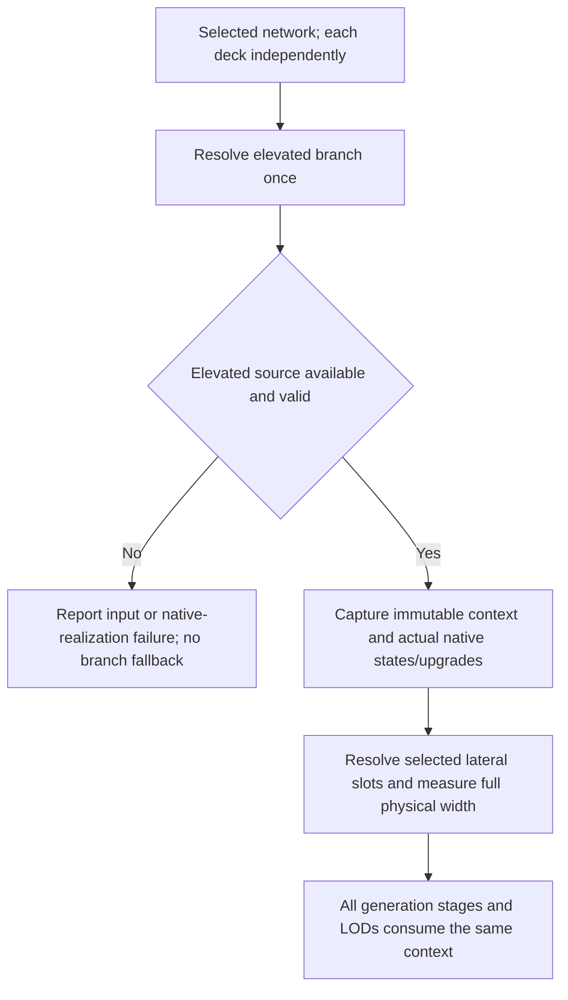

Every fixed and movable bridge uses the selected road's **elevated branch**. Resolve it once
at the common generation entry before width measurement, cloning or style construction. Do not
enumerate or rank ground/other road-level alternatives or use them as a fallback. An unavailable
or invalid elevated source is a genuine input/native-realization error, not permission to silently
substitute another branch. For double-deck inputs, resolve each selected network's elevated
context once; never borrow the other network's context.

Keep source Prefab/entity, resolved elevated flags, native branch/provenance and measured layout
as one immutable generation context. Width, sidewalks, extensions, geometry, bridgeheads, decks,
materials and every LOD consume it without reselecting. Preserve all physical edge/node
contributions, native section-local requirements, upgrades and directional state within that
branch. They are not competing road-level choices. Construction flags do not authorize a new level.

Separate the road-level choice from measured physical elevation and pose. Native sampling must
derive complete states/upgrades for the elevated branch while retaining actual positions, curves,
bones and mechanism heights. Patching an elevated bit after native state selection is insufficient.

Fixed bridges retain selected native materials and markings; this rule does not introduce movable
road-material processing there. Material matching inside the elevated context remains noexcept:
no correspondence means Original, not another road branch. Corrupt resources and invalid native
realization remain separate errors. Verify one context per network, unchanged physical height,
all physical contributions retained and common geometry/material provenance across LODs and
preview/export. An unused helper or unrelated elevated flags do not prove integration.

Measure Edge + Elevated with actual native edge-state conditions and requested upgrades. Read
initialized `NetGeometrySection`, `NetSubSection`, `NetSectionPiece` and `NetPieceData`, resolving
alternatives through `NetCompositionHelpers`. Sum selected lateral slots, taking the maximum
selected width once for overlapping render layers within each slot, never across alternative
variants. Include medians, carriageways and sidewalks; keep outward side extensions separate.
Do not infer width from lane counts, names, cached totals or universal sidewalk widths, or compress
ground geometry into an elevated width. The zero-flags native default is only a diagnostic;
unmeasurable external input fails rather than falling back to that total or serialized-section sums.

`NetWidth.cs`, `BridgeRoadWidthSystem.cs` and `DeckCatalog.cs` must share these states and boundaries
for RoadPrefab, TrackPrefab, PathwayPrefab and available Road Builder inputs. Report piece widths,
offsets, flags, surface sum, extensions and default-width diagnostics separately. Verify zero,
one-sided and unequal sidewalks and carriageway/median alternatives. Do not alter measured prototype
parameters to conceal a mismatch. [Selected-state observations](../archive/bridge-evidence/generation-source-observations.md#elevated-road-width-state-observations)
are not hardcoded exceptions or all-road acceptance; use the [complete-span audit](#generation-14-preserve-each-archetypes-width-allowance)
for a real prototype and human-created sample.

## Preserve original UV projection and mapping mode

This is a mandatory rule for **all bridge generators, fixed/non-movable and movable alike**.
It covers every component and every LOD in preview, creation, regeneration and export.
Material-specific requirements supplement this rule; they cannot restrict it to movable bridges.

See [Scope and authority](../contracts/material-contract.md#material-scope-and-authority).

Resolve the elevated road-level branch once at the common generation entry, before width
measurement, cloning or style construction. Every fixed and movable bridge uses that elevated
context for geometry, bridgeheads, decks, materials and every LOD. Do not enumerate, rank or
fall back to ground/other road-level branches; no downstream re-selection.
Keep all physical contributions and section-local branches within the selected road branch.
Material matching within it is noexcept: a corresponding match selects that route; no match
selects the original source-material route, without selecting a different road branch.
The [complete material pipeline](../contracts/material-contract.md#material-complete-material-processing-without-propagated-exceptions) must return explicit outcomes through
resolution, adaptation, assembly, persistence, preview and creation without propagated exceptions.
Within the movable-bridge road and rail running-surface conversion scope, valid unknown materials use compatible originals, equivalent conversion, or a visible processed
native compatibility material with non-blocking difference diagnostics. Compatibility gaps must
not reject valid input. Name/CID whitelist adapters, incompatible blind shader binding and
unreported appearance losses are prohibited; genuine resource/IO failures remain explicit.
Branch mechanism decks and native network bridgeheads
by their own source/domain and render context; do not classify a mixed piece from a section name.
Resource corruption and native realization failures return explicit non-exception failure results. Follow
[the material routing rule](material-spec.md#material-total-material-routing-by-part-and-actual-source).

For non-road materials, preserve original projection and tiling/stretch mode per source part,
material domain, LOD, layer and axis. Unsupported selected-road appearances retain their own
source evidence, or use the corresponding compatible native road replacement under material
contract [section 4](material-spec.md#material-4-persist-constant-reusable-materials-before-runtime). An equivalent representation must preserve every source layer and its
sampling behavior. Where equivalence is unavailable, the material contract authorizes visible
processed compatibility output with non-blocking network/world-blend difference diagnostics.
Preserve actual category, physical density, frames and native dependencies.

**Prototype-supported processed movable-road appearances must tile at original resolution and physical texel
density, never stretch to road width or length.** This applies to asphalt, sidewalk paving and
other supported road types in every LOD, including moving surfaces, fixed running caps and finite
terminals. Finite geometry bounds where the material is drawn; it does not justify stretching
its pattern. Use [the supported-road material rule](material-spec.md#material-prototype-supported-road-surfaces-must-tile)
for pure-source offline authored repeats, complete periodic mip chains and coherent source/PBR,
density and phase across domains sharing the same evidenced prototype appearance. Do not classify concrete or gray curb imagery as
asphalt merely from a label. The road rule overrides original finite/stretch road mapping; it
does not change structural material modes or authorize structural rebaking.

| Material/mapping | Required generated mapping |
| --- | --- |
| Prototype-supported processed movable-road paving | Tile at original resolution and physical density on the applicable road dimensions; never stretch, including finite caps and every LOD. |
| Non-road or unsupported input: tiling | Preserve physical density, orientation, phase and measured repeat boundaries. |
| Non-road or unsupported input: evidenced finite/stretch | Retain authored UVs, interpolating permitted construction fragments; report expected density changes. |
| Non-road mixed axes, mirrors or folds | Preserve each axis and measured traversal independently. |
| Different LOD source | Use corresponding source resolution and native frame while obeying the same road tiling, wear placement and marking-removal rules. |

For processed movable roads, [remove embedded road markings at every LOD](material-spec.md#material-remove-embedded-road-markings-at-every-lod),
including all road material channels/mips, caps, transitions and merged far atlases. Keep the
selected road's intended paint generated from its actual layout through the applicable native
path; movable mechanisms use the authorized current-skeleton decal program. Shared original
atlases remain unchanged for structure; changed road derivatives have new identities.

Record source/version, Surface/texture identities, slots, domain membership, LOD, coordinate
ranges and native sampling semantics. A Repeat flag alone does not establish correct mapping.
Unknown modes or failed tests are not evidence of stretching or of an original period. Do not
add texture-period cuts, use vertex-only modulo or change bones. Native loading and quality checks
remain mandatory; specification compliance is not established by metadata or compilation.

## Wheel-track placement follows actual selected lanes

For movable roads requiring material processing, resolve actual vehicle lane centers from the selected native
road composition and upgrades, never paint geometry or assumed uniformly spaced lanes. Test wear
support independently from asphalt and sidewalk support. Use the same complete measured wear
source for the corresponding appearance across lanes and a matching same-source tiled background.
Translate the whole wear pattern so its measured visual center aligns to the native lane center.
Preserve its original physical transverse width, internal dark/light relationships, longitudinal
density and phase. Do not retain an obsolete source lane-reference offset, center individual dark
bands, or stretch wear with road/lane width. A bright/dark stripe alone does not identify tire tracks.

No vehicle lane means no wear placement: curbs, sidewalks, shoulders and medians use their proper
background/category. BaseColor, Normal, Mask and other required channels share the same source
mapping. Apply these principles to every LOD, preview and export without changing selected geometry,
bones or independent paint. Source crops, center values and widths are measured per appearance,
not global constants copied from Draw03 or another prototype.

## Offline source-atlas repeat materials

Use original materials when they satisfy the required mapping and marking content. Otherwise
prepare supported-road repeats outside the game under [material contract section 3](material-spec.md#material-3-tile-repeatable-materials-at-their-original-density), including
bounded authored repeats from original pure road grain. Such new periods must be identified as
authored derivatives, not claimed as original prototype evidence. Preserve base texel density,
channel alignment and complete native periodic mips; no arbitrary downsampling or budget increase.
This repeat-material route prohibits non-road texture derivatives, including the recorded Lift05
profile domains; the separate [native-template conversion](material-spec.md#non-network-native-material-template-conversion)
has its own bounded permission and does not authorize structural repeat textures.

Keep existing seams and necessary actual shape, motion and material-domain boundaries. No new
cuts solely to reset periods, prototype-triangle Boolean operations, per-use texture copies or
full-span pixels are permitted. Preserve source assets, selected-road shape and original bones.
Changed derivatives receive new CIDs and complete native dependencies. Validate PBR, frames,
filtering/aniso, every mip/LOD, independent loading, informational owner measurements and complete package-size reporting.

## Every generated bridge follows its archetype

A generated bridge is built from a real bridge of the same type — its archetype. Every parameter of
the result must be what the archetype has, not what seemed reasonable when the code was written.

This covers the whole prefab, not the parts that looked important: the components and their fields,
the sub-object placement (`m_Position`, `m_Placement`, `m_FixedIndex`, `m_Spacing`, `m_AnchorTop`,
`m_AnchorCenter`, `m_RequireElevated`), the number of mesh parts on each half of a placeholder pair,
the spawn probability, the pillar type and its offsets.

Where the code differs from the archetype deliberately, the difference is written down at the point of
difference with the reason. Anything else is a defect, whether or not it has been noticed yet.

Historical cases are recorded in the [source observations](../archive/bridge-evidence/generation-source-observations.md#historical-archetype-fidelity-failures).

## Numeric storage in embedded typed arrays

Hardcoding means immutable, offline-measured prototype data, not giant C# literal initializers.
Store recorded numerical values in typed arrays in uncompressed numerical binary
resources embedded in the mod DLL. Preserve signedness, integer width, IEEE floating-point bits,
array order and all measured values. Store the `.bin` source files under
`assets/HardcodedNumbers/<BridgeType>/`; use `Shared/` only for data genuinely shared by bridge
types. Each resource is independently readable so requesting one bridge never requires
loading another bridge's data. The checked-in resources are part of the source delivery
and must be embedded by both the command-line production build and the project build. Do not
also ship compressed duplicates or a monolithic archive of all bridge arrays. Compression belongs
to the complete Paradox Mods package; do not add per-resource compression when the final package
sizes are similar. Compare identical publication file lists after official postprocessing.

### Request-local numerical resource lifecycle

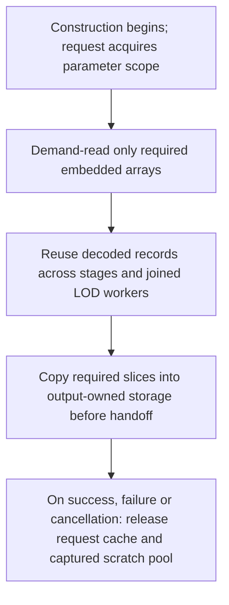

Load each resource only when its owning bridge/data class actually needs it.
Do not load all resources at startup, catalogue enumeration or style selection. Prevent
eager static initialization of unused numerical resource holders. Read the trusted embedded
typed arrays directly; resource format, array lengths, complete payload and checksum are checked
by offline build/development tools, not repeated during runtime memory decoding. Uncompressed
loading needs no extraction file. If a development conversion needs
decompression, its decoded file must be temporary and deleted on success or failure, never a
persistent extraction cache or installed/generated bridge asset. Load numerical resources only on demand within the current generation request. Reuse decoded
BBN arrays, SIMD programs and reconstructed parameter/membership records across that request's
stages and joined LOD workers. Release all cache-owned strong references on success, failure or
cancellation. Do not preload unused bridge types or retain permanent static numerical holders.
Independent requests must not clear each other's active data. Deferred material preparation acquires
this scope only when construction begins. Bounded metadata queries may use temporary scopes, not a
permanent fallback cache. Final native output and delayed preview/publication callbacks must own
their required data rather than retaining a session or borrowed parameter arrays. Copy required
parameter slices into output-owned storage before handoff. Do not force GC or promise an immediate
RSS decrease; later requests reload only their demanded trusted resources. Numerical scratch
pools are separately request-owned: return buffers to the captured request pool, and release that
pool at completion rather than retaining large register buffers in a global shared pool. Do not require loose files beside the DLL,
an installed prototype, a network request, or runtime geometry inspection to reconstruct the values.
Use bounded loops to reconstruct compound records from the numerical arrays; do not regenerate
huge static initializer methods. Ordinary algorithmic constants, enum values, array indices and
compile-time language requirements are code, not prototype measurements.

### Numerical preservation and authoring checks

Migrate every existing recorded numerical table and parameter, including non-movable bridge data,
without changing geometry, transformation rules, material references, bones, identity or behavior.
Preserve the offline extraction tools and make resource conversion repeatable after regeneration.
Verify numerical values and ordering against the measured source data, verify all embedded
resources, and run affected checks. Generated bridge assets remain independently persisted native
assets: they must never acquire a runtime dependency on these mod resources.

The archetype's parameters are read out of the game once and written into embedded data arrays. They are
**not** copied from the archetype prefab at generation time.

Each `.bin` encodes six typed-array counts, ordered numerical bytes and a SHA-256 checksum,
without file magic or a version identifier. `inventory.json` records `payloadBytes` for authoring;
it is not a runtime dependency. Both build routes use logical resource names
`BridgeBuilder.Numbers.<resource>.bin` with culture inference disabled. `HardcodedNumbers.Load`
reads those six arrays from the request-local cache or trusted embedded stream; `GenerationParameters`
owns their scope and joined-worker reuse.

Offline verification uses `tools/HardcodedDataPack --check` for checksums, counts, resource coverage,
classification paths and demand initialization. The packer emits explicit static constructors;
the UV recipe generator and Draw03 texture check use the same format. `tools/HardcodedNumbersCheck`
checks typed bits, optional original baseline bytes, concurrency and production DLL initialization
flags. `tools/GpuBake/HardcodedNumbersNativeCheck.Editor.cs` compares production-loader bytes under
Unity Mono. Historical totals remain in the [measurement record](../archive/audits/numerical-resource-measurement.md);
these resource checks do not establish material or geometry visual acceptance.

Measure numerical compression against the complete officially postprocessed package with identical
other content. `tools/Measure-DeliverySize.py --package <content.zip>` reports source delivery,
complete package and optionally one bridge's owned files. Local `tools/ParadoxPackage` packaging
requires retained log, manifest and toolchain identity but performs no upload. Unpacked DLL or
build-directory totals are not package sizes; the [SDK comparison](../publishing/paradox-package-size.md)
retains the paired evidence.

## CPU affine geometry execution

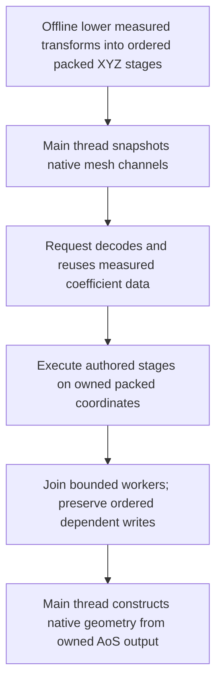

Express measured coordinate transformations as affine parameter matrices:
`position = origin + C0*p0 + C1*p1 + C2*p2`. X, Y and Z each have their own row;
constant axes are zero-coefficient rows. Width parameters may be distinct for the
upper deck, lower deck and structure. Preserve measured branch/domain membership,
anchors and arithmetic order. Do not replace piecewise rules with a global scale,
infer missing coefficients at runtime, or introduce new width-specific behavior.

Structure coordinate generation uses one common data-driven SIMD pipeline. Bridge styles
supply measured binary floating-point arrays, index memberships and topology recipes;
they do not supply separate numerical execution loops, callbacks or style-specific SIMD
adapters. Lower measured transformations offline into ordered shared numerical stages.
Compile axis scheduling and parameter layout offline into explicit interleaved stages.
Coordinate storage and numerical work use packed `x0,y0,z0,x1,y1,z1,...` order;
each SIMD block spans adjacent coordinates, not a gathered column of one axis.
Merge independent XYZ operations into these stages offline. Do not retain per-axis
register columns behind an AoS wrapper, replicate one coordinate into three lanes,
or recognize expressions at runtime to select specialized affine/interpolation paths.
`ExecuteAffine`/`AffineWeights` and `ExecuteEdges`/`EdgeXyz`, including equivalent
renamed recognition paths, are prohibited. The runtime executes the encoded operations
without algebraic pattern matching. Preserve sparse constant axes and source/destination
ownership. Inactive lanes retain their original bits, including signed zero and NaN payloads;
identity multiplication/addition is not an unchanged-axis copy. The same executor
serves fixed and movable structures, previews, permanent generation and every LOD.
Geometry/topology preparation and native realization remain separate from coordinate
execution; this rule does not introduce SIMD operations into asset database or mesh APIs.
Use contiguous source/target coordinate spans directly where the recorded membership
is contiguous. Sparse memberships may adapt whole XYZ records, never transpose them
into axis columns. Preserve aliased-read snapshots and ordered duplicate writes.
The completed owned AoS target is the source of the native position bytes: do not
unpack it into another scalar XYZ array before mesh construction. Scalar coefficient
and frame calculations are distinct from vertex storage and must be reported as such.

Keep operand bits and evaluation boundaries distinct. Binary32 storage does not imply
that an existing runtime rounds every intermediate to binary32. Preserve the original
runtime's intermediate precision, expression order, explicit float-rounding boundaries
and duplicate-write semantics in the encoded stages. Do not enable a different global
JIT floating-point mode, add fused operations or relax equivalence tolerances to make a
SIMD backend pass. Verify actual packed machine instructions on the supported game runtime;
a vector-shaped API or a scalar-emulated library is not SIMD evidence. Report unsupported
execution and remaining scalar structure paths explicitly; an unused kernel or partial
caller migration is not completion of this architecture.

Use `AffineGeometry` for CPU numerical execution. Existing per-vertex coefficient
arrays and part-range recipes are sparse matrix storage; they need not expand into
a dense matrix per vertex. Keep their numerical `.bin` typed payloads inside independently readable embedded
resources and preserve exact numeric bits when the existing representation suffices. Decode reusable coefficient tables
once within their owning generation request. General XYZ matrices and specialized scale, translation and single-coefficient
rows share the same numerical execution path. Avoid extra zero operations on
constant axes and do not fuse or reassociate measured multiply/add operations.

Snapshot native mesh channels on the main thread before scheduling work. Independent
LOD plans and disjoint vertex batches may run concurrently; native Mesh, Prefab,
asset database, material and persistence operations remain on the main thread.
Finish all workers before publishing their arrays. Bound parallelism, batch vertex
work and suppress nested parallel scheduling. Small batches may execute serially.

Execute overlapping recipe stages in authored order. Within a source-only scatter
table, retain the last row for each repeated destination. Repeated additive index
operations retain their multiplicity and order per destination. Never parallelize
shared topology counters, output lists or dependent writes without first making
ownership explicit. Numerical parallelism does not authorize triangle changes,
bone changes, material changes or persistence-format changes.

Regenerated measured code must retain these kernels. The offline
`tools/AffineGeometryMigration` lowering pass handles independent coordinate loops;
manually prepared maps and engine snapshot boundaries require review. Run the
resource integrity check, numerical equivalence/race checks, relevant measured
geometry checks and localization checks before deployment. Generated native assets
must remain usable with Bridge Builder enabled; mod-owned precompiled program registration is required; owner shader payloads are not persisted. Record snapshot and parallel-plan timings;
build success and microbenchmarks do not prove an in-game speed improvement.
Compare executors with identical threading and nesting settings, including the real
outer-LOD worker context. Include dispatch, sparse adaptation, allocation and native
position publication costs; report cold decoding separately from warm execution.

The original authoring Prefab need not be installed. Required native game/DLC content and
permitted packaged resources must still be available; hardcoded numbers do not replace missing
material, geometry or behavior dependencies. Report an unavailable required resource explicitly.

Source navigation: [generation methods](generation-spec.md#generation-4-the-tower-and-the-cables-are-derived-geometry-never-referenced-geometry).

**Recorded, or carried across — never recalled from another family.** Rule 2 says the archetype is
hardcoded rather than copied, and the reason is that the archetype may not be installed. That reason
does not apply to a thing already in hand. When the generator is modifying something — a sub-object
entry it is replacing, a piece or a mesh it is widening — the archetype *is* the input, and its
components and fields are carried across whole, changing only what the mod exists to change.

Recorded parameters must remain specific to their source family.

Carrying a component across carries its **references** too, and those still name the archetype's
prefabs. Repoint references to any dependency that is itself derived to that derived dependency, including every LOD.

So: recorded data is for what must be reproduced when the archetype is absent. What is present is
carried, not recalled. Where both exist, the recorded value becomes the check on the carried one — see
`CheckStacking`, which is the floating tower turned into an assertion.

Measurements are taken by `TowerSelfTest` and `AssetAnatomy`, which write them to
`ModsData/BridgeBuilder/`. Re-measuring is how these tables get corrected; a number that cannot
be reconciled with a measurement is wrong even when the bridge looks right.

**Measured data is never deleted.** An entry that turns out to describe something other than what it was
recorded as — a support column read as a portal — is marked, not removed. Deleting it only means it
gets measured again.

## No Boolean operations with prototype geometry

Bridge generation must not perform any Boolean operation with the prototype bridge:
intersection, union, difference or clipping against its meshes, triangles or reconstructed
prototype surfaces is prohibited. Hardcoding a copy of prototype triangles does not make
runtime Boolean operations against that copy permissible.

All prototype-specific coordinates, boundaries, transforms and part membership required by
generation must be measured offline and hardcoded as immutable construction data. Runtime
must directly apply those recorded rules, never consult prototype geometry to discover
or recompute the result. Prototype meshes remain the offline reference for shape and LOD
complexity; permitted attribute/resource reuse and recorded structural transforms are not
Boolean operations. Actual selected-road composition remains an input, not a fixed road layout.
Necessary selected-road cuts at hardcoded motion seams and appearance boundaries are distinct
from intersecting that road with prototype faces and remain subject to [section 4](generation-spec.md#generation-4-the-tower-and-the-cables-are-derived-geometry-never-referenced-geometry)'s complexity rule.

This rule applies to every bridge style, every LOD, preview and saved generation. Replace
prototype-face intersection with direct generation using the recorded construction rules;
do not merely move the same Boolean operation behind a helper or a hardcoded triangle table.

## A generated bridge differs from its archetype in geometry and road structure alone

Except for the native representation, UV-density, LOD, persistence and
[structural water-placement changes](#generation-structural-parts-must-not-block-placement-in-water) explicitly
required by this contract and its specialist contracts, preserve the components and their fields, the bridge behaviour, how the tower is
anchored, where the cables are drawn, the placement flags. Two things are allowed to differ, and they
are the two the mod exists to change —

- **the road structure**, because the point is to carry a road the archetype does not have;
- **the geometry**, because a road of a different width needs a tower and cables of a different width.

Any difference without such a required conversion or measured generation rule is a defect. When a generated bridge and its archetype are dumped by
`AssetAnatomy`, the two should read the same line for line apart from what identifies an asset rather
than describes it — names, the four `m_GuidPart` fields, `version` (which `OnSerializing` stamps and
nothing else reads) — plus mesh contents, the road's own `m_Sections` and the explicitly required
native representation, material and persistence conversions above.

## The tower and the cables are derived geometry, never referenced geometry

Both are produced by modifying the archetype's mesh. Neither may point at the archetype's mesh
unchanged and neither may be built from nothing.

Compute every submesh bound from its generated indexed vertices and retain their union as the mesh bound. Do not carry unchanged source bounds or rely on default descriptors to describe generated geometry. The native importer inspection and former zero-bound failure are preserved in the [bounds audit](../archive/bridge-evidence/generation-source-observations.md#historical-submesh-bounds-failure).

For carried structural meshes, preserve raw channels, formats, indices, submeshes and material
semantics by default. The explicit movable LOD and selected-road conversion rules permit their
scoped changes. Preserve tiling density through evidenced UV mapping where geometry deformation changes a
tiling source. All non-running structural parts retain original prototype material/texture identities except for the
[non-Network native-template conversion](material-spec.md#non-network-native-material-template-conversion), which retains source appearance and texture dependencies. The
[offline source-atlas repeat rule](generation-spec.md#generation-offline-source-atlas-repeat-materials) permits eligible movable-bridge road and rail running-surface derivatives only; it grants no structural material exception. Road composition is limited
to prototype-supported appearance types under [movable material families](movable-spec.md#movable-17-material-families-uv-density-and-texture-ownership); other types use compatible original or corresponding native object road materials under material [section 4](material-spec.md#material-4-persist-constant-reusable-materials-before-runtime). Preserve the actual appearance source's
applicable mapping under [the general source-mapping rule](generation-spec.md#generation-preserve-original-uv-projection-and-mapping-mode):
prototype-supported road surfaces tile without stretching at source density; non-road and
unsupported-input materials retain their evidenced modes, including mixed axes. Existing appearance-selection rules determine that source; a
prototype-unsupported selected road may retain its own evidenced stretching behavior, never inherit it from a different
bridge prototype. Unknown mappings, failed conversion or missing repeat evidence do not authorize stretching.
Neither path permits unrelated
channel re-encoding, topology changes or appearance substitution.

Preserve each source attribute’s native packed layout outside the expressly permitted conversions. Preserve the archetype’s render-prefab components, including its own stacking and tiling behavior, as well as geometry. The [packed-vertex audit](../archive/bridge-evidence/generation-source-observations.md#historical-packed-vertex-and-component-failures) retains the inspected layout and former failures.

Outside those explicit conversion paths, nothing is re-encoded. The raw vertex buffer is read, each attribute is lifted out of its stream at
the offset and width the mesh says it occupies, and handed on unchanged. Only the positions are
rewritten unless the density-preserving UV rule requires a measured remapping.

Where this lives:

- [`BridgeTowerSpec`](../../src/BridgeBuilder/Bridges/BridgeTowerSpec.cs) — the tower archetype as
  plain numbers, with no dependency on the game, so the offline tests can hold it to what was measured.
- [`BridgeTowerTemplate`](../../src/BridgeBuilder/Bridges/BridgeTowerTemplate.cs) and
  [`BridgeCableTemplate`](../../src/BridgeBuilder/Bridges/BridgeCableTemplate.cs) — apply the specs
  to a prefab. The only files that need the game.
- [`BridgeTowers`](../../src/BridgeBuilder/Bridges/BridgeTowers.cs),
  [`BridgeCables`](../../src/BridgeBuilder/Bridges/BridgeCables.cs),
  [`BridgeMeasurements`](../../src/BridgeBuilder/Bridges/BridgeMeasurements.cs) — the measured widths,
  same rule.

## Prototype-referenced mesh complexity

Generated bridge meshes must use the prototype bridge's meshes as their reference.
Excessive mesh subdivision or triangle cutting is prohibited. This applies to fixed and movable
bridges, generated road surfaces and structures, previews and persisted assets, at every LOD.
Use each corresponding prototype LOD's mesh organization and level of geometric detail as the
reference; do not carry near-detail tessellation wholesale into reduced-detail levels.

Necessary cuts for actual geometry, motion, material or selected-road boundaries remain permitted,
including the approved merged-part subdivision exception. That exception and permission to derive
LODs from high-detail geometry do not authorize excessive tessellation. Do not let repeated UV
tiling, marking conversion or intermediate clipping determine an unnecessarily dense final mesh.
Preserve required road composition, appearance, structural parts and bone ownership while producing
geometry appropriate to the prototype's corresponding LOD. Inspect the resulting topology and
triangle counts against that reference; compilation alone does not establish compliance.

## General width-only transformation rules

Except for the measured Golden ornament exception below, generation changes only tower width. Everything else — height, the
shape of the legs, the parts and where they sit, the materials, every component and field — is the
archetype's.

This tower rule keeps height and depth unchanged outside that explicit ornament exception. Other measured movable-part recipes may
have width-dependent X, Y and Z coefficients under [section 2](generation-spec.md#generation-2-the-archetype-is-hardcoded-never-copied); those coefficients must come
from that part's prototype evidence, not an invented tower deformation.
Concretely, the tower-width mapping in `TowerWidening` moves vertices along x. Whether a part is stretched or
translated is rule 8's question and only rule 8's — does it cross the centre line — and both answers
move the part's outer edge by half the extra width, so the two agree wherever parts meet.

Do not split the stretch/translate decision by vertex position or half the road width. Such a
boundary can cut through one authored leg and give its vertices incompatible displacements.
Classify the complete part under rule 8. Outside the explicit base mapping, do not apply
`sign(x)` translation to a continuous centre-crossing member: the discontinuity opens a gap.

Outside the measured Golden ornament exception, tower height and depth are untouched by construction.
Mesh part offsets move by the same shift as the
vertices they belong to, so the parts stay together. Authored placement/stacking bounds are derived from the archetype with only x adjusted;
these are distinct from the indexed mesh/submesh bounds that [section 4](generation-spec.md#generation-4-the-tower-and-the-cables-are-derived-geometry-never-referenced-geometry) requires computing — a pillar's authored bounds reach below what its
geometry draws, and that is how the game knows how far down it may be placed.

At the archetype's own width the shift is zero and the result is the archetype, vertex for vertex. That
is the property the tests check, and it is what makes "derived" mean something.

The mapping must satisfy these consequences:

- A tower is never scaled. Scaling thickens the legs in proportion; the tower stops being that tower.
- The tower stands its own archetype's distance outside the cables at every width.

  Concrete source spans and gaps are retained in the [suspension measurement audit](../archive/bridge-evidence/generation-source-observations.md#suspension-tower-and-cable-measurements).

  The tower's width is derived from this, not from the road. Solving
  `towerOuter + extra/2 == cableOuter + distance` gives the widening directly, and it comes out the same
  whichever part is measured because the archetype satisfies all three distances at once. The deck's
  width minus the tower's authored road width gives the same answer when the tower and cables share
  an archetype; it does not establish the required gap when their sources differ. For bridge types
  without cables, use the measured road-width relationship.

  This holds because the legs are carried out rigidly by half the extra width and the cable sheet is
  stretched from the span it draws, which moves its outer edge by the same half — two code paths that
  agree rather than one that enforces it. So it is also measured on the result and reported as a defect
  when it drifts. It can drift without anyone making an arithmetic mistake: the tower archetype is
  chosen by width from the recorded list and the cables come from whichever installed bridge carries
  that tower, and the same tower is carried by several. Let those resolve to different bridges and the
  distance becomes tower(A) minus cables(B), which is not this constant and never was.

- The cables keep their distance from the tower. Both are derived from the same archetype by the
  same extra width, so the gap between the cable’s outer edge and the tower’s is preserved exactly
  when both edges move by half the extra. A proportional stretch does that only if it divides by
  the distance being scaled — the span the mesh actually draws, not the width the piece declares.
  The denominator is the actual drawn source span; declared network width is not a substitute. The historical discrepancy is recorded in the [cable audit](../archive/bridge-evidence/generation-source-observations.md#declared-versus-drawn-cable-width).

- A continuous surface is not a portal, and rule 8 tells them apart without being told. Cables are one
  sheet reaching across the centre, so they are scaled; a portal's legs do not reach it, so they are
  carried. Both put the outer edge in the same place; do not apply rigid side translation to a continuous centre-crossing sheet.

## Approved movable LOD representation exception

When a merged structural LOD triangle cannot represent its authored parts' separate width
transforms, subdivide only as necessary. Preserve original vertices, interpolate original
attributes, retain material semantics and apply the same offline part classification. This
scoped index/topology change does not authorize runtime part discovery or excessive tessellation.

Integrate paint into the same mechanism using a separate skinned mesh under [movable contract
sections 7](movable-spec.md#movable-7-convert-the-closed-pose-road-into-persistent-object-geometry) and 18–19. Independent marking decal
objects must not follow historical bone matrices. The material contract authorizes direct-skeleton custom decals and scoped mod-enabled registration; transform-tracking runtime controllers remain prohibited.

## High-detail-derived movable LODs permitted

Deriving, simplifying or supplementing movable LODs from the measured prototype's
high-detail geometry is permitted; it is not limited to subdividing existing coarse triangles.
Vertex/index/topology changes are limited to that measured LOD derivation. It does not change authored-part classification and width
transforms, native skeleton/bone ownership, existing-material reuse, UV projection requirements,
all-LOD coverage or human visual acceptance. The material contract defines the two authorized custom programs and mod-enabled startup-registration requirement. Material preparation follows that contract.

## Measured exceptions to tower width mapping

An approved mapping applies only to its measured members and corresponding LODs. Keep unaffected tower geometry on its ordinary map. Preserve attachment contact and transform orientation consistently. On Golden, the upper fan and its lamps share the measured XY map, the centre below-deck truss stays in place and the outer returns follow their uprights. These exceptions do not permit runtime geometry inference.

## Native materials and prepared resources

For movable bridges, use original native texture references on every non-road receiver, including repeating structural parts. Follow [the road-only packaged texture rule](material-spec.md#material-packaged-textures-belong-to-road-running-surfaces) for mixed meshes and shared source materials. Road composition/precomposition (offline material baking outside the game) has
two necessary correspondence conditions: the actual receiver appearance type is verified and
the measured target prototype part has a matching material. Use that part's appearance, not a
bridge-wide type override. Follow [physical part correspondence](material-spec.md#material-physical-prototype-part-correspondence). Test asphalt, sidewalk surfacing and wheel-track/rut effects independently
per prototype and physical domain. Other road types reuse compatible input materials or use the corresponding native
animated-object road material under [material contract section 4](material-spec.md#material-4-persist-constant-reusable-materials-before-runtime); this replacement must preserve complete network-layer blending and dynamic worldspace projection, together with the actual
appearance category, sampling density and tiling/stretch behavior. Prototype-supported road surfaces instead follow mandatory fixed-density tiling and
all-LOD embedded-marking removal; non-road source modes remain unchanged. This is a generation rule, not a reverse-engineering finding or proof that the
current implementation complies. Authorized compatibility output must disclose lost layer/blend semantics and is not a full repair. Custom multilayer materials follow the current [mod-owned program and loading policy](material-spec.md#material-dynamically-generated-and-independently-persisted-material-shaders-part-2). Road processing must not mutate a shared structural Surface.

Follow the [material generation contract](../contracts/reading-map.md#material-generation-contract). Fully compatible
original materials remain direct references without new descriptors or texture payloads. Required
native template conversions within the movable-bridge road and rail running-surface scope or the
[non-Network exception](material-spec.md#non-network-native-material-template-conversion) preserve source appearance and dependencies; known, preparable constant derived
materials follow their applicable preparation rules. Movable-road precomposition is prepared
offline and packaged per style; runtime copies and binds those finished resources. The separate
[native instance-palette conversion](material-spec.md#native-material-consumers-and-instance-palette-preservation) permits necessary representation changes and shader binding but prohibits runtime material baking. Repeatable units retain original per-axis texel density and pattern
scale. Preserve evidenced non-road or unsupported-input stretching with authored UVs, native textures and material identity
under [the general source-mapping rule](generation-spec.md#generation-preserve-original-uv-projection-and-mapping-mode); record the actual selected appearance source and its part/LOD/axis
evidence, including mixed mappings. Selected-road/track inputs follow their own source mapping,
not a different prototype's stretching permission. Unknown or failed mappings do not qualify.
Never expand any road pattern into full-span texture pixels, including nonperiodic or mixed content
and multiple pages. Genuinely variable local content may use bounded native composition under
[material contract sections 3–4](material-spec.md#material-3-tile-repeatable-materials-at-their-original-density) while preserving its source mapping. Selected third-party road/track inputs that
are unavailable before runtime may receive necessary descriptor or bounded texture conversion
under [material contract section 4](material-spec.md#material-4-persist-constant-reusable-materials-before-runtime), after direct reuse and descriptor-only options are considered.
Missing known prepared resources do not qualify; no per-sampler bake or cross-bridge generated-result
cache is permitted. Do not modify original assets. Follow the material contract's scoped custom-program authorization and loading limitation. Preserve independent per-owner external dependency snapshots.

## Moving-road marking representation

Use compact single-sided native skinned source-layer meshes on the same mechanism object, with
0.001 m upper-normal clearance and the original road bones, transforms and stacking metadata.
Preserve original selected-road decal texture identities, texture-area UVs, continuous alpha and source ordering. Use the authorized direct-skeleton decal program; hashed-alpha or hard-cutout output is not the requested representation. Do not substitute shared white/yellow paint. Marking polygons may split at motion seams; receiver
triangles must not be cut for paint. Cuts solely for texture-period wraps are prohibited; use qualifying offline source-atlas repeat materials. Do not create one object per dash or a child that follows historical bone matrices.
See [movable contract sections 18–19](movable-spec.md#movable-18-marking-layout-mesh-and-native-material) for material, binding, visibility and persistence requirements.

## Approved native marking approximation

Curve segmentation and endpoint-fade differences remain accepted for converted markings, together
with no permission to replace original decal artwork by another atlas. Independent marking objects are prohibited.
Use the same current native motion module as the receiving mechanism through the authorized custom decal program. The material contract defines scoped mod-enabled registration and independent owner snapshots. Material descriptors and offline texture preparation follow that contract. Structural rules, traffic lanes and human
visual acceptance remain unchanged. See the [movable road conversion](movable-spec.md#movable-7-convert-the-closed-pose-road-into-persistent-object-geometry) and [observed failure prevention](movable-spec.md#movable-15-observed-failures-and-mandatory-prevention) requirements.

## Pedestrian movable truss assemblies

PedestrianDraw02's central truss uses `(x', y', z') = (k * x, y, z)` as one
complete measured assembly. Derive `k` from that assembly's original and target
transverse spans; its internal braces and connectors share the same map rather
than their individual spans or side translations. Identify membership offline
and preserve the corresponding representation at every LOD.

For both PedestrianDraw01 and PedestrianDraw02, distribute the moving deck's
underside longitudinal (Z-directed) trusses evenly across X. Translate each
complete longitudinal truss rigidly, preserving its transverse section. The
central longitudinal truss remains centred and must not widen. This longitudinal
rule takes precedence for its measured members; do not confuse them with the
separate central assembly subject to complete transverse scaling.

Record original member centres, complete membership and shared joints offline.
Apply the same classification to all LODs and supplements, preserve Y/Z, native
bones, materials and source attributes, and transform frames consistently where
the assembly is scaled. Do not introduce runtime geometry classification or
invent missing members. Verify member spacing, central width and connections
against actual output; automated checks do not establish game acceptance.

## Lift01 and Lift02 complete central truss assemblies

The complete central trusses of Lift01 and Lift02 use `(x', y', z') = (k * x, y, z)`,
except the measured outermost
edge trusses, which retain their original mapping. Identify each complete assembly
offline, including internal diagonals, connection plates and members lying entirely
on one side of the centre. Do not stretch each small connector by its own span or
translate an internal diagonal merely because it does not cross X=0.

For each physically distinct assembly, derive `k` from its corresponding original
and target assembly spans at the measured outer-edge connections. All its internal
members share that scale, including narrow connecting plates and diagonals that
do not individually span the bridge. Do not use a connector thickness or each small
part's own width as the denominator. Measure each bridge independently; Lift01
measurements are not Lift02 constants. For example, Lift01's complete U transverse
frame, complete Y transverse frame and tower assemblies may have different measured
support spans; their names
do not authorize splitting a web, its inclined members or its end collars into
separate own-span transforms. Record the
original and generated boundaries and every interface residual before freezing the
mapping. Preserve original gaps, overlaps and outer-edge profiles; do not repair
isolated faces or invent closing geometry to conceal inconsistent transforms.

This explicit rule takes precedence over the default own-span, side-part and base
rules for the recorded Lift01 and Lift02 central-truss memberships only. Apply it to all LODs
and middle-source far supplements, without duplicating retained source fragments.
Preserve Y/Z, original bones, material identity and evidenced UV modes. Transform
normals with the inverse-transpose and tangents with the corresponding affine frame,
including constructed vertices; preserve unrelated source channels. Verify whole
member coverage, shared connections, winding and the actual final native mesh path.
Where a welded source vertex belongs to differently mapped assemblies, preserve
its exact source-attribute provenance in distinct output indices rather than forcing
both parts to one position or inventing an interpolation point. These coverage and
connection checks are offline evidence, not structural rejection gates; finite signed
or zero target scales remain player-controlled under the generation rule.

## Members with a fixed transverse section

Where the approved part mapping retains a longitudinal girder’s original section, preserve its measured centre and thickness at every LOD. Adapt only the measured contact interfaces. An adjoining transverse assembly may have a separate measured span transform.

## Longitudinal member distribution

Distribute measured members using their documented source stations and retain their section widths. Preserve the central anchor and adapt connecting panels at their measured interfaces. Keep transverse supports on their own map.

## User-approved central railing post exception

An independent vertical railing post centred on the bridge centreline retains its original
width and centred position. Apply zero transverse displacement to that entire authored post
at every road width and LOD. Identify exact membership offline from the highest-detail
archetype; no runtime position band, aspect-ratio test or name heuristic may identify it.
Coarse merged faces use the same measured correspondence and permitted subdivision.

This exception takes precedence over the general centre-crossing stretch rule and its refusal
language throughout this contract and its instruction summaries. It does not apply to transverse
rails, crossbeams, walls, decks, side posts or unrelated structural parts. It does not authorize
new structural materials, skipped LODs or a fixed-width whole bridge. Permission to derive movable
LODs from high-detail prototype geometry is defined separately in [section 5](generation-spec.md#generation-5-a-generated-tower-differs-from-its-archetype-in-width-alone).

## General classification outside the explicit exceptions

A part that crosses the centre line is stretched. A part that does not is translated. That is the whole
rule, and it is the only criterion — not how far a vertex sits from the middle, not how wide the road
is, not which mesh the part belongs to.

## Default classification and explicit measured exceptions

The default authored-part decision is whether the complete part reaches or crosses `x = 0`:
crossing parts stretch against their own span; side parts translate rigidly. Apply the recorded
deck-adjacent base, longitudinal girder and rib mappings, measured hinge sections, centred posts, complete transverse assemblies and tower ornament mappings before that default. All are measured offline and apply at every LOD.
Do not invent other family-specific boundaries or overrides. Check recorded mapping consistency
offline; runtime must not reject a player-selected structure on that basis. Metaprogramming records the applicable rule and exact
membership; runtime does not rediscover or reclassify the part.

## Authored-part measurement

Identify complete authored members offline from the highest-detail prototype and carry their
membership to every LOD. Height slices and connected components are analysis aids, not the
units that independently choose transforms. A connected portal contains distinct columns and
crossbeams; a column must not change displacement at different heights. Outside the
explicit complete-assembly rules above, use each crossing member's own measured reach, never half the road width or the envelope of the entire tower.
Store the resulting membership and affine coefficients as immutable data. Runtime applies
those data without slicing, topology searches or part reclassification.

## Coordinate mappings

Outside the explicit exceptions, use `d` for half the extra width and `s` for the
recorded positive half-span (axis-to-end reach) of the crossing member, not its full width:

    does not cross    (x, y, z)  ->  (x + sgn(x) * d,  y, z)
    crosses           (x, y, z)  ->  (x * (s + d) / s, y, z)

The first has no stop at the centre, and no part of the tower is held back so that another can avoid
reaching it. The second uses the complete member's own recorded reach, not a height-dependent tower envelope.

## Deck-adjacent base definition and transformation

**Draw03 complete deck-base truss exception:** moving deck-base and under-deck trusses, together with the recorded fixed truss families and fixed-bone end components, use one complete authored deck-span affine scale. Do not scale positive-leaf halves independently or apply a second central-brace map. Preserve Y/Z, topology, materials, original bones, local piece-width correspondence and every LOD. Side railing, piers, mechanism axles, foundations and ordinary pillars retain their separate mappings. Preserve the native far merged-shell representation without inventing detailed bearing geometry. Membership, source spans, source identifiers and component counts are retained in the [Draw03 membership audit](../archive/bridge-evidence/generation-source-observations.md#draw03-complete-deck-base-truss-membership) and immutable source arrays; runtime classification is prohibited.

**The base is the structure immediately beneath the bridge deck.** "Base" has this one exact meaning in this project: the base
structure directly below and immediately adjacent to the road deck which supports or frames that deck.
It does not mean a pier footing, a pillar foot plate, a
tower foundation, a mesh merely containing `Base` in its prefab name, or any other lower structure.
Prefab naming must never override this spatial and structural definition. Before changing a base, the
Agent must locate this below-deck structure in the bridge archetype and apply the base rule to its
highest-detail mesh and every LOD; modifying another structure is not an implementation of a base
request.

**Outside the explicit Draw03 truss exception, the deck-adjacent base uses
`x -> x + sign(x) * d`.** Apply the complete displacement to its recorded side blocks.
Classify the complete base offline; its individual blocks need not cross the centre. It is also the part seen against the road: when it
is a metre out, the bridge is a metre out, whatever the rest of the tower is doing. Nothing about
another part of the same tower may reduce the `d` it is carried by.

The complete base displacement must not be reduced by a centre clamp or a tower-wide narrowing limit.

For movable bridges, do not add a dedicated narrow-road diagnostic or correction for a part
carried through the centre. Preserve native validity/error checks. Other width audits record the
measured result without changing the authored mapping. What it means is that the road is
narrower than the design was drawn for, which is a fact about the pairing and not something a widening
rule can repair.

## Crossing, side and centre-touching parts

The two cases, and why each is what it is:

- **Crosses the centre** — crossbeams, cable sheets, anything continuous from one side to the other.
  Scaled about the centre so that its outermost vertex moves by half the extra width, which is exactly
  as far as the legs it meets have moved. It stays attached at both ends and the middle simply spreads.
- **Does not cross** — legs, anchor blocks, everything belonging to one side. Translated by half the
  extra width, away from the centre. Its shape, thickness and proportions are untouched, which is what
  makes a widened tower the same tower.

Both move their outer edge by the same half of the same number, so parts that met still meet, and the
distances of rule 5 hold whichever branch a part takes.

A component that only touches the centre — one that reaches x = 0 and lies on a single side — counts as
crossing. Translating it would open a gap against the component mirroring it. Scaling leaves its vertex
at zero where it is and moves the far end out, so the two halves stay together.

## The suspension family is the reference; every other family is held to the same list

Each family must preserve its own stacking, placement, replacement probability, tiling, computed bounds and authored-part transformations. The [historical suspension checklist](../archive/bridge-evidence/generation-source-observations.md#suspension-reference-family-evidence) is evidence for that inspected family, not a source of constants for other bridges.

Tower-to-cable sizing is permitted only where that section is the recorded outer envelope and the distances were measured on the matching tower. Otherwise use the recorded road-width relationship and report missing measurements. Never borrow another family’s dimensions or invent unmeasured values.

## A double deck bridge is built from a double deck archetype, or not at all

Two decks is not one deck with a road hung underneath it. A double deck archetype's towers, portals and
cables are drawn around two levels at one particular separation and on one particular side; take a
single deck bridge, hang a second net below it and you have two structures that were never designed to
stand together.

So the archetype is chosen by the same rule as everything else — follow the one that already is what is
being asked for:

- Asked for two decks, the candidates are **filtered** to variants that carry an `AuxiliaryNets`
  arrangement of their own, not merely preferred among all of them.
- With no such variant the style **has no double deck version**, and generation fails saying so.
  Do not invent an arrangement.
- The arrangement is carried across whole: `m_Position` and `m_InvertWhen` are the archetype's, and
  only `m_Prefab` changes, because only the deck itself is what this mod generates.

**The separation is not adjustable.** Preserve the archetype’s signed auxiliary-network position and inversion conditions. Do not expose controls that imply a choice of unsupported separation or force the second deck below the first.

## Preserve each archetype's width allowance

Every bridge generated by this mod preserves a bridge-type-specific width allowance:

    archetype constant = archetype bridge width - archetype deck width
    generated bridge width - generated deck width = archetype constant

"Bridge width" and "deck width" must use the same documented geometric boundaries in both terms and
in both objects. Width is always the complete left-to-right span `maxX - minX`. The audit must measure
and record both bounds; it is forbidden to substitute one side's x coordinate, `abs(x)`, or twice a
one-sided boundary for width. A tower width may not be compared with a road-surface width in one
object and an outer railing or visible-deck width in the other. Asymmetric roads must retain separate
recorded left and right boundaries where a single total width would hide the mismatch.

The constant is evidence, not an assumed parameter. Establish it by dumping and measuring both:

1. the real, matching bridge archetype; and
2. a real bridge newly generated by this mod from a selected road.

Source arithmetic, recorded nominal widths, a compiled assembly, an offline fixture, a screenshot or
an old archetype by itself does not complete this comparison. If no newly generated bridge exists for
the bridge type being audited, a human must select any road and create a new bridge of that type.
An actual missing resource or native construction failure must be repaired or documented; it does
not waive the sample requirement and does not authorize a structural compatibility gate. A missing sample is never a skip condition and never completes the
audit. Creating and judging the sample is an in-game operation reserved for human judgment. The Agent
must not open or control the game, expose or consume a bridge-construction API, or create a persistent
request file for that operation. The Agent must identify the exact human sample-creation step and keep
the audit and its compliance claim explicitly incomplete until the real sample exists. Readiness for
human acceptance may complete an implementation task when that is the user's stated delivery boundary;
it does not complete the audit. The Agent must not invent a result or
report an absent sample as a skipped bridge, compliant bridge or final unchanged disposition.

For an existing generated sample, the audit executes exactly these two formulae, in this written
order:

    widthIncrement =
        (archetypeBridgeWidth - archetypeRoadWidth)
        - (generatedBridgeWidth - generatedRoadWidth)

    newBridgeWidth = generatedBridgeWidth + widthIncrement

All four width inputs are complete spans. `widthIncrement` is the increment of the complete generated
bridge span, not a displacement to apply independently at each side. All four measured inputs, both
subtractions and the final addition must remain IEEE-754 binary32. Parse source tokens directly to
binary32, emit round-trip text and the raw bit pattern, and prohibit decimal promotion, rounding,
display-value reuse, epsilon, tolerance, normalization, forced zero and bridge-specific result
overrides. A positive-zero result is unchanged only when its raw bit pattern is exactly `0x00000000`.

If `abs(widthIncrement) > 1.0f`, where `widthIncrement` is the complete-span increment, do not change
source code, generated assets or geometry for that bridge as part of the invariant pass. Record the
bridge type, archetype, selected road, both bridge left/right bounds, all four input bit patterns, the
width-increment and new-width bit patterns, and the reason it was skipped. A large
discrepancy is evidence that the bridge or the measurement basis needs separate investigation; it is
not permission for a large automatic correction.

Apply a verified correction to the full-detail mesh and every LOD together, subject to rule 8 and the
optional branch policy in [section 12](../contracts/development-contract.md#generation-12-branches-organize-work-without-blocking-integration). Never turn this invariant into runtime geometric guessing.
The metaprogramming step may identify the affected authored parts and emit reviewed immutable data;
runtime code consumes only that hardcoded result.

Every bridge-generation correction must be completed during metaprogramming. The metaprogramming
output must be folded into the original immutable archetype parameters or into generated source data
before the mod is built. Runtime bridge-generation code is forbidden from calculating, looking up or
applying an audit/geometry correction. In particular, it may not contain a correction table keyed by
bridge style, add an audit delta after the ordinary width calculation, convert a one-sided correction
to a span, or post-process generated geometry to make an audited result fit. Runtime may use the final
hardcoded archetype parameters produced by metaprogramming as ordinary inputs; it must not know that
a correction step existed.

A bridge without the required
real generated sample remains mandatory unfinished work. A human must select a road and actually
create a new bridge before the bridge can receive the `1 m` decision. It must not be marked skipped,
compliant or complete merely because the implementation's algebra appears to preserve the constant.

The specifically authorized Grand reference-road correction is an exception to the audit limit. Apply its native reference through immutable archetype data, never a runtime correction. The [measured value](../archive/bridge-evidence/generation-source-observations.md#grand-reference-road-correction) applies only to that case.

## Bridge lighting is copied from the archetype as behavior

A bridge's lighting is part of the archetype, not an optional decoration to reconstruct from a shared
template. A generated bridge preserves every bridge-specific light the archetype carries and every
field which controls its visible effect. This includes light objects placed directly in the bridge's
`NetSubObjects`, lights and other mounted objects inside a tower or pylon's `ObjectSubObjects`, the
referenced prefab's `EffectSource`, `LightEffect`, colour, intensity, range and culling behavior, and
each placement's position, rotation, parent mesh, group, probability and activation conditions.

Do not identify lights from prefab names. Names such as `WallLight`, `Spotlight` and `WarningLight`
are useful in a diagnostic report but are not a complete type system. Carry the authored component and
its prefab references whole. A referenced light/effect prefab which is not itself derived remains the
exact shared archetype reference. If a carried component points to a prefab which is being derived,
repoint only that reference to the corresponding generated prefab, as required by rule 2.

Tower-mounted objects must remain attached when the tower width changes. The recorded Golden
ornament lamps follow [section 5](generation-spec.md#generation-5-a-generated-tower-differs-from-its-archetype-in-width-alone)'s ornament map; the following rigid rule applies to other mounts. `m_ParentMesh` identifies the
authored mesh part whose displacement applies. A child object standing at non-zero x is a rigid side
part and its x position moves by the same signed half-width delta as that parent mesh; a child at
`x = 0` remains on the centre line. Its y and z coordinates, rotation, parent-mesh index, group,
probability and activation data do not change. This uses only comparison with `x = 0` and does not
permit a non-zero runtime coordinate heuristic or any geometric guessing.

The user-selected road remains the deliberate road-structure difference allowed by rule 3. Its
ordinary street lights stay those of that road. They are not replaced with the archetype road's street
lights. Bridge-specific lights mounted on the archetype's towers, pylons or bridge-only sub-object
entries are carried in addition to that road behavior, with the archetype's duplication and placement
rules preserved exactly.

Lighting validation follows rules 6 and 7. Compare the real archetype and generated prefab dumps,
including nested tower replacements, and verify that their bridge-specific light/effect references and
non-width fields match. Compilation is not evidence of a lighting match. Final validation is a human
in-game comparison at night in near and far views; the Agent must not open or control the game.

## Structural parts must not block placement in water

For every generated bridge, structural parts other than its constituent road/track network
meshes must not cause the native `InWater` construction blocker. This includes bridge-owned
supports, arches, towers and other structural objects, including structural parts at approach
ends. Preserve those parts and their required placement; do not omit geometry or attachments
to avoid the blocker. Apply this requirement consistently to generated and persisted placement
behavior, independently of the visual LOD selected.

The constituent road/track network meshes retain their actual native water-placement rules.
Do not globally suppress `InWater`, change the selected network's water rules or bypass other
legitimate native construction constraints. Establish the relevant native placement behavior
from game implementation evidence before changing fields; this requirement does not prescribe
an unevidenced flag or enum value. This is a scoped exception to archetype placement preservation.

Water-placement permission must preserve structural collision identity and native shipping-lane
collision/network clearance. For non-Network supports, apply the [structural collision and navigable-clearance rules](non-network-spec.md#structural-collision-identity-and-navigable-clearance);
do not disable those native constraints to repair InWater rejection.

Acceptance must distinguish structural water contact from road/track water contact: structural
parts alone must not block construction, while the selected network's native water restrictions
and unrelated construction failures remain effective. Verify approach structures at both ends
and near/far geometry separately; offline field checks or a successful build do not establish
native in-game construction acceptance.

## Preserve native construction and upkeep pricing

Preserve the source
roads' and bridge prototypes' `PlaceableNetPiece`/`PlaceableObject` construction, elevation and
upkeep fees. The game selects composition pieces and calculates charges for network length,
height, auxiliary networks and placed objects.

Do not store a manager-defined total, apply bridge-specific multipliers, offsets or floors, zero
auxiliary fees, or override runtime native cost data. Do not create cost-only pieces, sections,
objects or private graph copies for pricing. Geometry-derived private assets retain native fees.

Legacy conversion removes the custom `BridgeConstructionCost` component while preserving the
native dependency graph, bridge/deck UUID and CID, and geometry. Previously baked native fees
remain valid data: do not guess their original values or delete referenced copies. Restoring fees
requires authoritative original data and a separately verified migration. Deployment cleanup
follows [section 13](../contracts/development-contract.md#generation-13-deploy-coherent-increments-and-preserve-healthy-assets); pricing history alone is not permission to delete existing bridges.

## New bridge styles require immediate UI synchronization, generator routing and multilingual names

Whenever a new bridge style is created, immediately synchronize the UI and connect the new style
to the generator router. Complete both in the same implementation increment. This applies to
fixed and movable bridges alike. A completed generator without a working creation-panel entry is
an incomplete style implementation; UI integration must not be deferred to another user request.

- Register the stable style ID consistently in the style definitions, catalogue, generator route,
  supported deck modes and UI bindings. With its prerequisites satisfied, the style must appear in
  the appropriate creation list and participate in search, filtering, selection and preview.
- Connect both creation actions to that style's actual generator. Keep management labels and style
  filters consistent with the creation panel. Preserve existing DLC and source-availability checks.
- Supply the style name in every supported UI language through the existing localization tables.
  Current coverage is English, Simplified Chinese, Traditional Chinese, German, Spanish, French,
  Italian, Japanese, Korean, Polish, Brazilian Portuguese and Russian. Extend coverage when the
  project's supported-language set grows; a Chinese-only label is insufficient.
- Use stable, unlocalized IDs for routing, persistence and selection. Resolve displayed names from
  the active game locale and refresh them when the language changes. Preserve user-entered bridge
  names. Keep English fallback for unsupported locales, but do not use fallback to conceal missing
  translations in a supported locale.
- Verify catalogue visibility, supported deck modes, preview selection, both creation actions,
  management labels and language changes together. Run the existing relevant localization checks;
  record any pending human UI verification explicitly. Compilation alone is not UI acceptance.

Bridge-family labels are not generatable style IDs. `Draw`, `Lift` and `PedestrianDraw`
are generic placeholders, not aliases for a numbered style. Normal catalogue registration,
selection, preview, creation, prepared-resource routing and new persisted style metadata use
only the explicit standard IDs: `Draw01`–`Draw03`, `Lift01`–`Lift05` and
`PedestrianDraw01`–`PedestrianDraw02` for these families. Do not register the three generic
placeholders, silently redirect them to `01`, or choose a variant from a family label.
This does not remove any standard style or change ordinary availability/completeness policy.

Historical normalization belongs only to the existing
[self-check migration boundary](../contracts/self-check-contract.md#self-check-3-additive-migration-and-owner-scoped-recovery),
with evidence of a previously published record and an unambiguous actual prototype/style mapping.
A historical disabled placeholder or shared family name proves neither. Do not invent a migration
for it, add ordinary-runtime alias adapters or rewrite healthy saved owners.

A bridge network is a `RoadPrefab`, `TrackPrefab` or `PathwayPrefab` derived from
`NetGeometryPrefab`. `BridgeBuildStyle` describes ground treatment (`Elevated`, `Raised`, `Quay`),
not a suspension, arch or cable-stayed design.

Bridge Builder uses explicit stable style IDs, supported deck modes and generator routes.
Runtime discovery supplies available prototype variants; an installed prefab alone does not enable
an unsupported generator. Register each style's ordered required-source array under the
[DLC and mod compatibility rules](cross-environment-spec.md#dlc-and-mod-compatibility). Bind the
first entry as the direct source, retain every additional requirement and use the complete array
for catalogue admission, preview and both creation actions, including direct and queued requests.
Base-game styles declare an empty array. Generated bridges are excluded from source selection.

| Component | Responsibility |
| --- | --- |
| `Bridge` | Span length, hanging, water elevation, curvature and fixed-segment behavior |
| `m_Sections` | The selected network's road/track structure and composition conditions |
| `OverheadNetSections` | Additional authored sections such as cables and trusses |
| `NetSubObjects` | Towers, piers and other objects with prototype-specific placement rules |
| `AuxiliaryNets` | Additional networks with native ownership, offset and inversion behavior |

These components form a graph, not a universal list that can be copied blindly. Preserve each
prototype's behavior and references while replacing the selected road structure and deriving the
required geometry. Fixed segments require compatible section states and placement indices.

## Generation-only double-precision GPU road construction

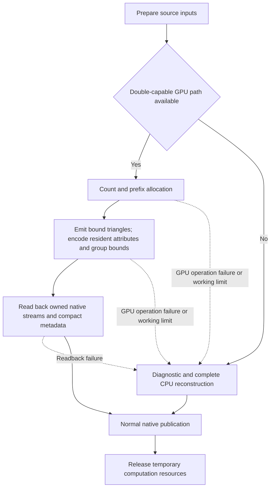

The selected-road and lane path uses generation-only GPU computation for seam clipping,
rigid bone assignment and native vertex encoding. Run count, prefix allocation, emission
and attribute encoding as one connected operation: the encoder consumes the GPU's bound
triangle buffer directly. Keep intermediate bound vertices resident while reducing per-material bounds, determining UV2/UV4 layout and distributing encoded attributes into stable material groups. Read back the CPU-owned native attribute streams and compact group metadata needed for normal native asset
publication. Full bound-triangle readback is reserved for explicitly armed replay diagnostics or the reference verification API; normal generation must not read it back merely to split the same attributes again. Preserve within-material triangle order, canonical Surface identity, every vertex channel and one owner for each native allocation. Trust internal GPU inputs and results under the execution policy; do not dispatch attribute-validation passes. Record upload/readback byte counts and calls, CPU preparation/group offsets, dispatch, synchronization/readback, native allocation/copy and native publication separately; a blocking readback includes pending GPU work and is not kernel-only time. Saved bridges do not require generation compute dispatch or a per-frame manager; Bridge Builder remains enabled for startup material-program registration.
Keep the exact request-local cross-LOD reuse rules below and each LOD's own skeleton.

Seam distances, intersection parameters and constructed positions use double precision,
including the established uncertainty and canonical-edge rules. Do not silently substitute
float clipping. Float interpolation of normals, tangents and UVs and octahedral quantization
may differ slightly from the CPU reference; this is an explicitly accepted GPU implementation
difference, not permission to alter topology, provenance, material assignment or bones.
Validate these channels separately and report measured error, rather than claiming byte
identity of every attribute. Preserve source colors, complete channels and UV2/UV4 layout.

Use a version-compatible Unity compute AssetBundle and preserve compiler settings required
by the validated double implementation. Creation, dispatch, synchronization and cleanup run
through Unity main-thread APIs, which submit work to the graphics backend. Compute dispatch sizes and output allocation from the construction algorithm. Do not validate
internal inputs or output before publishing a model. Release every temporary GPU buffer and program on success and
failure. This is a construction tool, not a custom runtime rendering shader or synchronizer.

Unavailable double-capable compute, unsupported graphics backends, exceeded GPU working
limits or GPU failures select a complete CPU reconstruction with an explicit diagnostic.
Never silently select float clipping or publish a partial GPU result. Genuine invalid source
resources remain failures of the normal generation path. Record backend, fallback reason,
input/output counts and end-to-end GPU time, including transfers, prefix work and synchronization;
do not add nested encoding time twice. Benchmark the connected path on captured real inputs,
then verify native geometry publication and persistence. Offline replay is not game visual acceptance.

Remove unnecessary texture/material generation and redundant Prefab wrappers before optimizing remaining arithmetic. This order preserves the governing appearance and graph requirements; stage measurements belong in audit records.

## Reuse identical selected-road computation across LODs

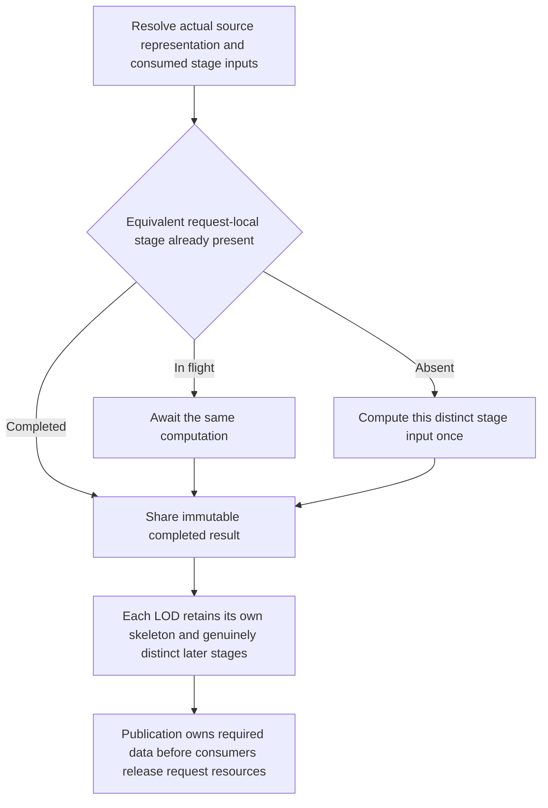

Preview and formal generation must reuse the complete selected-road and lane pipeline across
LOD0, LOD1 and LOD2 when its actual inputs and consumed semantics are identical. Reuse starts
before source extraction, not only after GPU binding/encoding. Resolve the selected elevated
context once, identify each required source representation and process each distinct stage input
once within the request. All matching LOD consumers use the resulting immutable value. Cover road surfaces, railway
and other lane geometry, cable geometry and the applicable source-input/material plans for
retained decals through their common processing routes. Preserve each route's native semantics;
this does not reintroduce excluded decals or force projection volumes into the road encoder.

The reuse boundary covers source identity resolution, resource extraction and unpacking,
curve evaluation/deformation, road appearance selection/adaptation and coordinate mapping,
clipping and bone binding, material grouping, vertex encoding, bounds, and the completed road
result. Reuse common earlier stages even when a later stage genuinely differs. For example,
one decoded source can feed two distinct appearance or motion-domain computations; a later
miss must not force an identical source to be extracted and decoded again.

If initial sampling already compiled the selected source for LOD0, retain that compiled result
for LOD1/LOD2 with the same inputs. Calling `Compile` again for those consumers and detecting
an identical result only in a downstream GPU/model cache does not meet this requirement.
Resolve actual native LOD references and fallback identities before scheduling expensive work;
a different requested LOD number alone is not a different input. Do not repeat the computation
merely to establish equality of its results.

Establish exact stage-input equivalence using immutable source identity/version and the complete
semantics consumed by that stage: ordered attributes and provenance, native composition/state,
curve/frame inputs, appearance and material-slot bindings, compatibility mapping, road-to-object
pose, motion partitions, occurrence/face assignments and bone-index encoding requirements.
Equal names, triangle counts or coincident bounds are insufficient. The current clipping/encoding
routines consume bone-array count and partition indices, not skeleton names, transforms, bind
poses or animation metadata. Keep that metadata on each LOD unchanged; unused metadata does
not invalidate otherwise identical computation. If a stage starts consuming another field, its
reuse key and tests must include that field.

Different actual road/lane LOD geometry, appearance, source channels or motion domains remain
distinct at the affected stages. Preserve genuine reduced-detail geometry and each LOD's native
references and skeleton. This rule concerns selected-road/lane work, not the bridge prototype's
structural LODs; it never authorizes copying LOD0 structure into every level.

Own immutable stage results and in-flight computations within one generation request. Equivalent
consumers share the same completed result or await the same in-flight work, rather than racing
to produce duplicate values. Keep one disposal owner for each native allocation. Publication
must own any required copy/reference before request resources are released; one LOD's disposal
must not invalidate another consumer. Never reuse mutable native resources across owner UUIDs
or retain generated preview results as a later formal-creation cache. Success, failure and
cancellation release resources only after their active consumers have relinquished them.
Independent persisted output and per-owner dependency copies remain unchanged.

Report per-stage execution and reuse counts, consumer LODs, miss reasons and key-comparison
cost. Verify actual expensive-stage execution counts of exactly one for identical three-LOD input,
not merely final cache-hit counts. Cover all applicable routes above, including the
already-compiled sampling case, and that distinct source/appearance/bone-domain cases remain
separate. Compare all output channels, order, material/bone assignment, bounds and publication
ownership offline. Reuse is not permission to merge triangles; offline tests verify output without runtime result checks.

**Implementation status:** the request-local context records the initial sampling compilation
and reuses source surfaces/roads by their actual resolved render inputs. Lane source snapshots,
deformation and expansion, appearance receiver groups/partitions, bounds and equivalent complete
appearance inputs have separate reuse stages. Final road/model reuse remains in place. Actual
source differences remain distinct even when their triangle counts match. These mechanisms do
not prove every live request executes each eligible stage once: stage counts, differing-input
cases and final publication still require the stated checks, including manual game verification.

## Generation input coordinate stage

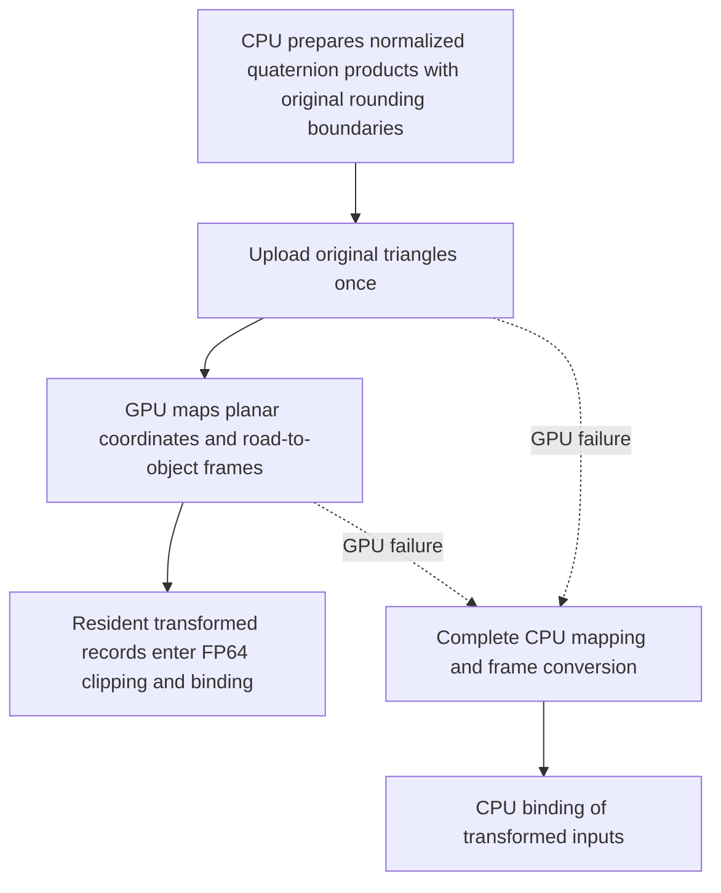

Selected-road planar material coordinates and the measured road-to-object pose are evaluated in the same generation-only GPU pipeline before FP64 clipping. Prepare the normalized quaternion float products once on the CPU. Preserve Unity/Mono expression ordering with double intermediate evaluation and the original float store boundaries for each position, normal and tangent. Preserve untouched UV channels and tangent handedness. Upload original triangle records once and keep transformed records resident. The complete CPU fallback performs the same mapping and frame conversion before binding; it must never bind untransformed input after a GPU failure. The strict cross-LOD reuse key continues to compare original inputs, mappings and pose.

The count pass computes allocation sizes; it must not validate original or evaluated internal GPU attributes. Finite/frame checks and result error flags for pure computation are prohibited. Preserve actual dispatch/readback failures and the complete CPU fallback.

## Preview background execution and timing boundaries

Preview lane preparation must batch owned mesh snapshots and keep packed-frame decoding with dependent deformation in one worker dispatch under the preview specification, preserving native affinity, cancellation and output ordering.

Preview capture follows the viewport-sized capture section of the preview specification: use measured physical viewport pixels, preserve supersampling and full framing, and rerender existing draw data on resize without bridge regeneration.

Preview generation uses continuous detached background computation and asynchronous engine-thread dispatch under the preview specification. Ordinary generation stages must not force frame yields or use a 6 ms frame budget; only genuine GPU/render completion waits require later engine updates. Preserve cancellation, native affinity and owned input lifetimes.

The [preview execution requirements](preview-spec.md#preview-ready-work-budget-and-detached-background-computation)
apply throughout sampling, appearance preparation, assembly and scene preparation. Every CPU
calculation that can operate on detached immutable data must run on bounded background workers
in preview. Keep only required Unity/ECS/native API access, minimal snapshots/publication and
GPU API submission on the main thread. Split mixed helpers at that boundary rather than moving
their native calls to a worker or treating the whole helper as necessarily synchronous.

Measure request and stage wall time, active main-thread work, worker computation, worker queue
wait, main-thread continuation/frame wait, GPU submission/completion wait, transfers and native
publication separately where observable. Use explicit timestamps/events at those boundaries;
wall time minus active work is only an unexplained residual, not a measured frame/GPU/queue wait.
Overlapping CPU/GPU spans and nested stages cannot be added as exclusive elapsed time. State
unmeasured components and the reconciliation basis. Include maximum individual main-thread
step and whole-update pump times, stage execution/reuse counts, transfer bytes/calls and
cancellation cleanup. A shorter total or isolated kernel result alone does not prove responsiveness.

Compare CPU and GPU clipping, bone binding and vertex encoding on the same captured inputs
and ordered output requirements. Include GPU allocation, upload, dispatch, synchronization and
CPU readback in end-to-end measurements; distinguish them from kernel-only timings. Keep
existing double-precision seam construction and float-rounding boundaries unless an explicitly
reported experiment proves the required output equivalence. Do not report a single-precision
approximation or unrelated structural arithmetic benchmark as an equivalent road pipeline.

A diagnostic capture is explicitly armed for one matching generation request, bounded and
consumed once. It does not create bridges or start the game, and normal requests perform no
geometry dump. Record full source vertices, partitions, pose, material-slot mapping and output
checksums for replay. Missing actual inputs leave the representative benchmark pending; synthetic
correctness fixtures must be labelled separately. GPU experiments do not authorize changing
persisted rendering protocols, shader behavior or runtime synchronization.

Movable render-graph diagnostics must report exclusive per-LOD stage timings and a
reconcilable graph total, including validation/setup, road and lane material cache
lookup/conversion (through cleanup), mapping/copy, frame transforms, partition binding,
model encoding, structural read/build/retile/release, supplements, grouping, native
publication preparation and disposal. Count input/output triangles and material cache
hits/misses. Instrument stage boundaries, never individual vertices or triangles.
Report otherwise unclassified work as overhead; nested model encoding is a subset of
its parent mesh-building time and must not be added again. Emit bounded summaries on
success and failure without changing geometry, scheduling or error propagation.
Thread allocation deltas, when supported, exclude native/GPU allocations and other
threads. GC collection deltas are process-wide observations, not proof that the measured
stage caused a collection. Instrumentation overhead remains part of observed elapsed
time. These logs diagnose generation; they are not a replacement for visual acceptance.

Use CPU or vendor-compatible GPU APIs as appropriate. Prefer GPU execution for large pixel workloads
and parallelize independent work when beneficial. A correct bounded CPU path is permitted; GPU
conversion is not a prerequisite for integrating a generator. Do not require vendor-exclusive APIs.
Respect Unity/game thread affinity, resource ownership and deterministic construction. Measure and
fix actual slow stages without postponing complete generation for speculative optimization.
This runtime scheduling policy does not authorize delegation to coding agents.

## Movable bridge asset size

Report delivery size using three distinct scopes: (1) the source-delivery files selected by Git,
with component subtotals and an explicit distinction between tracked files and pending additions;
(2) the complete Paradox Mods content package after official postprocessing and SDK packaging,
including embedded data, prepared materials, required libraries, UI files and any shipped symbols;
(3) one generated bridge's complete asset footprint. For scope 2 measure the final compressed ZIP's
actual length, state the publication file list, toolchain and whether it was packaged locally or
downloaded from a published version. A local SDK package is not proof of publication. Covers and
listing screenshots are separate uploads, not installed content. For scopes 1 and 3 sum actual file
lengths without transport compression. State exact bytes and units for every scope; disk allocation
and an unpacked build-directory total are not package-size substitutes. Local authoring intermediates and backups are not delivery-size metrics. Keep them
out of source publication and compiled output, and do not describe their size as mod or bridge size.

Keep the generated bridge's material footprint as small as possible without compromising
material resolution. [Material source resolution](material-spec.md#material-2-preserve-source-resolution-and-pattern-scale) and [package measurement requirements](../contracts/material-contract.md#material-5-per-bridge-material-directory-and-mod-packaging) require informational complete-owner material
measurements and complete compressed official SDK package measurements without hard byte ceilings.
A prepared style-directory subtotal is neither a complete-owner nor a complete-package measurement.
Mark unavailable measurements explicitly. The complete-graph comparison below remains independently
required. Reduce redundant storage through original-resource
reuse, identical-resource sharing and source-density tiling, not resolution loss. Continue to
report the exact complete bridge footprint, including geometry, every LOD, materials, texture
and VT/mip payloads, dependency snapshots, presentation resources and CID sidecars. Control
mod-package size through the same reuse policy without duplicate baking, and report it separately
from the size of an individual generated bridge.

The total size of a generated movable bridge Prefab, including its dependencies, must be
comparable to the corresponding original movable bridge. The root Prefab file alone is not
the measurement. Count the root, generated networks/objects, every LOD and geometry payload,
surfaces, textures, required presentation assets and external dependency snapshots. Deduplicate
logical dependencies by identity within one bridge; also report physical files/bytes, including
CID sidecars and any duplicate copies. Built-in resources remain references under [section 17](../contracts/persistence-contract.md#generation-17-persist-external-dependencies-as-identical-cid-copies-owned-by-each-bridge):
include their reachable payloads in the logical comparison without exporting duplicate files.

Compare like-for-like content and serialized payload sizes using a declared compression basis.
Do not compare a complete game/DLC archive with one generated bridge, use shared UI catalogue
back-links to inflate the reference, or compare compressed bytes with decoded texture memory.
Record both serialized size and decoded texture memory separately where available. Explain
selected-road differences. Unresolved references or an absent generated sample leave the total
comparison incomplete; a texture subtotal or render-only subtree cannot establish compliance.

Reuse identical appearance resources across a bridge's LODs; avoid per-triangle texture/prefab
explosion and redundant constant textures. Do not satisfy the size requirement by omitting
required dependencies, dropping LODs, silently reducing appearance quality or introducing a
manager-owned runtime reconstruction dependency. Measure a human-created persisted bridge
before claiming this requirement is met. No arbitrary acceptance ratio is implied by this rule.

## Adapt sidewalk-dependent components to the actual elevated road

This rule applies to every bridge generator, including fixed and movable bridges. Roads do not
necessarily have sidewalks on both sides, and their sides are not necessarily symmetric: a road
may have no sidewalks, a sidewalk on only one side, or sidewalks of different widths on its two
sides. Resolve sidewalk layout inside the single road-level branch selected at generation entry
and its applicable upgrade state. Use the elevated context already selected at the common entry; do not
resolve another branch for sidewalks. Do not infer sidewalks from another branch, lane count or the prototype bridge.

Only sections in the `Sidewalk` family count as sidewalks. Curbs and all other section
families are not sidewalks and must not be classified as sidewalks when resolving either side's
sidewalk presence, position or width.

Within the movable mechanism, including its stationary running caps, colored asphalt uses
the same ordinary-asphalt appearance route as its uncolored substrate. Do not preserve or
reapply a lane-color overlay after that replacement. Identify the color-overlay role from
native material semantics rather than a template number, source name, CID or sampled RGB.
Keep genuine markings and rail artwork separate. External native approaches remain unchanged;
Sidewalk and curb ownership rules below still apply.

Use the selected root section and the source triangle together. In mixed sections only confirmed walking pavement contributes to the lateral span, walking motion, coverage subtraction and walking material. Keep the original curb faces, including flat tops, slopes and sidewalls. Preserve source triangle identity through clipping and all LODs. Pedestrian lane metadata alone does not establish sidewalk ownership.

Adapt every sidewalk-dependent component, including inner bridge railings and bridge-authored
sidewalk portions, to the presence, position and width of the actual selected-branch sidewalk on each
side independently. A side without a sidewalk must not receive a fabricated sidewalk or a
component whose purpose depends on that sidewalk. Do not mirror one side onto the other, assume
equal widths, or reserve a prototype-width sidewalk strip in the carriageway. Distinguish these
components from structural or outer safety railings that do not depend on sidewalk presence;
absence of a sidewalk alone does not authorize removing unrelated bridge structure.

The same requirements apply to sidewalk portions embedded in a composite bridge component,
including fixed bases, end platforms and transitions next to a movable mechanism. A component's
fixed or structural role does not exempt its sidewalk portion. Identify that portion from measured
archetype membership and adapt its presence, position and width independently on each side to the
selected road branch's `Sidewalk` sections. If a side has no such section, do not retain or generate
that sidewalk portion. Preserve unrelated load-bearing structure and outer safety components;
do not remove the whole composite component merely to remove its sidewalk portion. Apply this
rule to the highest-detail mesh, every LOD, preview and persisted geometry.

The measured Draw01 outer longitudinal walkway frame is part of the bridge body,
not a sidewalk-dependent paving surface. Retain its original faces, profile, materials
and bone ownership even when the selected road has no sidewalk, one sidewalk or unequal
sidewalk widths. Its two sides follow the recorded rigid half-width displacement;
inner paving boundaries do not move or suppress it. Preserve it at every LOD, including
the measured middle-source supplement used for the far level.

The thin transverse supports visible on the Draw01 top grating are evidenced in the
original four-metre panel material, including opaque alpha and aligned PBR channels;
they are distinct from the independent outer longitudinal bridge-body frame. Preserve
that transverse material content and its native longitudinal period, phase and leaf
orientation at every LOD. Its visible X extent follows the actual sidewalk surface on
each side independently; a side without a sidewalk has no such transverse top support.
Keep wire texel density unchanged as sidewalk width changes. Do not invent box geometry,
restore unrelated end faces or add texture-period cuts to recreate this appearance.

Apply the resolved layout consistently to preview, formal generation and all LODs. Preserve the
selected road's native lane semantics and use measured archetype component membership when
adapting bridge-owned geometry. This rule governs sidewalk-dependent presence and placement; it
does not authorize guesses about structural parts or changes to unrelated geometry. Verify roads
with zero sidewalks, one sidewalk and unequal left/right sidewalk widths when claiming support.

## Affine execution and parameter lifetime

Related requirements: [Development Contract](../contracts/development-contract.md#repository-performance-and-deployment), [Development Contract](../contracts/development-contract.md#repository-performance-and-deployment-part-3), [Preview Spec](preview-spec.md#repository-performance-and-deployment-part-4).

Follow [CPU affine execution](generation-spec.md#generation-cpu-affine-geometry-execution): shared interleaved XYZ SIMD, measured binary coefficients/memberships, direct owned buffers, original arithmetic/rounding and all-LOD equivalence. No runtime expression recognition, axis-column execution or per-style numerical adapters. Native asset access stays on the main thread; measured cost and correctness govern CPU/GPU placement and bounded parallelism. GPU conversion and style branches are not implementation gates.

## Shared sidewalk requirements

**Mandatory for every bridge generator:** roads may have no sidewalks, a sidewalk on only one
side, or sidewalks of unequal widths. Sidewalk-dependent components, including inner bridge
railings and bridge-authored sidewalk portions, must adapt independently to each side's actual
sidewalk presence, position and width in the selected road's **elevated-mode composition** and
upgrade state. Do not fabricate a sidewalk-dependent component on a side without a sidewalk or
assume symmetry. This applies to fixed and movable bridges, previews, saved assets and all LODs.
See [bridge generation contract section 25](generation-spec.md#generation-25-adapt-sidewalk-dependent-components-to-the-actual-elevated-road)
for the authoritative rule and the distinction from unrelated structural or outer safety railings.
This is a general contract routing requirement, not a movable-bridge-only rule.

## Shared affine execution rules

Related requirements: [Documentation Contract](../contracts/documentation-contract.md#contract-index-specialist-contracts), [Material Spec](material-spec.md#contract-index-specialist-contracts-part-2), [Documentation Contract](../contracts/documentation-contract.md#contract-index-specialist-contracts-part-3), [Documentation Contract](../contracts/documentation-contract.md#contract-index-specialist-contracts-part-5).

The [CPU affine geometry execution rules](generation-spec.md#generation-cpu-affine-geometry-execution)
apply to fixed and movable bridges. They define XYZ parameter matrices, sparse embedded-array
storage, independent numerical batches, native API thread boundaries and verification.
The [contributor generation step](../guides/adding-bridge-styles-with-coding-agents.md#affine-matrix-generation-step)
connects these requirements to extraction, regeneration and runtime assembly.

