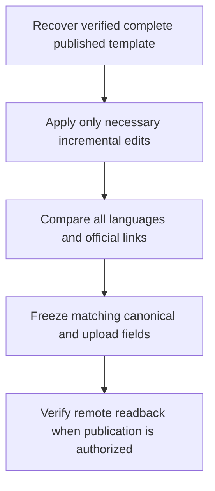

# Publishing metadata specification

Read this complete specification before preparing, editing or publishing mod metadata, release
versions, changelogs or player-facing descriptions. The [development contract](../contracts/development-contract.md#repository-release-workflow)
owns release execution; this document is the single authority for metadata content and format.

## Game and mod versions

The supported game-version declaration must be `{num1}.{num2}.*`, using the first two numeric
components of the verified current game version. Record the actual game evidence; an old draft,
existing remote range or Game.dll's uninformative assembly version is not proof. Do not invent
an exact patch range or silently broaden support beyond that declaration.

The mod version uses its publication date as `yy.m.d` (the year, month and day represented by
`yy.mm.dd` date components, without forced leading zeroes). The first release on a date uses
the unsuffixed date; subsequent releases that day append `a` through `z` in order, for example
`26.10.3a`. Determine the next suffix from published history, not a local build counter. A
metadata-only correction does not create a package release or change an existing published
version/date. Preserve the user's selected release scope and the existing package identity.

## Title and changelog

The metadata title and main description heading are exactly `Bridge Builder`, without translation,
prefix or suffix. Changelog text is English only and describes actual player-facing additions
and fixes. Do not put internal documentation cleanup, unsupported acceptance claims or removal
of never-published functionality into a public changelog.

## Description purpose and sections

The mod description presents current, stable functionality and usage. Do not include release
announcements, update summaries, narratives about newly added features or bridges, or bug-fix accounts in it;
maintain actual version-specific changes in the English changelog instead. Judge content by its
meaning, selection and origin, not by the presence of update-related words. Replacing an addition
or fix verb with a support verb, or dropping the verb, does not turn a release-selected group of
features or bridges into a stable product catalogue. Remove such isolated release highlights from
the description even when their individual capabilities remain supported.

A maintained catalogue must be complete within its stated scope or use a consistent functional
classification independent of release membership; recent additions must not receive a separate
feature bullet by being relabelled as catalogue content. Official source-mod entries in the
purpose-grouped compatibility list and necessary ongoing usage restrictions retain their roles.
Preserve historical changelogs and publication records when reorganizing the maintained description.

Review each description item against relevant publication history and metadata diffs to distinguish
ongoing functionality, catalogue information and usage cautions from release-specific selections.
Record the semantic decisions and their evidence separately from structural checks. Matching
translations, valid lists, correct links and synchronized upload fields do not establish compliance
with the description's content rules; a structural pass must not be reported as semantic approval.

The Compatibility section uses a two-level list grouped by the mods' actual purposes. First-level
items are localized purpose categories; second-level items contain only each mod's exact official
published title and official link. List each compatible mod once, retaining equivalent categories
and membership across all description languages. Use valid CommonMark nested-list indentation.
Put integration behavior, optional-content
status, prerequisites, supported scope, restrictions and compatibility cautions in Notes, not in
Compatibility paragraphs or annotations on list entries. Preserve every applicable caution and
its meaning consistently across all description languages when moving it.

## Description languages and official mod titles

The player-facing description contains complete sections in this order: English, Simplified
Chinese, Traditional Chinese. Preserve equivalent features, requirements, operation instructions
and caveats in all three. Internal project documentation remains English under the
[constitution](../constitution.md#project-all-documentation-is-written-in-english).

Every mod link uses the author's exact complete official published title as anchor text,
regardless of surrounding language. Verify the title from the official listing/API; never
translate, transliterate, abbreviate or convert its Chinese script. Preserve punctuation and
authored qualifiers. The same exact-title requirement applies to README and internal mod links.

## Incremental template maintenance

Use the existing published description as the template. Make only the necessary incremental
additions, removals and corrections; do not replace it with a newly written or retranslated
article. Preserve unchanged structure, paragraphs and wording, including all three languages.
If a local draft has lost content, recover the last complete published metadata or its verified
receipt before applying changes. Record the template revision/hash and itemized changes; compare
all language sections and official links before freezing the result. Keep the canonical source
and upload field synchronized; for an authorized publication, verify the remote readback. Local-only
description maintenance does not publish metadata or change a release version. Publication facts require actual
receipts; a prepared draft or accepted request is not proof of publication.
