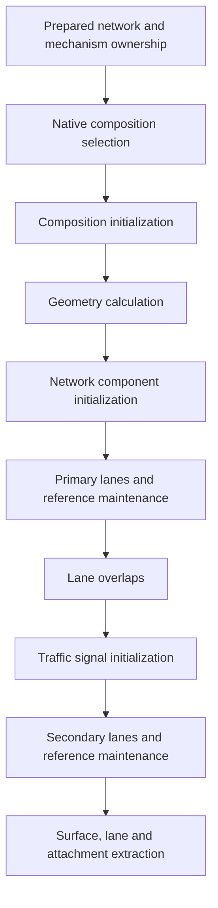

# Movable Spec

Required companion: [Movable Contract](../contracts/movable-contract.md). Both documents are normative; read applicable requirements from both. See the [complete scope maps](../contracts/reading-map.md) for additional relocated sections.

This document is normative within its stated scope. Responsibility-based placement does not change requirement strength, existing specialist exceptions or explicit user authorizations. Specifications and contracts are equally normative; the split introduces no new precedence hierarchy.

## Packaged textures belong to road running surfaces

See [Packaged textures belong to road running surfaces](material-spec.md#material-packaged-textures-belong-to-road-running-surfaces).

## No special road-width adaptation

Movable bridges must not perform any special adaptation based on road width.
Apply the ordinary measured width-difference rules without narrow-road-specific
compensation, limits, geometry substitution or bone reassignment. Remove dedicated
narrow-road diagnostic branches. Narrow-road adaptation and dedicated compatibility
tests are outside the batch scope and are not completion gates.
Preserve actual external-IO failures and native operation failures; internal structural checks are not runtime rejection gates. This does not assert
support for every narrow input. Non-movable bridge behavior is outside this change.

## Selected-road moving surfaces

Related requirements: [Movable Contract](../contracts/movable-contract.md#movable-1-authority-scope-and-implementation-status).

The moving road surface MUST be generated from the selected
road's closed-pose composition, converted into persistent object geometry, partitioned and bound to
the measured mechanism. Reusing the prototype's road surface as the generated road is not an
alternative implementation of this requirement.

## General generation flow

| Stage | Inputs and output | Required invariant |
| --- | --- | --- |
| Resolve | Selected road and supported native state to sections, pieces, lanes and evaluated closed geometry | Preserve conditional alternatives and selected layout; no prototype-section whitelist. |
| Prepare mechanism | Immutable prototype parts, motion domains, skeleton, materials and LOD data to width-adjusted structure | Preserve authored transforms, fixed platforms and native behavior. |
| Convert surfaces | Evaluated road to object-local triangles clipped by motion and appearance domains | One native bone per triangle; fixed and moving regions remain distinct. |
| Assign appearance | Native structural references, measured repeating road units, bounded local composites and directly skeleton-bound generated decal materials | Follow [sections 17–19](movable-spec.md#movable-17-material-families-uv-density-and-texture-ownership); no paint-driven road cuts or unauthorized custom shaders; cuts solely for texture-period wraps are prohibited; use [section 17](movable-spec.md#movable-17-material-families-uv-density-and-texture-ownership)'s offline repeat materials. |
| Assemble | Structure, converted road, merged moving mesh attachments, native light effects and per-material models to the prototype's mechanism hierarchy | Correct material batch counts, bones, bounds and all LODs. |
| Build network graph | Native crossing conditions plus selected-road sections to minimal changed Section/Piece nodes | Preserve lanes, signals, fees, upgrade logic and unlock AND/OR groups. |
| Preview or save | Same generated graph to a temporary open-pose assembly or registered native assets | Preview writes no formal assets; saving preserves owned identity and original dependency references. |
| Verify | Actual geometry, logs and saved graph to evidence for the claimed input/style | File checks and timings remain separate from human visual, traffic and cold-load acceptance. |

Stages describe dependencies rather than requiring a serial implementation. Independent work may
run concurrently subject to [section 12](../contracts/movable-contract.md#movable-12-integration-and-update-scope) and native API thread affinity. Prototype-specific motion
and appearance data are parameters to this method, never dimensions copied from the first bridge.

## Fixed structure assembly and bounds

Related requirements: [Movable Contract](../contracts/movable-contract.md#movable-non-moving-parts-follow-the-general-bridge-generation-contract).

Generate the prototype's complete fixed structural representation around the selected road. Do
not retain the selected road's generic bottom in place of a required prototype base while installing
prototype pillars at a different vertical connection level. Preserve the measured base-to-pillar
interface and original Y/Z coordinates; raising pillars or changing depth to hide a missing base
is prohibited. Apply selected-road width and sidewalk adaptation under the general contract while
preserving source lane semantics. Keep fixed-span structural conditions separate from moving-node
hiding so stationary geometry cannot intrude into the opening. Preview and persisted generation
must include the same fixed structures at every LOD.

## Archetype evidence and immutable mechanism data

Related requirements: [Movable Contract](../contracts/movable-contract.md#movable-3-archetype-evidence-and-immutable-mechanism-data-part-2), [Movable Spec](movable-spec.md#movable-3-archetype-evidence-and-immutable-mechanism-data-part-3).

Follow the general contract's [pedestrian truss placement rules](generation-spec.md#generation-8-stretch-or-translate-is-decided-by-one-thing-does-the-part-cross-the-bridges-centre): scale
PedestrianDraw02's central assembly as a whole in X, and distribute each style's
underside longitudinal members evenly across X with rigid sections and an
unchanged central longitudinal truss. Preserve measured membership and shared
connections at every LOD; these are distinct structural roles.

Lift01 and Lift02 central-truss memberships follow the explicit complete-assembly rule in
[bridge generation contract section 8](generation-spec.md#generation-8-stretch-or-translate-is-decided-by-one-thing-does-the-part-cross-the-bridges-centre), overriding default own-span stretching,
side-part translation and base mapping for those measured members. Internal
braces and narrow connectors share their complete assembly's `x -> k*x`; only the outermost
edge trusses retain their original mapping. Record assembly spans and connection
residuals offline, apply the rule at every LOD including far supplements, and
preserve bones/material modes with the corresponding affine normal/tangent frame.
Measure each style's complete source and target assembly spans; never use a small
connector's thickness or another style's span as its scale denominator.

## Measured widening and part membership

Related requirements: [Movable Spec](movable-spec.md#movable-3-archetype-evidence-and-immutable-mechanism-data), [Movable Contract](../contracts/movable-contract.md#movable-3-archetype-evidence-and-immutable-mechanism-data-part-2).

The existing `x = 0` stretch/translate rule, tower-height/depth constraints and binary32 width audit
remain in force, with the user-approved central railing post exception in [bridge generation contract section 8](generation-spec.md#generation-8-stretch-or-translate-is-decided-by-one-thing-does-the-part-cross-the-bridges-centre).
The Draw03 complete moving/fixed truss and deck-adjacent base rules in that section also apply.
The measured Draw02 central longitudinal girder retains its original narrow transverse
section under general [section 8](generation-spec.md#generation-8-stretch-or-translate-is-decided-by-one-thing-does-the-part-cross-the-bridges-centre); it is not a transverse width member. Preserve original
coordinates of that girder and its recorded adjoining horizontal closure-panel anchors.
Its independent transverse moving-base supports follow `x -> x + sign(x) * d`, like
the longitudinal side blocks, rather than proportional own-span widening; preserve
the far merged shell's existing signed mapping. Hinge axles and unrelated mechanism
parts retain their distinct measured transforms. Preserve the central hinge-plate
sections at zero transverse displacement under general [section 8](generation-spec.md#generation-8-stretch-or-translate-is-decided-by-one-thing-does-the-part-cross-the-bridges-centre); the matching lateral
plates translate rigidly. A plate's thickness is not the axle's assembly span. Preserve original
outer deck underside and side-closure faces separately from the replaced upper road
faces. These measured downward/vertical structural faces remain when an edge is not
a Sidewalk: retain the lateral body's signed displacement on that side, except the
measured original rail-contact edges governed by general [section 8](generation-spec.md#generation-8-stretch-or-translate-is-decided-by-one-thing-does-the-part-cross-the-bridges-centre). Where a real
Sidewalk exists, preserve its independent measured layout adaptation. Do not restore
the upward prototype sidewalk surface or invent a pedestrian allocation. An upper road-removal height
must not remove the slab underside with the top. Keep absent-sidewalk handling independent
of unrelated supporting frames and retain each corresponding native LOD representation.
Rejoin the original upper longitudinal wall and slab inner edges to the actual
high-rail inner shell using the same source anchor. Use the original base-top
boundary for the necessary source-face subdivision, retaining a vertical upper
closure outside car space and the unchanged lower wall anchor. Preserve original
UV/bone interpolation, apply the matching lower-domain frame Jacobian, and keep
rail-owned coincident faces in only one renderer. This does not permit changing
the central girder, signed transverse supports or uniformly spaced rib profiles.
Adapt the complete original upper-beam section and its panel contact, not only
one wall; preserve its transverse offsets and unchanged lower anchor. Restore
the recorded leaf end caps and complete folded profiles at both free and hinge
ends, at their own LOD's road-contact height, and
carry their shared edges with that section. Verify directed area/order, closure
and car clearance for left/right/asymmetric edge layouts. The far merged cap uses
its original faces and corresponding road boundary, without invented fine detail.
Its merged sidewalk upper end-cap band is retained only where that side actually
has a Sidewalk, with original-source interpolation and the matching frame transform;
the lower car cap and a side without a sidewalk remain unchanged. Preserve the
original thin near/middle slab terminal plates even when source quantization makes
their almost vertical normal's Y component slightly positive.
Include all incident source faces and coincident independently indexed vertices
in the closure audit; the near folded bottom and middle two-face fold must remain
connected to their front/back faces and the original panel assembly.
Draw02's original outer wall and stepped outer railing seat are bridge-body structure,
including their upward-facing ledges. Retain their full native faces independently of
sidewalk presence; road-height replacement must not truncate them. When restoring a
whole original face, remove its superseded replacement fragments to avoid overlap.
Its outer support includes the measured outward turn at each leaf hinge, not only the
straight outer strip. The original under-road panel edges adjoining the fixed central
girder retain that connection under width changes; their outer edges follow the original
longitudinal ribs without changing the ribs' section.
Its six thin longitudinal ribs use the recorded quarter-width translations around
the unchanged centre member, preserving equal internal centre intervals and their
original profiles. Existing panel endpoints follow the same rib translations;
outer-edge offsets and the independent transverse-base signed map remain intact.
The far native merged shell retains its simplified representation without new ribs.
An independent vertical railing post centred on the bridge centreline retains its original width
and centred position in the highest-detail mesh and every LOD. Identify exact membership offline;
do not extend that exception to transverse rails, walls or other crossing parts.
Motion partitioning is separate from structural widening and cannot reclassify authored parts.
Missing evidence rejects the affected operation; it never authorizes guessed geometry or fallback.

## Source-face coverage and prevention of missing structure

Classify original faces offline by actual authored part and purpose at every source LOD.
A road-height threshold, coarse bounding box, upward normal or shared road material is not
sufficient evidence that a face is replaceable road. Such predicates must not remove outer
walls, bottom plates, end closures, stepped ledges or railing supports. Preserve their
measured ownership even when the selected road has no sidewalk; only genuinely sidewalk-
dependent parts follow that side's presence and allocation. Do not generalize one style's
measured face list or transform to another style.

Record a complete source-face disposition for each affected original mesh and LOD:

| Disposition | Required evidence and output |
| --- | --- |
| Retained structure | Identified physical part, prescribed width transform, original material/channels and motion binding; its required original face or permitted equivalent remains in the final output. |
| Replaced road or permitted structural fragment | Exact original face and replacement provenance, required coverage and attributes; exclude the original only where the replacement supplies the intended surface. |
| Intentionally omitted | A measured physical gap, replaced road top, absent sidewalk-dependent part or other explicit contract rule; record why no replacement is required. |

A face absent from the current removal table is not automatically proved visible. Trace the
final plan, added vertices, replacement fragments, retile/material dispatch, native upload
and actual renderer/LOD assignment. Conversely, vertices retained in a shared buffer do not
prove that a triangle survives: audit final indices and winding. When restoring a whole
original face, remove only its obsolete same-face replacement fragments, retaining unrelated
fragments. Do not overlap a restored face with its old partial replacement, invent a closing
box, or delete a small valid face using an arbitrary area epsilon.

Part-local face coverage is insufficient when adjoining parts use different transforms.
Verify their original shared boundaries remain connected after the final transforms,
including panel-to-girder joints and corner support turns. Preserve measured original
gaps and avoid new gaps or duplicated closing surfaces; retaining a member's section
alone does not prove its connections remain intact.

Compare immutable source membership with the actual generated output using matching source
versions, selected input, pose and build identity. Cover every LOD, original and changed
widths, closed and moving poses, and no/left-only/right-only/unequal sidewalks. This is ordinary
width coverage, not special narrow-road adaptation. Check actual physical part bounds and
connection offsets, not only overall bounds. Preserve source UVs or the explicitly permitted
mapping, packed normal/tangent/bone data, original material identity, triangle orientation and
fragment interpolation under the relevant geometry/material rules. Document unavoidable native
format promotion or permitted conversion rather than calling different bytes identical.

Diagnose apparent missing faces in separate evidence layers: source/topology and final indices;
Surface/PBR/channel and alpha/mip/cutout behavior; renderer registration and material slots;
native independent LOD thresholds and culling; and skeleton/pose/stack transforms. A screenshot,
a same-CID reference, a warm-cache preview or one synchronous LOD selection cannot distinguish
these causes. Use the [stable render-group rule](movable-spec.md#movable-material-selection-projection-and-render-batches)
to verify that a part is present exactly once for independently selected group LODs. A capacity
fallback that migrates a required part across renderers and creates an empty interval is a bug,
not an allowed degradation. Preserve real native metadata and split oversized graphs by stable
physical roles without duplicating geometry or requiring runtime synchronization.

Record exact positive and negative controls, source/generated identities, covered face counts,
all-LOD group assignments and any unavailable game sample. Distinguish a final-plan check,
a native TryBuild/upload, a real Retile path, a saved owner comparison and live visual acceptance;
none silently stands in for the others. Preserve old failing evidence and healthy saved owners.

## Resolve the selected road before mapping

Resolve the road's native section and subsection requirements for the intended elevated composition,
including its own edge states and supported upgrades. Do not sum all alternatives, choose the widest
alternative or infer layout from the displayed lane count. Obtain pieces, lateral offsets, lane
definitions, direction/group flags, pedestrian paths, markings and relevant attachments from that
same resolved state.

Keep surface width and outward side extensions separate in generator inputs. Report which boundary
each width describes. A full composition width is not automatically the project's road-surface
width or the measured outer width of the bridge mechanism. Follow
[road width calculation](generation-spec.md) and [bridge generation contract section 14](generation-spec.md#generation-14-preserve-each-archetypes-width-allowance).

Preserve supported one-way/asymmetric arrangements and source lane restrictions. Do not mirror a
road merely because the mechanism is symmetric. Preserve tram/rail/bicycle/transport-lane behavior
only where the complete geometry, signals and persistence path supports it. Unusual combinations must not be rejected on structural or appearance grounds; preserve native
features and report unavailable API/resource operations accurately. Silently removing an upgrade is forbidden.

Parking, stops, overhead wires and other special features require explicit handling. Use native
elevated selection where it removes a ground-only feature. Do not reject an active feature merely because its placement on the moving span may be unsuitable.
Preserve its native data and let the player evaluate the result; do not fabricate functionality
when an actual native API or required resource is unavailable.

## Per-archetype mapping

Mapping is defined by the specific movable-bridge archetype together with the selected road and
its resolved state. Different drawbridge archetypes may require different mappings even when they
carry the same lane count. A shared mechanism category is not evidence of an identical network
layout. The mandatory technical route is selected-road surface generation; the six-lane mapping
in the linked audit is an illustrative instance of that route, not its universal conversion algorithm.

Record each archetype's native lane roles, node/edge conditions, visible/hidden layers,
connection offsets and fixed/moving boundaries. Section correspondence tables are audit evidence,
not a runtime prerequisite or whitelist. Resolve arbitrary selected-road sections through native
composition, then assign their evaluated geometry to measured physical motion domains. A median,
sidewalk or third-party section absent from the prototype must use this same path. Absence from a
mapping table is not a failure; malformed external data or an actually unrepresentable feature
must identify its real failure. Do not infer bone ownership from a section name, centroid or lane
count. Do not assume one-to-one correspondence, three branches per source section or shared
placement dimensions across archetypes.

## Six-lane reference case

The [six-lane source observations](../archive/bridge-evidence/generation-source-observations.md#large-road-and-drawbridge03-six-lane-reference) preserve the measured case. It is not a universal layout or a substitute for the selected road. Preserve actual source directions and conditional entries; never hardcode its lane count or sidewalk allocation for other roads.

## Network conversion and placement

Each variant uses its own measured node/edge conditions. The [DrawBridge03 branch observation](../archive/bridge-evidence/generation-source-observations.md#drawbridge03-fixed-node-branches) is not a universal three-branch template.

Merge the chosen archetype's measured conditions with the selected road's requirements rather than
overwriting them. Apply a recorded branch pattern only where that archetype's evidence establishes it.
Preserve inversion, flip, median, offsets and relevant source semantics. Detect contradictory
conditions explicitly. Other archetypes require their own measured section scheme.

`NetCompositionHelpers` selects composition pieces; the mesh-reference path excludes hidden pieces.
Native lanes remain a separate output. Do not remove `NetPieceLanes` to hide road geometry or assume
that `m_HalfLength` literally identifies one animated leaf. Read the native mesh-generation behavior
when implementing the connection span.

### Native calculation sequence

`CalculateNetworkAsync` schedules these stages through `GenerationWork`. Composition selection
uses actual source state rules, handedness, elevations, connected edges, upgrades and mechanism
flags. Private composition caches do not copy city compositions. Initialization fills native lane,
carriageway, object, area and crossing data; consumed private Created markers are removed to avoid
appending the same buffers again. The [context history](../archive/audits/movable-network-geometry-development-record.md#composition-flag-history) records the superseded implementation.

Geometry runs the native allocation, node initialization, edge calculation, flattening, edge finish,
both node-calculation iterations, intersection calculation, node copy and node update sequence.
Lookups and chunk handles belong to the private world and honor native ReadOnly attributes.
Native container types are allocated through generic factories rather than copied ABI layouts.
Temporary containers are disposed on success and failure; borrowed terrain is not disposed.

Primary lane creation is followed by native owner references, skipped-lane mapping/repair and lane
index maintenance. Full-context overlaps retain the native overlap algorithm and native query
counts for capacities. Signal initialization derives movable-bridge state from native ownership,
PointOfInterest, lift offsets and lane connectivity. Secondary lanes and their references follow.
These stages do not fabricate shipping navigation or claim city traffic acceptance.

Reflection selects the actual native signatures, including the chunk lane overload and command
buffer writer type. Commands play back before subsequent handles are bound; chunk arrays do not
survive structural playback. Unsupported native binding fields fail explicitly instead of acquiring
default data. The native field inventory belongs to the linked audit, not this mechanism description.

## Mechanism placement and ordinary supports

Use the measured waterway-crossing object placement. The object's `NetObject` establishes the
fixed-node state and endpoint offsets; ordinary supports retain their separate non-crossing rules.
Do not place an animated mechanism at every road node or leave ordinary pillars in its shipping
opening. Preserve native connection geometry, editing and demolition behavior.

Fixed-node extent, model bounds and moving-leaf extent are distinct measurements. Use full measured transforms and bind data from the [source evidence](../archive/bridge-evidence/generation-source-observations.md#drawbridge03-placement-and-hinge-measurements); rounded prose must not become implementation constants.

## Convert the closed-pose road into persistent object geometry

The required generation sequence is:

1. Resolve the source road and supported states, and determine the measured mechanism's closed-pose
   span, fixed transitions and coordinate frame.
2. Compose visible road geometry for that span before applying the moving-node hiding branch.
   Retain its correspondence with traffic lanes, markings and attachments.
3. Evaluate native network deformation into explicit object-local geometry. Network-packed positions,
   curve/composition matrices and preview-only material properties are not a saved object mesh.
4. Partition at the measured fixed/moving interfaces and leaf seams. Split crossing triangles where
   necessary, preserving interpolated attributes and material/submesh ownership. Do not weld a
   moving leaf to the fixed approach or allow one triangle to span two independently moving leaves.
5. Bind each moving region to the correct native bone and fixed regions to their measured fixed
   frame. Derive all required LODs and mounted-object relationships consistently.
6. Save generated native nodes and geometry, retain unchanged resource references, and snapshot
   required external dependencies under [section 11](../contracts/persistence-contract.md#movable-11-persistence-failures-and-compatibility). Use existing per-bridge identity and layout
   helpers. Publish success only after the required persistence work has completed.

The user's selected-road geometry conversion requirement entails constructing new road-surface
topology, skinning channels and any necessary network-to-object attribute representation. This
operation is distinct from widening an existing archetype structure: [bridge generation contract section 4](generation-spec.md#generation-4-the-tower-and-the-cables-are-derived-geometry-never-referenced-geometry)'s
raw-channel/index preservation continues to apply to carried structure meshes. Do not use road
conversion as permission to re-encode those meshes, replace their materials or guess authored parts.
Record the source and destination layouts and the reason for each road-data conversion.

Apply measured partition transforms as construction data, not runtime part-detection heuristics.
Authored mechanism membership must already be known offline. Generated road clipping may be
performed in the recorded seam's local frame against its zero plane; it must not infer a hinge or
part boundary from road bounds or introduce a new transverse widening criterion.

Prototype-face intersection remains prohibited by [general bridge contract section 2](generation-spec.md#generation-2-the-archetype-is-hardcoded-never-copied). Use the
hardcoded motion/appearance frames directly on selected-road geometry; never intersect it
with a prototype mesh or a stored copy of its triangles to rebuild a road LOD. Preserve
selected-road heights, curbs, asymmetric sidewalks and bone ownership at every level.

## Integrated paint and receiver geometry

Draw02 exception: moving road leaves carry no road markings. Suppress only paint polygons on original moving-leaf domains; fixed running caps and external connecting approaches retain selected-road markings. Preserve road receivers and bone ownership. Other styles retain the general paint rule below.

Markings consume the native mechanism's current skeleton through the authorized custom decal program
as specified in [sections 18–19](movable-spec.md#movable-18-marking-layout-mesh-and-native-material). Evaluate native selected-road marking footprints, partition only those polygons at
physical motion seams, match the evaluated upper road height and bind them to the original road
bones. The authorized clearance is 0.001 m along the local upper normal. Do not cut road receiver
triangles at marking edges, render projection boxes, create one child object per dash, or move
the road onto marking bones. [Sections 18–19](movable-spec.md#movable-18-marking-layout-mesh-and-native-material) define the required implementation; unfinished consumers remain explicitly unverified.

## Selected-road sidewalk composition

The general sidewalk rule belongs to [bridge generation contract section 25](generation-spec.md#generation-25-adapt-sidewalk-dependent-components-to-the-actual-elevated-road)
and the root AGENTS.md; it applies to all bridge types, not only movable bridges.
Apply measured longitudinal motion seams to those actual surface roles. Keep lane-visual and road
occurrence indices separate; paint follows its receiver. A mixed-use Piece requires its actual
subsurface semantics, not a blanket assumption that every face has the same role.

## Material selection, projection and render batches

Select the required appearance by surface type under [section 24](movable-spec.md#movable-24-track-geometry-overhead-supply-and-material-selection). Reuse the corresponding
original material directly when its vertex layout and native animated-object path are compatible.
For a prototype-supported road type, preserve the required composite through [section 17](movable-spec.md#movable-17-material-families-uv-density-and-texture-ownership)'s
native path. Other road types reuse compatible originals or the corresponding native
animated-object road material under [material contract section 4](material-spec.md#material-4-persist-constant-reusable-materials-before-runtime), preserving complete source layers,
blend semantics and dynamic worldspace projection. Existing explicit track
descriptor conversions remain separate native representation rules. Carried non-road materials remain original by default; only [section 17](movable-spec.md#movable-17-material-families-uv-density-and-texture-ownership)'s narrow offline
repeat derivation may replace an evidenced repeating domain to avoid new period-wrap seams. Only prototype-supported road types enter [section 17](movable-spec.md#movable-17-material-families-uv-density-and-texture-ownership)'s composition/precomposition plan;
other road types follow that corresponding-material rule. Prepare known, preparable constant derived
resources offline. Genuinely variable composition and necessary conversion of selected third-party
road/track inputs unavailable before runtime follow the bounded exceptions in [material contract
section 4](material-spec.md#material-4-persist-constant-reusable-materials-before-runtime), with direct reuse and descriptor-only conversion considered first. The material contract authorizes two custom programs with a mod-enabled startup-registration requirement. Structural receiver-only descriptor rewrites remain prohibited. Native marking layout is evaluated before producing direct-skeleton decals described
in [section 18](movable-spec.md#movable-18-marking-layout-mesh-and-native-material); source continuous alpha must not be replaced by cutout coverage.

For converted surfaces, derive UV axes, origin and physical scale from the applicable source
selected under [section 24](movable-spec.md#movable-24-track-geometry-overhead-supply-and-material-selection): the prototype for supported surface types, or the selected road/track
for types requiring original appearance. Separate measured material, side and leaf-orientation domains; one global projection
or copied network-packed UVs is insufficient. Keep compatible object UVs only when they satisfy the applicable mapping rule. Remove
embedded road markings from all road types, domains, channels and mips at every LOD, retaining
independent selected-road paint. Exclude unrelated pale gutters from asphalt content. Inspect the existing atlas interior and filtering margin, retaining measured physical
texture density for evidenced or eligible authored repeats under material [section 3](material-spec.md#material-3-tile-repeatable-materials-at-their-original-density). Establish
source content and tileable boundaries independently of the receiver; a convenient rectangle is insufficient.
Prepare each known, preparable unit only once offline and share it across all roads, triangles,
LODs and sampling variants using that unit. Unknown selected-input units remain subject to material
contract [section 4](material-spec.md#material-4-persist-constant-reusable-materials-before-runtime) and share one conversion within the current owner. Do not enlarge a unit to
cover the complete bridge; preserve native channels,
the complete mip chain, filtering and physical UV gradients ([section 17](movable-spec.md#movable-17-material-families-uv-density-and-texture-ownership)).
Build tangent frames from triangle position/UV derivatives with consistent handedness; when the
projection has zero UV area, retain a valid source frame rather than divide by a singular mapping.
Do not claim exact authored UV-island or LOD-atlas reproduction without verifying it.

Preserve fixed platform/curb structural faces and their corresponding prototype material appearance.
This does not require retaining a selected-road edge material where a measured corresponding
prototype edge replacement exists under [section 17](movable-spec.md#movable-17-material-families-uv-density-and-texture-ownership). Retain original
UVs for rigid transforms only where the actual native mapping preserves both UV gradients,
chart coverage, phase and normal semantics; rigid position displacement alone is not proof.
Use measured density-preserving remapping when tiling geometry stretches. Verified source
non-road finite/stretch mappings retain authored UVs under material [section 2](material-spec.md#material-2-preserve-source-resolution-and-pattern-scale). Exclude structural
domains from replacement road geometry. Fixed running caps obey the same supported-road tiling
and marking-removal rules, with coherent source/PBR/density/phase at road seams; concrete-looking
cap content must not masquerade as asphalt.
Do not mistake a missing rendered face for missing vertices or add an overlapping white patch.

Emit material batches in the native importer layout: one generated model per used material slot,
local material index zero and its matching surface reference. Registered mesh counts must cover
all emitted batches at every LOD. Road batches belong to existing mechanism render nodes. Decals use the bounded native rigid
child grouping in [sections 18–19](movable-spec.md#movable-18-marking-layout-mesh-and-native-material), not a separate Prefab per dash.

Independent native render groups may select different LODs at the same view distance,
even with identical bounds and skeletons: native thresholds also use geometry area and
index counts. Keep a visible semantic part in the same renderer across its complete
LOD chain. Prefer complete structure/selected-road groups when each fits the native
16-batch graph limit; do not split solely by each LOD's material-slot count if that
moves sidewalks or other parts between renderers. Validate independently selected
LOD combinations for missing or duplicate parts. Preserve real counts, areas, bounds,
materials and bones; do not falsify metadata, duplicate structure as filler or require
runtime synchronization to conceal a transition gap. Oversized graphs require their
own stable semantic partition evidence, not assumed synchronization.

A far supplement may replace a tower, end lip or support that belongs to the near
main mesh. Preserve the complete structural prefix as one group when it fits,
even if the selected-road graph needs several groups. A near glass slot and a far
support slot with the same ordinal are not the same physical role. Derive ownership
from source coverage and the actual append boundary before road models are added.

Oversized semantic groups use stable, source-provenance subgroups across LODs. Supplemental
occurrences declare a shared semantic key for the same physical part at every LOD;
ordinal position alone is not proof of correspondence. Within one role, a Surface identity
may anchor a subgroup only when present in every LOD. Keep remaining LOD-specific material
slots together in a complete residual group. Grouping does not merge same-material geometry
at different locations: every original slot and triangle remains exactly once. Verify actual
native thresholds and arbitrary independent group LOD combinations. Legacy unmeasured
capacity fallbacks are implementation limitations, not exceptions to this requirement.

Never assume changing a shader keyword makes a network material a valid animated object material.
Verify the native object vertex layout, skinning path and surface dependencies. The original-source route must be completely represented and persisted in its target context
under the [non-throwing material pipeline](../contracts/material-contract.md#material-complete-material-processing-without-propagated-exceptions).
An incomplete adapter for valid input requires implementation, and a preview-only workaround
does not satisfy generation. Actual operation failures return explicit diagnostic failure results. Keep temporary ECS entities, meshes and texture leases disposable.

## Skeletons, animation and attachments

Preserve the measured bone hierarchy, rest transforms, inverse bind matrices, procedural animation
types, connection/source IDs, speeds and accelerations. The closed-pose skinning transform must
reproduce the converted road geometry in the mechanism's object space. Bone array indices, connection
IDs and mounted-object parent IDs are distinct identifiers; do not substitute one for another.

| Mechanism | Required motion behavior |
| --- | --- |
| Bascule/draw | Each longitudinal leaf rotates about its own authored hinge; each carries the full applicable transverse road layout |
| Vertical lift | The moving span translates with its deck bone; counterweights and pulleys preserve their recorded source-bone relationships |
| Other | Admit only with a measured real archetype and an independently verified native motion/control path |

Traffic carriageways and longitudinal moving leaves are distinct. Each leaf carries its applicable full transverse layout; do not infer bone identity or angle signs from names. The concrete connection IDs are retained in [source observations](../archive/bridge-evidence/generation-source-observations.md#drawbridge03-leaf-identity).

Native draw variants use aim-driven procedural bones; lift variants can use movement-driven bones,
`ScaledMovement` counterweights and `RotationXFromMovementY` pulleys. Preserve each variant's actual
configuration rather than constructing a universal animator. `MoveableBridge.m_LiftOffsets` supplies
signal-group-dependent target heights; its three values are not an XYZ displacement vector.
`m_MovingTime` participates in native signal timing, not an animation-completion callback.

Moving lights, barriers, rails and other mounted items must follow their proper parent throughout
the cycle. Fixed towers/supports remain fixed. Preserve bridge-specific lighting and effects under
[bridge generation contract section 15](generation-spec.md#generation-15-bridge-lighting-is-copied-from-the-archetype-as-behavior) and selected-road lighting as selected-road behavior. Avoid duplicate
streetlights where network and object paths overlap. Verify every LOD and motion-dependent culling
extent; a closed-pose bounding box alone does not establish correct open-pose rendering.

Native draw/lift crossing objects carry `MoveableBridge`; their render prefabs carry procedural
bone animation. Traffic signals coordinate road/track/pedestrian clearance with watercraft and
mechanism movement. Ordinary node meshes hide in the moving span while network connectivity remains.
The [render-graph audit](../archive/audits/bridge-model-render-graph-audit.md) records primary-mesh and
skinning observations: export-helper omissions do not prove missing native animation bones, and
valid skinning alone does not establish baked-network material compatibility.

## Attachment anchors in measured gaps

For every movable style, evaluate each selected-road attachment's final mounting anchor
in the correct deck/mechanism frame against its measured road-support and bone partition.
A gap leaf means no attachment is generated at that position, for every attachment kind.
This rule includes utility poles, streetlights and furniture without a type, road-name,
prefab-name or CID whitelist. A measured gap is an ordinary omitted placement and must
not fail preview or creation. Never invent a nearest supported position for a rejected anchor.

Keep anchors in supported moving and fixed regions with their original native parent,
rotation, probability, group and effects. An anchor exactly on a partition seam follows
the positive-region convention used by road clipping. Apply each deck's own frame and
partition independently, including opposite directions. The mounting decision is shared
across rendering LODs. Authoritative malformed transforms or bone metadata remain explicit
operation failures and cannot be treated as a measured gap.

Apply this rule only to attachments assigned to the generated mechanism's physical support
partition. Native external approach/network attachments and structural fixtures retain their
existing owners and valid fixed mounts. Existing authored lamp stations and measured endpoint
support additions still have to pass the same final geometric mounting test. They do not
provide an exception permitting a placement inside a gap.

## Waterway and traffic compatibility

Both ends of a movable bridge's moving span must use boom barriers. Traffic lights must not be used in place of these barriers. This requirement applies regardless of whether the selected road has sidewalks.

Use the native crossing recognition, lane-signal initialization and traffic-light simulation paths.
Inspect `SubObjectSystem`, `CompositionSelectSystem`, `TrafficLightInitializationSystem`,
`TrafficLightSystem` and `WatercraftNavigationSystem` for the target game version. A waterway drawn
under a bridge visually is not sufficient evidence that the native crossing node was created.

Acceptance must establish the native sequence: prevent new road/track/pedestrian entry, clear the
moving span, open it, allow the requesting vessels through, close it, then restore land traffic.
Preserve lane reservations and auxiliary-net signal grouping. Do not bypass occupied-span checks,
fake an empty deck or add a mod-owned timer to force progression.

Preserve native ship-clearance decisions. The inspected watercraft path compares water height plus
ship bounds against the node's elevation and network clearance data to determine signal need.
Small vessels may pass without opening where clearance permits. Do not invent a single ship-size
threshold or require every vessel to open every bridge. Opening must physically clear the ship as
well as satisfy signals; correct signal state alone does not establish geometric clearance.

Test a native supported narrow seaway crossing first. Wider or other waterway types, skew crossings,
curves, slopes and parallel bridges require explicit evidence before claiming support. Preserve
native restrictions; do not widen the waterway or fabricate a crossing to make an unsupported
placement appear functional. A failed supported crossing must be diagnosed, not masked as a success.

## Lift, rail, pedestrian and double-deck variants

Apply [section 24](movable-spec.md#movable-24-track-geometry-overhead-supply-and-material-selection) for track
geometry, overhead supply, selected-track materials and absent surface types. These
requirements also apply when a road bridge is generated with a track input.

Use the selected pathway or track composition for pedestrian/rail variants, with its own lanes,
markings and attachments. Six-lane road results do not establish pedestrian, tram, train or metro
acceptance. Check stopped vehicles spanning the approach and deck, long trains, pedestrian occupancy
and both movement directions where applicable.

A double-deck movable design requires a genuine double-deck archetype under [bridge generation contract
section 11](generation-spec.md#generation-11-a-double-deck-bridge-is-built-from-a-double-deck-archetype-or-not-at-all). Preserve its main/auxiliary roles, offsets, inversion conditions, linked endpoints and
fixed separation. Bind both decks according to that archetype and coordinate all relevant native
signal groups. Do not hang an extra network below a single-deck mechanism. The existing double-deck
rail-seam limitation remains unfinished work and must not be hidden by this specification.

## Minimal native Prefab graph and unlocks

Match the prototype's responsibilities and structural hierarchy, not an arbitrary total node count.
Selected-road upgrade alternatives can legitimately require more network nodes than the prototype.
Place representable branch conditions directly on native section entries instead of allocating a
wrapper per occurrence. Preserve independent OR groups: `(a OR b) AND (c OR d)` cannot become one
OR list or overlapping lane-producing entries.

Return unchanged Sections, Pieces and Lanes by reference. Copy a Piece only when its fields or
object/track-end producers change; copy its parent Section only when references or other fields
change. Deduplicate equivalent conversions per source and conversion state within the current
bridge operation. Do not retain generated results for reuse by later previews or creation requests;
immutable offline-prepared material sources follow the material generation contract. Keep lane
semantics, requirements, native prices and geometry references. Hidden render layers alone do not
suppress stationary object producers: keep traffic signals network-owned, move visual attachments
with the mechanism, and retain required lighting through appropriate native lighting producers.

Do not merge assets by name, width, lane count or geometry reference alone. Establish equality of
all behavior-relevant fields and referenced resources. Distinguish lateral occurrences, conditional
upgrade alternatives and unique saved files when reporting Section/Piece counts.

Preserve native unlock AND/OR semantics. Put the outer gate directly on root/auxiliary networks
where native representation permits; deduplicate equal nested requirement groups and duplicate
children within the bridge. Keep original progression leaves as references and never flatten
independent OR groups or share private generated groups across bridge owners.

## Native fee preservation

Related requirements: [Movable Contract](../contracts/movable-contract.md#movable-failure-handling-and-compatibility).

Preserve native fees and pricing components on their actual generated geometry/object counterparts.
Do not add custom movement charges, zero fees, price-only copies or runtime fee overrides. Trace
generation, previews, saving/loading, self-check, migration, management, deletion and localization
together. Migration follows the [self-check contract](../contracts/reading-map.md#bridge-self-check-contract); implementation of
a new mechanism alone does not authorize rewriting healthy existing assets.

## Total asset footprint

[Generated bridge asset size](generation-spec.md#generation-24-movable-bridge-asset-size) requires the entire generated Prefab and dependency footprint to
be comparable to the original movable bridge. Reuse existing appearances across LODs and compact equivalent generated graph nodes
within the bridge without losing selected-road semantics. Required LODs, native behavior and
appearance must remain intact. Record a complete, same-basis dependency comparison; root-only,
texture-only and incomplete reference graphs are insufficient evidence.
[Material source resolution](material-spec.md#material-2-preserve-source-resolution-and-pattern-scale) and [package measurement requirements](../contracts/material-contract.md#material-5-per-bridge-material-directory-and-mod-packaging) require informational measurement of the complete
persisted material graph of each owner without a hard ceiling. The complete official SDK content
ZIP is measured separately without a hard ceiling. Neither a prepared-directory subtotal nor an incomplete graph proves
compliance; report unavailable generated-owner measurements explicitly.

## Affine execution and stage separation

Related requirements: [Movable Contract](../contracts/movable-contract.md#movable-stage-timing-and-parallel-execution).

Follow [bridge generation contract section 2](generation-spec.md#generation-2-the-archetype-is-hardcoded-never-copied) for CPU affine geometry and [section 23](../contracts/movable-contract.md#movable-23-acceptance-and-contributor-checklist) for
measured, vendor-neutral bulk image work; never require CUDA. Prepare known constant resources
offline. Generation-time variable composition and unknown selected-input conversion follow only
the bounded exceptions in [material contract section 4](material-spec.md#material-4-persist-constant-reusable-materials-before-runtime). Persisted bridges require no
ongoing baking or manager callbacks. Independent pure geometry operations
may process immutable triangle chunks with local output buffers and deterministic merges. Native
asset lookup, Unity/ECS operations, render creation and persistence retain their required thread
and graphics context; parallelism does not authorize unsafe native API calls. Do not claim
parallel execution or an end-to-end timing target without measuring the actual current path.

## Acceptance and completion criteria

Related requirements: [Movable Contract](../contracts/movable-contract.md#movable-13-acceptance-and-completion-criteria-part-2).

Follow [bridge generation contract section 4](generation-spec.md#generation-4-the-tower-and-the-cables-are-derived-geometry-never-referenced-geometry)'s prototype-referenced mesh complexity rule for every
mechanism and converted road LOD. Excessive subdivision or triangle cutting is prohibited;
necessary subdivision and high-detail-derived LOD permissions do not waive this requirement.

Necessary subdivision of merged structural LOD triangles is permitted while preserving original
vertices, material semantics and interpolated attributes. Deriving, simplifying or supplementing movable
bridge LODs from the measured prototype's high-detail geometry is permitted under bridge generation
contract [section 5](generation-spec.md#generation-5-a-generated-tower-differs-from-its-archetype-in-width-alone). Authored part classification remains applicable; the material contract authorizes two custom programs with a mod-enabled startup-registration requirement. Marking
representation follows [section 7](movable-spec.md#movable-7-convert-the-closed-pose-road-into-persistent-object-geometry) and the current-skeleton requirement in [sections 18–19](movable-spec.md#movable-18-marking-layout-mesh-and-native-material).

## Six-lane reference reproduction

The reproducible source-inspection procedure is preserved with the [six-lane evidence](../archive/bridge-evidence/generation-source-observations.md#six-lane-extraction-procedure). Required acceptance remains per style and selected input; the reference case cannot establish general support.

## Observed failures and mandatory prevention

Required behavior and acceptance obligations derived from those cases remain normative below. Historical symptoms and causal findings are preserved in the [failure audit](../archive/bridge-evidence/generation-source-observations.md#movable-generation-failure-observations).

| Required prevention and acceptance |
| --- |
| Classify exact authored source faces at every LOD; retain structural supports independently of sidewalk presence and remove obsolete fragments when restoring whole faces. |
| Keep per-part renderer ownership stable within native batch capacity; verify all independent LOD combinations and actual native thresholds without changing metadata. |
| Compose the selected road and clip against measured physical domains; exercise unseen sections without adding name exceptions. |
| Match native one-model-per-material layout and verify counts at every LOD; inspect rendered output as well as saved triangles. |
| Clip at measured seams; each triangle belongs to one bone, each leaf carries its full transverse layout. |
| Inspect prototype geometry/materials first; preserve the intended appearance while diagnosing actual missing batches separately. |
| Derive the fixed base and node pieces at every LOD, preserve the native support interface and separate fixed/moving conditions; never raise the pillar to hide the missing base. |
| Retain structural platforms, exclude duplicate road coverage, and assign cap appearance to the generated fixed carriageway; preserve Z. |
| Select verified asphalt interior with filtering margin and preserve physical UV density; inspect a newly generated bridge. |
| Use actual selected pedestrian occurrences and geometry; do not fabricate a missing side or mirror its width. |
| Use measured UV-per-metre scale, separate side/leaf origins and mirrors, and verify all LODs. |
| Derive per-triangle frames, preserve one handedness, handle singular UV derivatives explicitly without suppressing validation. |
| Use compact single-sided source-layer meshes on the original mechanism with bounded clearance; never cut road receivers for decals ([sections 18–19](movable-spec.md#movable-18-marking-layout-mesh-and-native-material)). |
| Reuse structural materials, extract bounded repeat units, share appearance across LODs and remove redundant nodes; measure GPU, VT and persistence costs separately ([section 22](movable-spec.md#movable-22-performance-and-diagnostic-requirements)). |
| Preserve native traffic/light functions while suppressing duplicate stationary visuals; use measured native lamp mounts where approved, retaining selected model, lateral placement and orientation. |
| Assemble fixed ends plus moving centre and fit the camera to all transformed bounds; inspect actual panel output. |
| Support the native format in the shared reader, replay real Prefabs/layout migration without identity changes, then check native cold loading. |
| Copy only changed nodes, share equivalent conversions within the owner, preserve condition semantics, inline the outer unlock gate and deduplicate equal nested groups. |
| Preserve the measured native network Surface, encoded channels and composition context under [section 17](movable-spec.md#movable-17-material-families-uv-density-and-texture-ownership); test the complete preview/saved path rather than globally bypassing object conversion. |
| Preserve the authored transverse mapping and evaluate longitudinal density through the evidenced native mapping context; do not apply the generic polar-frame V as an unproven substitute. |
| Retain the evidenced finite axis and independently preserve density and phase on the repeating axis, including constructed fragments and every LOD. |
| Classify the domain's actual source faces and sampling footprint; preserve distinct closure/terminal faces and do not expand an arbitrary crop to hide a true crossing. |

## Generation pipeline and source map

Follow this dependency order for a new mechanism:

1. Measure the exact prototype's structure, materials, every LOD, fixed platforms, skeleton,
   inverse binds, connection codes, stacking and native traffic/signal behavior offline.
2. Resolve the selected elevated road and upgrades. Evaluate closed-pose road geometry, lane
   visuals and marking layout in the same native sampling context. Keep traffic connectivity
   separate from visible moving geometry.
3. Define prototype-specific road-to-object transforms, physical motion domains and appearance
   frames. Preserve actual asymmetric sidewalks and fixed cap domains.
4. Prepare each road LOD from its appropriate native road input. Convert network attributes to
   object attributes and bind road regions to the original mechanism skeleton. Physical seams
   may require clipping. Paint edges must not drive road subdivision; texture-period wrap planes must not drive road subdivision.
5. Bind original non-road materials, or narrowly eligible offline repeat derivatives under
   material [section 3](material-spec.md#material-3-tile-repeatable-materials-at-their-original-density) to avoid new period-wrap seams. Under [section 17](movable-spec.md#movable-17-material-families-uv-density-and-texture-ownership), compose/precompose supported road types
   and bind compatible originals or corresponding native object road materials for unsupported types.
   Apply only material
   contract [section 4](material-spec.md#material-4-persist-constant-reusable-materials-before-runtime)'s bounded variable-content or unknown-selected-input conversions when needed,
   and preserve structural surface-slot semantics.
6. Produce the separate marking mesh in [section 18](movable-spec.md#movable-18-marking-layout-mesh-and-native-material) and append it to the same mechanism object
   using the binding and stacking rules in [section 19](movable-spec.md#movable-19-common-motion-stacking-visibility-and-underside). Keep existing mesh ordering unchanged.
7. Assemble native network conditions, approaches, lamps, barriers and mechanism references.
8. Use the same graph for temporary preview or native persistence. Register only after required
   dependencies and any generated VT mid-mip data are complete. Verify using [section 23](../contracts/movable-contract.md#movable-23-acceptance-and-contributor-checklist).

| Responsibility | Current source reference |
| --- | --- |
| Closed road sampling and per-LOD appearance domains | `Draw01ClosedRoad.Sample`, `PrepareRenderLevels` |
| Immutable mechanism rules | Draw01 measured data and `Draw01RoadPartitions`; replace with each new prototype's own measurements |
| Material/texture production | `MovableSurfaceAtlas`, `MovableRoadMaterial`, `MovableGpuBake` |
| Render models and original structural references | `MovableRoadAssets`, `MovableRoadModel` |
| Marking footprint and mesh generation | `MovableNativeDecals.Regions`, `TowerFactory.AttachMovablePaint` |
| Marking material preparation and persistence | `MovableMaterialConversion` with projected geometry, original source texture dependencies, and the owner-local dependency snapshot path |
| Final attachment | `Draw01ObjectAssembly` and shared `TowerFactory` |

These are source navigation references, not permission to copy Draw01 dimensions, atlas patches,
bone indices or LOD counts into other styles. Retain the shared generator architecture of [section 2](../contracts/movable-contract.md#movable-2-required-architecture)
and the generator code contract.

## Noexcept material routing and separate deck/head branches

Use the [single common elevated context](generation-spec.md#generation-select-one-road-level-branch-before-generation)
resolved before generation. Every sampling pass, bridgehead, deck, material and LOD consumes it.
Do not enumerate/rank ground or other branches, reselect downstream or mistake physical
contributions for alternatives. No material match selects Original within the elevated branch.

Keep all physical edge/node contributions and native local conditions. Preserve measured physical
height/pose independently of the elevated level; derive native states/upgrades using that level
before geometry evaluation. Source, frame and occurrence provenance remain consistent, while
head and deck retain their different native render contexts.

Follow [total material routing](material-spec.md#material-total-material-routing-by-part-and-actual-source).
A measured corresponding match selects its material route; every no-match selects the original
source-material route without throwing. Unknown types, missing optional correspondence and mixed
source coverage are not generation errors. Classify the actual face/domain and source channels,
not the root Sidewalk section or the whole Surface's worldspace-family label.

Apply [physical prototype-part correspondence](material-spec.md#material-physical-prototype-part-correspondence)
within that context: moving deck, fixed running cap, moving sidewalk, fixed sidewalk platform and
external approach are separate material decisions, even if they receive the same input type.
A bridge-wide support flag cannot overwrite every part. Retain intentional differences between
prototype paving, concrete, grating and asphalt. Draw01's four measured part assignments are an
example, not defaults for other bridges. An external approach without a matching prototype part
uses Original. Verify actual visible bindings and all-LOD PBR/alpha, density and marking removal.

Apply [complete component material coverage](material-spec.md#material-complete-material-coverage-of-a-replaced-component):
replace every matched material domain of the component, including sidewalk and median edges,
curbs, vertical sidewalls, bevels and end caps, not just its top. Each domain requires its own
actual source classification and measured target-part correspondence. Preserve distinct prototype
edge appearances rather than painting every edge with the top material. Unmatched domains retain
compatible Original; shared atlas coordinates or proximity do not make a median, sidewalk and
external approach equivalent. Check actual final face/submesh bindings in every LOD. Material
replacement must not remove supporting, bottom or closure geometry; diagnose those faces through
the source-face coverage and independent-LOD rules. Intended native paint remains separate under
[section 18](movable-spec.md#movable-18-marking-layout-mesh-and-native-material) and its existing style-specific exception.

Route the mechanism's skinned road and its native network bridgeheads separately, including every
LOD. The former keeps its original motion/bone ownership and requires a valid object material
representation; the latter keeps actual composed occurrence offsets/flags, native network UV
encoding and curve context. A deck descriptor must not be inserted into a network piece. Retain
unmatched faces and source materials; never extend a match over an entire mixed piece.

The complete material pipeline returns explicit outcomes without propagated exceptions.
Corrupt required data and native realization/persistence failures retain ERROR diagnostics and
return failure rather than partial success. Original-source conversion preserves the complete
source graph, blends and anchoring under material [section 4](material-spec.md#material-4-persist-constant-reusable-materials-before-runtime). Unknown valid materials require
compatible reuse, equivalent conversion, or visible processed compatibility output with
non-blocking difference diagnostics, without per-source name/CID whitelist adapters.

## Non-road reuse and road composition

Here, **precomposition means baking the material outside the game**, saving its complete native
resources and packaging them before distribution. Game loading, preview, creation and export
only load/copy/bind that finished result; startup or first-use baking is not precomposition.
See the [material definition](../contracts/material-contract.md#material-meaning-of-precomposition).

The required generation scheme is **original non-road material reuse, composition/precomposition only for
prototype-supported road appearance types, and corresponding compatible road materials for other types**. This is a generation requirement, not a reverse-engineering
finding. Follow the [material generation contract](../contracts/reading-map.md#material-generation-contract) for the
complete source, sampling, preparation, ownership and verification rules.

Retain original prototype Surface identities, shaders, parameters, texture bindings and native
dependencies on structure, towers, trusses, underside, railings and mechanisms, including each
LOD's corresponding material. Geometry adaptation alone must not trigger structural rebaking.
Only the [offline source-atlas repeat rule](material-spec.md#material-offline-source-atlas-repeat-materials)
permits derived structural materials for evidenced repeat domains to avoid new period-wrap seams.
Preserve compatible native context; failed mapping alone is not eligibility for that rule.

Road composition requires verified receiver appearance and a matching measured prototype material
at the target physical part. Determine support separately for
each type and physical domain from immutable prototype evidence. Asphalt, sidewalk surfacing
and wheel-track/rut effects are examples: a prototype may support one, several or none of them.
Do not assume all prototypes share a support list, or turn one supported type into whole-road
composition. Unsupported types use compatible originals or corresponding native object road
materials under material [section 4](material-spec.md#material-4-persist-constant-reusable-materials-before-runtime), without extending prototype support.

For a supported type, resolve its measured prototype sample, masks and required source layers
under [section 24](movable-spec.md#movable-24-track-geometry-overhead-supply-and-material-selection). Tile at original density without stretching and remove embedded markings in
all channels/mips at every LOD, including fixed running caps; preserve independent native paint. Precompose constant combinations offline; use only verified bounded native
composition for genuinely variable combinations. Preserve unrelated appearance categories and
markings; corresponding-material replacement follows material [section 4](material-spec.md#material-4-persist-constant-reusable-materials-before-runtime). This is neither blanket preservation of the selected road's complete appearance nor
blanket replacement with prototype asphalt. Native representation failures do not change the
support classification or authorize a substitute material.

Original road and structural faces may share one Surface or atlas. Keep that source unchanged
for structure except independently eligible offline repeat derivatives, and assign a supported
type's road composite only to its measured road faces/material batches.
Unsupported road types follow material [section 4](material-spec.md#material-4-persist-constant-reusable-materials-before-runtime)'s corresponding native object replacement rule.
Do not edit source pixels or global parameters, remove structural details, or change bones to
separate materials. Physical location and a material-slot name alone do not identify road faces.
Fixed structural platforms remain distinct from road-cap appearance domains. Selected track and
attachment rules remain in [section 24](movable-spec.md#movable-24-track-geometry-overhead-supply-and-material-selection); marking layout and direct-skeleton decals remain separate
under [section 18](movable-spec.md#movable-18-marking-layout-mesh-and-native-material). This scheme grants no new texture-period cuts; preserve necessary physical and actual material-domain boundaries.

## Preserve original UV projection and mapping mode

Apply the general bridge contract's [original UV projection and mapping rule](generation-spec.md#generation-preserve-original-uv-projection-and-mapping-mode).
Its structural source-mapping rules govern all bridges. Road processing, composition, tiling,
embedded-marking cleanup and derived wear rules here apply only to movable bridges requiring
that processing; fixed bridges retain selected native road materials and markings.

For non-road parts, preserve the prototype material and mapping. Prototype-supported road
surfaces instead tile at source resolution/physical density without stretching, including finite
terminals. Unsupported inputs follow their own evidence or the corresponding-material rule. Measure original geometry,
UV seams and native sampling; texture Repeat/Clamp flags alone do not classify atlas regions.
Retain original texture resolution, channel alignment, normals and complete mip dependencies.
UV adaptation and material-content modification are separate operations.

Known compositions/conversions for prototype-supported road types and their genuinely required
road repeat units are prepared once
offline and shared across all sampling uses. A fully identical resolved region may bind its
original material without baking only if supported-road tiling and all-LOD marking removal
are satisfied. Descriptor-only conversions retain compatible pixels. Only
[material contract section 4](material-spec.md#material-4-persist-constant-reusable-materials-before-runtime)'s genuinely variable or unknown-selected-input cases permit bounded
runtime composition/conversion. These runtime exceptions permit neither full-road rasterization nor structural rebaking;
structural consumers retain native pixels at every LOD.
Preserve independent owner snapshots and prohibit transform-tracking rebinding. The material contract requires mod-enabled custom-program registration and owner-local dependencies.

## Native network context and independent sampling axes

Decouple distinct material layers under [material generation contract section 3](material-spec.md#material-3-tile-repeatable-materials-at-their-original-density): retain independent
coordinates, periods and phases for road, asphalt, worldspace detail and blend masks, while
preserving each layer's authored channel alignment. Do not impose a common period on all layers.
The corresponding native object road replacement in material [section 4](material-spec.md#material-4-persist-constant-reusable-materials-before-runtime) must preserve
complete network layers, world projection, physical density and native bone behavior.
Binding an incompatible two-layer network shader onto an object is not conversion.
Use an explicitly documented per-layer tolerance supported by measurement; no universal phase cutoff substitutes for per-layer evidence. Verify the native skinned-object
and persistence paths rather than inferring capability from network rendering.

[Material tiling rules](material-spec.md#material-3-tile-repeatable-materials-at-their-original-density) prohibit expanding any pattern across the complete
road/span into texture pixels, including mixed and non-repeating appearances. A failed repeat
test must not fall back to receiver-length baking. Splitting the same bake into smaller pages
or VT tiles does not comply. Runtime composition exceptions remain subject to this prohibition;
retain source content through a verified native representation and preserve its resolution.

Apply the following retained-source routes without changing geometry, topology, bones or
independent persistence. Unchanged resources retain pixels/mips; supported-road derivatives
follow material [section 3](material-spec.md#material-3-tile-repeatable-materials-at-their-original-density) instead of retaining incompatible finite content or embedded paint:

- **Draw03 native network structures:** when an approach remains a native `NetPiecePrefab`
  through `CreateMovableRenderGraph`, retain its compatible original network Surface and
  network vertex encoding. Preserve the actual composition/curve context, signed-V mapping,
  transverse mapping, worldspace layers and native layout. Verify each affected render and
  LOD and both preview and persisted assembly. Do not force template 17/33 into template 0
  merely because the common mesh writer is also used for objects. Conversely, a NetPiece
  capability must not leak into a skinned-object path or justify a global conversion bypass.
- **Positive-V native network mappings:** preserve the authored transverse coordinate and
  original longitudinal texel density. Use the source's actual signed-V rate and resolved
  native longitudinal distance/phase, or retain the native renderer that evaluates them.
  Distinguish encoded vertex rates from evaluated fragment UVs; do not multiply a rate twice,
  normalize positive V as a finite chart, or substitute a two-dimensional polar-frame mapping
  without proof. A required object conversion must establish the applicable longitudinal mapping and native
  representation, including [section 4](movable-spec.md#movable-4-resolve-the-selected-road-before-mapping)'s permitted corresponding-road differences where eligible.
- **Lift04 non-road finite U with repeating V:** express the two axes independently from measured
  source/domain data. Retain original corrected U, interpolated on permitted construction
  fragments, while preserving V's original physical density, phase and verified repeat
  boundaries. A whole-domain non-tiling flag cannot authorize stretching V. Keep the original
  Surface where it expresses the measured mixed axes without new period cuts. Preserve native sampling on all other structural domains.
  A separately identified prototype-supported road
  composition must use a compliant tiled unpainted unit under material [sections 3](material-spec.md#material-3-tile-repeatable-materials-at-their-original-density) and 4.
- **Domains touching repeat coverage:** classify the actual original source faces, authored
  part and full sampling footprint. A chart neighbor or bounding-rectangle overlap alone
  does not establish that a closure, terminal strip or other finite surface repeats. Apply
  finite UV retention only to proven non-road or unsupported-input domains. Supported road
  terminals remain physical bounds over tiled content, not stretched finite textures. A face genuinely crossing finite
  and repeating semantics needs an evidenced native representation or the already permitted
  measured construction; do not hide the crossing with an expanded arbitrary crop, a blanket
  allow flag or new per-receiver pixels. New cuts solely for atlas-period wraps are prohibited; use eligible offline source-atlas repeat materials.

Store immutable axis and native-mapping decisions separately from texture identities. Keep
whole-source retention compatible with the existing finite-domain path; unknown or unchanged
classifications do not silently gain permissions. The retained component of a mixed mapping
must come from the corrected/interpolated source UV, never from an already density-remapped
coordinate. Verify both axes after final native mesh upload, not only eligibility predicates.
Native network checks additionally cover material identity, vertex-stage semantics, worldspace
mask/layer behavior and the actual render-context binding. Keep exact original face/domain
provenance in the observer so retained, density-mapped and unresolved output remain distinct.

Apply the supported-type gate before the prototype conversion families below. Unsupported
road types follow the separate corresponding native object material rule in material [section 4](material-spec.md#material-4-persist-constant-reusable-materials-before-runtime). Keep the following paths
distinct; a global switch to VT or a global material replacement cannot implement them correctly.

| Family | Current generation/persistence treatment | Required invariant |
| --- | --- | --- |
| Carried prototype structure, underside, towers and supplements | Retain original Surface and texture identities by default; only evidenced repeat domains needing avoidance of new period-wrap seams may use material [section 3](material-spec.md#material-3-tile-repeatable-materials-at-their-original-density)'s offline derivative | Preserve per-LOD source projection: tiling stays tiling, stretching stays stretching, including mixed axes. Record narrow derivative eligibility and validate its sampling; no general structural material replacement |
| Prototype-supported tiled road paving | Reuse a compatible original material, or copy the once-prepared evidenced or eligible authored unpainted repeat unit and native non-VT object Surface shared by all its uses | Continuous UV repetition preserves measured prototype gradients and physical scale |
| Converted repeating metal grating | Reuse the original where compatible; otherwise copy the once-prepared genuine grating unit and `DefaultCutoutDoubleSided` non-VT Repeat material shared by all its uses | Preserve alpha/cutout holes and two-sided behavior; never turn the sidewalk into opaque asphalt |
| Other converted local road appearances | Copy known prepared constants; apply [material contract section 4](material-spec.md#material-4-persist-constant-reusable-materials-before-runtime)'s bounded variable-content or unknown-selected-input conversion only when necessary | Preserve physical domains, source-density tiling, channel semantics and all mips; no road-cap stretching or embedded markings |

Paint is a fifth, separate family defined in [section 18](movable-spec.md#movable-18-marking-layout-mesh-and-native-material). Do not bake it into the asphalt or into
structural underside textures. Keep paint generation separate from road and structural texture composition.

For repeating units, derive UV axes, orientation and origin from measured patches of the applicable
source selected under [section 24](movable-spec.md#movable-24-track-geometry-overhead-supply-and-material-selection). Establish each unit under material [section 3](material-spec.md#material-3-tile-repeatable-materials-at-their-original-density): authoritative
source identity/version, source region, physical density/period, channel semantics and complete
filter/mip evidence. Distinguish an evidenced original repeat from an eligible newly authored
road repeat; both must retain source grain scale and exclude embedded markings.
A rectangular chart, a triangle's extent or an arbitrary crop does not establish a new unit.
Unit identity must not depend on the road, receiver, triangle, LOD or sampling variant.

When extraction is necessary, the offline extractor sizes the unit from its verified source atlas
rectangle, rounded to BC7 block alignment; it does not stretch a full-span baked image. Prepare
each real unit once, then reuse the finished payload for every sampling use of that unit. Different
real units in the same atlas may each have their own necessary conversion; do not bake per triangle,
per sampler or per receiver. Retain one original payload wherever unchanged source texels and
supported native sampling already serve the uses correctly. Keep unit provenance and per-use
orientation, phase and UV mapping separate from the shared finished payload. Per-style and
per-owner byte-identical copies do not authorize rebaking. Record actual dimensions and density
for each generated material. A cropped genuine unit need not equal the dimensions of the full source atlas.
Do not claim every material is 1024 x 1024 or 409.6 pixels/metre: these are not universal constants
and the accepted prototype-derived path must be measured on its own inputs.

Verify the complete source-to-output texel Jacobian, including its maximum singular value for
oblique projections; checking two column lengths alone is insufficient. For each physical unit
direction d, verify density using the final texture dimensions and UV Jacobian: sqrt((width * du/dm)^2 + (height * dv/dm)^2). Check both longitudinal and transverse
axes, including mirrored leaves, after cropping, packing and persistence. Preserve native scale
within necessary block-alignment rounding; document rounding rather than claiming bit-exact density.
Do not add triangles at Repeat boundaries or expand units to 16384-square full-span images.

Color is sampled with its proper sRGB semantics; normal, mask and control data are linear.
Preserve the native channel meanings and valid normals/tangents. Generated object meshes use
packed octahedral normals/tangents, so the saved material must carry `_TANGENTSPACE_OCTO`.
Preview-only keyword injection is insufficient. Native object skinning support must be verified
in the selected template; toggling a keyword cannot add missing shader functionality.

Prepared road units that require whole-texture Repeat use the verified non-VT object path.
This does not require converting original VT structure: its mesh-authored atlas repetition can
remain valid with Clamp. Do not infer region-local repetition from a VT allocation transform.
For remaining VT composites use native configuration, BC7 formats and native ZSTD compression
setting; never modify global compression configuration to speed one generation. Complete the
matching native mid-mip cache, register/refresh VT resources and preserve the
whole dependency chain before publishing the render. A mismatch between requested and stored
mid mips is a generation failure, not a reason to suppress the error.

Known converted VT surfaces use offline-prepared MidMips dependencies. [Material packaging requirements](../contracts/material-contract.md#material-5-per-bridge-material-directory-and-mod-packaging)
permits only these immutable cache sources to share the read-only packaged
`Materials/Shared/MidMips/<cacheCID>/TS512_MB3.MidMips` path and CID sidecar. Preflight primary
and duplicate Surface membership plus matching native mip levels before registration. Each bridge
copies only its required cache dependencies into its own independent snapshot, retaining bytes,
CIDs and native tag-bearing filenames. Other per-style resource rules and runtime baking limits
remain unchanged; the informational owner material measurement still includes these dependencies.

## Offline repeat materials instead of period seams

Apply [material section 3](material-spec.md#material-offline-source-atlas-repeat-materials)
to verified running-surface domains only. Bake independent tiling materials from
the original atlas outside the game instead of adding cuts solely for period wraps. Preserve
existing native seams and necessary motion, shape and actual material boundaries. Keep independent
axes/layers, phase, original density, physical terminal bounds, original attributes and bones.
Supported road patterns tile within terminal bounds without stretching. Fully reusable
original materials remain unchanged; this is not general structural rebaking. Derived assets have
new identities while source assets stay unchanged. Complete all PBR/filter/mip, native persistence
and informational owner measurements / complete package-size reporting; no full-span bake or relaxed global tolerance is allowed.
Current feasibility and implementation must be verified separately from this specification.

## Marking layout, mesh and native material

Follow [source-preserving decals](material-spec.md#material-source-preserving-selected-road-decals).
Every retained selected-road decal, including line and rail artwork, uses its original
texture channels, alpha/blend behavior, native texture area and evaluated source UV density.
There is no kind/name/CID whitelist and no unknown white-ribbon fallback. Existing prototype-owned
wear exclusions still apply; this route does not reintroduce selected-road deterioration.

Generate compact native decal projection volumes covering the evaluated receiver footprint,
partitioned by actual physical motion domains. Omit unsupported gaps without moving decals to a
nearby support. Group by source appearance and native parent connection rather than creating a
Prefab per dash. Keep receiver topology unchanged and preserve distinct overlapping source layers.
A curved-source descriptor may require a native static-decal protocol conversion after its curve
coordinates have been evaluated. Preserve all applicable source appearance defaults and overrides,
original textures and unmodified authored mips; record genuinely different fade behavior.
Do not use hard/hashed cutout or rescale mip alpha to stand in for continuous source blending.

## Common motion, stacking, visibility and underside

Ordinary moving meshes and retained decals must use the corresponding deck's native motion
module and current motion sample. Ordinary nested mesh attachments are included: hierarchy
alone is not permission to retain a historical transform follower. Fixed parts remain fixed.

The following explicit exceptions retain their existing native attachment/BoneHistory path:
conditional visibility, actual independent animation, instance-color attachments, emissive
attachments, and native light effects. Preserve their native behavior and descendants rather
than baking a sampled state or silently discarding their data. An animation component with
only stationary bones is not evidence of independent animation. These exceptions permit the
existing native path, not a new Bridge Builder tracking controller or per-frame synchronizer.

Probabilistic or placeholder-selected nested branches remain native conditional attachments; do
not freeze their per-instance selection into the generated mechanism. Retain their original child
records, ordering and grouping. Resolve deterministic ordinary nested attachments once per request
and share that plan between model assembly
and native child assembly. Apply native selection probabilities, randomization groups, theme
requirements and selected variations once; accumulate the native local position/rotation and
parent-mesh/connection semantics at each level. Repeated noncyclic references are distinct
placements. Detect a cycle on the current ancestry path rather than deduplicating all occurrences.
When a source with native conditional/effect/utility descendants is also retained in another
native branch, preserve its implicit source-identity random group rather than splitting that
selection context between a clone and the original. An explicit unchanged randomization group
does not need this restriction. Unrelated deterministic leaf visuals remain eligible for merging.
An ordinary child inherits its parent's mounting domain; it must not jump to a different leaf
merely because its local mesh extends across a seam. Preserve gap omission at the actual mount.

Merged parent visuals must not remain in a native carrier. A retained exceptional child branch
must remain complete and appear once, without causing an already-merged ancestor or sibling to
render again. Preserve functional utility metadata and bounds, every source material slot and
actual LOD. Never flatten an independently animated ancestor into a static child transform.
Preview and formal creation consume the same hierarchy plan and persist every required private
carrier/reference. Verify nested rotations/translations, nonzero parent connections, selection,
cycles, mixed ordinary/exception branches, all LODs and source immutability.

The material contract authorizes current-bone decals and layered PBR programs. Bridge Builder restores shader registration at startup; no per-frame Bridge Builder
motion synchronization is allowed. Historical child motion is accepted only for the explicit
exceptions above, not as fallback for ordinary nested geometry or decals.

Direct skeleton binding is the preferred route for compatible object geometry. Transform each
rigid attachment mesh into the mechanism's closed frame, retain its original materials, UVs,
channels and LOD ownership, and give its vertices unit weight to the actual mounting bone in
the existing mechanism render graph. Do not substitute a connection ID for the bone index or
create a separately advancing skeleton and call it the same matrix source. Preserve nonvisual
object semantics and light/effect behavior; removing the original child is permitted only when
its required behavior is represented completely. Verify native encoded attributes and successive
poses against the deck's same skeleton, not only a custom preview transform.

Stationary source bones are not an independent-animation exception. Evaluate their parent TRS
and bind-pose matrices in original bind-index order before assigning the mechanism bone. Preserve
the source procedural shader's packed bind-index and direction-transform semantics, including
static scale, rather than applying a structural inverse-transpose policy to that native skin step.
Resolve nested parent connections through the same static inverse-bind/current-pose composition.

A missing decal/effect protocol does not prohibit implementing this route for compatible object
meshes. Conversely, successful mesh binding does not establish correct projected decals or
light effects. Preserve the explicitly exempt native light positioning and test it separately.

A production replacement must establish an evidenced native shared-motion representation;
merely adding bone weights to a shader without procedural-bone support cannot do so. Enlarging a
projection volume to conceal lag is not a motion repair. Test mod-enabled cold loading and generated-program registration under the material contract.

Verify successive moving poses, not only closed/open endpoints: compare the actual deck and each directly merged component's
motion sample, leaf seams and gaps, stack placement, native receiver layers, bounds/culling and
preview traversal. Include rotational far ends and translational lifts. Do not claim zero lag from
a closed-pose or paused test. The retained native exceptions may use their historical sample;
test preservation of their original behavior rather than claiming same-frame equivalence.
Native material/Geometry serialization and parent fields
must survive mod-enabled cold loading in this implementation. Serialization alone does not prove successful startup registration. Human in-game movement
acceptance remains separate from offline hierarchy and shader tests.

## LOD, topology and prototype-specific extension

Use each prototype’s actual LOD graph and keep structural slots distinct from converted road surfaces. The historical [Draw01 LOD observation](../archive/bridge-evidence/generation-source-observations.md#draw01-road-lod-observation) does not prescribe another style’s level count.

Maintain these distinctions when reporting face counts:

- Carried/width-adjusted prototype structural triangles, including each actual LOD.
- Converted selected-road triangles, including required physical/appearance-domain partitioning
  without coplanar coalescing or its retriangulation.
- Deliberately supplied structural supplements, if the current measured style requires them.
- Additional single-sided paint triangles, generated from marking footprints only.

Do not claim that generation adds no triangles: paint does add them. Do not introduce road
subdivision to encode paint outlines. Cuts solely for texture-period wraps are prohibited; use qualifying offline repeat materials. Any LOD supplement needs source geometry,
material and part provenance and a stated purpose; never automatically copy a mid-distance bottom
plate into every far LOD. Retain native simplified underside where present and test underside
appearance at transitions. The paint exception does not authorize arbitrary structure replacement.

For each new style supply its own fixed/moving partitions, upper receiver roles, stack semantics,
source atlas regions and mirrored projection frames. Keep source grating, caps and railings on the
correct side according to the actual selected sidewalk layout. Exercise seam-crossing paint and
both motion directions before generalizing from the Draw01 implementation.

## Performance and diagnostic requirements

Related requirements: [Movable Contract](../contracts/movable-contract.md#movable-22-performance-and-diagnostic-requirements-part-2), [Movable Spec](movable-spec.md#movable-22-performance-and-diagnostic-requirements-part-3), [Movable Contract](../contracts/movable-contract.md#movable-22-performance-and-diagnostic-requirements-part-4).

Selected-road clipping, rigid bone binding and vertex encoding follow the [generation-only double-precision GPU construction policy](generation-spec.md#generation-generation-only-double-precision-gpu-road-construction). This does not move structural recipe planning to the GPU or change persisted rendering protocols. GPU failure requires a recorded complete CPU fallback, never float clipping or partial output.

Structural coordinate generation follows the shared
[CPU affine execution contract](generation-spec.md#generation-cpu-affine-geometry-execution).
Keep separate upper-deck, lower-deck and structure width parameters where measured. The sequence
is main-thread mesh snapshot, independent numerical LOD planning through `AffineGeometry`,
worker completion, then main-thread native render/asset construction. Within a worker, nested
vertex batches execute serially. Preserve recipe ordering, original road bones, marking bindings,
structural material slots and all LOD topology. Affine coefficients may affect any XYZ axis;
do not force Y/Z constant or invent coefficients for a prototype that lacks them.

## Material resource execution

Related requirements: [Movable Spec](movable-spec.md#movable-22-performance-and-diagnostic-requirements), [Movable Contract](../contracts/movable-contract.md#movable-22-performance-and-diagnostic-requirements-part-2), [Movable Contract](../contracts/movable-contract.md#movable-22-performance-and-diagnostic-requirements-part-4).

Preserve source-scale repeat units instead of baking the entire span. Share composed resources
across LODs within their owner; reuse original structure assets. Avoid one object/material per dash,
unnecessary native texture decoding, repeated VT compilation and redundant registration wrappers.
Choose CPU or the existing vendor-neutral GPU path for bulk image work from measured cost,
correctness and native API affinity under [bridge generation contract section 23](generation-spec.md#generation-23-performance-follows-measured-bottlenecks). Known, preparable
constant material preparation remains offline; CPU/GPU placement does not expand [material contract
section 4](material-spec.md#material-4-persist-constant-reusable-materials-before-runtime)'s bounded runtime exceptions or authorize rebaking known prepared sources. Native Unity/database
calls retain thread affinity. Do not reduce native texture quality or global compression settings
to meet a target.

## Preserve partitioned road triangles

Road preparation, atlas input/output and final render assembly must retain each partitioned input triangle rather than merging adjacent
faces and fan-triangulating the result. Texture charts may still share appearance resources;
chart sharing must not merge geometry. Motion/appearance-domain clipping, measured prototype
replacement fragments and separate paint polygon triangulation remain in place. Do not coalesce these road triangles.
Actual post-change face counts and performance must be measured on newly generated assets.

## Track geometry, overhead supply and material selection

These requirements apply to every movable style and every deck,
including road archetypes generated with railway, subway or tram inputs. It does not
change unrelated non-movable bridges.

## Track geometry and ownership

Resolve the selected track's actual native composition and upgrades. Preserve steel
rails, sleepers and applicable native track attachments with their geometry, UVs and
material assignments. Visible lane geometry must not disappear when the corresponding
network rendering is hidden to avoid duplication. Keep logical lanes, restrictions,
signals and native traffic behavior; visible track meshes are not a substitute for them.

Bind generated rails and sleepers to the original road motion domains and bones.
Preserve every required LOD and the source material-slot mapping. Where the native
batch limit requires separate render graphs, use independent native LOD groups within
the same mechanism, with the same original skeleton. This is not authorization to
split the track into independently updated objects, discard surfaces, omit distant
LODs or introduce runtime synchronization patches.

## Overhead supply and support placement

Preserve overhead supply when the selected track uses it, including railway and tram
inputs. Do not assume that every subway or other track uses overhead supply. Lift03
may provide implementation evidence, but its dimensions, deck frames and pole layout
must not be copied to another archetype without that archetype's own evidence.

Wires must pass through each retained pole's native hanging points. Resolve pole and
wire coordinates in the same closed-pose frame, including lateral offset, elevation
and orientation. Preserve the original motion binding and verify contacts through
opening and closing, not only in the closed pose.

Keep longitudinal support placement symmetric. A pole whose original mounting
anchor lies in an opening gap must be removed, not shifted to another station.
Never move utility poles to lamp stations or resolve a nearest-station tie to one side.
When the selected track provides poles, supplement its support rows at both outer ends
of the moving span. Use equal inward clearance derived from native support dimensions
and the measured motion domains; avoid duplicates and keep the support clear of the gap.
These endpoint additions do not reintroduce the pole removed from the central seam.
Preserve native transverse placement, including legitimately one-sided rows, instead
of inventing a mirror across the road width. Do not add poles to a track without them.

Resolve endpoint additions before collecting attachment geometry. Within a request,
the mesh collector and native functional/light attachment assembly consume the same
expanded placement list and measured partitions. Do not expand supports again only
after the mechanism mesh has been built. Determine motion through the complete bone
ancestry, including a stationary child of a moving bone. Keep utility connectivity
and native light positioning when moving an ordinary object's visible geometry into
the mechanism; merging a mesh does not authorize dropping its native functions.

## Material selection order

Apply these rules by surface type and physical motion domain, independently of the
section containing the surface. These rows select road-composition inputs and non-road reuse;
they do not impose preservation of the selected road's complete final appearance.
Only prototype-supported appearance types enter prototype composition/precomposition; other
types use compatible originals or corresponding native animated-object road materials under
material [section 4](material-spec.md#material-4-persist-constant-reusable-materials-before-runtime), with complete source-layer and world-projection preservation. Asphalt, sidewalks and wheel-track/rut effects are classified
separately, using each prototype's own measured support. Record prototype appearance from real source data;
players need not possess the original files. Compare each deck separately.

Lift03 additionally follows the [shared deck appearance rule](material-spec.md#shared-deck-appearance):
select its common road or ballast family from the actual receiver category, never
from upper/lower identity. This explicit rule overrides deck-local prototype support
differences at every LOD while preserving each deck's motion, height and native lane layout.

| Geometry and location | Required material appearance |
| --- | --- |
| Selected rails and sleepers | Original selected-track materials and UVs. |
| Road appearance type absent from the applicable prototype domain | Compatible original or corresponding native animated-object material of the actual road category under material [section 4](material-spec.md#material-4-persist-constant-reusable-materials-before-runtime); do not expand prototype support. |
| Road appearance type supported by the applicable prototype domain | Use measured prototype appearance through composition/precomposition; tile at original resolution/physical density, never stretch, and remove embedded markings at every LOD. |
| Asphalt, including empty lanes and sidewalk parking areas | Classify as asphalt, then apply the supported/unsupported rule above; asphalt is not automatically supported. |
| Sidewalk surfacing and wheel-track/rut effects | Test each type independently; support for asphalt does not imply support for either of these. Complete wear patterns align their measured visual center to actual native lane centers with unchanged physical width and internal relationships. |
| Stationary edge abutments/platforms | Retain genuine structural appearance; running-surface caps obey the supported-road tiling and all-LOD marking-removal rules. |
| Other bridge structure | Reuse corresponding original prototype materials by default; only material [section 3](material-spec.md#material-3-tile-repeatable-materials-at-their-original-density)'s evidenced offline repeat derivative may avoid new period-wrap seams. |

A stationary abutment does not become a moving surface merely because both are stored
in the same mechanism. Determine the boundary from recorded physical partitions and
original bone ownership, not appearance-region indices or object membership. Never
use the absent-surface-type rule to replace the material of the entire mechanism.

Original appearance includes texture references, parameters, UV mapping, worldspace
and atlas blending, and relevant upgrades. Retain native receiver UVs until the path
is selected. Corresponding road replacements must preserve complete network-layer blending and dynamic
world anchoring under material [section 4](material-spec.md#material-4-persist-constant-reusable-materials-before-runtime). Supported road conversions follow source-density
tiling, authored-repeat preparation and all-LOD marking removal under material [section 3](material-spec.md#material-3-tile-repeatable-materials-at-their-original-density);
other conversions retain their source semantics.
Known, preparable constant conversions are prepared offline, once per required source conversion
or evidenced/eligible authored repeat unit and shared by all its uses. Genuinely variable composition and
necessary conversion of selected third-party inputs unavailable before runtime follow material
contract [section 4](material-spec.md#material-4-persist-constant-reusable-materials-before-runtime), prioritizing direct reuse and descriptor-only conversion. Do not fall back
to an unrelated prototype/category material. Corresponding native road replacement follows
material [section 4](material-spec.md#material-4-persist-constant-reusable-materials-before-runtime); otherwise preserve VT headers, backing
resources and ordered texture stacks where applicable. Do not modify source assets.
Persist owner-local derived descriptors and all non-built-in dependencies under the
existing independent-persistence policy. Previews and all saved LODs use the same rule.

## Native track material conversion

Rails and sleepers retain selected railway, subway or tram appearance at every LOD.
Reuse compatible native object materials directly. Where conversion is required after native
curve geometry evaluation, use the measured template mapping: Curved (16) to Default (0),
CurvedCutout (31) to DefaultCutout (1), and CurvedHashedCutout (34) to DefaultHashedCutout (35).
An unrecognized template selects Original at routing. If no valid native realization exists, report
that specific representation limitation separately instead of substituting bridge material. The measured textureless
cable conversion is separate. Prepare known, preparable constant converted resources offline;
preview and creation copy and bind them. A previously unknown selected-track input may receive
the necessary descriptor-only conversion during the current operation under [material contract
section 4](material-spec.md#material-4-persist-constant-reusable-materials-before-runtime), retaining its compatible textures without pixel baking.

Preserve the complete source descriptor, VT header, VTSurface reference, texture CIDs and property
overrides. Check identical ordered texture stacks, preserve native appearance defaults where the
object template differs, and enable packed tangent encoding. SaveData preserves VT provenance;
ordinary Save(vt:false) clears it. Do not change source assets or texture payloads. Preserve UVs,
geometry, bones and LODs, and include external dependencies in the independent owner snapshot.

Prototype-supported road appearances must tile at original resolution and physical texel density,
never stretch, including fixed running caps, finite terminals and every LOD. Remove embedded road
markings from every road-material channel and mip; preserve intended selected-road paint through
the applicable native path (native rigidly attached source decals for movable mechanisms). Necessary
bounded offline repeats may be authored from pure original road content with aligned PBR donor
coordinates and complete periodic mip chains; do not claim new periods as original evidence.
Domains sharing the same evidenced prototype appearance require coherent source/PBR, density, orientation and phase; intentionally different physical-part materials remain distinct. Wear uses the
same complete measured source and matching same-source background; translate the whole pattern's
measured visual center to actual native lane centers while preserving physical width, internal
relationships and longitudinal density. No vehicle lane means no wear. Non-road finite/stretch
modes retain their own source evidence. No full-span pixels, period cuts, arbitrary downsampling,
custom shaders outside the two authorized programs or reduced material quality are permitted.

Follow material contract [section 3](material-spec.md#material-prototype-supported-road-surfaces-must-tile)
and the [movable-road lane rule](generation-spec.md#generation-wheel-track-placement-follows-actual-selected-lanes).

## Surface-material implementation

Dispatch road types by measured prototype support and complete source-domain coverage. Matching
types enter composition/precomposition; every no-match returns Original without throwing. Realize
Original using compatible source materials or evidenced source-based native object conversion
under material [section 4](material-spec.md#material-4-persist-constant-reusable-materials-before-runtime), independently from the network bridgehead route. Keep non-road material bindings unchanged except eligible
offline repeat derivatives under material [section 3](material-spec.md#material-3-tile-repeatable-materials-at-their-original-density). Retain evaluated native UVs as source evidence; final road output must follow its applicable
route, including supported-road tiling and marking removal. Evaluate native worldspace-layer
masks before substituting a measured prototype road sample: a section may contain
both asphalt and other surface types. Corresponding replacements require actual receiver category
evidence; do not replace unrelated domains on the strength of one supported layer. Physical
bone connections exclude stationary edge platforms from this path.

Texture projection and repeated texture extraction must use independent horizontal
and vertical dimensions. All LODs and saved assets use the same native material output;
no continuing synchronization dependency is introduced. Dynamically generated shader dependencies follow the material contract. Rebuild the generation
GPU bundle when its kernels change. Game appearance and cold-load checks remain human
acceptance items; compilation alone does not establish visual correctness.

## Native texel density on every movable component

The density requirement applies to every generated component and every LOD of
all movable styles: deck tops and undersides, stationary portions within movable
bridges, trusses, supports, towers, railings, tracks and attachments. Retain the
corresponding prototype's physical texture resolution except for the verified non-tiling
UV uses allowed by [material contract section 2](material-spec.md#material-2-preserve-source-resolution-and-pattern-scale). Preserve native texture resolution in both paths.
For surfaces intentionally
preserved from the selected road/track, that selected source is the reference.

Unchanged UV coordinates do not prove compliance after geometry deformation. Compare
the two-dimensional texel metric before and after transformation on each non-degenerate
surface. Include final texture dimensions, both UV gradients, filtering/mip behavior,
normal/mask/control maps and atlas packing. Translation/rotation may retain original
UVs; stretching tiling geometry requires a measured density-preserving repeat/remapping path.
Verified non-road or unsupported-input finite/stretch uses retain authored UVs, interpolated for permitted construction
fragments; audit source/part/LOD/axis evidence and their expected physical-density changes separately.
Use [section 17](movable-spec.md#movable-17-material-families-uv-density-and-texture-ownership)'s native network and independent-axis routes for signed-V longitudinal mappings,
mixed finite/repeating axes and source-face boundaries. Do not apply ordinary two-dimensional
atlas density rules to encoded native network coordinates before their renderer semantics are resolved.
Do not sample across atlas-island seams. Degenerate authored UVs must be identified
separately rather than reported as passing a density comparison.

Do not reduce chart resolution to satisfy a one-page or material-batch target. Do not
replace a native texture with an upscaled low-resolution bake and call it restored.
Use native-scale bounded units and supported native LOD/material grouping. Preserve
geometry, bones, material semantics and independent persistence. Build success,
yellow-pixel absence and UV continuity are not texel-density acceptance.

Do not fit mixed charts by reducing their packing scale.
Mixed receivers with a verified common period use the same once-prepared genuine repeating unit
at native density; changing a receiver or its sampling does not create another unit.
Verified non-road or unsupported-input finite/stretch receivers retain their original native texture/channel footprint
and authored UVs under [material contract section 2](material-spec.md#material-2-preserve-source-resolution-and-pattern-scale); geometry stretching needs no full-span bake.
Other nonperiodic receivers retain their full channel footprint and are never silently reduced
to fit a page. Oversized cases without a verified non-tiling mapping retain their source material and UVs
without baking the receiver extent. Record the representation limitation without a structural
or appearance-quality generation gate. Actual missing resources or native API failures remain explicit. Missing periodicity is not proof
of non-tiling authoring. This is
not permission to leave a supported style unbuildable or to call the whole repair complete.

Measured rectangular and nonrectangular structural domains must follow the same evidenced
tiling/non-tiling classification. Tiling domains use the native-density path; verified non-tiling
domains retain source UVs under [material source-resolution rules](material-spec.md#material-2-preserve-source-resolution-and-pattern-scale).
A structural UV domain is not automatically a genuine repeat unit: establish
the source pattern and tileable boundaries under [section 17](movable-spec.md#movable-17-material-families-uv-density-and-texture-ownership) before extracting one. Nonrectangular
domains use existing source triangles without physical
period cuts. Additional native network appearance groups retain matching dimensions, offsets and requirements; construction/upkeep components remain on the original group only. Acceptance requires actual generated-output density, size, all-style build and human native near/far, movement and cold-load evidence. Source-frame tests do not substitute for that evidence.

Follow [generated material program requirements](../contracts/material-contract.md#material-dynamically-generated-and-independently-persisted-material-shaders) for stable Surface program references, Player loading and mod-owned precompiled program registration; geometry, texture and source ownership rules remain unchanged.

## Prototype-owned mechanism wear, including fixed ends

See [Prototype-owned mechanism wear, including fixed ends](material-spec.md#material-prototype-owned-mechanism-wear-including-fixed-ends).

See [Projected chart coverage across mips](material-spec.md#material-projected-chart-coverage-across-mips).

Native decal projection hulls carry each face's plane normal through partition clipping.
Clipping through an existing vertex or edge must not derive a zero normal from duplicate
or collinear leading vertices. Thin valid volumes retain their source face frame rather
than normalizing an area-scaled cross product through a fixed small-vector cutoff.
This does not authorize suppressing invalid native vertex attributes or changing decal artwork.

## Source-face coverage

Related requirements: [Movable Contract](../contracts/movable-contract.md#movable-runtime-runtime-invariants), [Movable Contract](../contracts/movable-contract.md#movable-runtime-runtime-invariants-part-3), [Movable Spec](movable-spec.md#movable-runtime-runtime-invariants-part-4), [Movable Contract](../contracts/movable-contract.md#movable-runtime-runtime-invariants-part-5), [Movable Spec](movable-spec.md#movable-runtime-runtime-invariants-part-6), [Movable Contract](../contracts/movable-contract.md#movable-runtime-runtime-invariants-part-7), [Movable Spec](movable-spec.md#movable-runtime-runtime-invariants-part-8), [Movable Contract](../contracts/movable-contract.md#movable-runtime-runtime-invariants-part-9), [Persistence Contract](../contracts/persistence-contract.md#movable-runtime-runtime-invariants-part-10), [Movable Contract](../contracts/movable-contract.md#movable-runtime-runtime-invariants-part-11).

Apply [source-face coverage](movable-spec.md#movable-source-face-coverage-and-prevention-of-missing-structure):
use measured retained/replaced/intentionally-omitted memberships, never coarse height or bounds
as permission to remove non-road structure. Whole-face restoration retires only its obsolete
fragments. Trace actual indices, original channels/bones, material/alpha and renderer LOD ownership
through final native output for every LOD and absent/one-sided/asymmetric sidewalk configuration.
Keep geometric, material and independent-LOD causes separate in evidence; do not repair one by
masking another. Preserve healthy saved owners and report unavailable real-game verification.

Native render groups choose LODs independently. Keep semantic part ownership stable
across each complete LOD chain and verify that mixed group LOD selections neither
omit nor duplicate parts. Prefer capacity-valid structure/road boundaries over slot-count
slices; retain actual native area/count/bounds metadata and the 16-batch graph limit.
Oversized semantic groups use stable, source-provenance subgroups across LODs. Supplemental
occurrences declare a shared semantic key for the same physical part at every LOD;
ordinal position alone is not proof of correspondence. Within one role, a Surface identity
may anchor a subgroup only when present in every LOD. Keep remaining LOD-specific material
slots together in a complete residual group. Grouping does not merge same-material geometry
at different locations: every original slot and triangle remains exactly once. Verify actual
native thresholds and arbitrary independent group LOD combinations. Legacy unmeasured
capacity fallbacks are implementation limitations, not exceptions to this requirement.

## Source mapping and separate paint

Related requirements: [Movable Contract](../contracts/movable-contract.md#movable-runtime-runtime-invariants), [Movable Spec](movable-spec.md#movable-runtime-runtime-invariants-part-2), [Movable Contract](../contracts/movable-contract.md#movable-runtime-runtime-invariants-part-3), [Movable Contract](../contracts/movable-contract.md#movable-runtime-runtime-invariants-part-5), [Movable Spec](movable-spec.md#movable-runtime-runtime-invariants-part-6), [Movable Contract](../contracts/movable-contract.md#movable-runtime-runtime-invariants-part-7), [Movable Spec](movable-spec.md#movable-runtime-runtime-invariants-part-8), [Movable Contract](../contracts/movable-contract.md#movable-runtime-runtime-invariants-part-9), [Persistence Contract](../contracts/persistence-contract.md#movable-runtime-runtime-invariants-part-10), [Movable Contract](../contracts/movable-contract.md#movable-runtime-runtime-invariants-part-11).

The [general source-mapping rule](generation-spec.md#generation-preserve-original-uv-projection-and-mapping-mode) preserves non-road source modes for all bridges. Movable roads requiring processing use
prototype-supported appearances tiled at original resolution/physical density without stretching
in every LOD. Fixed bridges retain selected native road materials and markings.

## Measured geometry without Boolean operations

Related requirements: [Movable Contract](../contracts/movable-contract.md#movable-runtime-runtime-invariants), [Movable Spec](movable-spec.md#movable-runtime-runtime-invariants-part-2), [Movable Contract](../contracts/movable-contract.md#movable-runtime-runtime-invariants-part-3), [Movable Spec](movable-spec.md#movable-runtime-runtime-invariants-part-4), [Movable Contract](../contracts/movable-contract.md#movable-runtime-runtime-invariants-part-5), [Movable Contract](../contracts/movable-contract.md#movable-runtime-runtime-invariants-part-7), [Movable Spec](movable-spec.md#movable-runtime-runtime-invariants-part-8), [Movable Contract](../contracts/movable-contract.md#movable-runtime-runtime-invariants-part-9), [Persistence Contract](../contracts/persistence-contract.md#movable-runtime-runtime-invariants-part-10), [Movable Contract](../contracts/movable-contract.md#movable-runtime-runtime-invariants-part-11).

Bridge generation contract section 2 prohibits all Boolean operations with prototype geometry,
including hardcoded copies of prototype faces. Apply immutable measured construction coordinates
and rules directly; offline prototype inspection does not authorize runtime mesh intersection.

## LOD geometry and native format

Related requirements: [Movable Contract](../contracts/movable-contract.md#movable-runtime-runtime-invariants), [Movable Spec](movable-spec.md#movable-runtime-runtime-invariants-part-2), [Movable Contract](../contracts/movable-contract.md#movable-runtime-runtime-invariants-part-3), [Movable Spec](movable-spec.md#movable-runtime-runtime-invariants-part-4), [Movable Contract](../contracts/movable-contract.md#movable-runtime-runtime-invariants-part-5), [Movable Spec](movable-spec.md#movable-runtime-runtime-invariants-part-6), [Movable Contract](../contracts/movable-contract.md#movable-runtime-runtime-invariants-part-7), [Movable Contract](../contracts/movable-contract.md#movable-runtime-runtime-invariants-part-9), [Persistence Contract](../contracts/persistence-contract.md#movable-runtime-runtime-invariants-part-10), [Movable Contract](../contracts/movable-contract.md#movable-runtime-runtime-invariants-part-11).

- Meshes must use the prototype bridge's corresponding LOD meshes as their shape and complexity
  reference; derived geometry must not retain an unchanged prototype geometry reference. Excessive subdivision
  or triangle cutting is prohibited. Follow [bridge generation contract section 4](generation-spec.md#generation-4-the-tower-and-the-cables-are-derived-geometry-never-referenced-geometry), including for
  converted road surfaces, UV tiling and marking clipping; existing LOD exceptions do not waive it.

- Bridge generation contract section 25 applies to every generator: derive left/right sidewalk presence,
  position and width from the selected elevated composition and upgrades. Adapt sidewalk-dependent
  inner railings and bridge-authored sidewalk portions independently; never fabricate a missing
  side or mirror unequal widths. Preserve unrelated structure and apply the layout to every LOD,
  preview and persisted geometry. The root AGENTS.md is the routing authority for this rule.
  Sidewalk portions embedded in fixed bases, end platforms or other composite components are also
  subject to section 25. Only `Sidewalk` sections count as sidewalks; curbs do not. Adapt each side
  independently without removing unrelated structural parts.

- Self-check follows the [self-check contract](../contracts/reading-map.md#bridge-self-check-contract).

## Documentation language and format

The movable-bridge requirements are defined in [bridge generation contract section 21](../contracts/generation-contract.md#generation-21-movable-bridges-use-generated-selected-road-surfaces-and-native-mechanisms) and the [movable contract](../contracts/movable-contract.md). The six-lane mapping example is not a universal template.

The companion [English documentation obligation](../constitution.md#repository-documentation-language-and-format-part-2) retains its repository-wide scope.
