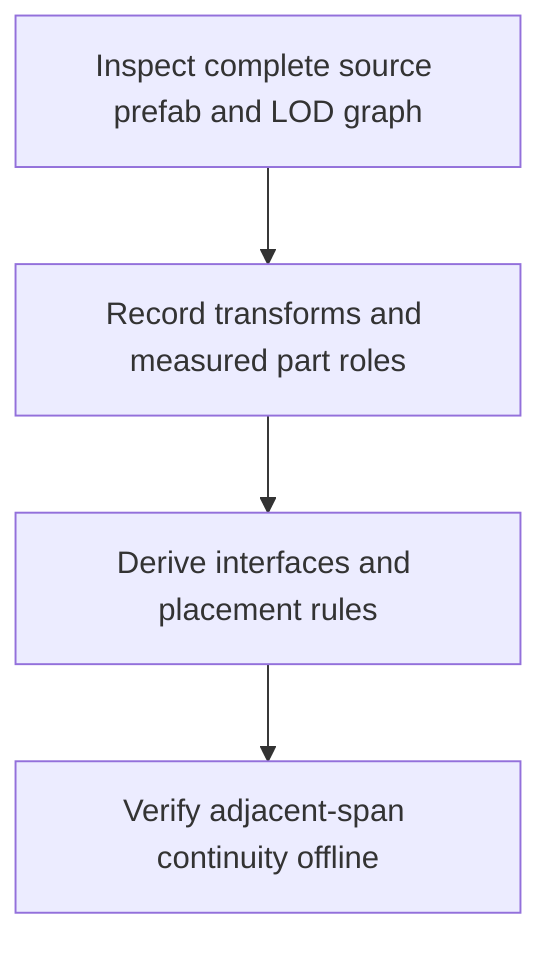
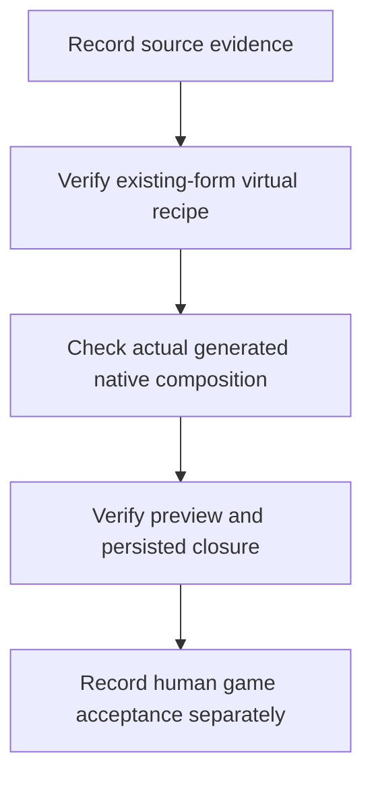

# Non Network Spec

Required companion: [Non Network Contract](../contracts/non-network-contract.md). Both documents are normative; read applicable requirements from both. See the [complete scope maps](../contracts/reading-map.md) for additional relocated sections.

Before non-Network bridge work, agents must read the complete [general bridge generation scope](../contracts/reading-map.md#bridge-generation-contract), including the full [generation specification](generation-spec.md), [generation contract](../contracts/generation-contract.md) and all applicable routed requirements. Read this complete specification and its companion contract as supplements, never as replacements for that scope. Root and directory agent instructions remain mandatory.

This document is normative within its stated scope. Responsibility-based placement does not
change requirement strength, existing specialist exceptions or explicit user authorizations.
Specifications are equally normative; this separation introduces no new precedence hierarchy.

## Source evidence and parameter meanings

For each source, record the mod ID, exact version, description URL, retrieval date, relevant short
description quotations with original units, and the installed package/prefab identities and hashes.
Keep description evidence and measured values separately attributable. A current description must
not silently describe an older installed version. Preserve source wording and explain it in English.
Use the description's explicitly stated parameter semantics as authoritative authoring intent, then
corroborate them against the actual geometry. Names and thumbnail proportions are not measurements:
for example, a name containing `224m` alone establishes neither total length nor span.

When the author publishes no dimensional data, derive the required parameters directly from the
actual source structure and mesh graph. Record source identities, transforms, units, measured
boundaries and support/member roles, distinguishing these measurements from published claims.
Measurable source geometry is sufficient evidence for adaptation; absence of published dimensions
alone must not block Nanpu, Lupu or another non-Network source. Do not substitute dimensions from
names, thumbnails, a different bridge or an assumed real-world counterpart.

Maintain the following conceptual parameter record per asset within the existing recipe form;
it does not define or authorize a separate runtime schema.

| Parameter | Meaning and required evidence |
| --- | --- |
| Total length | Entire authored bridge extent between documented endpoints, including approaches when applicable; record which parts are included. |
| Span | Distance between identified bearing/support stations for one span; distinguish centre-to-centre span from clear opening and record unequal spans separately. |
| Repeat length | Measured longitudinal module interval and its origin/phase; do not equate it with total length or span without evidence. |
| Roadway width | Usable running surface between explicitly identified left/right boundaries; record sidewalks, tracks and medians separately where present. |
| Structure width | Complete outer structural extent, with both bounds; do not substitute roadway width or twice a one-sided extent. |
| Reference deck dimensions | Measured deck boundaries and length used by the virtual prototype's width mapping; no chosen native composition or road type is implied. |
| Placement and frame | Units, axis directions, source scale/rotation, deck datum, support stations, end connections and the transform into the virtual prototype's construction frame. |

Record original values and unit conversions without rounding away source precision. Explicitly reconcile
description/geometry differences: identify version mismatch, different boundaries, units or authored
transforms with evidence. Do not silently overwrite either value, average them, or distort geometry
to make them agree. A required parameter that remains ambiguous or cannot be established from either published
information or actual source measurements remains pending evidence;
continue independent work, but do not fabricate a usable recipe from a plausible number.

## Describe the virtual bridge prototype

Inspect the real prefab graph and all reachable structural objects, render parts and LODs. Record
local and accumulated transforms, authored member membership, material slots, geometry identities,
attachment/stacking behavior and end interfaces. Check that dumps cover the entire graph. Preserve
the source files and live prefabs unchanged; derived assets receive their own identities.

Describe the bridge's measured deck dimensions, coordinate frame, spans, structure, all LODs,
material references, supports, endpoints and placement semantics as construction data. Separate
bridge-owned structure and running-surface domains so final generation can adapt or replace the
surface through the existing selected-road path without layering competing decks. No operational
traffic network or native template donor is required to establish this virtual prototype.

Record each support's actual role: span-local, repeating, endpoint or shared span boundary, with
its transform, attachment and stacking semantics. These are abstract placement descriptions at this
stage, not a requirement to instantiate `NetPieceObjects` or `NetSubObjects`. Preserve nested render
parts; do not assign duplicate roles or infer anchoring merely from appearance or prefab name.

Derive endpoints, repeat origin, support stations and placement rules from the source record.
Verify adjacent virtual spans meet continuously without duplicated boundary supports, missing
members or a repeated end cap in every span. Any required partitioning and endpoint representation
must be measured offline and preserve the corresponding source faces and attributes at every LOD.
Do not invent a longitudinal deformation rule merely to fit an arbitrary segment length.

## Structural collision identity and navigable clearance

Load-bearing towers, piers, abutments and other measured supports of a non-Network bridge must
have the appropriate native structural collision identity and participate in native shipping-lane
collision and network-clearance evaluation. Do not treat them as ordinary Overridable or Brushable
decoration merely because their source was a static object. Determine the actual native components,
flags, collision shapes and consumers from measured prototype/native evidence. This is not a
blanket instruction to classify every decorative object as a Pillar.

Preserve the authored pose, support role and correct generated placement. Represent actual solid
members with their evidenced collision shapes; do not turn the whole bridge's aggregate bounds
into one solid obstacle that seals the navigable opening below its span. Do not move, flatten,
omit or enlarge structure to conceal a collision-identity defect. Keep native collision geometry
and render bounds distinct, and preserve intended openings and clearances.

UnderwaterAllowDryland is a placement permission, not a replacement for structural collision
identity or shape. The [structural water-placement rule](generation-spec.md#generation-structural-parts-must-not-block-placement-in-water)
prevents structural water contact from causing InWater rejection; it does not authorize disabling
shipping collision, network clearance or other genuine native construction constraints.

Compare source and generated components, native flags, shapes and transforms for each measured
support role. Verify all-LOD visual correspondence and preview/placed pose agreement independently
of collision identity. Native acceptance must distinguish a shipping lane intersecting a real
support from one passing through the intended open span, including both approach ends and the
actual road/track water rules. Record preview, native placement/collision and saved-load results
separately from offline field/shape checks. These are development acceptance requirements, not
new runtime geometry-validation gates or changes to self-check and ownership workflows.

## Native LOD transition equivalence

Read the complete [LOD specification](lod-spec.md) before preparing or generating a non-Network bridge. It defines native selection, source preservation, per-level triangle disclosure and acceptance.

## Lupu two-level representation

For Lupu only, retain LOD0 and LOD1 for the entire generated structure: the continuous main
arch and each of the four tower groups. Exclude LOD2 from all five generated parts and their
LOD references; do not rebuild the far bridgeheads or substitute duplicated meshes for the
removed level. Each part has two distinct source-derived levels selected through the normal
native path. Preserve the original source package, authored bias and shadow bias, structure
and materials. This exception grants no custom bias calibration and does not change the
applicable LOD requirements of other styles.

Verify both retained levels of all five parts, absence of LOD2 references and duplicated payloads,
and near/far preview, native placement and saved-load behavior independently. Existing owners
are not automatically migrated or regenerated by this generation change; it adds no self-check
workflow and does not authorize deleting healthy assets.

## Native material representation for network rendering

Default to original prototype materials. When the source's native object template cannot provide
the required native network rendering, use the necessary [native-template conversion](material-spec.md#non-network-native-material-template-conversion)
with unchanged source appearance, all-LOD coverage and complete native Surface dependencies.
Use a compatible native network shader where sufficient; otherwise use the scoped mod-owned
precompiled appearance program under the [custom shader table](custom-shader-spec.md#custom-shader-table).
Runtime material baking is prohibited for all non-Network styles, while necessary descriptor/template
and appearance-preserving native VT resource conversion remain permitted under that material rule.
Both packed VTSurface and standalone VTTexture sources are valid; select from the actual native
protocol and preserve unchanged dependency forms. Apply the [native consumer and instance-palette requirements](material-spec.md#native-material-consumers-and-instance-palette-preservation) before selecting a representation, including their bounded conversion and acceptance scope. Record the source/target protocol and verify generated
geometry, material bindings and owner snapshots together. Keep ordinary preview, native placed
rendering and cold-load acceptance distinct from offline conversion checks.

## Select longitudinal behavior from native evidence

Use the [complete installed native length inventory](../archive/audits/native-bridge-length-handling-audit.md)
as the reference, including ordinary bridges, fixed sequences, auxiliary decks and movable crossings.
Select by the measured construction roles and native fields, not by the word "arch", a thumbnail,
source total length, road kind or the list of styles Bridge Builder already supports. Record the
exact reference root/section/piece identities, installed version and native consumer for the selected
behavior. Recheck that evidence when the native format or consumer changes.

| Measured source role | Required final native representation and length rule |
| --- | --- |
| Continuous spanning structure, arch, cable sheet or deck | Use the corresponding native composition-piece normalization against its recorded reference length and the actual composed edge/node curves. Preserve applicable section requirements, offsets, inversion, flipping, half-length and source mesh/LOD attributes. Reference mesh length, preferred segment length and realized span are separate values. |
| Piers, bearing blocks, rigid end structures and shared boundary supports | Separate their measured all-LOD face ownership from the deforming span. Place them through the evidenced node/course/fixed-index or piece-object endpoint rules; retain their sections, object transforms and stacking semantics. Do not stretch the whole source object longitudinally to make the span fit. |
| Ordered unequal spans or mirrored half-spans | Record the evidenced `FixedSegments` count ranges, lengths, states and curvature rules, together with the matching section selections and support indices. A fixed sequence is a native course layout, not an exact-length lock. Do not add one merely to conceal missing longitudinal adaptation. |
| Repeated objects or finite endpoint attachments | Record native `NetPieceObjects` spacing, phase range, offsets, orientation, requirements, minimum length and probability. Let the actual native composition/secondary-object path place them; requested spacing is not a constant-distance grid and an endpoint is not an untrimmed root coordinate. |
| Moving crossing with fixed approaches | Follow the movable contract's measured crossing object, native mechanism/bones, state selection, approaches and waterway-node placement. Do not scale the mechanism to an arbitrary whole-course length or infer fixed segments merely because it moves. |

Do not introduce extra network nodes or course segments solely to preserve geometry anchors,
a rigid tower core or a boundary between structural mesh parts when no actual network topology
or native course requirement needs them. Prefer one full-span network segment with the necessary
measured structural-anchor adaptation. Mesh, material and rigid-member partitions alone do not
establish a network-node requirement. Preserve the intended road/rail connectivity and native
traffic behavior; geometry convenience must not dictate an otherwise unnecessary topology change.

Retain segmentation required by actual network connections, native course behavior or the
separately evidenced approach/span sequence. This rule does not prohibit all FixedSegments or
require merging genuinely distinct spans. Record the reason for each retained network boundary
and compare structural contact, support placement, preview and final native topology. Any claimed
vehicle-simulation effect requires separate evidence; this rule does not assert that a particular
segmentation has already been shown to alter lane changing.

Native `Bridge.m_SegmentLength` ordinarily establishes a preferred edge range rather than exact
length. `FixedSegments` can initialize ranged elements; even an equal minimum/maximum element
is subject to native course deficit allocation and validation tolerances. Preserve the measured
native behavior. Do not approximate a hard lock by epsilon ranges, introduce a mod length gate,
or assert that an authored total length or clear span remains constant after native deformation.

`NetPiecePrefab.m_NodeOffset` contributes to native endpoint geometry with other edge/node offsets,
width, slope and intersection conditions. It is not an unconditional fixed reservation at each end.
Span geometry, rigid endpoints, repeated supports and preview must consume the same actual native
course geometry. Preserve `NetDividerPiece.m_PreserveShape`, vertex matching/movement and other
applicable node semantics; a shape-preserving node piece is not a general edge-length lock.

Longitudinal normalization by the native network is distinct from Bridge Builder's transverse
width transformation. [General transverse mapping](generation-spec.md#generation-5-a-generated-tower-differs-from-its-archetype-in-width-alone) and [part placement](generation-spec.md#generation-8-stretch-or-translate-is-decided-by-one-thing-does-the-part-cross-the-bridges-centre) still determine measured transverse part
membership: piers retain their sections, side members translate and applicable transverse assemblies
use their recorded map. Do not reuse that X-axis decision as a Z-axis scaling rule. Record the two
stages and their shared interfaces separately, including source-material projection behavior.

All of this remains offline selection and existing-form immutable recipe data. It creates no virtual
Network files, runtime intermediate, additional conversion pass or road-kind prerequisite. Only normal
final Bridge Builder generation realizes the selected native graph and its ordinary length behavior.

## Fixed bridge approaches and proportional length allocation

For a static fixed bridge with authored approaches, preserve both approaches and the main span
as distinct measured longitudinal regions. Use the native all-positive proportional length
allocation for their course sequence: each approach and main-span region contributes its
measured positive reference length, and each receives its proportional share of the realized
course length. Preserve their order, orientation and shared interfaces. Do not reserve an
arbitrary fixed approach length, omit an approach, or force the entire course to the source's
nominal total length.

This longitudinal allocation describes the approach and span regions, not permission to stretch
every part inside them. Keep rigid piers, bearings, support blocks and endpoint members separate
through measured all-LOD membership and native placement. Their required rigid dimensions and
sections remain unchanged while their stations follow the allocated course. Apply native
longitudinal normalization to the continuous structure appropriate to each region, with the
same interface positions used by the road, structure, supports and preview.

Do not use a dam's mixed zero/positive fixed-segment allocation as the reference for this
ordinary static bridge approach/main-span sequence. In particular, it is not the longitudinal
reference for GO 224m Viaduct Bridge. Select and record an applicable native all-positive sequence
and its actual consumer under the preceding [native-evidence rule](#non-network-select-longitudinal-behavior-from-native-evidence).
Movable crossings retain their separately evidenced mechanism and approach rules; this fixed-bridge
requirement does not scale a moving mechanism or override its native placement behavior.

Offline acceptance must cover source-dimension identity and shorter and longer realized courses,
including each approach's and main span's proportional allocation, continuous seams at both
approach/main-span boundaries, source-face ownership and complete geometry/material coverage at
every LOD. Verify rigid-support dimensions separately from allocated region lengths, and check
native endpoint/node offsets, selected-road continuity and preview/persisted agreement. Preserve
source assets unchanged. These checks do not add runtime structural validation or an exact-length
construction gate, and do not establish untested native in-game placement acceptance.

## Native placed bridge naming

A bridge generated from a non-Network source must participate in the game's native bridge
naming behavior when placed. Its automatically generated map/street label must use the native
bridge naming category and localized bridge-name format, subject to the explicit proper-name
exception below, rather than inheriting the selected
road's ordinary street or highway naming category. The selected road still supplies the required
traffic and road composition; it does not determine the placed bridge's naming role.

This is separate from the generated asset's catalogue title, native LocaleAsset text, style
label and stable Prefab identity. Correct asset localization alone does not establish correct
placed-network naming. Configure the native naming behavior from verified native field and
consumer evidence; do not hardcode a language-specific bridge suffix, invent an unrequested name in
Bridge Builder, or introduce a runtime label-replacement loop. Preserve player-assigned names
and the game's native localization and naming lifecycle, including save/load.

Acceptance checks a newly placed bridge using an ordinary road and a highway input, the native
automatic bridge-name format in different supported locales, persistence across save/load, and
preservation of a player rename. Verify that connected ordinary roads keep their own native
naming behavior. Record native game results separately from serialized-field and localization
checks; a catalogue title or preview image is not placed-map-label acceptance.

## Prototype proper names apply only to map labels

A placed bridge using the Nanpu Bridge prototype (source mod `162995`) uses its localized
proper map/street name, Nanpu Bridge; a placed bridge using the Lupu Bridge prototype
(source mod `151335`) uses Lupu Bridge. Select these native map names rather than a random
bridge-name-pool entry or the selected road's ordinary street/highway map name.

This is exclusively a placed-map naming rule. Candidate defaults, editable creation names,
saved asset display names and later asset renames follow the [common naming rules](ui-spec.md#candidate-saved-asset-and-map-names)
without any prototype exception. Do not force Nanpu Bridge or Lupu Bridge into the asset name.
Preserve stable unlocalized style/Prefab identities and independent owner UUIDs.

Provide both map names through the existing localization system in all twelve supported UI
languages and native placed-network naming integration. Do not append a hardcoded
language-specific suffix or replace labels per frame. Preserve original source assets and
explicit player map renames across locale changes and save/load; the localized automatic name
must not overwrite the player's choice.

Verify localized placed-network labels, player map renames and save/cold load separately from
candidate and saved-asset naming. Check differing selected roads and multiple generated owners;
asset names must retain the common defaults or submitted edits while automatic map labels retain
the prototype proper name. Implementation and native acceptance evidence remain separate.

## Staged verification and acceptance

| Stage | Required evidence |
| --- | --- |
| Source record | Version-matched published parameters when available, otherwise explicitly attributed actual-source measurements; units, boundary definitions, complete prefab/LOD inventory and explicitly resolved discrepancies. |
| Virtual prototype | Existing-form hardcoded data with reproducible dimensions/frame, adjacent-span seams, support roles/counts/transforms and all-LOD correspondence; no intermediate network files or runtime creation/conversion stage. |
| Bridge Builder generation | Source-width identity, selected-width transforms, final native composition and lane connectivity, realized support placement, all-LOD member/material coverage and zero/one/asymmetric sidewalk cases. Check reference, shorter and longer native courses, repeated spans, sequence state boundaries, endpoint/node offsets and rigid-support dimensions; separate authored dimensions from realized dimensions. |
| Preview and persistence | Piece-object and node-object coverage without duplicate supports; saved reference closure, independent snapshots and unchanged source assets. |
| Human game acceptance | Actual generated sample, near/far appearance, repeated spans and endpoints, usable native traffic, fees/unlocks, cold start and existing-save behavior with required content available. |

Use actual composed edge and node curves for length checks, including relevant slope/intersection cases.
Check native length warnings and placement behavior without replacing them with mod acceptance gates.
Compare every retained structural face and LOD across the deforming-span/rigid-support interfaces;
count endpoint halves and shared supports by their distinct authored roles, not coincident positions.
Record automated results separately from human acceptance and identify missing samples explicitly.
These stages verify implementation; they must not become structural/appearance rejection gates for
player-selected widths, overlap, clearance or signed scales. Preserve genuine missing-resource,
schema, arithmetic, native API and persistence failures under the general error contract.

