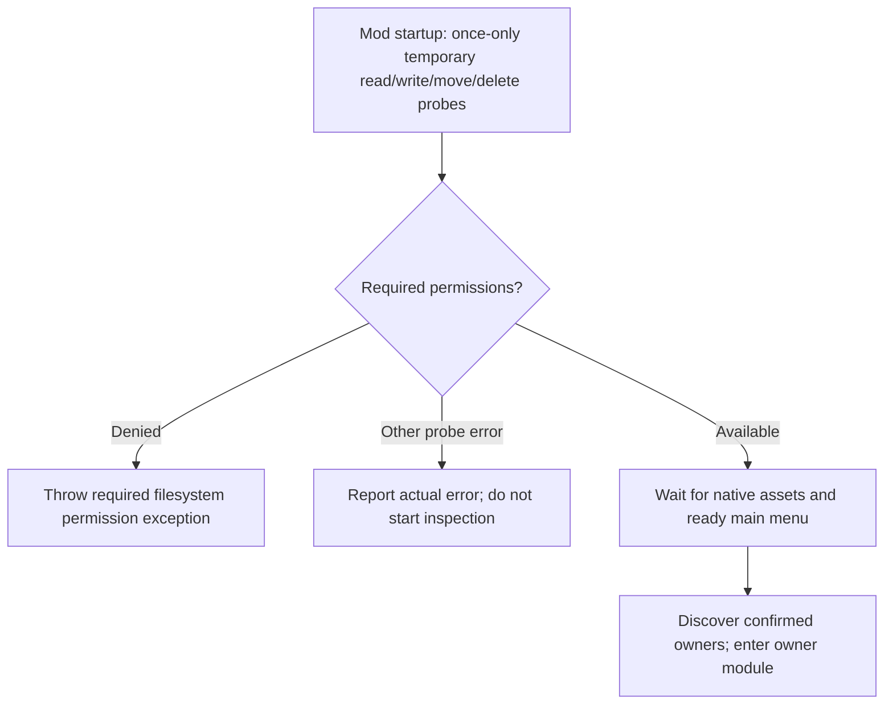
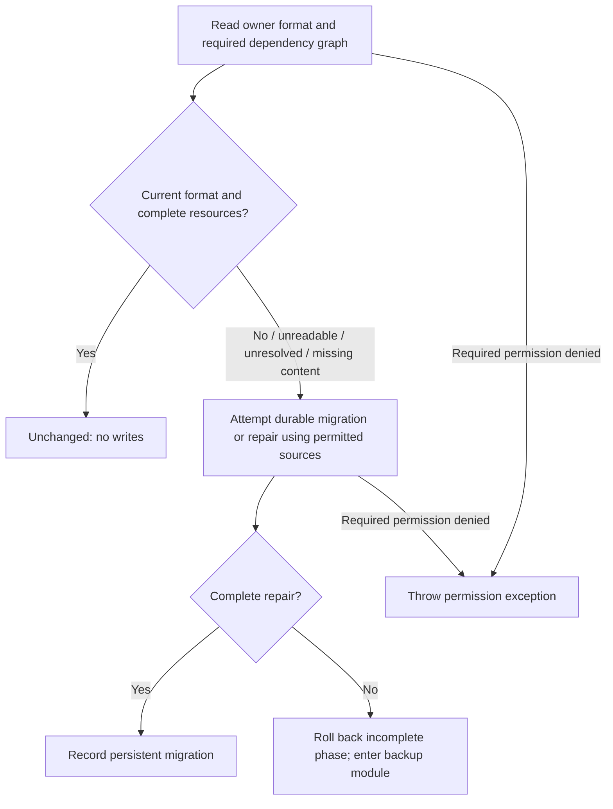
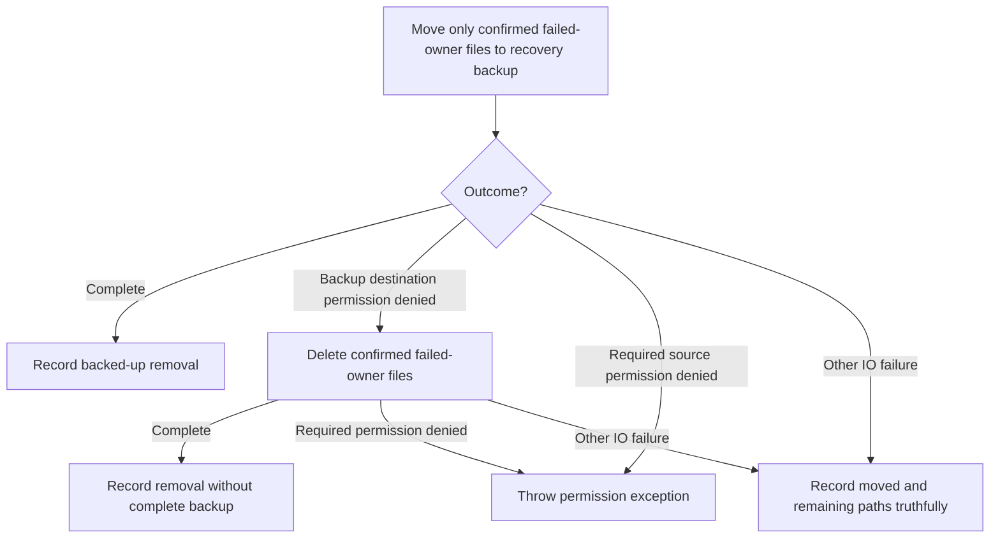
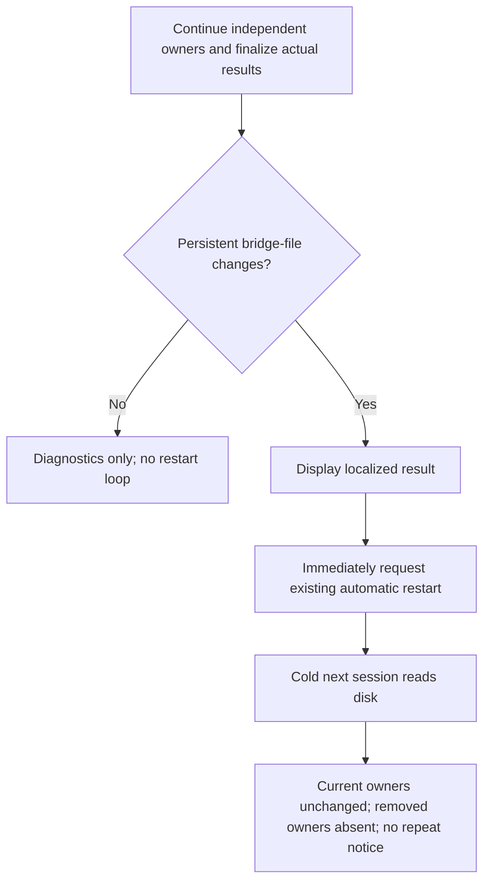

# Self Check Spec

Required companion: [Self Check Contract](../contracts/self-check-contract.md). Both documents are normative; read applicable requirements from both. See the [complete scope maps](../contracts/reading-map.md) for additional relocated sections.

This document is normative within its stated scope. Responsibility-based placement does not
change requirement strength, existing specialist exceptions or explicit user authorizations.
Specifications are equally normative; this separation introduces no new precedence hierarchy.

## Startup permissions and readiness

## Each confirmed owner

Unknown ownership never authorizes file operations. Missing optional content is not a separate
inspection exemption: try available independent snapshots and repair, then recover the confirmed
owner if it cannot reach current format with complete required resources. Native availability or
registration of an arbitrary dependency alone is not a corruption verdict; use actual owner IO and
required dependency evidence. A global unowned shader/cache error cannot select all owners for removal.

## Backup and removal

## Completion and restart

Restart follows display, without close/confirmation/Escape. Failed presentation after changes still
requests restart. Required permission exceptions propagate without automatic retry loops.

## Bounded discovery

Retain confirmed owner/path entries even when obtaining a live instance fails. List immediate children of relevant storage roots and enter only selected owner directories; reuse this inventory for backup, layout and retirement. Normalize physical path aliases before layout comparison so an already-correct destination is not deleted as a duplicate.

Startup self-check and historical migration follow each bridge's serialized dependency chain and the native cache provenance described below. Use current-owner direct paths, exact CID lookups and the selected native material's indexed cache provenance. A once-per-inspection discovery of registered bridge prefab identities and historical owner-file locations may establish roots and migration candidates. Reuse those candidates throughout the pass. Do not build a global all-asset/CID index, reread every Prefab per owner, or repeatedly scan all owner directories. The bounded inspection-only MidMips fallback below is the sole cache-index exception. Retain unowned shared legacy sources when their other consumers cannot be proven without a global reverse scan; migrate only the selected bridge closure. Preserve the separate discovery and handling of orphaned legacy components and the existing migration-first recovery and retirement semantics. Do not persist cache relations or an inspection index. Include dependency, validation, portable migration, name/layout migration and retirement costs in the self-check timings.

## Exact owner snapshot resolution during inspection

When a native database cannot supply a dependency handle for the current owner, check its canonical CID-named snapshot and matching sidecar before classifying the bridge. Parse saved Surface/VT bytes and resolve cache membership from exact native/prepared provenance or the one-per-inspection ephemeral cache fallback defined below. No cache-edge file or additional persisted self-check data is allowed. Foreign-owner handles alone cannot establish that a dependency has disappeared. Complete shared cache-relation preparation before owner dependency migration and structural inspection; shared preparation failure is not a global owner verdict; attempt each confirmed owner using available direct sources and recover an owner whose required inputs cannot be repaired. Confirmed corruption and genuinely missing dependencies retain the [section 3](../contracts/self-check-contract.md#self-check-3-additive-migration-and-owner-scoped-recovery) migration policy.

## Inspection cache relationships

`BridgeCacheEdges.txt` must not be read or written by current dependency resolution.
Remove an existing obsolete file only after that owner's complete inspection and migration
succeed; preserve its original bytes in the normal backup area first. Failed or unfinished
inspection retains the file without relying on its contents. No other relationship file,
extra native payload copy, path alias, cache layout change or persisted index replaces it.

Follow root Prefab CIDs and exact required Surface/VT dependencies. Prefer the game's
already-built Surface-CID atlas index and exact native/prepared cache provenance. Reusing
that native dictionary is not permission to enumerate all assets or rebuild it.
When necessary, one inspection-scoped fallback may traverse MidMips caches **at most once
for the entire self-check across all owners**. Parse native primary/duplicate membership
headers into a shared ephemeral map; include relevant owner cache paths already discovered
for inspection, without another directory scan per owner. Read no unrelated asset types
for this fallback. Complete this shared cache-relation preparation at the inspection
entry, after native asset-batch loading and before owner dependency migration or structural
checks. Reuse the map for every owner and discard it after inspection. Partial preparation failures log a warning. Failed shared cache reads retain usable independent entries. Attribute missing required inputs during each owner repair attempt; shared preparation failure alone cannot remove all owners or emit a global failure popup.

Original cache payloads and CIDs remain in their existing native paths, one dependency
copy per owner. A snapshot Surface needs no live native handle to resolve its cache.
Use native VT headers to distinguish a genuine zero-mid-mip material from unavailable
cache provenance. After successful shared preparation, a required absent cache is an explicit
missing-dependency diagnostic, not a per-owner readiness deferral. Missing
required resources and corrupt payloads retain contextual failures. Creation continues
using its explicit source handoff and must not invoke the inspection-wide fallback.

## External snapshot supplementation

Startup/manual self-check runs the creation dependency
traversal for every inspected bridge before validating live references, including healthy bridges
whose installed source mod currently hides a missing local copy. Supplement missing payloads and
CID sidecars without changing geometry, identities or live objects. Complete snapshots remain
unchanged on repeated checks; new copies are reported as migration and require restart. The existing
migration failure policy applies when permitted sources are unavailable or destination bytes conflict.

Intentional identical-CID owner snapshots are not collisions and must not retire healthy bridges.
Existing checks for unintended generated-asset collisions remain separate.

## Field-by-field migration

Version migration must complete missing fields individually, because legacy bridges may originate from different versions and lack different fields.
After migration, bridges must use the same file structure and naming conventions as bridges generated by the current version.

Inspect each persisted field/component independently on the root and its owned networks. A version
marker or one complete root must not skip checks of other fields, auxiliary networks, locales,
dependencies, names or layout. Preserve valid values, native unlock semantics, UUID/CID and geometry;
write only assets needing an upgrade. Unknown optional historical values remain empty rather than
invented; missing required information must produce an explicit migration failure followed by removal.
Use the same native persistence helpers and naming/layout rules as generation. Repeated migration
must make no changes after successful completion; report it as migration and require restart.

Preserve current bridge-specific icons whose exact canonical URI resolves to a packaged file in the
registered UI host. A shared URI prefix is not evidence of an obsolete manager-only icon. Apply the
same icon decision to migration eligibility and serialized presentation checks. Legacy manager-only
icons still migrate to an available supported icon; unknown or missing required icon resources retain
the ordinary repair-failure policy. Register packaged availability once at the UI-host IO boundary,
without a per-owner directory scan or changing healthy bridge files merely to inspect them.

## Legacy naming migration exception

Legacy naming migration exception: self-check must replace reachable
pre-UUID sections reached through the canonical bridge root's CID dependency graph, plus their
derived pieces/LODs/geometry (never use section-name regexes or child-name prefixes)
with per-bridge copies named by appending "-b{uuid}" to the first space-delimited name token. Rewrite file references to new private CIDs, back up originals,
and remove old files only after no local prefab references remain. Do not mutate live prefabs; require
restart. This exception permits graph-based source selection and changed identities only for
these pre-UUID files during explicit rename migration; ordinary snapshots remain byte-identical.

## Unified file layout and truthful migration notices

After successful self-check migration or repair, an old bridge must use the same directory layout,
file naming rules, CID sidecars and dependency-copy layout as a newly generated bridge. Generation
and migration must share the layout implementation; do not maintain an old-only naming scheme or
skip layout migration merely because native component conversion already succeeded. Identity values
may differ between distinct bridges, but their naming and directory conventions must match. Preserve
the existing bridge and deck CID, UUID and geometry. Back up before relocation, handle collisions
without overwriting unrelated files, and leave a repeated migration unchanged. Retained historical
backup files belong outside the game's active asset directories, subject to shared-reference safety.

Use [asset persistence sections 6–7](persistence-spec.md#persistence-6-approved-owner-directory-layout)
for owner-local Prefabs, Geometry, Appearance, VT/mid-mips, Locales and Dependencies. Legacy sibling
dependency directories remain migration inputs. Preserve other owners on layout collisions;
native cold-load acceptance remains separate.

## Cold-session idempotence and no restart loop

Published-format fixtures enter self-check migration, persist the complete current representation,
and then pass current-format-only runtime readers. A fresh second process must not invoke historical
adapters or depend on an in-memory conversion flag.

Persist complete successful repairs before reporting. A second cold-session inspection must read
those files without relying on `_copiedOwners`, old report state or another in-memory guard. Already
current assets remain unchanged and removed owners are absent: no repeated notice or restart.
Do not rewrite identical files and count that as another migration.

Only actual persistent bridge-file changes trigger the ordinary result notice and automatic restart.
Unknown ownership and unchanged recovery failures remain truthful diagnostics. After a partial move,
record changed and remaining paths; if the next cold round makes no further change due to an ordinary
IO limitation, do not restart again solely for that unresolved condition. Keep inspecting other
owners; disabling inspection or pretending the unfinished owner is repaired is prohibited. Required
read/write/move/delete permission denial instead follows the explicit exception above. No new persisted
self-check ledger is needed to suppress repeat notices.

## Self-check result summary

Automatic and manual self-checks report only this run's final result per bridge UUID, exactly once
in one mutually exclusive category: migrated to the latest format; removed with a complete backup;
removed with a failed or incomplete backup; or unfinished. Migration is complete only after all
required dependency, native-format, naming and layout work succeeds. A layout conflict or partial
migration is unfinished, even if earlier phases wrote files. Removal supersedes earlier migration;
backup-directory permission denial followed by verified deletion belongs to removed without complete backup, not
unfinished. Remaining or inaccessible selected files, incomplete enumeration and owner-scoped
repair failures with remaining files are unprocessed. An ordinary read failure is an unresolved owner input, not a healthy verdict. Attempt repair and then recover the confirmed owner; record unknown scope and actual remaining files without invented outcomes. No-change recovery failures alone do not mandate restart. Use deletion fallback only for backup-directory permission denial.

Show one native localized dialog containing only nonzero categories, each with its count, in the
order above, followed by automatic restart immediately after display under section 4. Append the explanation that restarting alone
does not resolve unfinished processing only when the unfinished-owner count is greater than zero.
Completed migration/removal outcomes, including removal without complete backup, receive only
the display-triggered automatic restart. Normal finalization must not emit a global failure or interruption
dialog. Unknown discovery scope is logged without invented owner counts. Migration text must explicitly say migrated
to the latest format (English semantics: `Migrated {0} bridges to the latest format.`). Provide all twelve supported
languages with identical count placeholders. Do not claim incomplete backups are complete or that
restarting alone repairs unfinished operations. A run without actual persistent bridge-file changes shows
no dialog, whether automatic or manual. Unattributable exceptions remain diagnostic records,
not a global failure popup or a fabricated successful owner outcome.

Create fresh reporting state per run; never repeat old migration/removal/incomplete totals. Retain
session-level protection against reading copied, moved or retired resources through stale cached
references. Skipped session-protected owners are not new results. Preserve completed outcomes when
another owner fails, and report partial-file failures honestly. Human native-dialog interaction
remains separate from automated lifecycle and localization checks.

## Acceptance and evidence

Verify readiness at both early and late initialization, failed-registration cached roots, one shared
cache preparation pass, exact-CID recovery, healthy-owner supplementation, additive field/name/layout
migration and idempotence. Cover unknown ownership, unavailable optional content, failed enumeration
and owner/program/cache reads: unresolved confirmed owners attempt repair/recovery; unowned shared failures must not select every bridge for removal or cause global interruption.

Inject repair failures, partial moves, backup-directory permission denial, other backup failures and
delete denial. Confirm owner containment, retained source mods/other owners, actual remaining paths
and truthful mutually exclusive results. Exercise all exception/report/cleanup boundaries, failed
logging/dialog creation and normal exit failure. Verify fresh per-run counts and all twelve locales.

Verify display-then-immediate-restart without button/dismissal callbacks, failed formatting/display
after changes, duplicate restart requests and the specific permission exception propagating through
all entry boundaries. Run two cold-session fixtures for successful migration and removal: the second
reads persisted files, makes no change and requests no restart. Cover partial change followed by a
zero-change ordinary IO failure, and fatal required read/write/move/delete permissions without restart loops. Documentation,
offline fixtures and builds are not native game acceptance. Agents must not start or close the game.

