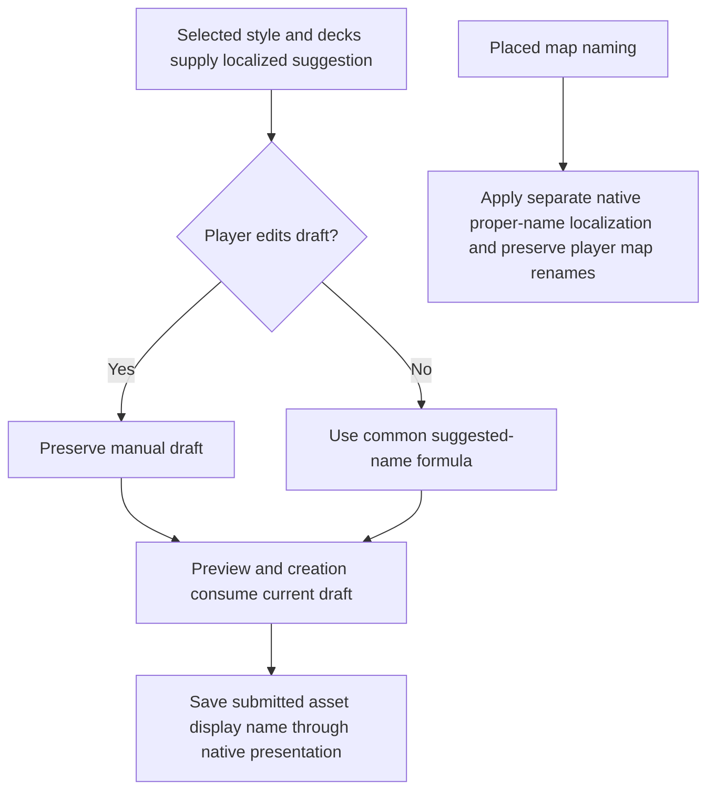
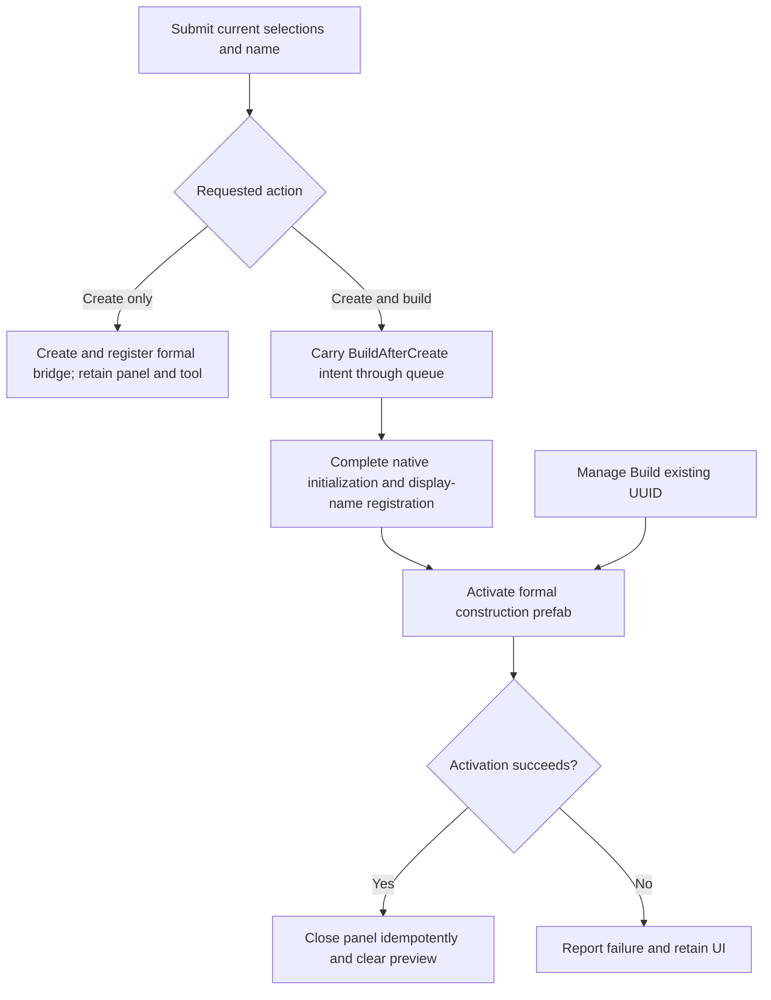

# Native interface specification

This document is normative within its stated scope. Responsibility-based placement does not
change requirement strength, existing specialist exceptions or explicit user authorizations.
Specifications are equally normative; this separation introduces no new precedence hierarchy.

## Native game UI windows

All UI windows must be created through Cities: Skylines II native UI APIs and components.
This includes panels, modal dialogs, confirmation/message windows and file/directory pickers.
Do not substitute custom HTML/CSS window shells or operating-system dialogs for native game
windows. Mod-specific content, localized labels and bindings may be composed inside native
containers; styling alone does not make a custom window native.

Use the native window lifecycle, focus, input handling and modal backdrop. File or directory
selection must use the game's native picker interface rather than only a text field. Inspect
the installed game's API and existing native usage before choosing an interface; do not invent
unsupported calls. For example, the export flow uses `cs2/ui.ConfirmationDialog`, native input
and button components, and `DirectoryBrowserPanel` with mod-owned `WidgetBindings` and
`EditorWidgetListRenderer` inside the native directory-picker panel/backdrop theme,
with native `FocusRoot`, `AutoNavigationScope` and `BackConsumer`. Do not put the directory
page view in a message dialog text slot; it needs the native picker layout constraints. The options-only directory browser
does not update while the options screen is closed; do not use it for gameplay dialogs.
Keep dialogs out of non-interactive parents that suppress pointer events. Verify clicking,
text entry, selection, cancellation and confirmation in game before claiming interaction works;
compilation alone is insufficient. The computer-use prohibition still applies.

## Creation picker ordering and categories

Order the upper network, lower network and bridge-style cards by their displayed names using the
active game language's dictionary order. Use the stable ID as the ordinal tie-breaker. Refresh
ordering on a language change. A network card and its type filter use the same native network
category, regardless of the provider. Keep Road Builder provenance for identity, custom labels and
import. The bridge-type filter uses explicit structural families keyed by stable style ID. Combine
the selected family with search and the existing single/double-deck eligibility rules. Build the
family options from the installed styles that match deck mode and search, before applying the
selected family. Always offer All, including when no styles match. If the selected family disappears,
reset it to All. An admitted style contributes its family in every compatible mode automatically.
Extradosed styles retain their display names and share the cable-stayed filter. Filtering
the visible list must not change the selected asset or the player's custom bridge name.

Every mod-owned dropdown viewport fits its available options up to seven complete rows, including
the All option where present. Short lists shrink to their contents; longer lists use the game scroll
container to reach all remaining options. Row and viewport dimensions use the same scaling units.
Popup padding and borders sit outside the seven-row viewport.

## Full published source mod names

Display the style's [ordered required-source array](cross-environment-spec.md#dlc-and-mod-compatibility)
in its declared order: direct source first, normally a source mod before its required DLC. Show
all registered sources, not only the direct source; an empty array represents base-game content.
Catalogue admission and preview/creation eligibility use the same all-sources decision.

Every user-visible source-mod label must use the full official title published on Paradox Mods.
This applies to all bridge styles and source assets, including native-network and non-Network
prototypes, catalogue cards, details/settings, saved-bridge source presentation and alternate/error
paths. Never substitute a numeric mod ID, package/folder/prefab name, technical alias or shortened
name. Preserve an author's abbreviation when it is part of the published full title; do not invent
its expansion. Localize the surrounding Mod/source prefix in every supported language, not the
publisher's title. Preserve user-entered bridge names and existing native DLC localization.

Verify known source titles by web search on Paradox Mods and the official mod page/API. Record the
exact title, mod ID, URL and verification date as evidence; when search indexing fails, record that
fact and the successful official-page/API verification separately. Local SDK/cache metadata may
supply the published title at runtime, but is not a substitute for the required development-time
web verification. Do not claim a local name has been externally verified when it has not.

Keep IDs for ownership, prerequisites, binding and persistence; display names must never become
source-selection keys. Use the full official title from the matched native mod metadata, with
verified recorded titles when required metadata is unavailable. An unresolved title uses an explicit
localized name-unavailable label, not the ID or a guessed expansion, and does not add a generation
or availability gate. Preserve the complete title in existing tooltips or equivalent accessible
full-text presentation when the compact card truncates it. Audit all source-label producers and
consumers together; do not repair only one bridge's card or rewrite healthy assets merely to update
a display label. Follow the [UI source presentation design](ui-spec.md#generation-full-published-source-mod-names).

## Registered-style behavior parity for testing

All registered bridge styles must use identical UI and operation behavior regardless of implementation
completeness. This requirement applies to fixed and movable styles.

- Never display a notice, warning, tooltip, badge, placeholder or other message stating that a bridge
  style is unfinished, incomplete, not ready or still under development. Its messages and notification
  behavior must be identical to those of completed styles.
- Do not disable creation, create-and-build or preview for any registered style because its
  implementation is incomplete or its generator is not connected. Do not hide such styles or prevent
  their requests from reaching the generator router. Apply the same ordinary input, DLC, source and
  deck-mode requirements to every style; completion status must not introduce an additional gate.
- A creation or preview request for a registered style without a connected generator must explicitly
  fail with an **ERROR** identifying the requested style ID and the missing generator route. Surface
  it through the same operation-failure handling used for completed styles and record an ERROR-level
  diagnostic. A silent return, warning-only log, disabled control, substitute bridge or reported success
  is prohibited. The error describes the actual routing failure, not the style's completion status.
- Use the same request dispatch, progress, success and failure handling for all registered styles.
  Report success only when the requested operation actually succeeds. This rule does not authorize
  publishing invalid or partial assets, or claiming that an unverified generator is complete.

## New style integration

New bridge styles must follow bridge generation contract section 22: immediately synchronize the UI and
connect the new bridge style to the generator router. Update the creation catalogue, preview,
both creation actions and management labels in the same implementation increment, and provide
style names in every supported UI language. Stable style IDs remain unlocalized. Verify translated
names after game-language changes and preserve user-entered bridge names. Backend generation alone
does not complete a new style without its corresponding working UI entry.

For testing, all registered styles follow the same interaction and notification behavior regardless
of implementation completeness. Never show an unfinished-style message or disable creation and
preview on that basis. Dispatch requests normally; a missing generator route must produce an explicit
ERROR with the style ID through ordinary operation-failure handling. See contract section 22.

## Search, filters and text-free preview

Remove the legacy operation-status subscription and its props in both views; retain preview status only to stop the spinner on failure. Removing the footer is structural, not CSS hiding. Existing bridge assets are unaffected; deployment checks do not replace human acceptance after restart.

- Each upper/lower network picker has independent name/ID search and a stable network-type filter. The backend classifies RoadPrefab by HighwayRules / PublicTransport, PathwayPrefab as pedestrian, and the existing track catalogue by train/subway/tram. It does not infer a network type from a localized name or confuse RoadBuilder provenance with a transport type.
- The creation lists sort by localized display name and use the stable ID to break ties. Bridge-style search matches the name or ID within the selected deck mode. The family filter offers only families represented in those results and returns to All if its selection disappears. Low-tower cable-stayed styles belong to the cable-stayed family. Management combines name, UUID or style search with deck count, style and availability.
- The shared filter menu fits up to seven complete options, including All. Short lists fit their contents. Longer lists use the native vertical scroll control.
- Filtering changes the visible list only. It preserves selected IDs and edited names, does not publish preview requests or generate/delete assets, and resets only the list scroll position. Upper/lower picker state is independent. All lists keep three explicit card cells per row.
- The preview frame contains no text in idle, loading, success or failure states. A CSS spinner uses an explicit backend loading flag rather than comparing localized strings. Decode errors or failed assembly stop it; existing error dialogs and logging are retained. The create/manage panel error footer and its preview-error callback are permanently removed; do not restore inline error text below the action buttons. Image alt text is empty to prevent a broken-image text fallback; the frame retains an accessibility label.
- Names that fit the normal text area between the two outer fade bands stay centered, including exact fits. The layout is strictly outer left fade band, left text baseline, normal text area, right text baseline, outer right fade band. Both bands occupy 8% of the measured label viewport width. Set the inner area width and side margins from that same measurement in pixels, rather than relying on percentage flex margins. An overflowing name starts at the left text baseline with the entire left fade band reserved as empty margin; it must not start at the outer viewport edge. Hovering or selecting an overflowing name starts travel toward the right endpoint immediately, without an initial pause, smoothly entering the left fade band as it moves. Its last glyph aligns with the right edge of the normal text area. Each arrival at either end pauses for three seconds before reversing; only the outer bands fade. The same name treatment applies to road pickers, bridge styles and saved bridges; the button retains its full-name tooltip. Search/filter labels, options and empty results use the same 12-language dictionary and stable, nonlocalized filter IDs.

## Candidate, saved asset and map names

All bridge styles use the same suggested Prefab display-name formula, with no fixed, movable,
landmark or prototype exceptions:

- Single deck: `{localized prototype}·{localized road}`.
- Double deck: `{localized prototype}·{localized upper road}·{localized lower road}·{localized same/opposite direction}`.

Use the selected prototype/style's localized display label, the actual selected network display
names and the existing localized direction label. Preserve Road Builder and player-authored network
display names. The middle-dot separator is `·`; do not omit the prototype, a selected deck or the
double-deck direction, and do not substitute a forced landmark-only or road-only name.

The player can edit the suggestion. Preview, Create and Create-and-build use the same current
draft, and permanent saving preserves the submitted display name through the existing native
locale/presentation path. Do not replace a manual draft with a suggested formula or map name.
Later rename and language behavior follow the common rules below; stable internal Prefab IDs
and owner UUIDs remain independent of display text.

A prototype proper name applies only to the placed bridge's native map/street name. This includes
localized landmark or bridge names such as Golden Gate Bridge or Grand Bridge, and the
[Nanpu and Lupu map-name rule](non-network-spec.md#non-network-prototype-proper-name-exception).
Do not propagate that map-name choice into candidate text, saved asset display names or internal
Prefab identities. Map naming uses the native localization lifecycle and preserves player map
renames; it does not authorize hardcoded language-specific suffixes.

Acceptance checks the complete single-deck and double-deck formulas for every style, edited-name
preservation through preview and both creation actions, saved/renamed asset names and localized
map names as separate outcomes. No named prototype may bypass the common asset-naming path.

## Creation and placement actions

- Management retains prefab UUIDs as opaque action/selection keys only. The detail
  panel and create/rename success messages no longer display them.
- The name field submits RenameBridge on every nonblank change. Clearing the input
  leaves the saved name intact. Adjacent pending renames for the same identity are
  coalesced; other requests remain ordering barriers. Saved acknowledgements do not
  reset the active draft. 

- `CreateBridge` creates and registers the formal bridge only; the panel and current tool remain unchanged. `CreateAndBuildBridge` carries explicit `BuildAfterCreate` intent through the queue and native publication callback. Both use the same selected networks, style and custom display name.
- Create-and-build activates the formal prefab only after native initialization and display-name registration succeed. Successful native tool activation closes the panel idempotently and clears its preview. Validation, publication or tool activation failure does not dismiss the UI. Create-only retains the existing translated `CreatedManage` status.
- Management has a fixed Build/Export/Delete action row outside the details scroller. Rename
  is submitted from the nonblank name field without a separate Rename button. Build activates the selected existing UUID directly, without generating another bridge or temporary copy. Unavailable assets disable Build. Successful activation follows the same close/preview-cleanup path.
- Creation buttons occupy a separate row below the name field so longer translations do not squeeze the name input. The new Create label is translated into all 12 languages.
- Offline checks exercise both UI handlers, missing selections, existing-UUID activation, fixed action placement and request intent. Native tool switching and panel layout still require human verification after restarting the game.

## Catalogue image dimensions

Catalogue card images use a fixed appropriate display height and an explicit width calculated
as height multiplied by the source image's intrinsic width/height ratio. Resolve the intrinsic
dimensions from the actual native image resource or vector dimensions/viewBox in the backend,
accepting SVG files with an XML declaration, UTF-8 BOM and standard DOCTYPE such as Road Builder
thumbnails. Ignore the DTD when reading dimensions and disable external resolution; reading the
canvas must not fetch a DTD or expand declared entities. Preserve the original source URI and bytes,
and send the ratio with the icon URI. Set both numeric display dimensions; do not rely on Cohtml
`width:auto`, `object-fit`, browser `onLoad` events or `naturalWidth`/`naturalHeight` behavior.
Apply the same rule to network, bridge-style and management cards, including fallback images and
subsequent source changes. Do not gate visibility or assign
zero width while waiting for JavaScript image-load events or intrinsic-size properties;
cached images and Cohtml event differences must not leave every card blank. Do not clamp
width independently of the fixed height or stretch images into a fixed rectangular box.
Preserve original image content and transparent margins: a wide drawing inside a square image
does not authorize cropping or changing the canvas ratio. If source dimensions cannot be resolved,
show the existing fallback image at its known ratio rather than guessing the source's dimensions.
Preserve the error path. Tests must include square, wide and tall resources and rendering with no
load callback at all; offline
JavaScript checks do not establish actual Cohtml layout acceptance.

## Double-deck direction and locale behavior

The runtime create/manage panels use the same game locale as the existing settings and bridge-style translations. `Settings/RuntimeUiText.cs` supplies the runtime UI dictionary in 12 languages: English, Simplified Chinese, Traditional Chinese, German, Spanish, French, Italian, Japanese, Korean, Polish, Brazilian Portuguese and Russian.

Both creation actions and preview pass an immutable recipe through `BridgeRecipeReader`. `UiStringCatalog.Resolve` canonicalizes locale IDs, supports language/region fallback and distinguishes Chinese scripts. `BridgeBuilderUISystem` publishes the current dictionary. Operation status stores a translation key and original arguments; preview status stores its key. The catalogue selects and saves stable internal IDs.

Every double-deck style exposes the localized `LowerDeckOpposite` toggle, enabled by default and chosen per request. Preview identity includes direction; a late image for the previous direction must not replace the current one. Existing bridges retain their stored `AuxiliaryNets` arrangement without regeneration or editing.

Unsupported languages fall back to English. Language changes refresh asset labels and translate existing status messages without requesting another preview or rebuilding geometry. Preserve Road Builder names, custom bridge display names, deck IDs and prefab UUIDs. Translate panel labels, empty states, accessibility labels and tooltips. The JavaScript English fallback must match the C# table. Bound long header labels and expose full text in tooltips. Content-source label translation changes presentation only, not prerequisites or ownership.

## Native field and filter presentation

The implementation uses `game-ui/common/input/text/text-input.tsx` (`TextInput`), `editor-item.module.scss` and `FOCUS_DISABLED`. Explicit widths provide the full-width creation name field in Cohtml. The shared `SearchPlaceholder` expresses "Search" followed by an ellipsis in each supported language. The three packaged SVG masks replace font-dependent filter triangles and supply filter/search symbols.

Search/name fields use native game components and theme instead of browser-default borders. Keep the creation name field full-width. Search fields retain contextual accessibility labels and the shared 12-language `SearchPlaceholder`. Each filter has a white outline funnel and filled downward triangle on its left; each search has a left-side magnifier. Use the packaged independent SVG masks, with no Find It dependency or cache reference.

## Verification references

Follow the [runtime UI verification procedure](../guides/runtime-ui-verification.md). Retained [historical check results](../archive/audits/runtime-ui-verification-history.md) have limited provenance.

Management validation evidence is retained in [bridge management verification](../archive/audits/bridge-management-verification.md).
